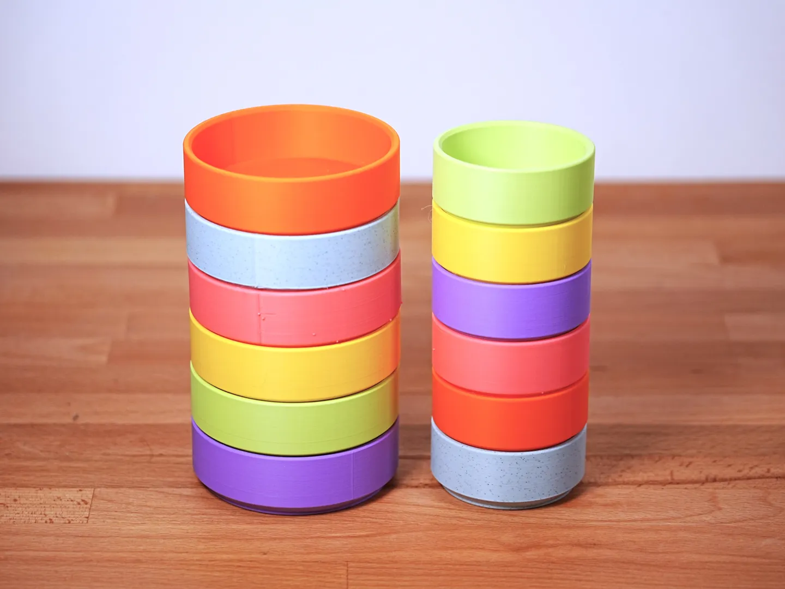

# Bub

<!-- Generated by scripts/Update-Readmes.ps1 (Linux: scripts/update_readmes.py) - edit scripts/readme-sources.json and rerun instead of editing by hand. -->

[Home](../README.md) / **Bub**

3 builds &middot; 3 MakerWorld &middot; 2 collections (22 more builds)

## Collections

- [Little People](little-people/README.md) - 4 builds
- [Play Doh](play-doh/README.md) - 18 builds

## Bub

<table>
<tr>
<td width="33%" align="center" valign="top">
<i>no preview</i> 
<b>260616 All Printers AMS</b> 
<a href="https://makerworld.com/en/search/models?keyword=260616%20All%20Printers%20AMS">Search MakerWorld</a> &middot; <a href="260616_All_Printers_AMS_stls">Repo folder</a>
</td>
<td width="33%" align="center" valign="top">
<i>no preview</i> 
<b>260616 Monochrome</b> 
<a href="https://makerworld.com/en/search/models?keyword=260616%20Monochrome">Search MakerWorld</a> &middot; <a href="260616_Monochrome_stls">Repo folder</a>
</td>
<td width="33%" align="center" valign="top">
 
<b>Stack &amp; Play Dishes – Large &amp; Small Bowls</b> 
by Phazor 
<a href="https://makerworld.com/en/models/1987011-stack-play-dishes-large-small-bowls">MakerWorld</a> &middot; <a href="kitchen">Repo folder</a>
</td>
</tr>
</table>

