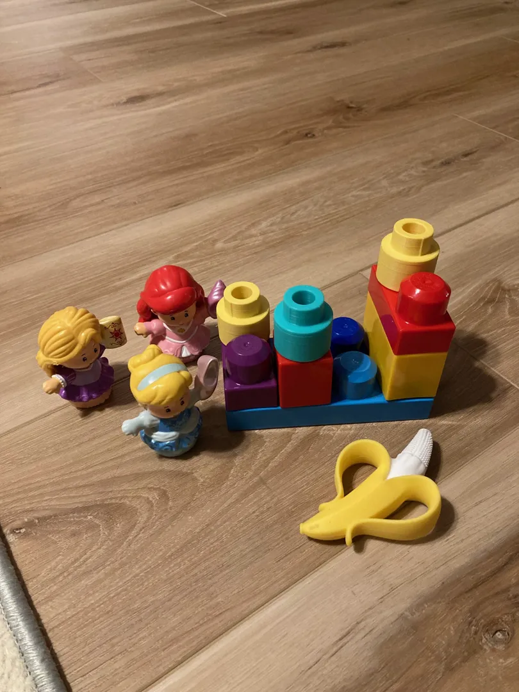
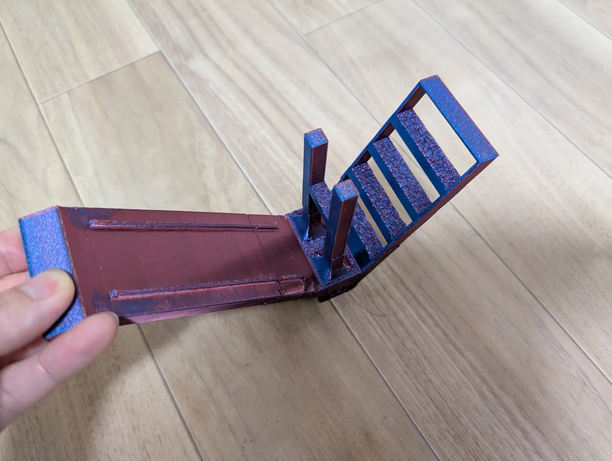

# Little People

<!-- Generated by scripts/Update-Readmes.ps1 (Linux: scripts/update_readmes.py) - edit scripts/readme-sources.json and rerun instead of editing by hand. -->

[Home](../../README.md) / [Bub](../README.md) / **Little People**

4 builds &middot; 2 Printables &middot; 2 unknown source

## Little People

<table>
<tr>
<td width="33%" align="center" valign="top">
 
<b>Classic Little People Couch</b> 
by Heather D 
<a href="https://www.printables.com/model/394281-classic-little-people-couch">Printables</a> &middot; <a href="classic-little-people-couch-model_files">Repo folder</a>
</td>
<td width="33%" align="center" valign="top">
 
<b>Fisher Price Little People Compatible Furniture (Chair, Bed, Table)</b> 
by XYZBenchy 
<a href="https://www.printables.com/model/1026242-fisher-price-little-people-compatible-furniture-ch">Printables</a> &middot; <a href="fisher-price-little-people-compatible-furniture-chair-bed-table-model_files">Repo folder</a>
</td>
<td width="33%" align="center" valign="top">
 
<b>LittlePeopleAdaptorV2</b> 
Source unknown &middot; <a href="LittlePeopleAdaptorV2.3mf">LittlePeopleAdaptorV2.3mf</a>
</td>
</tr>
<tr>
<td width="33%" align="center" valign="top">
 
<b>Miniature_Slide</b> 
Source unknown &middot; <a href="Miniature_Slide.3mf">Miniature_Slide.3mf</a>
</td>
</tr>
</table>

