# Play Doh

<!-- Generated by scripts/Update-Readmes.ps1 (Linux: scripts/update_readmes.py) - edit scripts/readme-sources.json and rerun instead of editing by hand. -->

[Home](../../README.md) / [Bub](../README.md) / **Play Doh**

18 builds &middot; 13 MakerWorld &middot; 5 unknown source

## Play Doh

<table>
<tr>
<td width="33%" align="center" valign="top">
<a href="2%2BCOLOR%2B-%2BFOREST%2BANIMALS.3mf">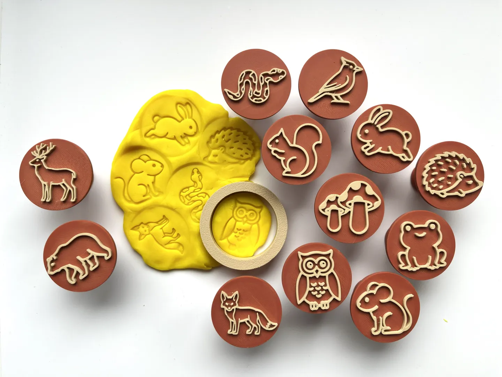</a> 
<b>2 COLOR - FOREST ANIMALS</b> 
<a href="https://makerworld.com/en/search/models?keyword=2%20COLOR%20-%20FOREST%20ANIMALS">Search MakerWorld</a> &middot; <a href="2%2BCOLOR%2B-%2BFOREST%2BANIMALS.3mf">2+COLOR+-+FOREST+ANIMALS.3mf</a>
</td>
<td width="33%" align="center" valign="top">
<a href="2%2Bcolor-%2Btrucks.3mf">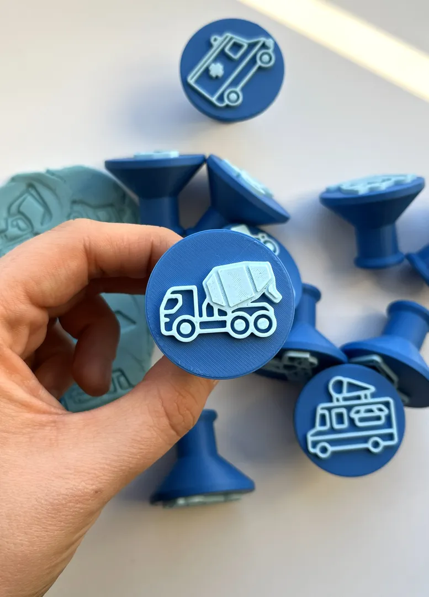</a> 
<b>2 color- trucks</b> 
<a href="https://makerworld.com/en/search/models?keyword=2%20color-%20trucks">Search MakerWorld</a> &middot; <a href="2%2Bcolor-%2Btrucks.3mf">2+color-+trucks.3mf</a>
</td>
<td width="33%" align="center" valign="top">
<a href="2%2Bcolor-bugs%2Bstamps.3mf">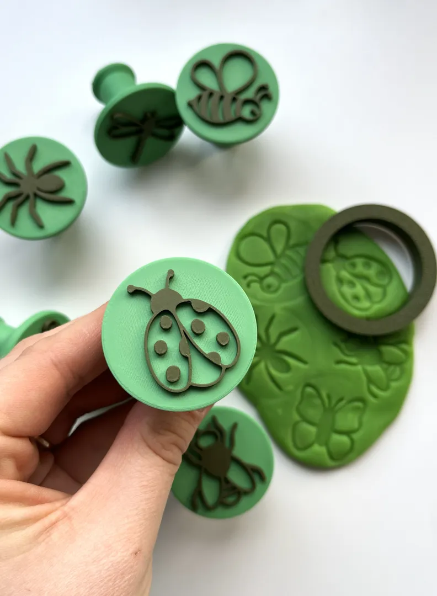</a> 
<b>2 color-bugs stamps</b> 
<a href="https://makerworld.com/en/search/models?keyword=2%20color-bugs%20stamps">Search MakerWorld</a> &middot; <a href="2%2Bcolor-bugs%2Bstamps.3mf">2+color-bugs+stamps.3mf</a>
</td>
</tr>
<tr>
<td width="33%" align="center" valign="top">
<a href="2cm_2plates.3mf">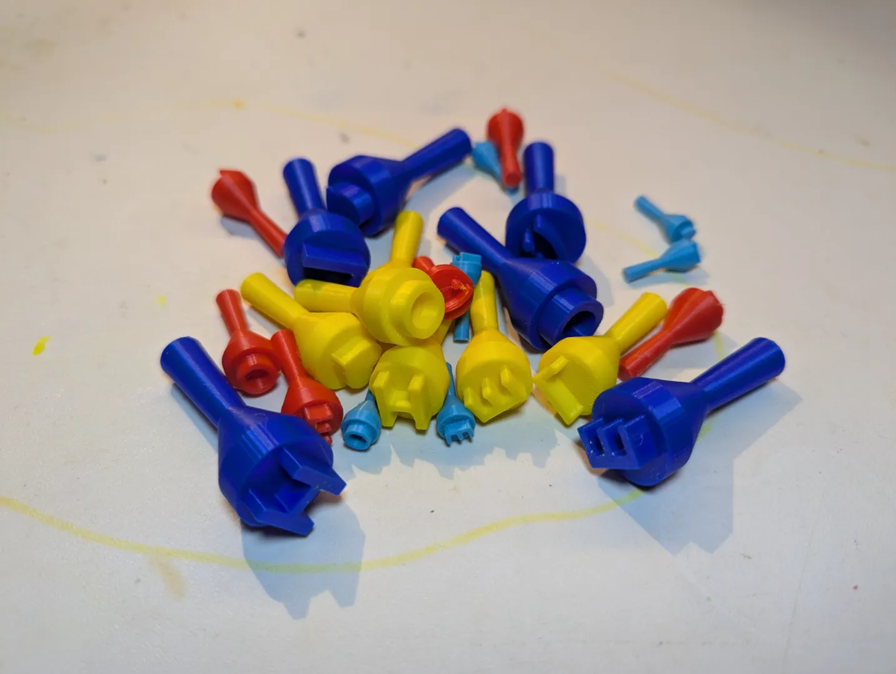</a> 
<b>2cm_2plates</b> 
Source unknown &middot; <a href="2cm_2plates.3mf">2cm_2plates.3mf</a>
</td>
<td width="33%" align="center" valign="top">
 
<b>5cm_2plates</b> 
Source unknown &middot; <a href="5cm_2plates.3mf">5cm_2plates.3mf</a>
</td>
<td width="33%" align="center" valign="top">
<a href="Bluey%2BCookie%2BCutter%2BSet%2B%E2%80%93%2BSet%2Bof%2B5%2B(Set%2B2)">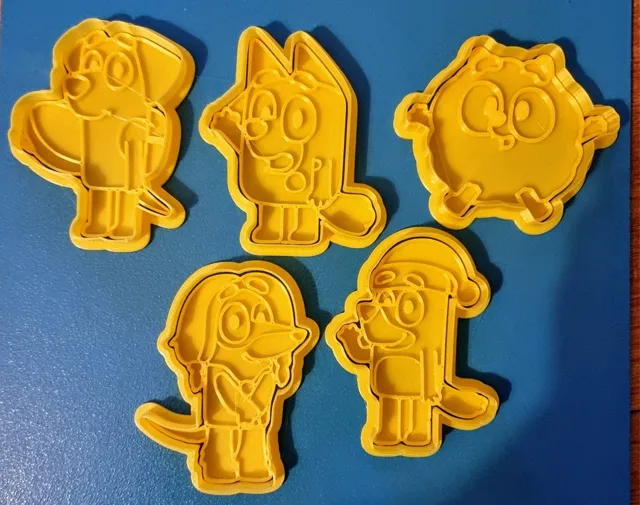</a> 
<b>Bluey Cookie Cutter Set – Set of 5 (Set 2)</b> 
by RifRaf 
<a href="https://makerworld.com/en/models/873499-bluey-cookie-cutter-set-set-of-5-set-2">MakerWorld</a> &middot; <a href="Bluey%2BCookie%2BCutter%2BSet%2B%E2%80%93%2BSet%2Bof%2B5%2B(Set%2B2)">Repo folder</a>
</td>
</tr>
<tr>
<td width="33%" align="center" valign="top">
<i>no preview</i> 
<b>Bluey Play-Doh Roller</b> 
<a href="https://makerworld.com/en/search/models?keyword=Bluey%20Play-Doh%20Roller">Search MakerWorld</a> &middot; <a href="Bluey%2BPlay-Doh%2BRoller">Repo folder</a>
</td>
<td width="33%" align="center" valign="top">
<a href="Cat%2BCookie%2BCutter%2BSet.zip">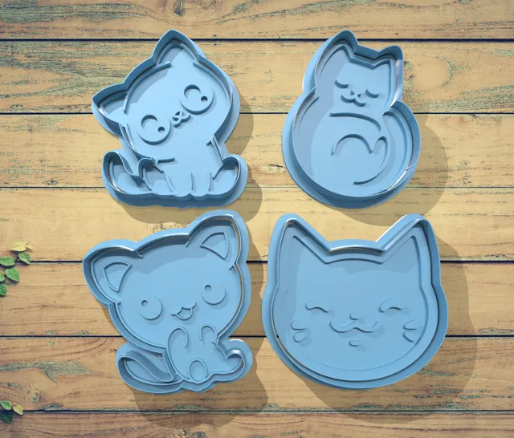</a> 
<b>Cat Cookie Cutter Set</b> 
by 3DTrece 
<a href="https://makerworld.com/en/models/471707-cat-cookie-cutter-set">MakerWorld</a> &middot; <a href="Cat%2BCookie%2BCutter%2BSet.zip">Cat+Cookie+Cutter+Set.zip</a>
</td>
<td width="33%" align="center" valign="top">
<a href="cats-A1-mini.3mf">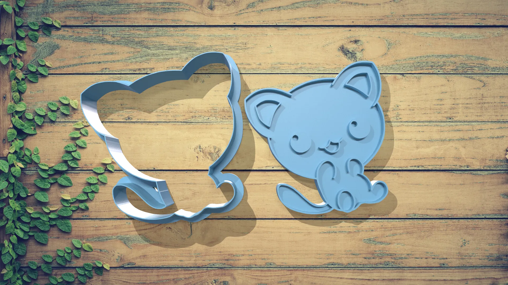</a> 
<b>cats-A1-mini</b> 
Source unknown &middot; <a href="cats-A1-mini.3mf">cats-A1-mini.3mf</a>
</td>
</tr>
<tr>
<td width="33%" align="center" valign="top">
<i>no preview</i> 
<b>Fairy Peppa Pig Play-Doh Roller</b> 
<a href="https://makerworld.com/en/search/models?keyword=Fairy%20Peppa%20Pig%20Play-Doh%20Roller">Search MakerWorld</a> &middot; <a href="Fairy%2BPeppa%2BPig%2BPlay-Doh%2BRoller">Repo folder</a>
</td>
<td width="33%" align="center" valign="top">
<i>no preview</i> 
<b>Farm Animals Print Profile</b> 
<a href="https://makerworld.com/en/search/models?keyword=Farm%20Animals%20Print%20Profile">Search MakerWorld</a> &middot; <a href="farm%2Banimals%2Bprint%2Bprofile_stls">Repo folder</a>
</td>
<td width="33%" align="center" valign="top">
<i>no preview</i> 
<b>Ice Cream Cone Set - Kids Play</b> 
<a href="https://makerworld.com/en/search/models?keyword=Ice%20Cream%20Cone%20Set%20-%20Kids%20Play">Search MakerWorld</a> &middot; <a href="Ice%2BCream%2BCone%2BSet%2B-%2BKids%2BPlay">Repo folder</a>
</td>
</tr>
<tr>
<td width="33%" align="center" valign="top">
<a href="IcecreamSet.3mf">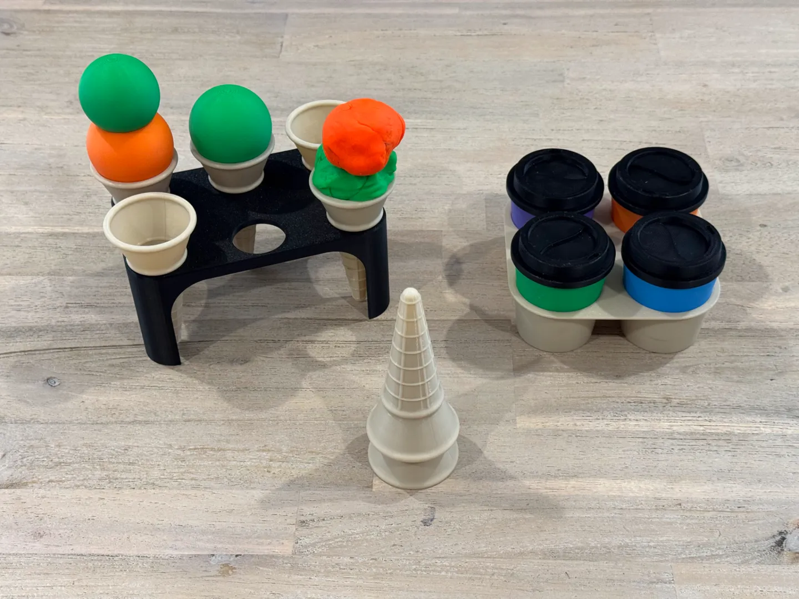</a> 
<b>IcecreamSet</b> 
Source unknown &middot; <a href="IcecreamSet.3mf">IcecreamSet.3mf</a>
</td>
<td width="33%" align="center" valign="top">
<i>no preview</i> 
<b>Play Doh Donut Maker</b> 
Source unknown &middot; <a href="play-doh_donut-maker">Repo folder</a>
</td>
<td width="33%" align="center" valign="top">
<a href="Play-Doh%2BPasta%2BRoller%2Bv2%2B-%2Bmulti-colour.3mf">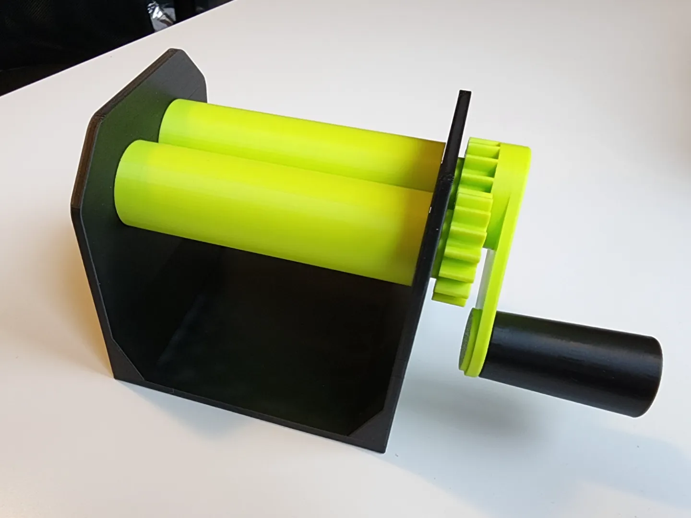</a> 
<b>Play-Doh Pasta Roller v2 - multi-colour</b> 
<a href="https://makerworld.com/en/search/models?keyword=Play-Doh%20Pasta%20Roller%20v2%20-%20multi-colour">Search MakerWorld</a> &middot; <a href="Play-Doh%2BPasta%2BRoller%2Bv2%2B-%2Bmulti-colour.3mf">Play-Doh+Pasta+Roller+v2+-+multi-colour.3mf</a>
</td>
</tr>
<tr>
<td width="33%" align="center" valign="top">
<a href="Play-Doh%2BPizza%2BCutter.3mf">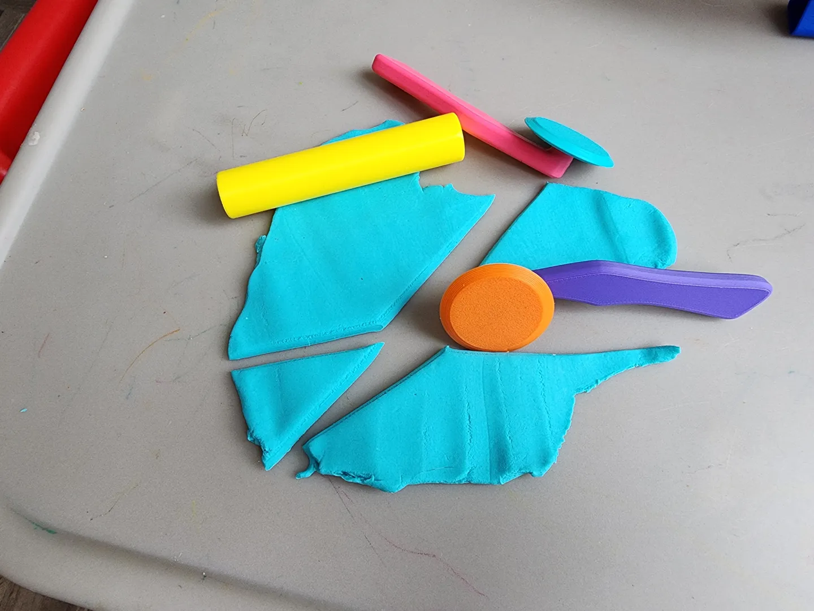</a> 
<b>Play-Doh Pizza Cutter</b> 
<a href="https://makerworld.com/en/search/models?keyword=Play-Doh%20Pizza%20Cutter">Search MakerWorld</a> &middot; <a href="Play-Doh%2BPizza%2BCutter.3mf">Play-Doh+Pizza+Cutter.3mf</a>
</td>
<td width="33%" align="center" valign="top">
<a href="Play-Doh%2BKnife.3mf">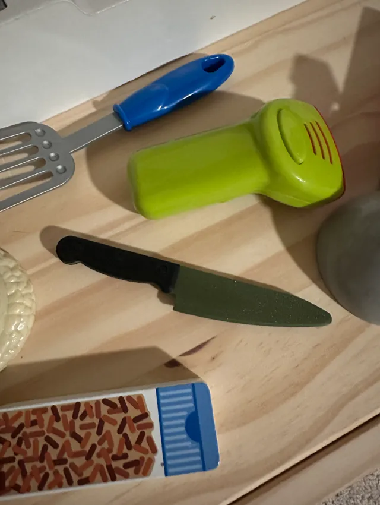</a> 
<b>Playdoh Knife</b> 
by InnovateITx 
<a href="https://makerworld.com/en/models/736966-playdoh-knife">MakerWorld</a> &middot; <a href="Play-Doh%2BKnife.3mf">Play-Doh+Knife.3mf</a>
</td>
<td width="33%" align="center" valign="top">
<a href="Vehicles%2B-%2B2%2Bpart.3mf">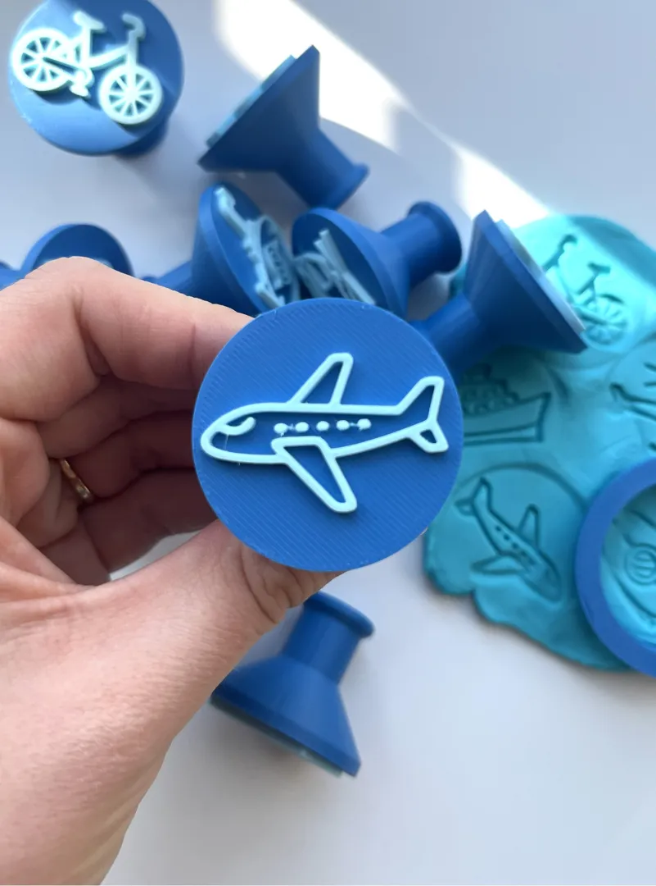</a> 
<b>Vehicles - 2 part</b> 
<a href="https://makerworld.com/en/search/models?keyword=Vehicles%20-%202%20part">Search MakerWorld</a> &middot; <a href="Vehicles%2B-%2B2%2Bpart.3mf">Vehicles+-+2+part.3mf</a>
</td>
</tr>
</table>

