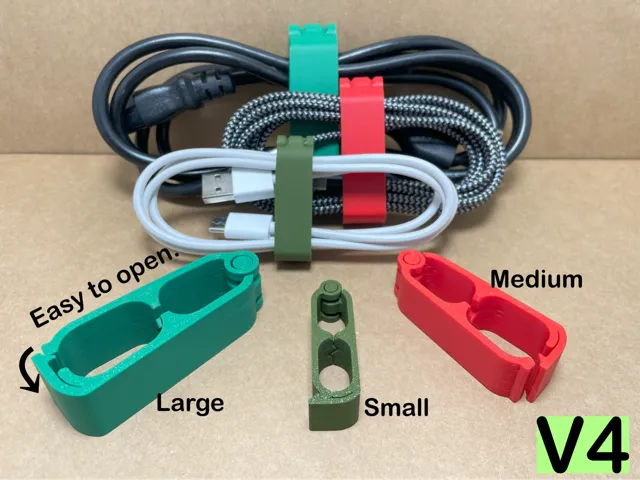
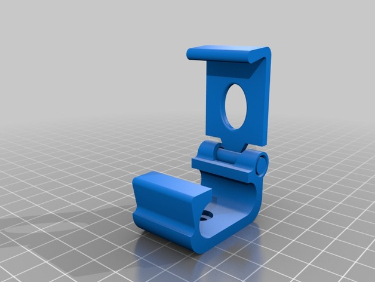
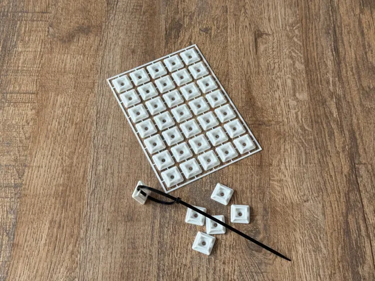
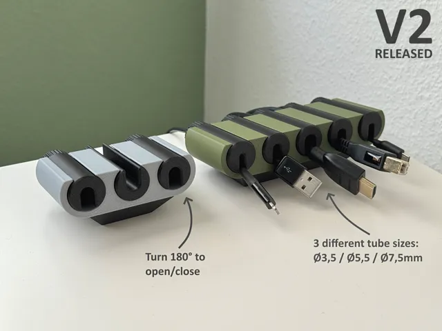
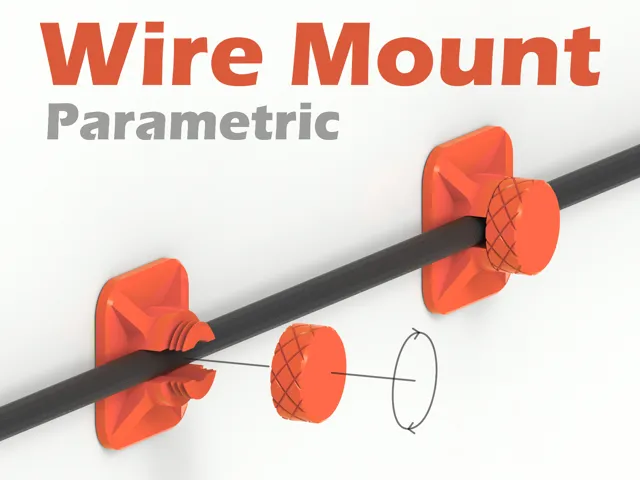
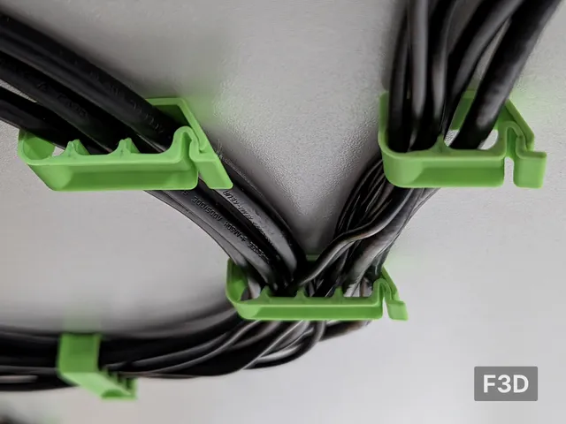
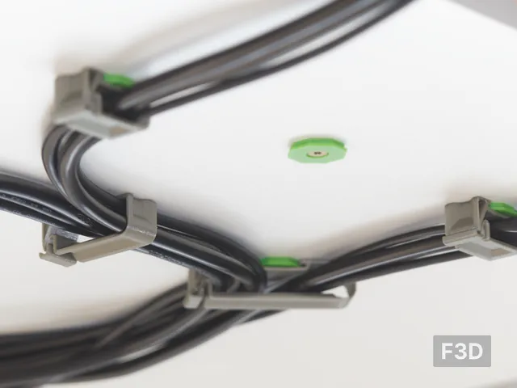
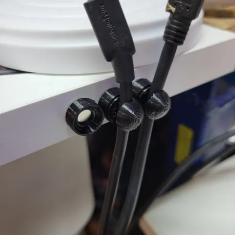
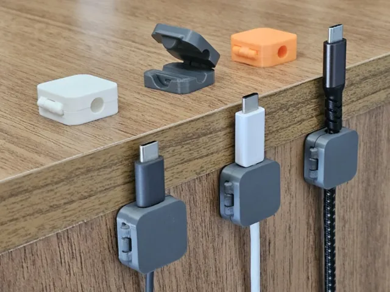
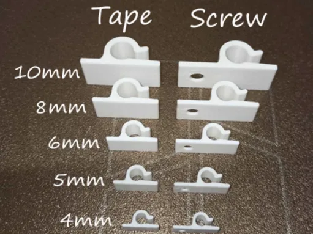

# Cable Management

<!-- Generated by scripts/Update-Readmes.ps1 (Linux: scripts/update_readmes.py) - edit scripts/readme-sources.json and rerun instead of editing by hand. -->

[Home](../README.md) / **Cable Management**

20 builds &middot; 9 MakerWorld &middot; 3 Printables &middot; 1 Thingiverse &middot; 7 unknown source

## Cable Management

<table>
<tr>
<td width="33%" align="center" valign="top">
 
<b>Cable Organizer</b> 
by Singh Design 
<a href="https://makerworld.com/en/models/2133463-cable-organizer">MakerWorld</a> &middot; <a href="Cable%2BOrganizer(1).zip">Cable+Organizer(1).zip</a>
</td>
<td width="33%" align="center" valign="top">
 
<b>Cable Organizer</b> 
by Singh Design 
<a href="https://makerworld.com/en/models/2133463-cable-organizer">MakerWorld</a> &middot; <a href="Cable%2BOrganizer.zip">Cable+Organizer.zip</a>
</td>
<td width="33%" align="center" valign="top">
 
<b>Cable organizer</b> 
by Papos98 
<a href="https://www.thingiverse.com/thing:3396905">Thingiverse</a> &middot; <a href="Cable_organizer__3396905">Repo folder</a>
</td>
</tr>
<tr>
<td width="33%" align="center" valign="top">
 
<b>Cable Zip Tie Mount kit card</b> 
by ArgiCZ 
<a href="https://makerworld.com/en/models/1335393-cable-zip-tie-mount-kit-card">MakerWorld</a> &middot; <a href="Cable%2BZip%2BTie%2BMount%2Bkit%2Bcard">Repo folder</a>
</td>
<td width="33%" align="center" valign="top">
 
<b>Desk cable management holder / cable organizer</b> 
by mgm86 
<a href="https://makerworld.com/en/models/1400922-desk-cable-management-holder-cable-organizer">MakerWorld</a> &middot; <a href="Desk%2Bcable%2Bmanagement%2Bholder%2B_%2Bcable%2Borganizer">Repo folder</a>
</td>
<td width="33%" align="center" valign="top">
 
<b>Electric Wire Wall Mount - Parametric</b> 
by VC_design 
<a href="https://makerworld.com/en/models/1574391-electric-wire-wall-mount-parametric">MakerWorld</a> &middot; <a href="Electric%2BWire%2BWall%2BMount%2B-%2BParametric">Repo folder</a>
</td>
</tr>
<tr>
<td width="33%" align="center" valign="top">
<i>no preview</i> 
<b>Electric Wire Wall Mount Collection - 8 Variations</b> 
<a href="https://makerworld.com/en/search/models?keyword=Electric%20Wire%20Wall%20Mount%20Collection%20-%208%20Variations">Search MakerWorld</a> &middot; <a href="Electric%2BWire%2BWall%2BMount%2BCollection%2B-%2B8%2BVariations">Repo folder</a>
</td>
<td width="33%" align="center" valign="top">
 
<b>KLAMMA - Locking Cable Clip</b> 
by FH 
<a href="https://www.printables.com/model/359285-klamma-locking-cable-clip">Printables</a> &middot; <a href="klamma-locking-cable-clip-model_files">Repo folder</a>
</td>
<td width="33%" align="center" valign="top">
 
<b>KLIPPT - Locking Cable Clip</b> 
by FH 
<a href="https://www.printables.com/model/424351-klippt-locking-cable-clip">Printables</a> &middot; <a href="klippt-locking-cable-clip-model_files">Repo folder</a>
</td>
</tr>
<tr>
<td width="33%" align="center" valign="top">
<i>no preview</i> 
<b>Loop</b> 
<a href="https://makerworld.com/en/search/models?keyword=Loop">Search MakerWorld</a> &middot; <a href="Loop_stls">Repo folder</a>
</td>
<td width="33%" align="center" valign="top">
 
<b>Minimalist Magnetic Cord / Cable Holder - 2 x 6mm Gridfinity Magnet</b> 
by BadLuck 
<a href="https://www.printables.com/model/399601-minimalist-magnetic-cord-cable-holder-2-x-6mm-grid">Printables</a> &middot; <a href="minimalist-magnetic-cord-cable-holder-2-x-6mm-gridfinity-magnet-model_files">Repo folder</a>
</td>
<td width="33%" align="center" valign="top">
 
<b>Print-in-Place Cable Holder – Fast Print</b> 
by jajaum3d 
<a href="https://makerworld.com/en/models/2538763-print-in-place-cable-holder-fast-print">MakerWorld</a> &middot; <a href="Print-in-Place%2BCable%2BHolder%2B%E2%80%93%2BFast%2BPrint">Repo folder</a>
</td>
</tr>
<tr>
<td width="33%" align="center" valign="top">
 
<b>Strong cable clips</b> 
by AndresMakes 
<a href="https://makerworld.com/en/models/1775885-strong-cable-clips">MakerWorld</a> &middot; <a href="Strong%2Bcable%2Bclips">Repo folder</a>
</td>
</tr>
</table>

Other files in this folder (7)

- [125mm_12_Slot_Cable_Holder.stl](125mm_12_Slot_Cable_Holder.stl)
- [3mmCableHolderWithHoles.stl](3mmCableHolderWithHoles.stl)
- [6mm_Cable_Holder_With_Holes.stl](6mm_Cable_Holder_With_Holes.stl)
- [cable-holder-flat.stl](cable-holder-flat.stl)
- [cable_holder_12.STL](cable_holder_12.STL)
- [cable_management_thingy_v5.stl](cable_management_thingy_v5.stl)
- [wireholder.stl](wireholder.stl)

