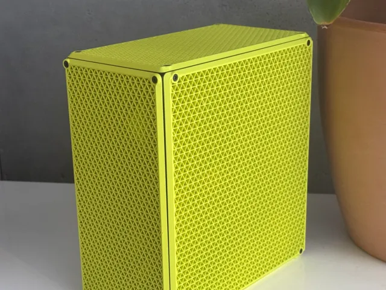

# Computer

<!-- Generated by scripts/Update-Readmes.ps1 - edit scripts/readme-sources.json and rerun instead of editing by hand. -->

2 builds &middot; 2 MakerWorld

## Computer

<table>
<tr>
<td width="33%" align="center" valign="top">
 
<b>Beaminnie 5.5L ITX SFF Sandwich Case</b> 
by nicnic 
<a href="https://makerworld.com/en/models/2990479-beaminnie-5-5l-itx-sff-sandwich-case">MakerWorld</a> &middot; <a href="Beaminnie%2B5.5L%2BITX%2BSFF%2BSandwich%2BCase">Repo folder</a>
</td>
<td width="33%" align="center" valign="top">
<i>no preview</i> 
<b>New Hive - Full ATX Home Lab Server &amp; PC Case</b> 
<a href="https://makerworld.com/en/search/models?keyword=New%20Hive%20-%20Full%20ATX%20Home%20Lab%20Server%20%26%20PC%20Case">Search MakerWorld</a> &middot; <a href="New%2BHive%2B-%2BFull%2BATX%2BHome%2BLab%2BServer%2B%26%2BPC%2BCase">Repo folder</a>
</td>
</tr>
</table>

