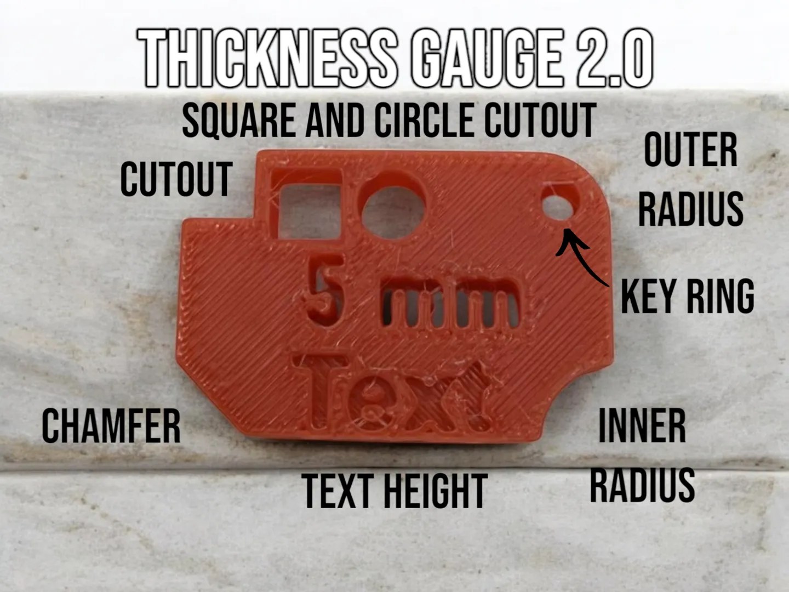
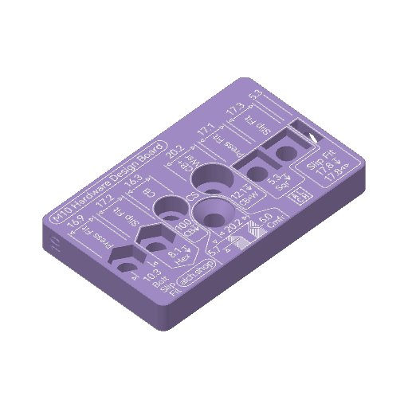
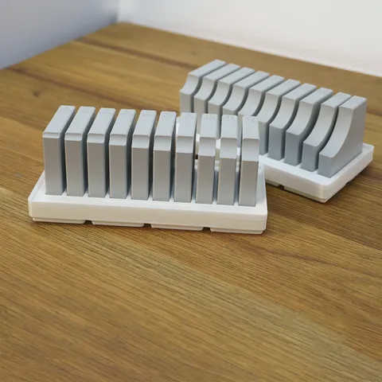
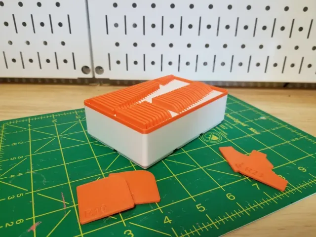
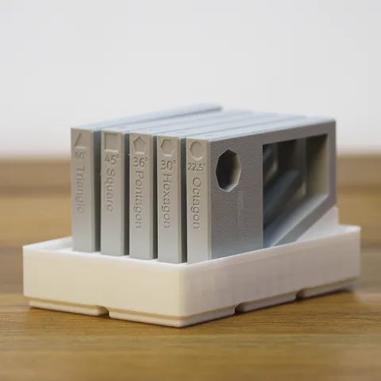
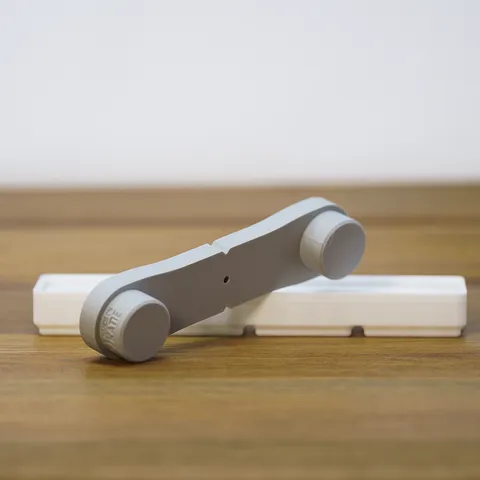

# Design Aids

<!-- Generated by scripts/Update-Readmes.ps1 (Linux: scripts/update_readmes.py) - edit scripts/readme-sources.json and rerun instead of editing by hand. -->

[Home](../README.md) / **Design Aids**

8 builds &middot; 3 MakerWorld &middot; 5 Printables

## Design Aids

<table>
<tr>
<td width="33%" align="center" valign="top">
 
<b>0.5mm - 5mm Thickness Guide 2.0 Gridfinity Set</b> 
by Ty&#39;s 3D Printing 
<a href="https://makerworld.com/en/models/949937-0-5mm-5mm-thickness-guide-2-0-gridfinity-set">MakerWorld</a> &middot; <a href="Thickness%2BGauges%2BVersion%2B2.0%2B-%2BNon%2BStacking%2B.3mf">Thickness+Gauges+Version+2.0+-+Non+Stacking+.3mf</a>
</td>
<td width="33%" align="center" valign="top">
 
<b>0.5mm - 5mm Thickness Guide 2.0 Gridfinity Set</b> 
by Ty&#39;s 3D Printing 
<a href="https://makerworld.com/en/models/949937-0-5mm-5mm-thickness-guide-2-0-gridfinity-set">MakerWorld</a> &middot; <a href="Thickness%2BGauges%2BVersion%2B2.0%2B-%2BStacking%2B.3mf">Thickness+Gauges+Version+2.0+-+Stacking+.3mf</a>
</td>
<td width="33%" align="center" valign="top">
 
<b>ALCH hardware design board set</b> 
<a href="https://makerworld.com/en/search/models?keyword=ALCH%20hardware%20design%20board%20set">Search MakerWorld</a> &middot; <a href="ALCH_hardware%2Bdesign%2Bboard%2Bset">Repo folder</a>
</td>
</tr>
<tr>
<td width="33%" align="center" valign="top">
 
<b>Fine Fillet Gauge Set with Custom Gridfinity Holders</b> 
by Hands on Katie 
<a href="https://www.printables.com/model/776187-fine-fillet-gauge-set-with-custom-gridfinity-holde">Printables</a> &middot; <a href="fine-fillet-gauge-set-with-custom-gridfinity-holders-model_files">Repo folder</a>
</td>
<td width="33%" align="center" valign="top">
 
<b>Fixed Gridfinity Radius/Fillet Guage Blocks and Holder NOW WITH LABELS!</b> 
by Volki 
<a href="https://www.printables.com/model/1274247-fixed-gridfinity-radiusfillet-guage-blocks-and-hol">Printables</a> &middot; <a href="fixed-gridfinity-radiusfillet-guage-blocks-and-holder-now-with-labels-model_files">Repo folder</a>
</td>
<td width="33%" align="center" valign="top">
 
<b>Hardware Design Boards</b> 
<a href="https://www.printables.com/model/1064488">Printables</a> &middot; <a href="hardware-design-boards-model_files">Repo folder</a>
</td>
</tr>
<tr>
<td width="33%" align="center" valign="top">
 
<b>Perfect Polygon Angle Finder Set</b> 
by Hands on Katie 
<a href="https://www.printables.com/model/777389-perfect-polygon-angle-finder-set">Printables</a> &middot; <a href="perfect-polygon-angle-finder-set-model_files.zip">perfect-polygon-angle-finder-set-model_files.zip</a>
</td>
<td width="33%" align="center" valign="top">
 
<b>Sweet Centre Spot Finder (For Straight Objects)</b> 
by Hands on Katie 
<a href="https://www.printables.com/model/777455-sweet-centre-spot-finder-for-straight-objects">Printables</a> &middot; <a href="sweet-centre-spot-finder-for-straight-objects-model_files.zip">sweet-centre-spot-finder-for-straight-objects-model_files.zip</a>
</td>
</tr>
</table>

