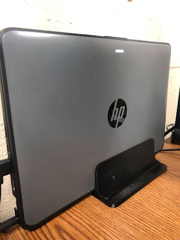
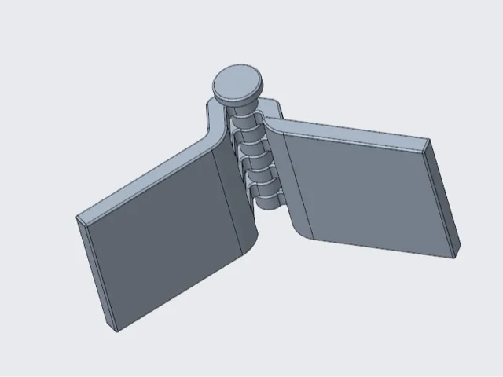
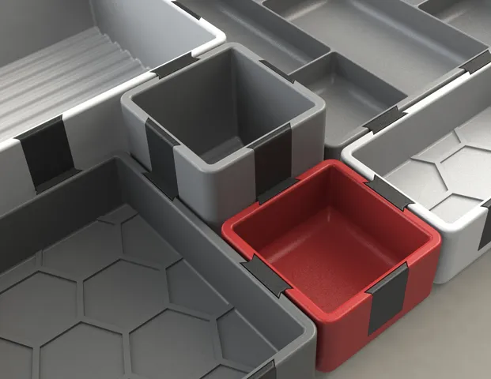
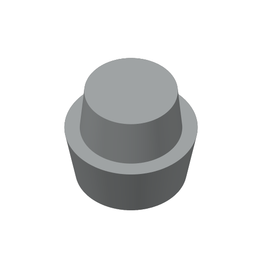
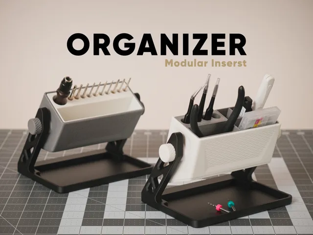
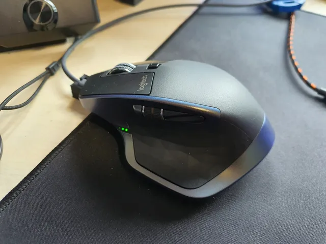
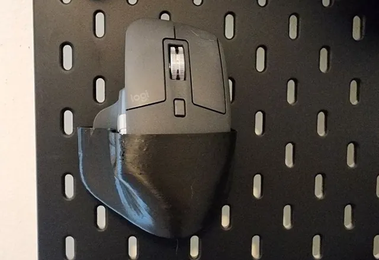
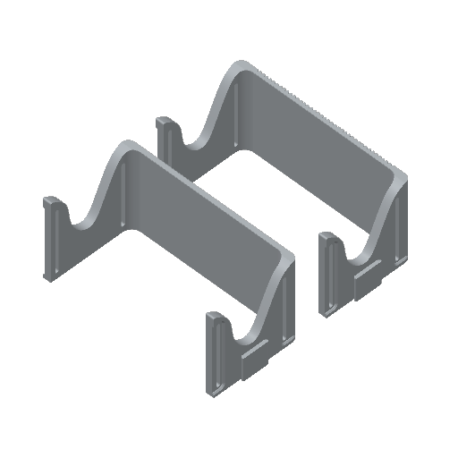
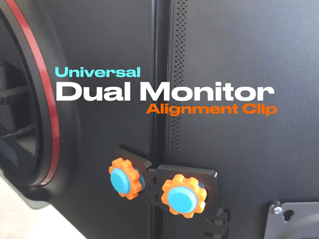

# Desk Organization

<!-- Generated by scripts/Update-Readmes.ps1 - edit scripts/readme-sources.json and rerun instead of editing by hand. -->

20 builds &middot; 11 MakerWorld &middot; 6 Printables &middot; 3 unknown source

## Contents

- [Desk Organization](#desk-organization) (16)
- [Assembly Trays](#assembly-trays) (4)

## Desk Organization

<table>
<tr>
<td width="33%" align="center" valign="top">
 
<b>Adjustable Vertical Laptop Stand (Single Remix)</b> 
by KnotHead 
<a href="https://www.printables.com/model/267998-adjustable-vertical-laptop-stand-single-remix">Printables</a> &middot; <a href="adjustable-vertical-laptop-stand-single-remix-model_files">Repo folder</a>
</td>
<td width="33%" align="center" valign="top">
 
<b>Alignment Tool for Multiple Monitors</b> 
by Lars 
<a href="https://makerworld.com/en/models/1165347-alignment-tool-for-multiple-monitors">MakerWorld</a> &middot; <a href="Alignment%2BTool%2Bfor%2BMultiple%2BMonitors">Repo folder</a>
</td>
<td width="33%" align="center" valign="top">
<i>no preview</i> 
<b>carepods V1</b> 
<a href="https://makerworld.com/en/search/models?keyword=carepods%20V1">Search MakerWorld</a> &middot; <a href="carepods%2BV1_stls">Repo folder</a>
</td>
</tr>
<tr>
<td width="33%" align="center" valign="top">
 
<b>Catch-All Trays / Desk organizer</b> 
by HribaDesign 
<a href="https://www.printables.com/model/376225-catch-all-trays-desk-organizer">Printables</a> &middot; <a href="catch-all-trays-desk-organizer-model_files">Repo folder</a>
</td>
<td width="33%" align="center" valign="top">
<i>no preview</i> 
<b>Clampdock System</b> 
Source unknown &middot; <a href="clampdock-system">Repo folder</a>
</td>
<td width="33%" align="center" valign="top">
<i>no preview</i> 
<b>Desk Organizer</b> 
<a href="https://makerworld.com/en/search/models?keyword=Desk%20Organizer">Search MakerWorld</a> &middot; <a href="Desk%2BOrganizer">Repo folder</a>
</td>
</tr>
<tr>
<td width="33%" align="center" valign="top">
 
<b>Desktop Gridfinity Gase 13 Sizes</b> 
Source unknown &middot; <a href="desktop-gridfinity-gase---13-sizes">Repo folder</a>
</td>
<td width="33%" align="center" valign="top">
<i>no preview</i> 
<b>Glove80 Sidecar</b> 
Source unknown &middot; <a href="glove80-sidecar">Repo folder</a>
</td>
<td width="33%" align="center" valign="top">
 
<b>Modular Desktop Tool Organizer - Adjustable Angle</b> 
by KL Worx 
<a href="https://makerworld.com/en/models/3098170-modular-desktop-tool-organizer-adjustable-angle">MakerWorld</a> &middot; <a href="Modular%2BDesktop%2BTool%2BOrganizer%2B-%2BAdjustable%2BAngle">Repo folder</a>
</td>
</tr>
<tr>
<td width="33%" align="center" valign="top">
<i>no preview</i> 
<b>ModuStack Organizer Modular Desktop Storage System</b> 
<a href="https://makerworld.com/en/search/models?keyword=ModuStack%20Organizer%20Modular%20Desktop%20Storage%20System">Search MakerWorld</a> &middot; <a href="ModuStack%2BOrganizer%2BModular%2BDesktop%2BStorage%2BSystem">Repo folder</a>
</td>
<td width="33%" align="center" valign="top">
 
<b>MX Master mouse dock (Fits MX Master and MX Master 2S)</b> 
by Malt_Vinegar 
<a href="https://www.printables.com/model/210348-mx-master-mouse-dock-fits-mx-master-and-mx-master-">Printables</a> &middot; <a href="mx-master-mouse-dock-fits-mx-master-and-mx-master-2s-model_files">Repo folder</a>
</td>
<td width="33%" align="center" valign="top">
 
<b>Skadis MX Master 3</b> 
by malkyan 
<a href="https://www.printables.com/model/642759-skadis-mx-master-3">Printables</a> &middot; <a href="skadis-mx-master-3-model_files">Repo folder</a>
</td>
</tr>
<tr>
<td width="33%" align="center" valign="top">
 
<b>Tabletop Shelf Rack</b> 
<a href="https://www.printables.com/model/713135">Printables</a> &middot; <a href="tabletop-shelf-rack-model_files">Repo folder</a>
</td>
<td width="33%" align="center" valign="top">
<i>no preview</i> 
<b>The Organizer</b> 
<a href="https://makerworld.com/en/search/models?keyword=The%20Organizer">Search MakerWorld</a> &middot; <a href="The%2BOrganizer">Repo folder</a>
</td>
<td width="33%" align="center" valign="top">
 
<b>Universal Dual Monitor Alignment Clip</b> 
by KRAMPLAUZIS 
<a href="https://makerworld.com/en/models/2747875-universal-dual-monitor-alignment-clip">MakerWorld</a> &middot; <a href="Universal%2BDual%2BMonitor%2BAlignment%2BClip">Repo folder</a>
</td>
</tr>
<tr>
<td width="33%" align="center" valign="top">
 
<b>模块化光轴增高架</b> 
by PlanP 
<a href="https://makerworld.com/en/models/2440881-modular-optical-axis-riser">MakerWorld</a> &middot; <a href="%E6%A8%A1%E5%9D%97%E5%8C%96%E5%85%89%E8%BD%B4%E5%A2%9E%E9%AB%98%E6%9E%B6">Repo folder</a>
</td>
</tr>
</table>

## Assembly Trays

<table>
<tr>
<td width="33%" align="center" valign="top">
 
<b>Catch-All Trays / Desk organizer</b> 
by HribaDesign 
<a href="https://www.printables.com/model/376225-catch-all-trays-desk-organizer">Printables</a> &middot; <a href="assembly-trays/catch-all-trays-desk-organizer-model_files">Repo folder</a>
</td>
<td width="33%" align="center" valign="top">
<i>no preview</i> 
<b>Kepler Tray 180</b> 
<a href="https://makerworld.com/en/search/models?keyword=Kepler%20Tray%20180">Search MakerWorld</a> &middot; <a href="assembly-trays/kepler%2Btray%2B180_stls">Repo folder</a>
</td>
<td width="33%" align="center" valign="top">
<i>no preview</i> 
<b>Volta Tray 180x180x16 Smooth Numbered</b> 
<a href="https://makerworld.com/en/search/models?keyword=Volta%20Tray%20180x180x16%20Smooth%20Numbered">Search MakerWorld</a> &middot; <a href="assembly-trays/volta%2Btray%2B180x180x16%2Bsmooth%2Bnumbered_stls">Repo folder</a>
</td>
</tr>
<tr>
<td width="33%" align="center" valign="top">
<i>no preview</i> 
<b>Volta Tray 240x240x18</b> 
<a href="https://makerworld.com/en/search/models?keyword=Volta%20Tray%20240x240x18">Search MakerWorld</a> &middot; <a href="assembly-trays/volta%2Btray%2B240x240x18_stls">Repo folder</a>
</td>
</tr>
</table>

