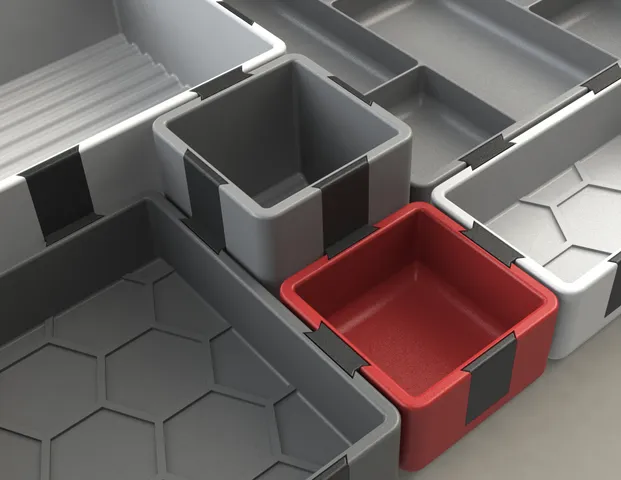

# Assembly Trays

<!-- Generated by scripts/Update-Readmes.ps1 (Linux: scripts/update_readmes.py) - edit scripts/readme-sources.json and rerun instead of editing by hand. -->

[Home](../../README.md) / [Desk Organization](../README.md) / **Assembly Trays**

4 builds &middot; 3 MakerWorld &middot; 1 Printables

## Assembly Trays

<table>
<tr>
<td width="33%" align="center" valign="top">
 
<b>Catch-All Trays / Desk organizer</b> 
by HribaDesign 
<a href="https://www.printables.com/model/376225-catch-all-trays-desk-organizer">Printables</a> &middot; <a href="catch-all-trays-desk-organizer-model_files">Repo folder</a>
</td>
<td width="33%" align="center" valign="top">
<i>no preview</i> 
<b>Kepler Tray 180</b> 
<a href="https://makerworld.com/en/search/models?keyword=Kepler%20Tray%20180">Search MakerWorld</a> &middot; <a href="kepler%2Btray%2B180_stls">Repo folder</a>
</td>
<td width="33%" align="center" valign="top">
<i>no preview</i> 
<b>Volta Tray 180x180x16 Smooth Numbered</b> 
<a href="https://makerworld.com/en/search/models?keyword=Volta%20Tray%20180x180x16%20Smooth%20Numbered">Search MakerWorld</a> &middot; <a href="volta%2Btray%2B180x180x16%2Bsmooth%2Bnumbered_stls">Repo folder</a>
</td>
</tr>
<tr>
<td width="33%" align="center" valign="top">
<i>no preview</i> 
<b>Volta Tray 240x240x18</b> 
<a href="https://makerworld.com/en/search/models?keyword=Volta%20Tray%20240x240x18">Search MakerWorld</a> &middot; <a href="volta%2Btray%2B240x240x18_stls">Repo folder</a>
</td>
</tr>
</table>

