# Electrical

<!-- Generated by scripts/Update-Readmes.ps1 - edit scripts/readme-sources.json and rerun instead of editing by hand. -->

158 builds &middot; 40 MakerWorld &middot; 50 Printables &middot; 41 Thingiverse &middot; 27 unknown source

## Contents

- [Electrical](#electrical) (7)
- [Dev Board Accessories](#dev-board-accessories) (8)
- [Dev Board Accessories / Din Mounts](#dev-board-accessories--din-mounts) (29)
- [Din Mounts](#din-mounts) (34)
- [Junction Boxes](#junction-boxes) (2)
- [Mini Rack](#mini-rack) (17)
- [Nas](#nas) (4)
- [Soldering](#soldering) (1)
- [Soldering / Paste Flux](#soldering--paste-flux) (8)
- [Soldering / Pcb Holders](#soldering--pcb-holders) (10)
- [Soldering / Pick N Place](#soldering--pick-n-place) (4)
- [Soldering / Smd Tools](#soldering--smd-tools) (8)
- [Soldering / Testing](#soldering--testing) (3)
- [Soldering / Tool Storage](#soldering--tool-storage) (7)
- [Soldering / Wire Holder](#soldering--wire-holder) (4)
- [Test Equipment](#test-equipment) (12)

## Electrical

<table>
<tr>
<td width="33%" align="center" valign="top">
<a href="Customizable%2BVESA%2Bmini%2BPC%2Bmounting%2Bplate">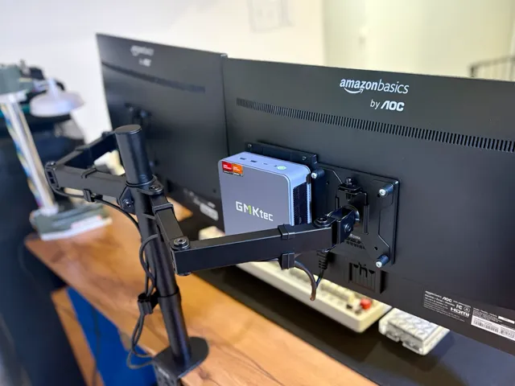</a> 
<b>Customizable VESA mini PC mounting plate</b> 
by MAX 3D DESIGN 
<a href="https://makerworld.com/en/models/2828371-customizable-vesa-mini-pc-mounting-plate">MakerWorld</a> &middot; <a href="Customizable%2BVESA%2Bmini%2BPC%2Bmounting%2Bplate">Repo folder</a>
</td>
<td width="33%" align="center" valign="top">
<a href="Darky%2BConnectors%2BDIY%2BVer%2B1.0">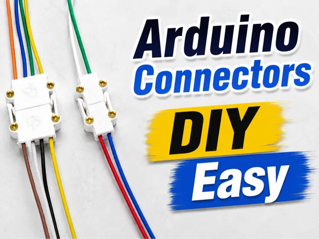</a> 
<b>Darky Connectors DIY Ver 1.0</b> 
by Darky Projects 
<a href="https://makerworld.com/en/models/2842649-darky-connectors-diy-ver-1-0">MakerWorld</a> &middot; <a href="Darky%2BConnectors%2BDIY%2BVer%2B1.0">Repo folder</a>
</td>
<td width="33%" align="center" valign="top">
 
<b>Hackman3D Orbit Controller</b> 
by HackMan3D 
<a href="https://makerworld.com/en/models/3009119-hackman3d-orbit-controller">MakerWorld</a> &middot; <a href="Hackman3D%2BOrbit%2BController">Repo folder</a>
</td>
</tr>
<tr>
<td width="33%" align="center" valign="top">
<i>no preview</i> 
<b>Junction Box – modular &amp; skalierbar</b> 
<a href="https://makerworld.com/en/search/models?keyword=Junction%20Box%20%E2%80%93%20modular%20%26%20skalierbar">Search MakerWorld</a> &middot; <a href="Junction%20Box%2B%E2%80%93%2Bmodular%2B%26%2Bskalierbar">Repo folder</a>
</td>
<td width="33%" align="center" valign="top">
<a href="Junction%2BBox%2BGenerator.zip">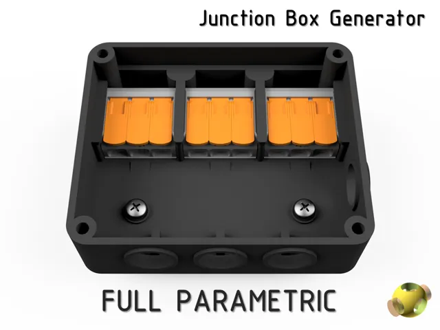</a> 
<b>Junction Box Generator</b> 
by Schnitzl 
<a href="https://makerworld.com/en/models/591912-junction-box-generator">MakerWorld</a> &middot; <a href="Junction%2BBox%2BGenerator.zip">Junction+Box+Generator.zip</a>
</td>
<td width="33%" align="center" valign="top">
<a href="TABLE%2BLEVELING%2BSYSTEM">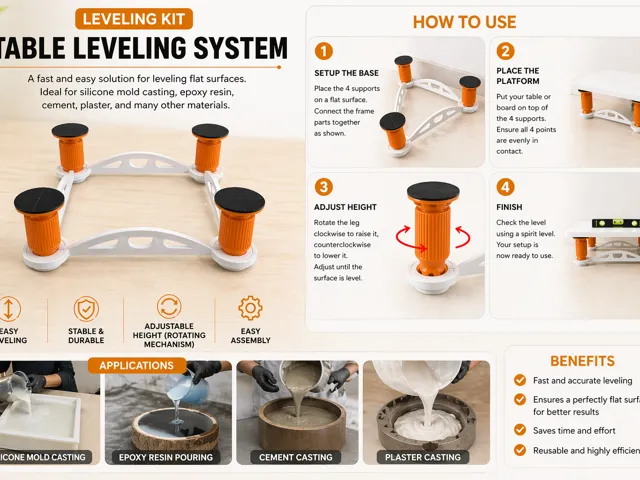</a> 
<b>TABLE LEVELING SYSTEM</b> 
by GoldWin 
<a href="https://makerworld.com/en/models/2692399-table-leveling-system">MakerWorld</a> &middot; <a href="TABLE%2BLEVELING%2BSYSTEM">Repo folder</a>
</td>
</tr>
<tr>
<td width="33%" align="center" valign="top">
<a href="USB_SD_and_MicroSD_holder_for_wide_USB_sticks">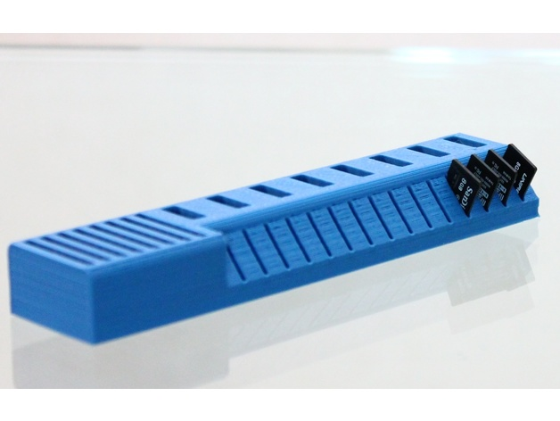</a> 
<b>USB SD and MicroSD holder for wide USB sticks</b> 
by Lalo_Solo 
<a href="https://www.thingiverse.com/thing:2637487">Thingiverse</a> &middot; <a href="USB_SD_and_MicroSD_holder_for_wide_USB_sticks">Repo folder</a>
</td>
</tr>
</table>

## Dev Board Accessories

<table>
<tr>
<td width="33%" align="center" valign="top">
<a href="dev-board-accessories/254mm-pin-uniter-2x5-pin-eg-for-logic-analyzer-model_files">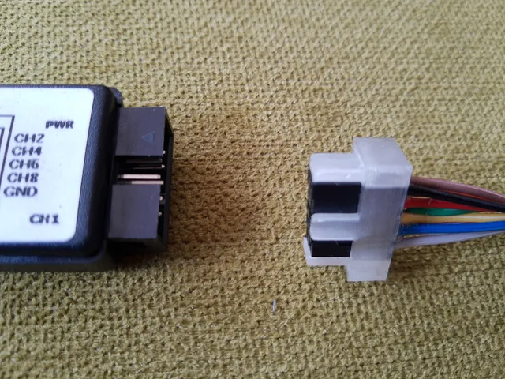</a> 
<b>2.54mm pin uniter (2x5 pin) e.g. for logic analyzer</b> 
by Simon 
<a href="https://www.printables.com/model/62446-254mm-pin-uniter-2x5-pin-eg-for-logic-analyzer">Printables</a> &middot; <a href="dev-board-accessories/254mm-pin-uniter-2x5-pin-eg-for-logic-analyzer-model_files">Repo folder</a>
</td>
<td width="33%" align="center" valign="top">
 
<b>Breadboard Spring Vise for Arduino or Raspberry Pi</b> 
by patshead 
<a href="https://www.thingiverse.com/thing:957376">Thingiverse</a> &middot; <a href="dev-board-accessories/Breadboard%20Spring%20Vise%20for%20Arduino%20or%20Raspberry%20Pi%20-%20957376">Repo folder</a>
</td>
<td width="33%" align="center" valign="top">
<a href="dev-board-accessories/esp32-breadboard-model_files">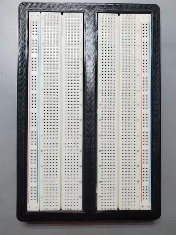</a> 
<b>ESP32 Breadboard</b> 
by UilHurtUrself 
<a href="https://www.printables.com/model/412644-esp32-breadboard">Printables</a> &middot; <a href="dev-board-accessories/esp32-breadboard-model_files">Repo folder</a>
</td>
</tr>
<tr>
<td width="33%" align="center" valign="top">
<a href="dev-board-accessories/nvidia_jetson_nano_case">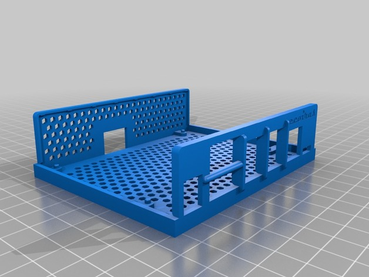</a> 
<b>Jetson Nano Case</b> 
by ecoiras 
<a href="https://www.thingiverse.com/thing:3518410">Thingiverse</a> &middot; <a href="dev-board-accessories/nvidia_jetson_nano_case">Repo folder</a>
</td>
<td width="33%" align="center" valign="top">
 
<b>PCB Probes</b> 
by DrTomFlint 
<a href="https://www.printables.com/model/821263-pcb-probes">Printables</a> &middot; <a href="dev-board-accessories/pcb-probes-model_files">Repo folder</a>
</td>
<td width="33%" align="center" valign="top">
<a href="dev-board-accessories/Pin_Header_Break_Away_Tool_4879426">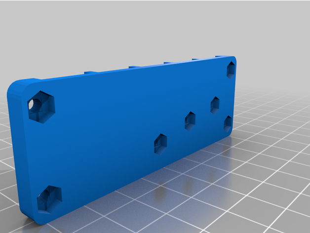</a> 
<b>Pin Header Break Away Tool</b> 
by arturo182 
<a href="https://www.thingiverse.com/thing:4879426">Thingiverse</a> &middot; <a href="dev-board-accessories/Pin_Header_Break_Away_Tool_4879426">Repo folder</a>
</td>
</tr>
<tr>
<td width="33%" align="center" valign="top">
 
<b>Vertical Laboratory</b> 
by JesusGomez 
<a href="https://www.thingiverse.com/thing:2734975">Thingiverse</a> &middot; <a href="dev-board-accessories/Vertical%20Laboratory%20-%202734975">Repo folder</a>
</td>
</tr>
</table>

Other files in this folder (1)

- [base 1660-1 3dp.stl](dev-board-accessories/base%201660-1%203dp.stl)

## Dev Board Accessories / Din Mounts

<table>
<tr>
<td width="33%" align="center" valign="top">
<a href="dev-board-accessories/din-mounts/v3-duff-din-undercarriage-filament-feeder-model_files">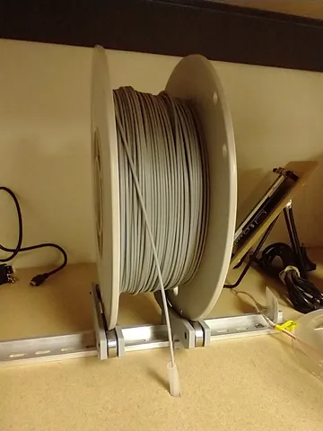</a> 
<b>[v3] DUFF: DIN Undercarriage Filament Feeder</b> 
by herr_brain 
<a href="https://www.printables.com/model/114513-v3-duff-din-undercarriage-filament-feeder">Printables</a> &middot; <a href="dev-board-accessories/din-mounts/v3-duff-din-undercarriage-filament-feeder-model_files">Repo folder</a>
</td>
<td width="33%" align="center" valign="top">
<a href="dev-board-accessories/din-mounts/arduino-nano-screw-terminal-din-rail-mount-model_files">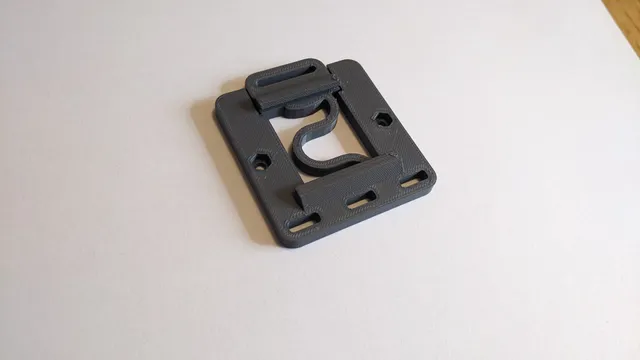</a> 
<b>Arduino Nano  Screw Terminal DIN Rail mount</b> 
by MadHulk 
<a href="https://www.printables.com/model/401952-arduino-nano-screw-terminal-din-rail-mount">Printables</a> &middot; <a href="dev-board-accessories/din-mounts/arduino-nano-screw-terminal-din-rail-mount-model_files">Repo folder</a>
</td>
<td width="33%" align="center" valign="top">
<i>no preview</i> 
<b>Din Mounts</b> 
Source unknown &middot; <a href="dev-board-accessories/din-mounts/files">Repo folder</a>
</td>
</tr>
<tr>
<td width="33%" align="center" valign="top">
 
<b>DIN Rail - 35mm - Prototyp Rack / Carrier</b> 
by hakan.g 
<a href="https://www.printables.com/model/222042-din-rail-35mm-prototyp-rack-carrier">Printables</a> &middot; <a href="dev-board-accessories/din-mounts/din-rail-35mm-prototyp-rack-carrier-model_files">Repo folder</a>
</td>
<td width="33%" align="center" valign="top">
<a href="dev-board-accessories/din-mounts/din-rail-bracket-heat-insert-version-525mm-625mm-model_files">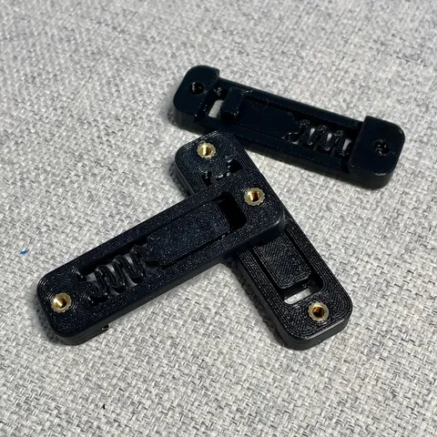</a> 
<b>DIN Rail Bracket - Heat Insert Version - 52.5mm &amp; 62.5mm</b> 
by mmuellerphoto 
<a href="https://www.printables.com/model/420009-din-rail-bracket-heat-insert-version-525mm-625mm">Printables</a> &middot; <a href="dev-board-accessories/din-mounts/din-rail-bracket-heat-insert-version-525mm-625mm-model_files">Repo folder</a>
</td>
<td width="33%" align="center" valign="top">
 
<b>DIN Rail Bracket M3 inserts</b> 
by m0ep 
<a href="https://www.printables.com/model/208404-din-rail-bracket-m3-inserts">Printables</a> &middot; <a href="dev-board-accessories/din-mounts/din-rail-bracket-m3-inserts-model_files">Repo folder</a>
</td>
</tr>
<tr>
<td width="33%" align="center" valign="top">
<a href="dev-board-accessories/din-mounts/din-rail-breadboard-mounts-model_files">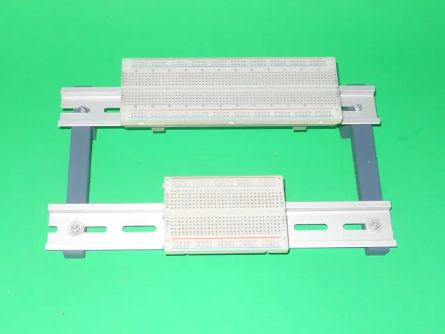</a> 
<b>Din Rail Breadboard Mounts</b> 
by ctheroux 
<a href="https://www.printables.com/model/629343-din-rail-breadboard-mounts">Printables</a> &middot; <a href="dev-board-accessories/din-mounts/din-rail-breadboard-mounts-model_files">Repo folder</a>
</td>
<td width="33%" align="center" valign="top">
 
<b>Din rail case for STM32 Nucleo-64 Boards</b> 
by PlasticXYZ 
<a href="https://www.printables.com/model/161725-din-rail-case-for-stm32-nucleo-64-boards">Printables</a> &middot; <a href="dev-board-accessories/din-mounts/din-rail-case-for-stm32-nucleo-64-boards-model_files">Repo folder</a>
</td>
<td width="33%" align="center" valign="top">
<a href="dev-board-accessories/din-mounts/din-rail-clip-model_files">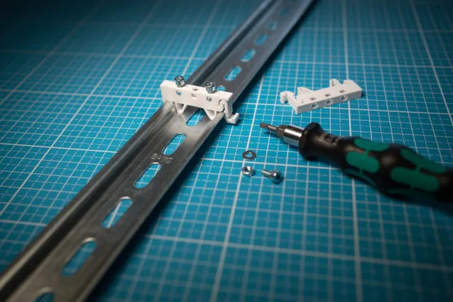</a> 
<b>DIN rail clip</b> 
by PlasticXYZ 
<a href="https://www.printables.com/model/161740-din-rail-clip">Printables</a> &middot; <a href="dev-board-accessories/din-mounts/din-rail-clip-model_files">Repo folder</a>
</td>
</tr>
<tr>
<td width="33%" align="center" valign="top">
<a href="dev-board-accessories/din-mounts/din-rail-test-rack-model_files">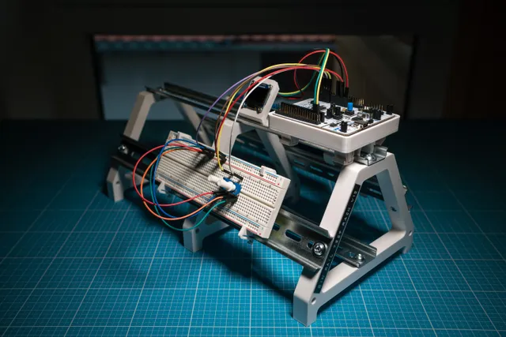</a> 
<b>DIN rail test rack</b> 
by PlasticXYZ 
<a href="https://www.printables.com/model/150786-din-rail-test-rack">Printables</a> &middot; <a href="dev-board-accessories/din-mounts/din-rail-test-rack-model_files">Repo folder</a>
</td>
<td width="33%" align="center" valign="top">
 
<b>Prototyping Stand</b> 
by sglahn 
<a href="https://www.thingiverse.com/thing:4441453">Thingiverse</a> &middot; <a href="dev-board-accessories/din-mounts/Prototyping%20Stand%20-%204441453">Repo folder</a>
</td>
<td width="33%" align="center" valign="top">
<a href="dev-board-accessories/din-mounts/qwiicplate-din-all-the-things-model_files">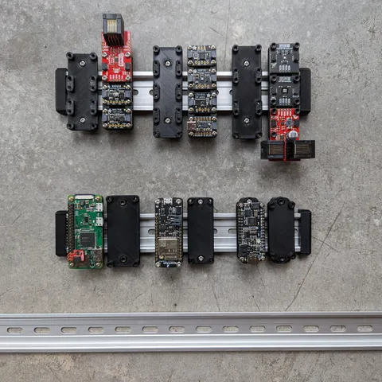</a> 
<b>Qwiicplate - DIN all the Things!</b> 
by herr_brain 
<a href="https://www.printables.com/model/468981-qwiicplate-din-all-the-things">Printables</a> &middot; <a href="dev-board-accessories/din-mounts/qwiicplate-din-all-the-things-model_files">Repo folder</a>
</td>
</tr>
<tr>
<td width="33%" align="center" valign="top">
<a href="dev-board-accessories/din-mounts/raspberry-pi-din-rail-case-model_files">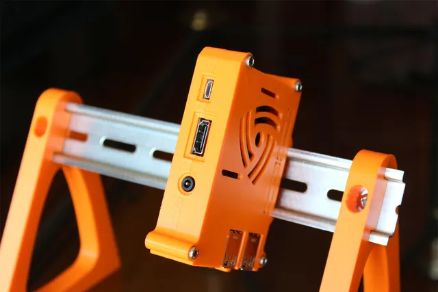</a> 
<b>Raspberry Pi DIN Rail Case</b> 
by mdkendall 
<a href="https://www.printables.com/model/133497-raspberry-pi-din-rail-case">Printables</a> &middot; <a href="dev-board-accessories/din-mounts/raspberry-pi-din-rail-case-model_files">Repo folder</a>
</td>
<td width="33%" align="center" valign="top">
 
<b>Raspberry Pi DIN Rail Case</b> 
by mdkendall 
<a href="https://www.thingiverse.com/thing:2492974">Thingiverse</a> &middot; <a href="dev-board-accessories/din-mounts/Raspberry_Pi_DIN_Rail_Case_2492974">Repo folder</a>
</td>
<td width="33%" align="center" valign="top">
<a href="dev-board-accessories/din-mounts/rpidin-model_files">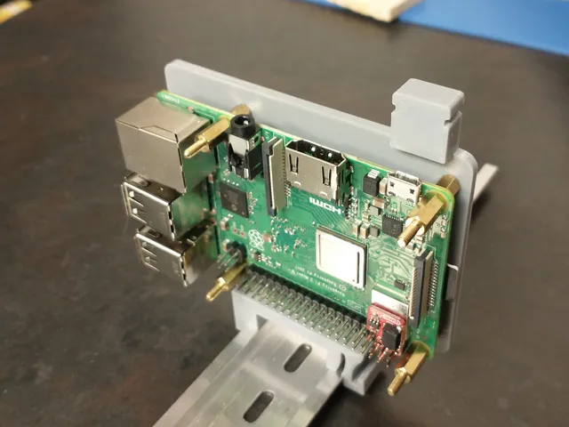</a> 
<b>RPiDIN</b> 
by herr_brain 
<a href="https://www.printables.com/model/65368-rpidin">Printables</a> &middot; <a href="dev-board-accessories/din-mounts/rpidin-model_files">Repo folder</a>
</td>
</tr>
<tr>
<td width="33%" align="center" valign="top">
<a href="dev-board-accessories/din-mounts/simple-stm32-nucleo-144-case-model_files">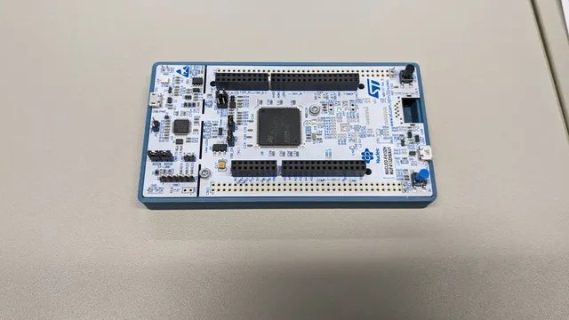</a> 
<b>Simple STM32 Nucleo-144 Case</b> 
by crasbe 
<a href="https://www.printables.com/model/764904-simple-stm32-nucleo-144-case">Printables</a> &middot; <a href="dev-board-accessories/din-mounts/simple-stm32-nucleo-144-case-model_files">Repo folder</a>
</td>
<td width="33%" align="center" valign="top">
 
<b>Universal PCB DIN/Desktop adjustable holder</b> 
by ICT Avatar 
<a href="https://www.printables.com/model/55644-universal-pcb-dindesktop-adjustable-holder">Printables</a> &middot; <a href="dev-board-accessories/din-mounts/universal-pcb-dindesktop-adjustable-holder-model_files">Repo folder</a>
</td>
<td width="33%" align="center" valign="top">
<a href="dev-board-accessories/din-mounts/wago-221-415-mount-for-din-rail-bracket-model_files">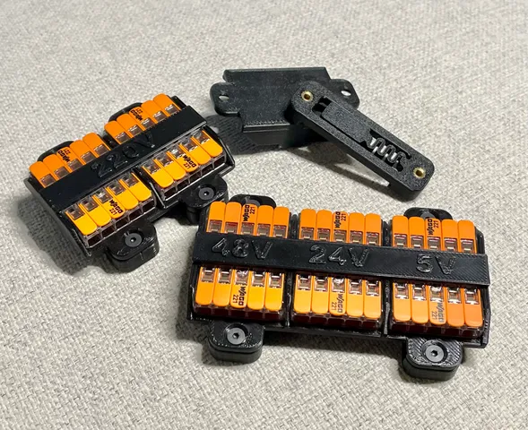</a> 
<b>Wago 221-415 Mount for DIN Rail Bracket</b> 
by mmuellerphoto 
<a href="https://www.printables.com/model/420081-wago-221-415-mount-for-din-rail-bracket">Printables</a> &middot; <a href="dev-board-accessories/din-mounts/wago-221-415-mount-for-din-rail-bracket-model_files">Repo folder</a>
</td>
</tr>
<tr>
<td width="33%" align="center" valign="top">
 
<b>Wago DIN Rail mount</b> 
by 3D Design SBK 
<a href="https://www.printables.com/model/292540-wago-din-rail-mount">Printables</a> &middot; <a href="dev-board-accessories/din-mounts/wago-din-rail-mount-model_files">Repo folder</a>
</td>
</tr>
</table>

Other files in this folder (10)

- [3d-din-rail-mount-clip2.scad](dev-board-accessories/din-mounts/3d-din-rail-mount-clip2.scad)
- [3d-din-rail-mount-clip2.stl](dev-board-accessories/din-mounts/3d-din-rail-mount-clip2.stl)
- [arduino UNO din mount.stl](dev-board-accessories/din-mounts/arduino%20UNO%20din%20mount.stl)
- [Arduino_Nano_din_mount.stl](dev-board-accessories/din-mounts/Arduino_Nano_din_mount.stl)
- [DIN Mounts_ Pi, Arduino and disks - 2610621 - part 1 of 2.zip](dev-board-accessories/din-mounts/DIN%20Mounts_%20Pi%2C%20Arduino%20and%20disks%20-%202610621%20-%20part%201%20of%202.zip)
- [DIN Mounts_ Pi, Arduino and disks - 2610621 - part 2 of 2.zip](dev-board-accessories/din-mounts/DIN%20Mounts_%20Pi%2C%20Arduino%20and%20disks%20-%202610621%20-%20part%202%20of%202.zip)
- [DIN_Rail_Clip_Universal_opt5 v6.3mf](dev-board-accessories/din-mounts/DIN_Rail_Clip_Universal_opt5%20v6.3mf)
- [din-breadboard-clip.stl](dev-board-accessories/din-mounts/din-breadboard-clip.stl)
- [din-rail-mount-for-nucleo-64-model_files.zip](dev-board-accessories/din-mounts/din-rail-mount-for-nucleo-64-model_files.zip)
- [Sabrent USB Hub Holder_w_DIN_Holes_Recessed.f3d](dev-board-accessories/din-mounts/Sabrent%20USB%20Hub%20Holder_w_DIN_Holes_Recessed.f3d)

## Din Mounts

<table>
<tr>
<td width="33%" align="center" valign="top">
 
<b>[v3] DUFF: DIN Undercarriage Filament Feeder</b> 
by herr_brain 
<a href="https://www.printables.com/model/114513-v3-duff-din-undercarriage-filament-feeder">Printables</a> &middot; <a href="din-mounts/v3-duff-din-undercarriage-filament-feeder-model_files">Repo folder</a>
</td>
<td width="33%" align="center" valign="top">
 
<b>Arduino Nano  Screw Terminal DIN Rail mount</b> 
by MadHulk 
<a href="https://www.printables.com/model/401952-arduino-nano-screw-terminal-din-rail-mount">Printables</a> &middot; <a href="din-mounts/arduino-nano-screw-terminal-din-rail-mount-model_files">Repo folder</a>
</td>
<td width="33%" align="center" valign="top">
<a href="din-mounts/Bracket%2Bfor%2BOpen%2BBench%2BRail">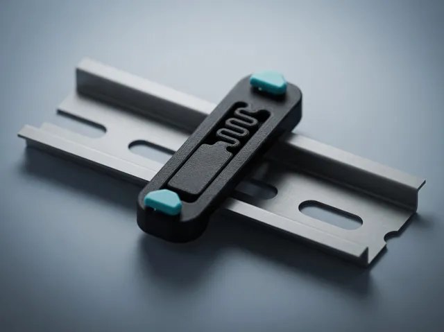</a> 
<b>Bracket for Open Bench Rail</b> 
by pixelwave 
<a href="https://makerworld.com/en/models/2710507-bracket-for-open-bench-rail">MakerWorld</a> &middot; <a href="din-mounts/Bracket%2Bfor%2BOpen%2BBench%2BRail">Repo folder</a>
</td>
</tr>
<tr>
<td width="33%" align="center" valign="top">
<a href="din-mounts/Breadboard%2BMount%2B(OBR%2BModule)">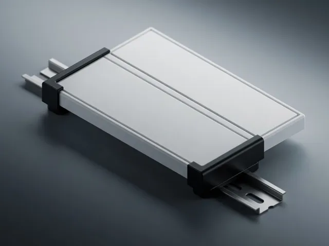</a> 
<b>Breadboard Mount (OBR Module)</b> 
by pixelwave 
<a href="https://makerworld.com/en/models/2710506-breadboard-mount-obr-module">MakerWorld</a> &middot; <a href="din-mounts/Breadboard%2BMount%2B(OBR%2BModule)">Repo folder</a>
</td>
<td width="33%" align="center" valign="top">
<i>no preview</i> 
<b>Din Mounts</b> 
Source unknown &middot; <a href="din-mounts/files">Repo folder</a>
</td>
<td width="33%" align="center" valign="top">
<a href="din-mounts/din-rail-35mm-prototyp-rack-carrier-model_files">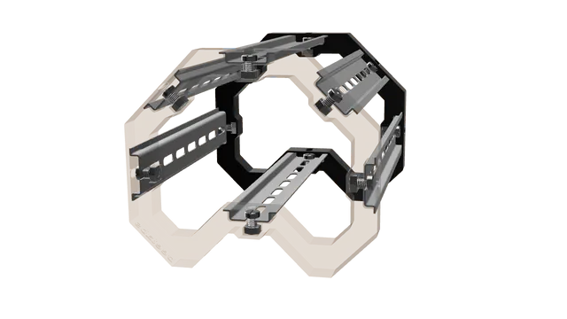</a> 
<b>DIN Rail - 35mm - Prototyp Rack / Carrier</b> 
by hakan.g 
<a href="https://www.printables.com/model/222042-din-rail-35mm-prototyp-rack-carrier">Printables</a> &middot; <a href="din-mounts/din-rail-35mm-prototyp-rack-carrier-model_files">Repo folder</a>
</td>
</tr>
<tr>
<td width="33%" align="center" valign="top">
 
<b>DIN Rail Bracket - Heat Insert Version - 52.5mm &amp; 62.5mm</b> 
by mmuellerphoto 
<a href="https://www.printables.com/model/420009-din-rail-bracket-heat-insert-version-525mm-625mm">Printables</a> &middot; <a href="din-mounts/din-rail-bracket-heat-insert-version-525mm-625mm-model_files">Repo folder</a>
</td>
<td width="33%" align="center" valign="top">
<a href="din-mounts/din-rail-bracket-m3-inserts-model_files">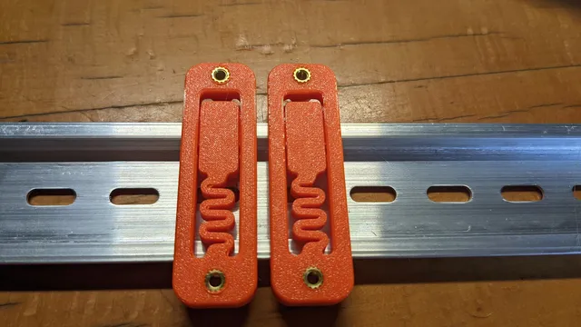</a> 
<b>DIN Rail Bracket M3 inserts</b> 
by m0ep 
<a href="https://www.printables.com/model/208404-din-rail-bracket-m3-inserts">Printables</a> &middot; <a href="din-mounts/din-rail-bracket-m3-inserts-model_files">Repo folder</a>
</td>
<td width="33%" align="center" valign="top">
 
<b>Din Rail Breadboard Mounts</b> 
by ctheroux 
<a href="https://www.printables.com/model/629343-din-rail-breadboard-mounts">Printables</a> &middot; <a href="din-mounts/din-rail-breadboard-mounts-model_files">Repo folder</a>
</td>
</tr>
<tr>
<td width="33%" align="center" valign="top">
<a href="din-mounts/din-rail-case-for-stm32-nucleo-64-boards-model_files">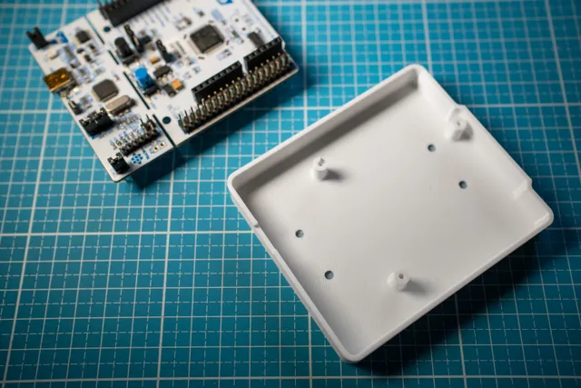</a> 
<b>Din rail case for STM32 Nucleo-64 Boards</b> 
by PlasticXYZ 
<a href="https://www.printables.com/model/161725-din-rail-case-for-stm32-nucleo-64-boards">Printables</a> &middot; <a href="din-mounts/din-rail-case-for-stm32-nucleo-64-boards-model_files">Repo folder</a>
</td>
<td width="33%" align="center" valign="top">
 
<b>DIN rail clip</b> 
by PlasticXYZ 
<a href="https://www.printables.com/model/161740-din-rail-clip">Printables</a> &middot; <a href="din-mounts/din-rail-clip-model_files">Repo folder</a>
</td>
<td width="33%" align="center" valign="top">
<a href="din-mounts/din-rail-mount-for-nucleo-64-model_files">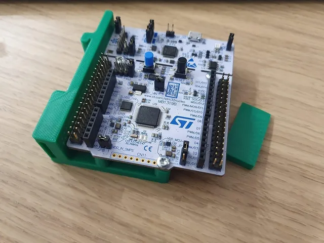</a> 
<b>DIN Rail mount for Nucleo-64</b> 
by jacek 
<a href="https://www.printables.com/model/169302-din-rail-mount-for-nucleo-64">Printables</a> &middot; <a href="din-mounts/din-rail-mount-for-nucleo-64-model_files">Repo folder</a>
</td>
</tr>
<tr>
<td width="33%" align="center" valign="top">
<a href="din-mounts/DIN%2BRail%2BStand%2BDuo%2Bv4">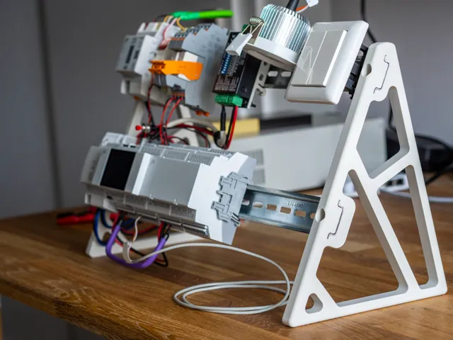</a> 
<b>DIN Rail Stand Duo v4</b> 
by klein0r 
<a href="https://makerworld.com/en/models/2566646-din-rail-stand-duo-v4">MakerWorld</a> &middot; <a href="din-mounts/DIN%2BRail%2BStand%2BDuo%2Bv4">Repo folder</a>
</td>
<td width="33%" align="center" valign="top">
 
<b>DIN rail test rack</b> 
by PlasticXYZ 
<a href="https://www.printables.com/model/150786-din-rail-test-rack">Printables</a> &middot; <a href="din-mounts/din-rail-test-rack-model_files">Repo folder</a>
</td>
<td width="33%" align="center" valign="top">
<i>no preview</i> 
<b>DIN35 snap holder</b> 
<a href="https://makerworld.com/en/search/models?keyword=DIN35%20snap%20holder">Search MakerWorld</a> &middot; <a href="din-mounts/DIN35_snap_holder_stls">Repo folder</a>
</td>
</tr>
<tr>
<td width="33%" align="center" valign="top">
<a href="din-mounts/Dual%2BBreadboard%2BCase%2B(for%2BESP32%2C%2BArduino%2C%2Betc%2B..)">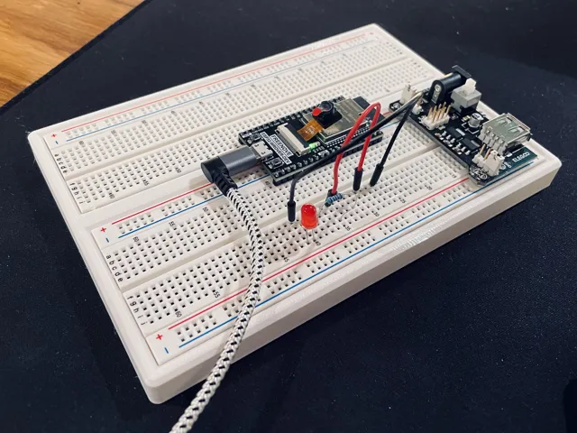</a> 
<b>Dual Breadboard Case (for ESP32, Arduino, etc ..)</b> 
by pixelwave 
<a href="https://makerworld.com/en/models/70791-dual-breadboard-case-for-esp32-arduino-etc">MakerWorld</a> &middot; <a href="din-mounts/Dual%2BBreadboard%2BCase%2B(for%2BESP32%2C%2BArduino%2C%2Betc%2B..)">Repo folder</a>
</td>
<td width="33%" align="center" valign="top">
<a href="din-mounts/Open%2BBench%2BRail">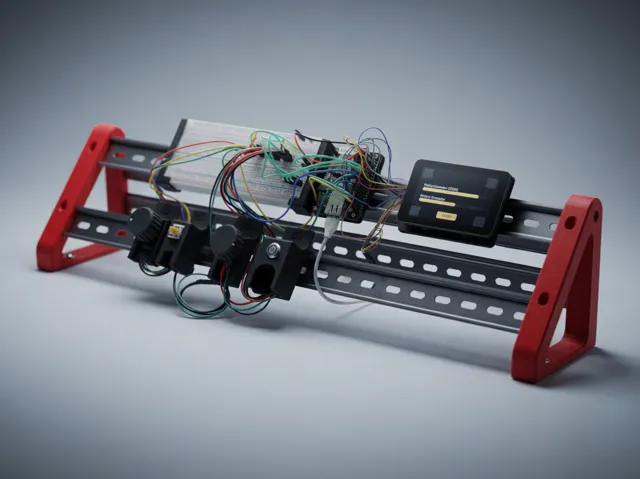</a> 
<b>Open Bench Rail</b> 
by pixelwave 
<a href="https://makerworld.com/en/models/2710510-open-bench-rail">MakerWorld</a> &middot; <a href="din-mounts/Open%2BBench%2BRail">Repo folder</a>
</td>
<td width="33%" align="center" valign="top">
<i>no preview</i> 
<b>Parametrischer DIN-Schienen-Adapter (Hutschiene)</b> 
<a href="https://makerworld.com/en/search/models?keyword=Parametrischer%20DIN-Schienen-Adapter%20(Hutschiene)">Search MakerWorld</a> &middot; <a href="din-mounts/Parametrischer%2BDIN-Schienen-Adapter%2B(Hutschiene)">Repo folder</a>
</td>
</tr>
<tr>
<td width="33%" align="center" valign="top">
 
<b>Prototyping Stand</b> 
by sglahn 
<a href="https://www.thingiverse.com/thing:4441453">Thingiverse</a> &middot; <a href="din-mounts/Prototyping%20Stand%20-%204441453">Repo folder</a>
</td>
<td width="33%" align="center" valign="top">
 
<b>Qwiicplate - DIN all the Things!</b> 
by herr_brain 
<a href="https://www.printables.com/model/468981-qwiicplate-din-all-the-things">Printables</a> &middot; <a href="din-mounts/qwiicplate-din-all-the-things-model_files">Repo folder</a>
</td>
<td width="33%" align="center" valign="top">
 
<b>Raspberry Pi DIN Rail Case</b> 
by mdkendall 
<a href="https://www.printables.com/model/133497-raspberry-pi-din-rail-case">Printables</a> &middot; <a href="din-mounts/raspberry-pi-din-rail-case-model_files">Repo folder</a>
</td>
</tr>
<tr>
<td width="33%" align="center" valign="top">
<a href="din-mounts/Raspberry_Pi_DIN_Rail_Case_2492974">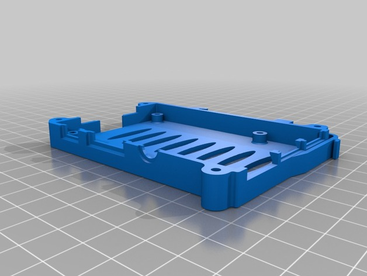</a> 
<b>Raspberry Pi DIN Rail Case</b> 
by mdkendall 
<a href="https://www.thingiverse.com/thing:2492974">Thingiverse</a> &middot; <a href="din-mounts/Raspberry_Pi_DIN_Rail_Case_2492974">Repo folder</a>
</td>
<td width="33%" align="center" valign="top">
 
<b>RPiDIN</b> 
by herr_brain 
<a href="https://www.printables.com/model/65368-rpidin">Printables</a> &middot; <a href="din-mounts/rpidin-model_files">Repo folder</a>
</td>
<td width="33%" align="center" valign="top">
 
<b>Simple STM32 Nucleo-144 Case</b> 
by crasbe 
<a href="https://www.printables.com/model/764904-simple-stm32-nucleo-144-case">Printables</a> &middot; <a href="din-mounts/simple-stm32-nucleo-144-case-model_files">Repo folder</a>
</td>
</tr>
<tr>
<td width="33%" align="center" valign="top">
<a href="din-mounts/universal-pcb-dindesktop-adjustable-holder-model_files">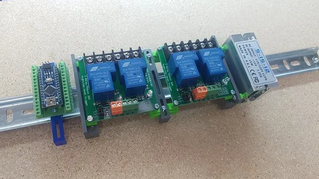</a> 
<b>Universal PCB DIN/Desktop adjustable holder</b> 
by ICT Avatar 
<a href="https://www.printables.com/model/55644-universal-pcb-dindesktop-adjustable-holder">Printables</a> &middot; <a href="din-mounts/universal-pcb-dindesktop-adjustable-holder-model_files">Repo folder</a>
</td>
<td width="33%" align="center" valign="top">
 
<b>Wago 221-415 Mount for DIN Rail Bracket</b> 
by mmuellerphoto 
<a href="https://www.printables.com/model/420081-wago-221-415-mount-for-din-rail-bracket">Printables</a> &middot; <a href="din-mounts/wago-221-415-mount-for-din-rail-bracket-model_files">Repo folder</a>
</td>
<td width="33%" align="center" valign="top">
<a href="din-mounts/wago-din-rail-mount-model_files">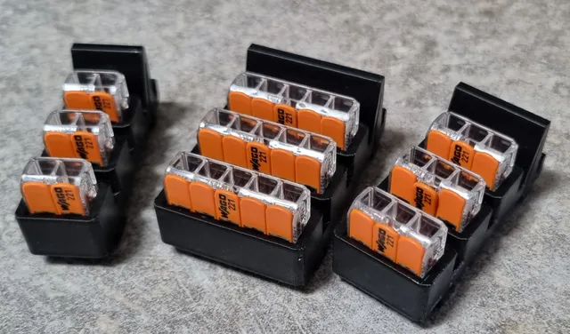</a> 
<b>Wago DIN Rail mount</b> 
by 3D Design SBK 
<a href="https://www.printables.com/model/292540-wago-din-rail-mount">Printables</a> &middot; <a href="din-mounts/wago-din-rail-mount-model_files">Repo folder</a>
</td>
</tr>
</table>

Other files in this folder (7)

- [3d-din-rail-mount-clip2.scad](din-mounts/3d-din-rail-mount-clip2.scad)
- [3d-din-rail-mount-clip2.stl](din-mounts/3d-din-rail-mount-clip2.stl)
- [arduino UNO din mount.stl](din-mounts/arduino%20UNO%20din%20mount.stl)
- [Arduino_Nano_din_mount.stl](din-mounts/Arduino_Nano_din_mount.stl)
- [DIN_Rail_Clip_Universal_opt5 v6.3mf](din-mounts/DIN_Rail_Clip_Universal_opt5%20v6.3mf)
- [din-breadboard-clip.stl](din-mounts/din-breadboard-clip.stl)
- [Sabrent USB Hub Holder_w_DIN_Holes_Recessed.f3d](din-mounts/Sabrent%20USB%20Hub%20Holder_w_DIN_Holes_Recessed.f3d)

## Junction Boxes

<table>
<tr>
<td width="33%" align="center" valign="top">
<i>no preview</i> 
<b>Junction Box – modular &amp; skalierbar</b> 
<a href="https://makerworld.com/en/search/models?keyword=Junction%20Box%20%E2%80%93%20modular%20%26%20skalierbar">Search MakerWorld</a> &middot; <a href="junction-boxes/Junction%20Box%2B%E2%80%93%2Bmodular%2B%26%2Bskalierbar">Repo folder</a>
</td>
<td width="33%" align="center" valign="top">
 
<b>Junction Box Generator</b> 
by Schnitzl 
<a href="https://makerworld.com/en/models/591912-junction-box-generator">MakerWorld</a> &middot; <a href="junction-boxes/Junction%2BBox%2BGenerator">Repo folder</a>
</td>
</tr>
</table>

## Mini Rack

<table>
<tr>
<td width="33%" align="center" valign="top">
<i>no preview</i> 
<b>10 Inch Mini Rack Generator</b> 
<a href="https://makerworld.com/en/search/models?keyword=10%20Inch%20Mini%20Rack%20Generator">Search MakerWorld</a> &middot; <a href="mini-rack/10%2BInch%2BMini%2BRack%2BGenerator">Repo folder</a>
</td>
<td width="33%" align="center" valign="top">
<i>no preview</i> 
<b>1U gridfinity draver</b> 
<a href="https://makerworld.com/en/search/models?keyword=1U%20gridfinity%20draver">Search MakerWorld</a> &middot; <a href="mini-rack/1U%2Bgridfinity%2Bdraver_stls">Repo folder</a>
</td>
<td width="33%" align="center" valign="top">
<a href="mini-rack/1U%2C%2B2U%2C%2B3U%2BDrawers%2Band%2BRails%2Bfor%2BKWS%2BRack%2BV.2">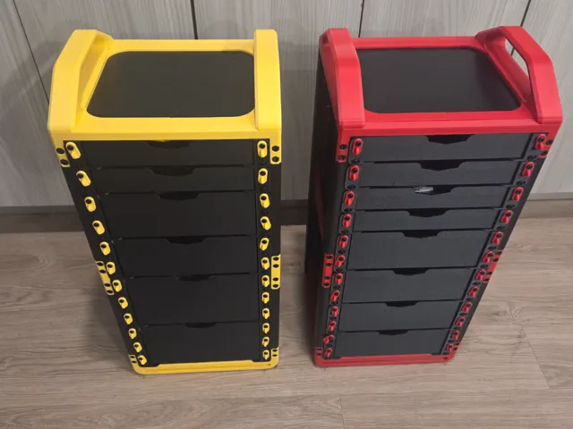</a> 
<b>1U, 2U, 3U Drawers and Rails for KWS Rack V.2</b> 
by usefulhobbies 
<a href="https://makerworld.com/en/models/2837840-1u-2u-3u-drawers-and-rails-for-kws-rack-v-2">MakerWorld</a> &middot; <a href="mini-rack/1U%2C%2B2U%2C%2B3U%2BDrawers%2Band%2BRails%2Bfor%2BKWS%2BRack%2BV.2">Repo folder</a>
</td>
</tr>
<tr>
<td width="33%" align="center" valign="top">
<a href="mini-rack/Customizable%2BRackmount%2B%5BANY%2BRACKSIZE%5D">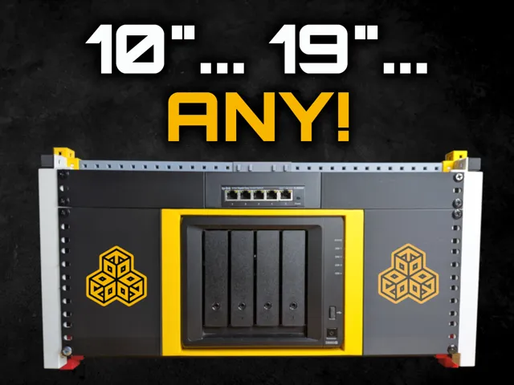</a> 
<b>Customizable Rackmount [ANY RACKSIZE]</b> 
by KellerLab 
<a href="https://makerworld.com/en/models/2128492-customizable-rackmount-any-racksize">MakerWorld</a> &middot; <a href="mini-rack/Customizable%2BRackmount%2B%5BANY%2BRACKSIZE%5D">Repo folder</a>
</td>
<td width="33%" align="center" valign="top">
<a href="mini-rack/Customizable%2Bvent%2B%26%2Bblank%2Bpanels%2Bfor%2B10%2BInch%2BRack">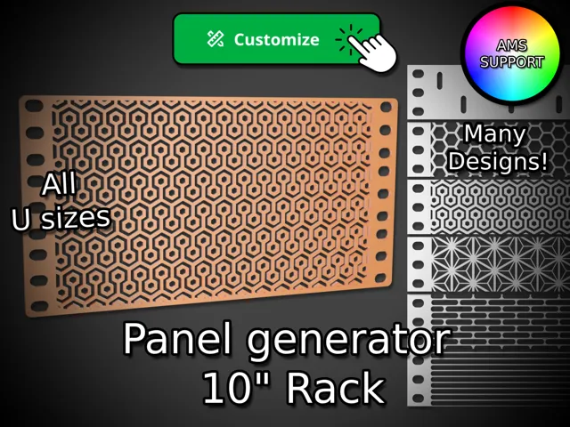</a> 
<b>Customizable vent &amp; blank panels for 10 Inch Rack</b> 
by Kiwiworks 
<a href="https://makerworld.com/en/models/1872040-customizable-vent-blank-panels-for-10-inch-rack">MakerWorld</a> &middot; <a href="mini-rack/Customizable%2Bvent%2B%26%2Bblank%2Bpanels%2Bfor%2B10%2BInch%2BRack">Repo folder</a>
</td>
<td width="33%" align="center" valign="top">
 
<b>HomeRacker - Core</b> 
<a href="https://makerworld.com/en/search/models?keyword=HomeRacker%20-%20Core">Search MakerWorld</a> &middot; <a href="mini-rack/HomeRacker%2B-%2BCore">Repo folder</a>
</td>
</tr>
<tr>
<td width="33%" align="center" valign="top">
 
<b>KWS Rack v.2 - Heavy‑Duty 10‑Inch Homelab Rack</b> 
by Ilan Kushnir 
<a href="https://makerworld.com/en/models/2139130-kws-rack-v-2-heavy-duty-10-inch-homelab-rack">MakerWorld</a> &middot; <a href="mini-rack/KWS%2BRack%2Bv.2%2B-%2BHeavy%E2%80%91Duty%2B10%E2%80%91Inch%2BHomelab%2BRack">Repo folder</a>
</td>
<td width="33%" align="center" valign="top">
<a href="mini-rack/Lab%2BRax%2B10_%2BServer%2BRack%2B-%2B5U">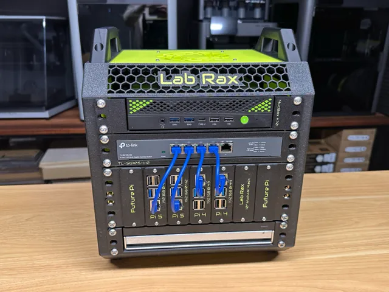</a> 
<b>Lab Rax 10&quot; Server Rack - 5U</b> 
by mklements 
<a href="https://makerworld.com/en/models/1294480-lab-rax-10-server-rack-5u">MakerWorld</a> &middot; <a href="mini-rack/Lab%2BRax%2B10_%2BServer%2BRack%2B-%2B5U">Repo folder</a>
</td>
<td width="33%" align="center" valign="top">
<a href="mini-rack/Lab%2BRax%2B10_%2BServer%2BRack%2B-%2BBolted%2BVersion%2B-%2B5U">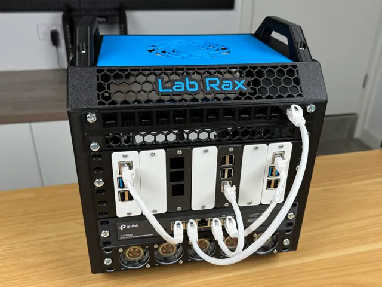</a> 
<b>Lab Rax 10&quot; Server Rack - Bolted Version - 5U</b> 
by mklements 
<a href="https://makerworld.com/en/models/1464819-lab-rax-10-server-rack-bolted-version-5u">MakerWorld</a> &middot; <a href="mini-rack/Lab%2BRax%2B10_%2BServer%2BRack%2B-%2BBolted%2BVersion%2B-%2B5U">Repo folder</a>
</td>
</tr>
<tr>
<td width="33%" align="center" valign="top">
<a href="mini-rack/Lab%2BRax%2B1-5U%2BPosts%2B%26%2BPanels">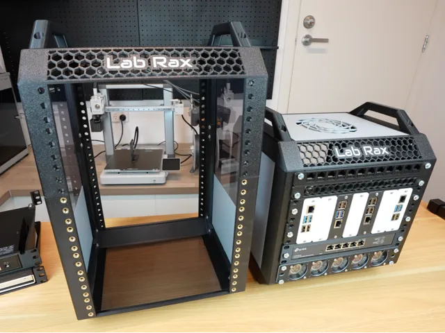</a> 
<b>Lab Rax 1-5U Posts &amp; Panels</b> 
by mklements 
<a href="https://makerworld.com/en/models/1294478-lab-rax-1-5u-posts-panels">MakerWorld</a> &middot; <a href="mini-rack/Lab%2BRax%2B1-5U%2BPosts%2B%26%2BPanels">Repo folder</a>
</td>
<td width="33%" align="center" valign="top">
<a href="mini-rack/LabRax%2BDIN%2BRail%2BMount">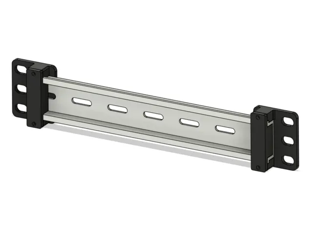</a> 
<b>LabRax DIN Rail Mount</b> 
by Dan Kreisher 
<a href="https://makerworld.com/en/models/3122809-labrax-din-rail-mount">MakerWorld</a> &middot; <a href="mini-rack/LabRax%2BDIN%2BRail%2BMount">Repo folder</a>
</td>
<td width="33%" align="center" valign="top">
<a href="mini-rack/Microlab%2B-%2BMini%2BModular%2BHome%2BServer%2BRack">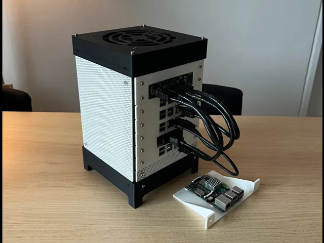</a> 
<b>Microlab - Mini Modular Home Server Rack</b> 
by CB4D 
<a href="https://makerworld.com/en/models/1062225-microlab-mini-modular-home-server-rack">MakerWorld</a> &middot; <a href="mini-rack/Microlab%2B-%2BMini%2BModular%2BHome%2BServer%2BRack">Repo folder</a>
</td>
</tr>
<tr>
<td width="33%" align="center" valign="top">
<a href="mini-rack/Mini%2BLab%2BRax%2B7U%2Brails%2Band%2Bside%2Bpanels">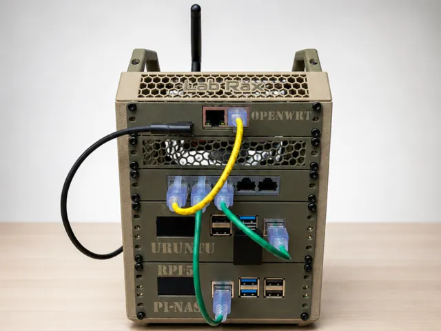</a> 
<b>Mini Lab Rax 7U rails and side panels</b> 
by Tommy_S 
<a href="https://makerworld.com/en/models/2847561-mini-lab-rax-7u-rails-and-side-panels">MakerWorld</a> &middot; <a href="mini-rack/Mini%2BLab%2BRax%2B7U%2Brails%2Band%2Bside%2Bpanels">Repo folder</a>
</td>
<td width="33%" align="center" valign="top">
<a href="mini-rack/Modular%2B10_%2BServer%2BRack">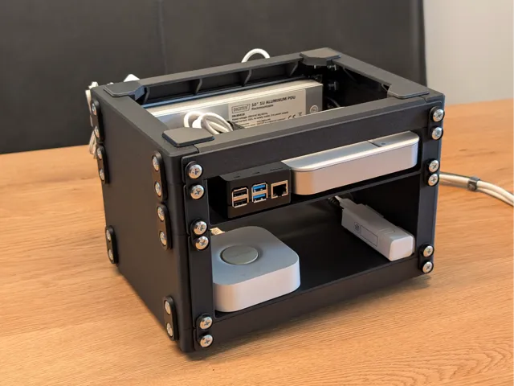</a> 
<b>Modular 10&quot; Server Rack</b> 
by Benjamin Kott 
<a href="https://makerworld.com/en/models/1452571-modular-10-server-rack">MakerWorld</a> &middot; <a href="mini-rack/Modular%2B10_%2BServer%2BRack">Repo folder</a>
</td>
<td width="33%" align="center" valign="top">
<a href="mini-rack/Ocktron%2BCompact%2B10%E2%80%91inch%2BMini%2BRack%2B5U%2Bby%2B6U%2Bby%2B8U">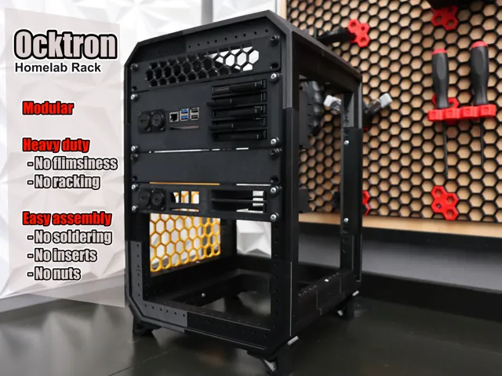</a> 
<b>Ocktron Compact 10‑inch Mini Rack 5U by 6U by 8U</b> 
by Carlos Byte 
<a href="https://makerworld.com/en/models/2021374-ocktron-compact-10-inch-mini-rack-5u-by-6u-by-8u">MakerWorld</a> &middot; <a href="mini-rack/Ocktron%2BCompact%2B10%E2%80%91inch%2BMini%2BRack%2B5U%2Bby%2B6U%2Bby%2B8U">Repo folder</a>
</td>
</tr>
<tr>
<td width="33%" align="center" valign="top">
<a href="mini-rack/OpenRack%2B1U%2B%E2%80%93%2BA%2BModular%2BServer%2BRack%2BSystem">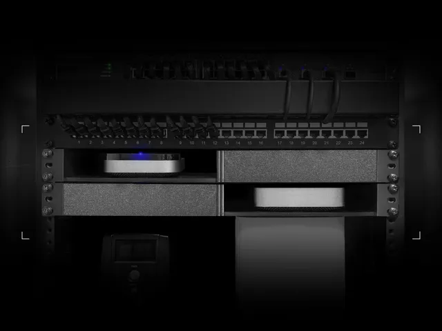</a> 
<b>OpenRack 1U – A Modular Server Rack System</b> 
by Sparco 
<a href="https://makerworld.com/en/models/1032069-openrack-1u-a-modular-server-rack-system">MakerWorld</a> &middot; <a href="mini-rack/OpenRack%2B1U%2B%E2%80%93%2BA%2BModular%2BServer%2BRack%2BSystem">Repo folder</a>
</td>
<td width="33%" align="center" valign="top">
<i>no preview</i> 
<b>Timber Rack</b> 
<a href="https://makerworld.com/en/search/models?keyword=Timber%20Rack">Search MakerWorld</a> &middot; <a href="mini-rack/Timber_Rack_stls">Repo folder</a>
</td>
</tr>
</table>

## Nas

<table>
<tr>
<td width="33%" align="center" valign="top">
<a href="nas/14%2Bbay%2BJBOD%2B_%2BHard%2BDrive%2BEnclosure">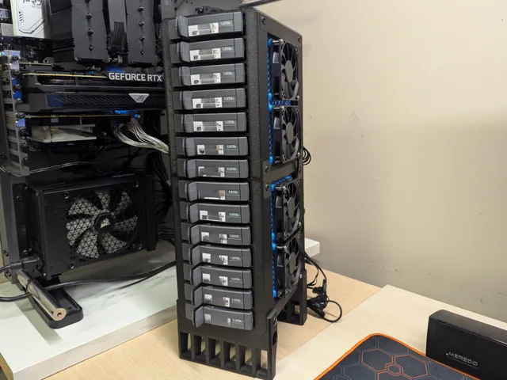</a> 
<b>14 bay JBOD / Hard Drive Enclosure</b> 
by eclipse1234 
<a href="https://makerworld.com/en/models/2843117-14-bay-jbod-hard-drive-enclosure">MakerWorld</a> &middot; <a href="nas/14%2Bbay%2BJBOD%2B_%2BHard%2BDrive%2BEnclosure">Repo folder</a>
</td>
<td width="33%" align="center" valign="top">
<a href="nas/QNAS%2BFRAMEWORK%2B%2BV1%2B%E5%BC%80%E6%94%BE%E5%BC%8FNAS%2B%E9%80%82%E9%85%8DITX%E4%B8%BB%E6%9D%BF">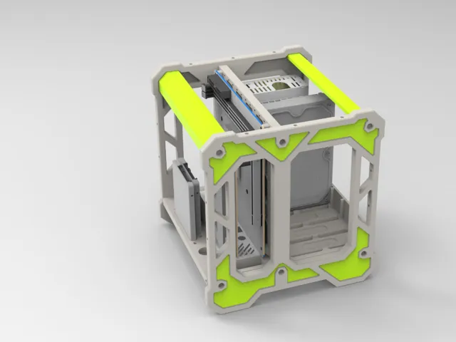</a> 
<b>QNAS FRAMEWORK  V1 开放式NAS 适配ITX主板</b> 
by 丫丫赶海 
<a href="https://makerworld.com/en/models/1308857-qnas-framework-v1-open-source-nas-adaptable-itx-mo">MakerWorld</a> &middot; <a href="nas/QNAS%2BFRAMEWORK%2B%2BV1%2B%E5%BC%80%E6%94%BE%E5%BC%8FNAS%2B%E9%80%82%E9%85%8DITX%E4%B8%BB%E6%9D%BF">Repo folder</a>
</td>
<td width="33%" align="center" valign="top">
 
<b>Stackable 3.5&quot; HDD cage for 140mm front fan rails</b> 
by Waarp 
<a href="https://makerworld.com/en/models/2945549-stackable-3-5-hdd-cage-for-140mm-front-fan-rails">MakerWorld</a> &middot; <a href="nas/Stackable%2B3.5_%2BHDD%2Bcage%2Bfor%2B140mm%2Bfront%2Bfan%2Brails">Repo folder</a>
</td>
</tr>
<tr>
<td width="33%" align="center" valign="top">
<a href="nas/ThinkBox%2B-%2BA%2BCustom%2B4-Bay%2BSATA_SAS%2BHDD%2BNAS">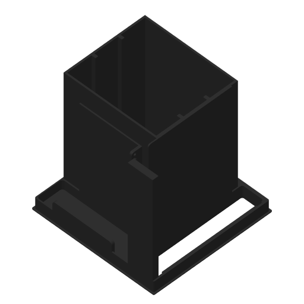</a> 
<b>ThinkBox - A Custom 4-Bay SATA SAS HDD NAS</b> 
<a href="https://makerworld.com/en/search/models?keyword=ThinkBox%20-%20A%20Custom%204-Bay%20SATA%20SAS%20HDD%20NAS">Search MakerWorld</a> &middot; <a href="nas/ThinkBox%2B-%2BA%2BCustom%2B4-Bay%2BSATA_SAS%2BHDD%2BNAS">Repo folder</a>
</td>
</tr>
</table>

## Soldering

<table>
<tr>
<td width="33%" align="center" valign="top">
<i>no preview</i> 
<b>Header Soldering Jig V2</b> 
<a href="https://makerworld.com/en/search/models?keyword=Header%20Soldering%20Jig%20V2">Search MakerWorld</a> &middot; <a href="soldering/Header%2BSoldering%2BJig%2BV2_stls">Repo folder</a>
</td>
</tr>
</table>

## Soldering / Paste Flux

<table>
<tr>
<td width="33%" align="center" valign="top">
 
<b>10CC Flux Dispenser (from Quick Release Clamp)</b> 
by Lehaiver 
<a href="https://www.thingiverse.com/thing:2268079">Thingiverse</a> &middot; <a href="soldering/paste-flux/10CC_Flux_Dispenser_from_Quick_Release_Clamp">Repo folder</a>
</td>
<td width="33%" align="center" valign="top">
<a href="soldering/paste-flux/Flux%20and%20Solder%20Paste%20Dispenser">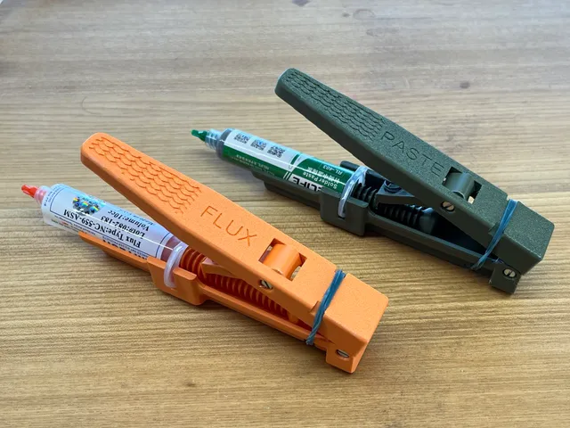</a> 
<b>Flux and Solder Paste Dispenser</b> 
by Elektroarzt 
<a href="https://www.printables.com/model/521761-flux-and-solder-paste-dispenser">Printables</a> &middot; <a href="soldering/paste-flux/Flux%20and%20Solder%20Paste%20Dispenser">Repo folder</a>
</td>
<td width="33%" align="center" valign="top">
<a href="soldering/paste-flux/Gun_for_flux_or_solder_paste">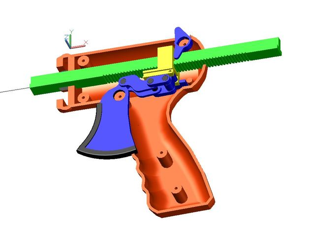</a> 
<b>Gun for flux or solder paste</b> 
by Lexoy48 
<a href="https://www.thingiverse.com/thing:2258662">Thingiverse</a> &middot; <a href="soldering/paste-flux/Gun_for_flux_or_solder_paste">Repo folder</a>
</td>
</tr>
<tr>
<td width="33%" align="center" valign="top">
<a href="soldering/paste-flux/Gun_for_flux_or_solder_paste_ver3">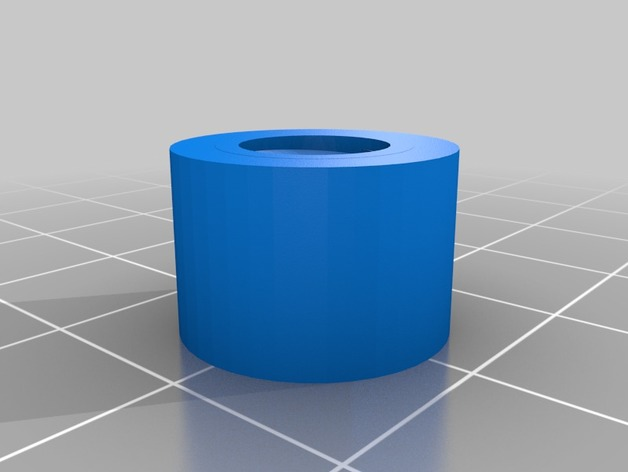</a> 
<b>Gun for flux or solder paste (ver3)</b> 
by Lexoy48 
<a href="https://www.thingiverse.com/thing:2722387">Thingiverse</a> &middot; <a href="soldering/paste-flux/Gun_for_flux_or_solder_paste_ver3">Repo folder</a>
</td>
<td width="33%" align="center" valign="top">
 
<b>Injection Plunger for Soldering Flux Syringe</b> 
by 0scar 
<a href="https://www.thingiverse.com/thing:2461265">Thingiverse</a> &middot; <a href="soldering/paste-flux/Injection_Plunger_for_Soldering_Flux_Syringe">Repo folder</a>
</td>
<td width="33%" align="center" valign="top">
 
<b>Solder Paste and Flux Dispenser</b> 
by chrisebryan 
<a href="https://www.printables.com/model/315615-solder-paste-and-flux-dispenser">Printables</a> &middot; <a href="soldering/paste-flux/Solder_paste_and_flux_dispenser">Repo folder</a>
</td>
</tr>
<tr>
<td width="33%" align="center" valign="top">
 
<b>Solderpaste And Flux Gun</b> 
by 8orge 
<a href="https://www.thingiverse.com/thing:3142361">Thingiverse</a> &middot; <a href="soldering/paste-flux/Solderpaste_And_Flux_Gun">Repo folder</a>
</td>
</tr>
</table>

Other files in this folder (1)

- [needle-syringe-caps-model_files.zip](soldering/paste-flux/needle-syringe-caps-model_files.zip)

## Soldering / Pcb Holders

<table>
<tr>
<td width="33%" align="center" valign="top">
 
<b>2040 Base PCB/Wire Holder Tool Set</b> 
by sulli18 
<a href="https://www.printables.com/model/820015-2040-base-pcbwire-holder-tool-set">Printables</a> &middot; <a href="soldering/pcb-holders/2040-base-pcbwire-holder-tool-set-model_files">Repo folder</a>
</td>
<td width="33%" align="center" valign="top">
 
<b>Locking ball and socket arm</b> 
by Alex R 
<a href="https://www.printables.com/model/7927-locking-ball-and-socket-arm">Printables</a> &middot; <a href="soldering/pcb-holders/locking-ball-and-socket-arm-model_files">Repo folder</a>
</td>
<td width="33%" align="center" valign="top">
 
<b>Magnetic PCB Holder</b> 
by sneakypoo 
<a href="https://www.thingiverse.com/thing:39519">Thingiverse</a> &middot; <a href="soldering/pcb-holders/Magnetic_PCB_Holder">Repo folder</a>
</td>
</tr>
<tr>
<td width="33%" align="center" valign="top">
 
<b>My Customized Rubber Band PCB Vice</b> 
by 416rhinoceros 
<a href="https://www.thingiverse.com/thing:3647990">Thingiverse</a> &middot; <a href="soldering/pcb-holders/My_Customized_Rubber_Band_PCB_Vice">Repo folder</a>
</td>
<td width="33%" align="center" valign="top">
 
<b>Parametric, stackable PCB standoffs (M2-M14 holes)</b> 
by bw3dp 
<a href="https://www.printables.com/model/740818-parametric-stackable-pcb-standoffs-m2-m14-holes">Printables</a> &middot; <a href="soldering/pcb-holders/parametric-stackable-pcb-standoffs-m2-m14-holes">Repo folder</a>
</td>
<td width="33%" align="center" valign="top">
 
<b>PCB Holder</b> 
by Branez 
<a href="https://www.thingiverse.com/thing:1396013">Thingiverse</a> &middot; <a href="soldering/pcb-holders/PCB_Holder">Repo folder</a>
</td>
</tr>
<tr>
<td width="33%" align="center" valign="top">
 
<b>PCB Workstation with Articulated Arms</b> 
by giufini 
<a href="https://www.thingiverse.com/thing:801279">Thingiverse</a> &middot; <a href="soldering/pcb-holders/PCB_Workstation_with_Articulated_Arms">Repo folder</a>
</td>
<td width="33%" align="center" valign="top">
 
<b>PCB Workstation with Nano-Probes</b> 
by giufini 
<a href="https://www.printables.com/model/351270-pcb-workstation-with-nano-probes">Printables</a> &middot; <a href="soldering/pcb-holders/pcb-workstation-with-nano-probes-model_files">Repo folder</a>
</td>
<td width="33%" align="center" valign="top">
 
<b>Rubber Band PCB Vice</b> 
by MS3FGX 
<a href="https://www.thingiverse.com/thing:2759522">Thingiverse</a> &middot; <a href="soldering/pcb-holders/Rubber_Band_PCB_Vice">Repo folder</a>
</td>
</tr>
</table>

Other files in this folder (1)

- [pcb-solder-fren-model_files.zip](soldering/pcb-holders/pcb-solder-fren-model_files.zip)

## Soldering / Pick N Place

<table>
<tr>
<td width="33%" align="center" valign="top">
 
<b>Manual DIY SMD Pick &amp; Place for desktop</b> 
by pcharvet 
<a href="https://www.thingiverse.com/thing:2815833">Thingiverse</a> &middot; <a href="soldering/pick-n-place/Manual%20DIY%20SMD%20Pick%20%26%20Place%20for%20desktop%20-%202815833">Repo folder</a>
</td>
<td width="33%" align="center" valign="top">
 
<b>Manual SMT Pick&amp;Place Machine</b> 
by lorinczroby 
<a href="https://www.thingiverse.com/thing:3644398">Thingiverse</a> &middot; <a href="soldering/pick-n-place/Manual%20SMT%20Pick%26Place%20Machine%20-%203644398%20-%20part%201%20of%202">Repo folder</a>
</td>
<td width="33%" align="center" valign="top">
 
<b>Modular SMD feeders</b> 
by stanoba 
<a href="https://www.thingiverse.com/thing:2414955">Thingiverse</a> &middot; <a href="soldering/pick-n-place/Modular%20SMD%20feeders%20-%202414955">Repo folder</a>
</td>
</tr>
<tr>
<td width="33%" align="center" valign="top">
 
<b>Vacuum Pickup Tool</b> 
by Dimwit-Dave 
<a href="https://www.thingiverse.com/thing:3052109">Thingiverse</a> &middot; <a href="soldering/pick-n-place/Vacuum%20Pickup%20Tool%20-%203052109">Repo folder</a>
</td>
</tr>
</table>

## Soldering / Smd Tools

<table>
<tr>
<td width="33%" align="center" valign="top">
 
<b>SMD Jig</b> 
by Nomis36 
<a href="https://www.thingiverse.com/thing:2677800">Thingiverse</a> &middot; <a href="soldering/smd-tools/SMD_Jig">Repo folder</a>
</td>
<td width="33%" align="center" valign="top">
 
<b>SMD Part Flipper</b> 
by Wiles 
<a href="https://www.thingiverse.com/thing:2486949">Thingiverse</a> &middot; <a href="soldering/smd-tools/SMD_Part_Flipper">Repo folder</a>
</td>
<td width="33%" align="center" valign="top">
 
<b>SMD solder holder</b> 
by mmalcek 
<a href="https://www.thingiverse.com/thing:1718197">Thingiverse</a> &middot; <a href="soldering/smd-tools/SMD_solder_holder">Repo folder</a>
</td>
</tr>
<tr>
<td width="33%" align="center" valign="top">
<i>no preview</i> 
<b>SMD Soldering assistant</b> 
by telboy2002 
<a href="https://www.thingiverse.com/thing:2835634">Thingiverse</a> &middot; <a href="soldering/smd-tools/SMD_Soldering_assistant">Repo folder</a>
</td>
<td width="33%" align="center" valign="top">
 
<b>SMD soldering clamp</b> 
by demenev 
<a href="https://www.thingiverse.com/thing:2900194">Thingiverse</a> &middot; <a href="soldering/smd-tools/SMD_soldering_clamp">Repo folder</a>
</td>
<td width="33%" align="center" valign="top">
<i>no preview</i> 
<b>SMD soldering long clamp</b> 
by TK_DESIGN 
<a href="https://www.thingiverse.com/thing:3386223">Thingiverse</a> &middot; <a href="soldering/smd-tools/SMD_soldering_long_clamp">Repo folder</a>
</td>
</tr>
<tr>
<td width="33%" align="center" valign="top">
 
<b>Soldering Fingers</b> 
by mistertech 
<a href="https://www.thingiverse.com/thing:1725308">Thingiverse</a> &middot; <a href="soldering/smd-tools/Soldering_Fingers">Repo folder</a>
</td>
</tr>
</table>

Other files in this folder (1)

- [din-mount-smd-dispenser-system-model_files.zip](soldering/smd-tools/din-mount-smd-dispenser-system-model_files.zip)

## Soldering / Testing

<table>
<tr>
<td width="33%" align="center" valign="top">
 
<b>Magnetic Precise PCB Probing</b> 
by Perinski 
<a href="https://www.thingiverse.com/thing:5815001">Thingiverse</a> &middot; <a href="soldering/testing/Magnetic%20Precise%20PCB%20Probing%20-%205815001">Repo folder</a>
</td>
<td width="33%" align="center" valign="top">
 
<b>PCB Probes</b> 
by DrTomFlint 
<a href="https://www.printables.com/model/821263-pcb-probes">Printables</a> &middot; <a href="soldering/testing/pcb-probes-model_files">Repo folder</a>
</td>
<td width="33%" align="center" valign="top">
 
<b>PCB Workstation Kit V1 with Micro Needle Probes</b> 
by giufini 
<a href="https://www.printables.com/model/414086-pcb-workstation-kit-v1-with-micro-needle-probes">Printables</a> &middot; <a href="soldering/testing/pcb-workstation-kit-v1-with-micro-needle-probes-mo">Repo folder</a>
</td>
</tr>
</table>

## Soldering / Tool Storage

<table>
<tr>
<td width="33%" align="center" valign="top">
 
<b>Large soldering tool holder</b> 
by Brubacker 
<a href="https://www.thingiverse.com/thing:1436727">Thingiverse</a> &middot; <a href="soldering/tool-storage/Large_soldering_tool_holder">Repo folder</a>
</td>
<td width="33%" align="center" valign="top">
 
<b>Multipart Pinecil Case</b> 
by Pjotrke 
<a href="https://www.thingiverse.com/thing:5186002">Thingiverse</a> &middot; <a href="soldering/tool-storage/Multipart_Pinecil_Case_5186002">Repo folder</a>
</td>
<td width="33%" align="center" valign="top">
<i>no preview</i> 
<b>Pinecil Bento - Base</b> 
<a href="https://makerworld.com/en/search/models?keyword=Pinecil%20Bento%20-%20Base">Search MakerWorld</a> &middot; <a href="soldering/tool-storage/Pinecil%2BBento%2B-%2BBase_stls">Repo folder</a>
</td>
</tr>
<tr>
<td width="33%" align="center" valign="top">
<i>no preview</i> 
<b>Pinecil Bento - Desoldering</b> 
<a href="https://makerworld.com/en/search/models?keyword=Pinecil%20Bento%20-%20Desoldering">Search MakerWorld</a> &middot; <a href="soldering/tool-storage/Pinecil%2BBento%2B-%2BDesoldering_stls">Repo folder</a>
</td>
<td width="33%" align="center" valign="top">
<i>no preview</i> 
<b>Pinecil Ts100 Ts101 Ts80 Ts80p Case With Options Stand Solder Reel Storage Box</b> 
<a href="https://www.printables.com/model/237958">Printables</a> &middot; <a href="soldering/tool-storage/pinecil-ts100-ts101-ts80-ts80p-case-with-options-stand-solder-reel-storage-box-model_files">Repo folder</a>
</td>
<td width="33%" align="center" valign="top">
 
<b>Soldering stand</b> 
by jarano 
<a href="https://www.thingiverse.com/thing:2806028">Thingiverse</a> &middot; <a href="soldering/tool-storage/Soldering_stand">Repo folder</a>
</td>
</tr>
<tr>
<td width="33%" align="center" valign="top">
 
<b>SOLDERING STATION MOUN TOOLS</b> 
by infectedfpv26 
<a href="https://www.thingiverse.com/thing:2644095">Thingiverse</a> &middot; <a href="soldering/tool-storage/SOLDERING_STATION_MOUN_TOOLS">Repo folder</a>
</td>
</tr>
</table>

## Soldering / Wire Holder

<table>
<tr>
<td width="33%" align="center" valign="top">
 
<b>Infinity Spool Holders - Stackable Storage Containers - Wire, Solder, Ribbon</b> 
by DesignCraft 
<a href="https://www.printables.com/model/744351-infinity-spool-holders-stackable-storage-container">Printables</a> &middot; <a href="soldering/wire-holder/infinity-spool-holders-stackable-storage-containers-wire-solder-ribbon-model_files">Repo folder</a>
</td>
<td width="33%" align="center" valign="top">
<i>no preview</i> 
<b>Modular wire spool holder with anti-retract</b> 
<a href="https://makerworld.com/en/search/models?keyword=Modular%20wire%20spool%20holder%20with%20anti-retract">Search MakerWorld</a> &middot; <a href="soldering/wire-holder/Modular%2Bwire%2Bspool%2Bholder%2Bwith%2Banti-retract">Repo folder</a>
</td>
<td width="33%" align="center" valign="top">
 
<b>Modular wire spool stack</b> 
by Noclafasm 
<a href="https://www.printables.com/model/740481-modular-wire-spool-stack">Printables</a> &middot; <a href="soldering/wire-holder/modular-wire-spool-stack-model_files">Repo folder</a>
</td>
</tr>
</table>

Other files in this folder (1)

- [Solder_Cableholder_1203831.zip](soldering/wire-holder/Solder_Cableholder_1203831.zip)

## Test Equipment

<table>
<tr>
<td width="33%" align="center" valign="top">
 
<b>Case for DSO138 - Remixed to fit new PCB mounting hole pattern</b> 
by Easybotics 
<a href="https://www.thingiverse.com/thing:1202909">Thingiverse</a> &middot; <a href="test-equipment/Case_for_DSO138_-_Remixed_to_fit_new_PCB_mounting_hole_pattern">Repo folder</a>
</td>
<td width="33%" align="center" valign="top">
 
<b>Desktop Power Supply</b> 
by Patric 
<a href="https://www.printables.com/model/668264-desktop-power-supply">Printables</a> &middot; <a href="test-equipment/desktop-power-supply-model_files">Repo folder</a>
</td>
<td width="33%" align="center" valign="top">
<i>no preview</i> 
<b>Mcu Programming Jig</b> 
Source unknown &middot; <a href="test-equipment/Mcu_Programming_Jig">Repo folder</a>
</td>
</tr>
<tr>
<td width="33%" align="center" valign="top">
 
<b>Multimeter / Oscilloscope probe Holder</b> 
by calatrabamix 
<a href="https://www.thingiverse.com/thing:1188427">Thingiverse</a> &middot; <a href="test-equipment/Multimeter___Oscilloscope_probe_Holder">Repo folder</a>
</td>
<td width="33%" align="center" valign="top">
 
<b>Multimeter Pegboard Holder</b> 
by DAVE42 
<a href="https://www.thingiverse.com/thing:2529844">Thingiverse</a> &middot; <a href="test-equipment/Multimeter_Pegboard_Holder">Repo folder</a>
</td>
<td width="33%" align="center" valign="top">
 
<b>Parametric Probe Holder</b> 
by billgertz 
<a href="https://www.thingiverse.com/thing:1134586">Thingiverse</a> &middot; <a href="test-equipment/Parametric_Probe_Holder">Repo folder</a>
</td>
</tr>
<tr>
<td width="33%" align="center" valign="top">
 
<b>Peg board Multimeter Holder</b> 
by jww 
<a href="https://www.thingiverse.com/thing:2024376">Thingiverse</a> &middot; <a href="test-equipment/Peg_board_Multimeter_Holder">Repo folder</a>
</td>
<td width="33%" align="center" valign="top">
<i>no preview</i> 
<b>Pogo Pin Charging Dock</b> 
Source unknown &middot; <a href="test-equipment/Pogo_Pin_Charging_Dock">Repo folder</a>
</td>
<td width="33%" align="center" valign="top">
 
<b>RIGOL DS1054Z Oscilloscope Stand with Probe Holder</b> 
by sb43201 
<a href="https://www.thingiverse.com/thing:2127891">Thingiverse</a> &middot; <a href="test-equipment/RIGOL_DS1054Z_Oscilloscope_Stand_with_Probe_Holder">Repo folder</a>
</td>
</tr>
<tr>
<td width="33%" align="center" valign="top">
 
<b>Simple PCB probe holder</b> 
by bw3dp 
<a href="https://www.printables.com/model/740859-simple-pcb-probe-holder">Printables</a> &middot; <a href="test-equipment/simple-pcb-probe-holder-model_files">Repo folder</a>
</td>
<td width="33%" align="center" valign="top">
 
<b>Small Cabinet Base and Drawers for PinePower Power Supply/Charger</b> 
by EvanBarnes 
<a href="https://www.printables.com/model/426768-small-cabinet-base-and-drawers-for-pinepower-power">Printables</a> &middot; <a href="test-equipment/small-cabinet-base-and-drawers-for-pinepower-power-supplycharger-model_files">Repo folder</a>
</td>
<td width="33%" align="center" valign="top">
<i>no preview</i> 
<b>Test Probe Haqnger -- Improved Slightly</b> 
Source unknown &middot; <a href="test-equipment/Test_Probe_Haqnger_--_Improved_Slightly">Repo folder</a>
</td>
</tr>
</table>

