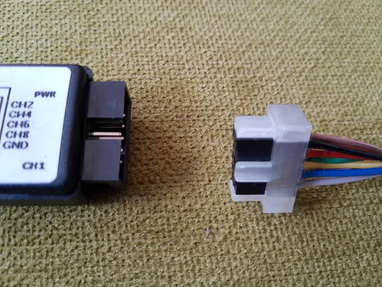
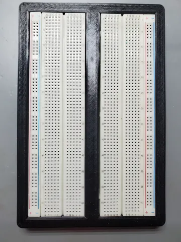
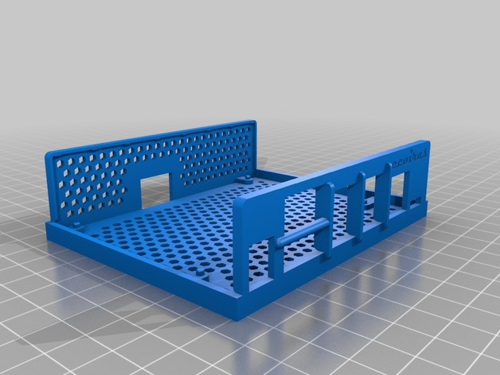
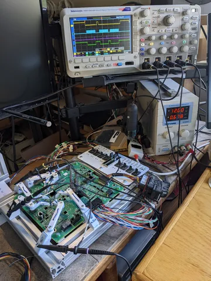
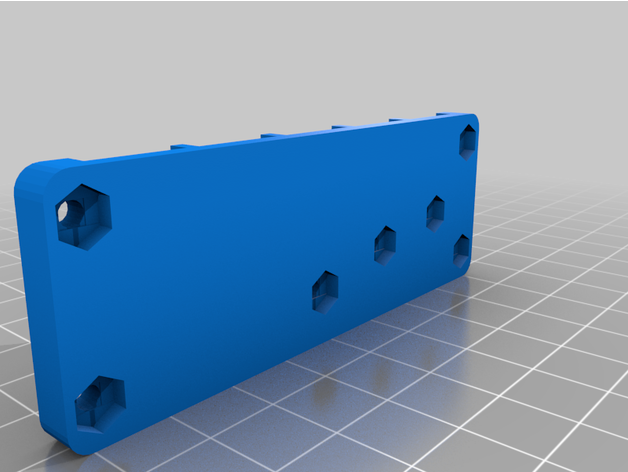

# Dev Board Accessories

<!-- Generated by scripts/Update-Readmes.ps1 (Linux: scripts/update_readmes.py) - edit scripts/readme-sources.json and rerun instead of editing by hand. -->

[Home](../../README.md) / [Electrical](../README.md) / **Dev Board Accessories**

8 builds &middot; 3 Printables &middot; 4 Thingiverse &middot; 1 unknown source &middot; 1 collections (29 more builds)

## Collections

- [Din Mounts](din-mounts/README.md) - 29 builds

## Dev Board Accessories

<table>
<tr>
<td width="33%" align="center" valign="top">
 
<b>2.54mm pin uniter (2x5 pin) e.g. for logic analyzer</b> 
by Simon 
<a href="https://www.printables.com/model/62446-254mm-pin-uniter-2x5-pin-eg-for-logic-analyzer">Printables</a> &middot; <a href="254mm-pin-uniter-2x5-pin-eg-for-logic-analyzer-model_files">Repo folder</a>
</td>
<td width="33%" align="center" valign="top">
 
<b>Breadboard Spring Vise for Arduino or Raspberry Pi</b> 
by patshead 
<a href="https://www.thingiverse.com/thing:957376">Thingiverse</a> &middot; <a href="Breadboard%20Spring%20Vise%20for%20Arduino%20or%20Raspberry%20Pi%20-%20957376">Repo folder</a>
</td>
<td width="33%" align="center" valign="top">
 
<b>ESP32 Breadboard</b> 
by UilHurtUrself 
<a href="https://www.printables.com/model/412644-esp32-breadboard">Printables</a> &middot; <a href="esp32-breadboard-model_files">Repo folder</a>
</td>
</tr>
<tr>
<td width="33%" align="center" valign="top">
 
<b>Jetson Nano Case</b> 
by ecoiras 
<a href="https://www.thingiverse.com/thing:3518410">Thingiverse</a> &middot; <a href="nvidia_jetson_nano_case">Repo folder</a>
</td>
<td width="33%" align="center" valign="top">
 
<b>PCB Probes</b> 
by DrTomFlint 
<a href="https://www.printables.com/model/821263-pcb-probes">Printables</a> &middot; <a href="pcb-probes-model_files">Repo folder</a>
</td>
<td width="33%" align="center" valign="top">
 
<b>Pin Header Break Away Tool</b> 
by arturo182 
<a href="https://www.thingiverse.com/thing:4879426">Thingiverse</a> &middot; <a href="Pin_Header_Break_Away_Tool_4879426">Repo folder</a>
</td>
</tr>
<tr>
<td width="33%" align="center" valign="top">
 
<b>Vertical Laboratory</b> 
by JesusGomez 
<a href="https://www.thingiverse.com/thing:2734975">Thingiverse</a> &middot; <a href="Vertical%20Laboratory%20-%202734975">Repo folder</a>
</td>
</tr>
</table>

Other files in this folder (1)

- [base 1660-1 3dp.stl](base%201660-1%203dp.stl)

