# Din Mounts

<!-- Generated by scripts/Update-Readmes.ps1 (Linux: scripts/update_readmes.py) - edit scripts/readme-sources.json and rerun instead of editing by hand. -->

[Home](../../../README.md) / [Electrical](../../README.md) / [Dev Board Accessories](../README.md) / **Din Mounts**

29 builds &middot; 16 Printables &middot; 2 Thingiverse &middot; 11 unknown source

## Din Mounts

<table>
<tr>
<td width="33%" align="center" valign="top">
<a href="arduino-nano-screw-terminal-din-rail-mount-model_files">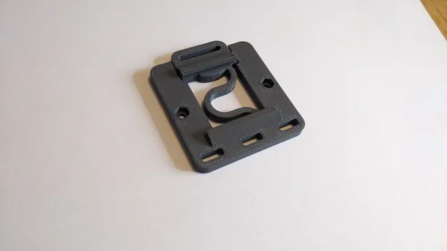</a> 
<b>Arduino Nano  Screw Terminal DIN Rail mount</b> 
by MadHulk 
<a href="https://www.printables.com/model/401952-arduino-nano-screw-terminal-din-rail-mount">Printables</a> &middot; <a href="arduino-nano-screw-terminal-din-rail-mount-model_files">Repo folder</a>
</td>
<td width="33%" align="center" valign="top">
<i>no preview</i> 
<b>Din Mounts (files)</b> 
Source unknown &middot; <a href="files">Repo folder</a>
</td>
<td width="33%" align="center" valign="top">
<a href="din-rail-35mm-prototyp-rack-carrier-model_files">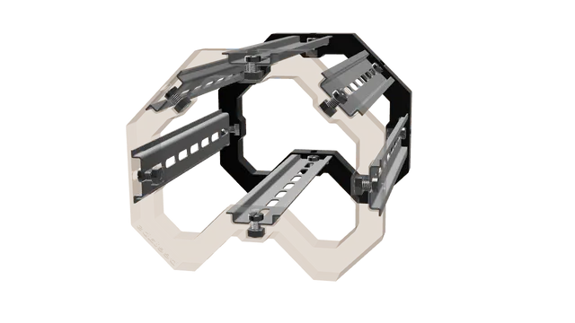</a> 
<b>DIN Rail - 35mm - Prototyp Rack / Carrier</b> 
by hakan.g 
<a href="https://www.printables.com/model/222042-din-rail-35mm-prototyp-rack-carrier">Printables</a> &middot; <a href="din-rail-35mm-prototyp-rack-carrier-model_files">Repo folder</a>
</td>
</tr>
<tr>
<td width="33%" align="center" valign="top">
<a href="din-rail-bracket-heat-insert-version-525mm-625mm-model_files">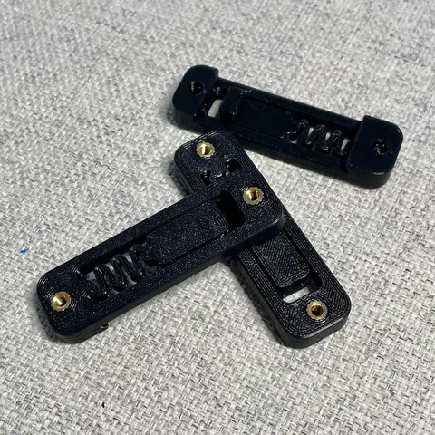</a> 
<b>DIN Rail Bracket - Heat Insert Version - 52.5mm &amp; 62.5mm</b> 
by mmuellerphoto 
<a href="https://www.printables.com/model/420009-din-rail-bracket-heat-insert-version-525mm-625mm">Printables</a> &middot; <a href="din-rail-bracket-heat-insert-version-525mm-625mm-model_files">Repo folder</a>
</td>
<td width="33%" align="center" valign="top">
<a href="din-rail-bracket-m3-inserts-model_files">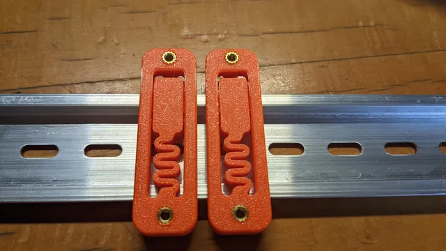</a> 
<b>DIN Rail Bracket M3 inserts</b> 
by m0ep 
<a href="https://www.printables.com/model/208404-din-rail-bracket-m3-inserts">Printables</a> &middot; <a href="din-rail-bracket-m3-inserts-model_files">Repo folder</a>
</td>
<td width="33%" align="center" valign="top">
<a href="din-rail-breadboard-mounts-model_files">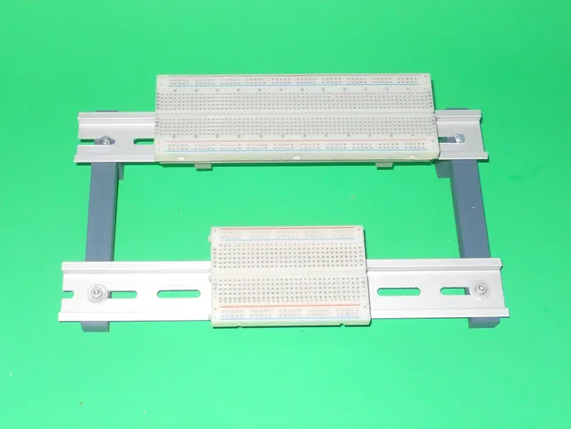</a> 
<b>Din Rail Breadboard Mounts</b> 
by ctheroux 
<a href="https://www.printables.com/model/629343-din-rail-breadboard-mounts">Printables</a> &middot; <a href="din-rail-breadboard-mounts-model_files">Repo folder</a>
</td>
</tr>
<tr>
<td width="33%" align="center" valign="top">
<a href="din-rail-case-for-stm32-nucleo-64-boards-model_files">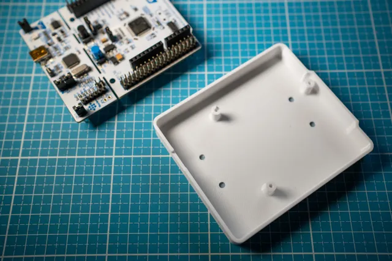</a> 
<b>Din rail case for STM32 Nucleo-64 Boards</b> 
by PlasticXYZ 
<a href="https://www.printables.com/model/161725-din-rail-case-for-stm32-nucleo-64-boards">Printables</a> &middot; <a href="din-rail-case-for-stm32-nucleo-64-boards-model_files">Repo folder</a>
</td>
<td width="33%" align="center" valign="top">
<a href="din-rail-clip-model_files">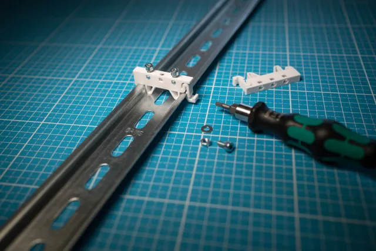</a> 
<b>DIN rail clip</b> 
by PlasticXYZ 
<a href="https://www.printables.com/model/161740-din-rail-clip">Printables</a> &middot; <a href="din-rail-clip-model_files">Repo folder</a>
</td>
<td width="33%" align="center" valign="top">
<a href="din-rail-test-rack-model_files">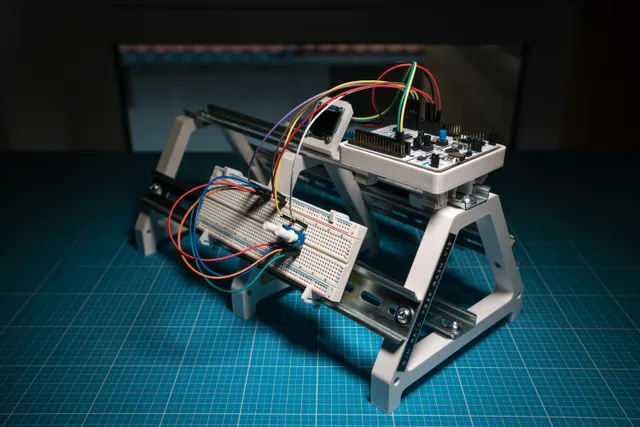</a> 
<b>DIN rail test rack</b> 
by PlasticXYZ 
<a href="https://www.printables.com/model/150786-din-rail-test-rack">Printables</a> &middot; <a href="din-rail-test-rack-model_files">Repo folder</a>
</td>
</tr>
<tr>
<td width="33%" align="center" valign="top">
 
<b>Prototyping Stand</b> 
by sglahn 
<a href="https://www.thingiverse.com/thing:4441453">Thingiverse</a> &middot; <a href="Prototyping%20Stand%20-%204441453">Repo folder</a>
</td>
<td width="33%" align="center" valign="top">
<a href="qwiicplate-din-all-the-things-model_files">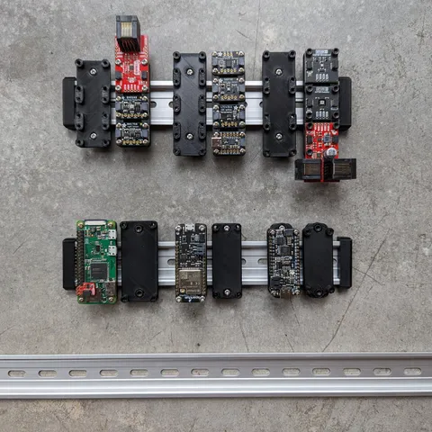</a> 
<b>Qwiicplate - DIN all the Things!</b> 
by herr_brain 
<a href="https://www.printables.com/model/468981-qwiicplate-din-all-the-things">Printables</a> &middot; <a href="qwiicplate-din-all-the-things-model_files">Repo folder</a>
</td>
<td width="33%" align="center" valign="top">
<a href="raspberry-pi-din-rail-case-model_files">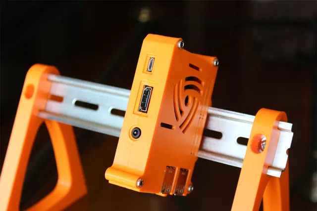</a> 
<b>Raspberry Pi DIN Rail Case</b> 
by mdkendall 
<a href="https://www.printables.com/model/133497-raspberry-pi-din-rail-case">Printables</a> &middot; <a href="raspberry-pi-din-rail-case-model_files">Repo folder</a>
</td>
</tr>
<tr>
<td width="33%" align="center" valign="top">
<a href="Raspberry_Pi_DIN_Rail_Case_2492974">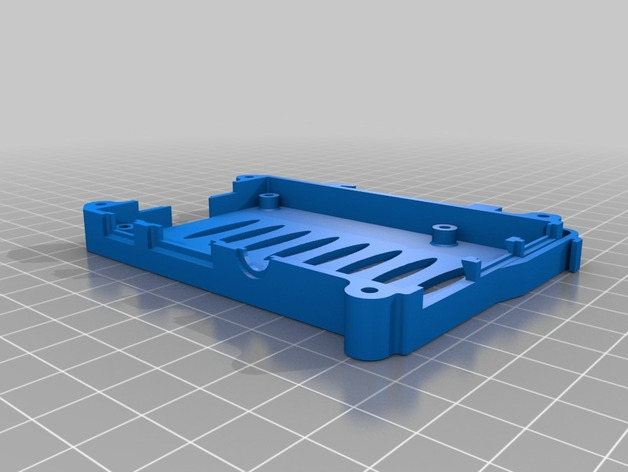</a> 
<b>Raspberry Pi DIN Rail Case</b> 
by mdkendall 
<a href="https://www.thingiverse.com/thing:2492974">Thingiverse</a> &middot; <a href="Raspberry_Pi_DIN_Rail_Case_2492974">Repo folder</a>
</td>
<td width="33%" align="center" valign="top">
<a href="rpidin-model_files">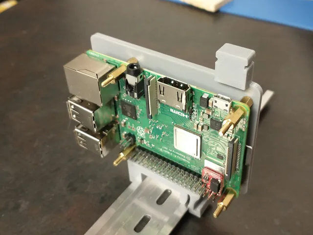</a> 
<b>RPiDIN</b> 
by herr_brain 
<a href="https://www.printables.com/model/65368-rpidin">Printables</a> &middot; <a href="rpidin-model_files">Repo folder</a>
</td>
<td width="33%" align="center" valign="top">
<a href="simple-stm32-nucleo-144-case-model_files">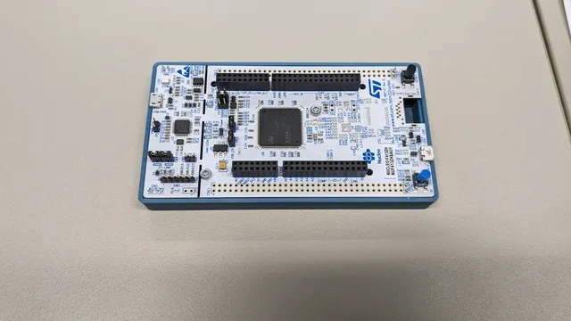</a> 
<b>Simple STM32 Nucleo-144 Case</b> 
by crasbe 
<a href="https://www.printables.com/model/764904-simple-stm32-nucleo-144-case">Printables</a> &middot; <a href="simple-stm32-nucleo-144-case-model_files">Repo folder</a>
</td>
</tr>
<tr>
<td width="33%" align="center" valign="top">
<a href="universal-pcb-dindesktop-adjustable-holder-model_files">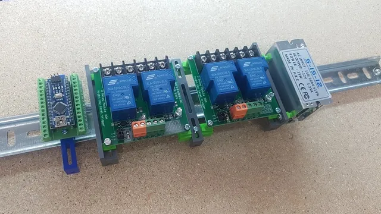</a> 
<b>Universal PCB DIN/Desktop adjustable holder</b> 
by ICT Avatar 
<a href="https://www.printables.com/model/55644-universal-pcb-dindesktop-adjustable-holder">Printables</a> &middot; <a href="universal-pcb-dindesktop-adjustable-holder-model_files">Repo folder</a>
</td>
<td width="33%" align="center" valign="top">
<a href="wago-221-415-mount-for-din-rail-bracket-model_files">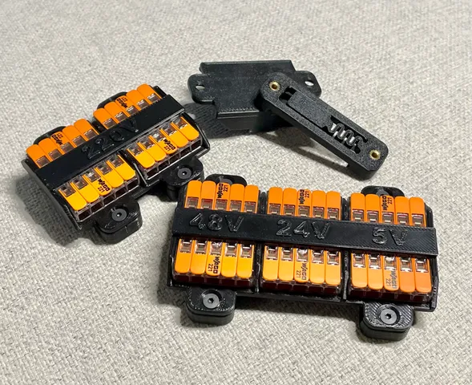</a> 
<b>Wago 221-415 Mount for DIN Rail Bracket</b> 
by mmuellerphoto 
<a href="https://www.printables.com/model/420081-wago-221-415-mount-for-din-rail-bracket">Printables</a> &middot; <a href="wago-221-415-mount-for-din-rail-bracket-model_files">Repo folder</a>
</td>
<td width="33%" align="center" valign="top">
<a href="wago-din-rail-mount-model_files">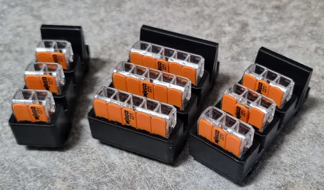</a> 
<b>Wago DIN Rail mount</b> 
by 3D Design SBK 
<a href="https://www.printables.com/model/292540-wago-din-rail-mount">Printables</a> &middot; <a href="wago-din-rail-mount-model_files">Repo folder</a>
</td>
</tr>
<tr>
<td width="33%" align="center" valign="top">
<a href="v3-duff-din-undercarriage-filament-feeder-model_files">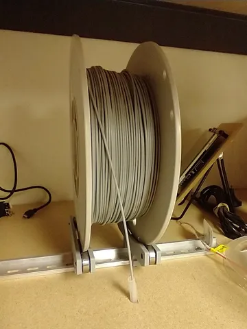</a> 
<b>[v3] DUFF: DIN Undercarriage Filament Feeder</b> 
by herr_brain 
<a href="https://www.printables.com/model/114513-v3-duff-din-undercarriage-filament-feeder">Printables</a> &middot; <a href="v3-duff-din-undercarriage-filament-feeder-model_files">Repo folder</a>
</td>
</tr>
</table>

Other files in this folder (10)

- [3d-din-rail-mount-clip2.scad](3d-din-rail-mount-clip2.scad)
- [3d-din-rail-mount-clip2.stl](3d-din-rail-mount-clip2.stl)
- [arduino UNO din mount.stl](arduino%20UNO%20din%20mount.stl)
- [Arduino_Nano_din_mount.stl](Arduino_Nano_din_mount.stl)
- [DIN Mounts_ Pi, Arduino and disks - 2610621 - part 1 of 2.zip](DIN%20Mounts_%20Pi%2C%20Arduino%20and%20disks%20-%202610621%20-%20part%201%20of%202.zip)
- [DIN Mounts_ Pi, Arduino and disks - 2610621 - part 2 of 2.zip](DIN%20Mounts_%20Pi%2C%20Arduino%20and%20disks%20-%202610621%20-%20part%202%20of%202.zip)
- [din-breadboard-clip.stl](din-breadboard-clip.stl)
- [din-rail-mount-for-nucleo-64-model_files.zip](din-rail-mount-for-nucleo-64-model_files.zip)
- [DIN_Rail_Clip_Universal_opt5 v6.3mf](DIN_Rail_Clip_Universal_opt5%20v6.3mf)
- [Sabrent USB Hub Holder_w_DIN_Holes_Recessed.f3d](Sabrent%20USB%20Hub%20Holder_w_DIN_Holes_Recessed.f3d)

