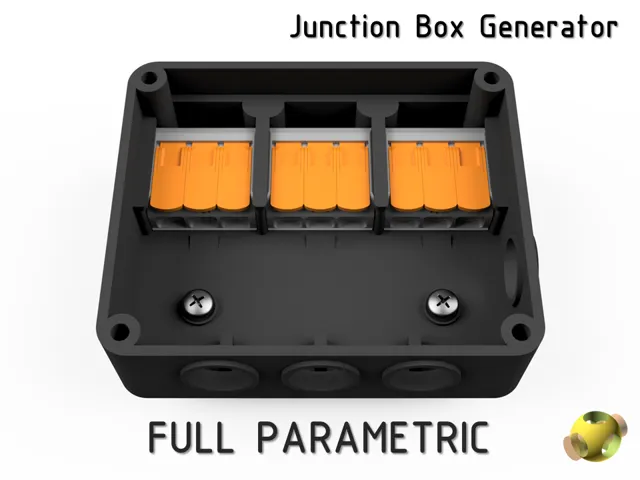

# Junction Boxes

<!-- Generated by scripts/Update-Readmes.ps1 (Linux: scripts/update_readmes.py) - edit scripts/readme-sources.json and rerun instead of editing by hand. -->

[Home](../../README.md) / [Electrical](../README.md) / **Junction Boxes**

2 builds &middot; 2 MakerWorld

## Junction Boxes

<table>
<tr>
<td width="33%" align="center" valign="top">
 
<b>Junction Box Generator</b> 
by Schnitzl 
<a href="https://makerworld.com/en/models/591912-junction-box-generator">MakerWorld</a> &middot; <a href="Junction%2BBox%2BGenerator">Repo folder</a>
</td>
<td width="33%" align="center" valign="top">
<i>no preview</i> 
<b>Junction Box – modular &amp; skalierbar</b> 
<a href="https://makerworld.com/en/search/models?keyword=Junction%20Box%20%E2%80%93%20modular%20%26%20skalierbar">Search MakerWorld</a> &middot; <a href="Junction%20Box%2B%E2%80%93%2Bmodular%2B%26%2Bskalierbar">Repo folder</a>
</td>
</tr>
</table>

