# Mini Rack

<!-- Generated by scripts/Update-Readmes.ps1 (Linux: scripts/update_readmes.py) - edit scripts/readme-sources.json and rerun instead of editing by hand. -->

[Home](../../README.md) / [Electrical](../README.md) / **Mini Rack**

17 builds &middot; 17 MakerWorld

## Mini Rack

<table>
<tr>
<td width="33%" align="center" valign="top">
<i>no preview</i> 
<b>10 Inch Mini Rack Generator</b> 
<a href="https://makerworld.com/en/search/models?keyword=10%20Inch%20Mini%20Rack%20Generator">Search MakerWorld</a> &middot; <a href="10%2BInch%2BMini%2BRack%2BGenerator">Repo folder</a>
</td>
<td width="33%" align="center" valign="top">
<i>no preview</i> 
<b>1U gridfinity draver</b> 
<a href="https://makerworld.com/en/search/models?keyword=1U%20gridfinity%20draver">Search MakerWorld</a> &middot; <a href="1U%2Bgridfinity%2Bdraver_stls">Repo folder</a>
</td>
<td width="33%" align="center" valign="top">
<a href="1U%2C%2B2U%2C%2B3U%2BDrawers%2Band%2BRails%2Bfor%2BKWS%2BRack%2BV.2">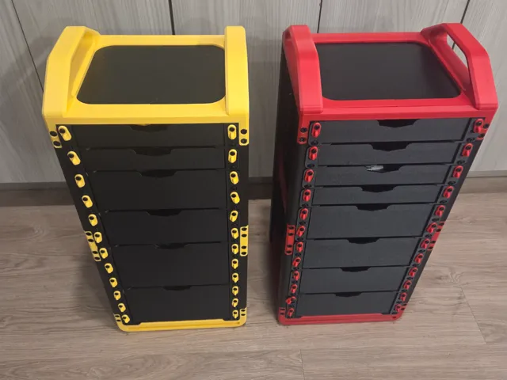</a> 
<b>1U, 2U, 3U Drawers and Rails for KWS Rack V.2</b> 
by usefulhobbies 
<a href="https://makerworld.com/en/models/2837840-1u-2u-3u-drawers-and-rails-for-kws-rack-v-2">MakerWorld</a> &middot; <a href="1U%2C%2B2U%2C%2B3U%2BDrawers%2Band%2BRails%2Bfor%2BKWS%2BRack%2BV.2">Repo folder</a>
</td>
</tr>
<tr>
<td width="33%" align="center" valign="top">
<a href="Customizable%2BRackmount%2B%5BANY%2BRACKSIZE%5D">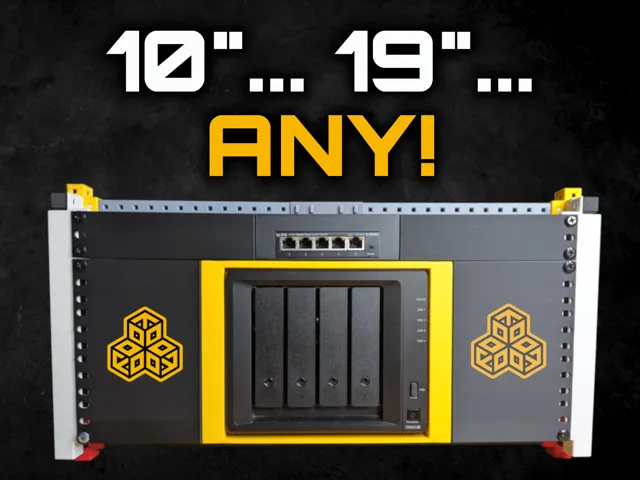</a> 
<b>Customizable Rackmount [ANY RACKSIZE]</b> 
by KellerLab 
<a href="https://makerworld.com/en/models/2128492-customizable-rackmount-any-racksize">MakerWorld</a> &middot; <a href="Customizable%2BRackmount%2B%5BANY%2BRACKSIZE%5D">Repo folder</a>
</td>
<td width="33%" align="center" valign="top">
<a href="Customizable%2Bvent%2B%26%2Bblank%2Bpanels%2Bfor%2B10%2BInch%2BRack">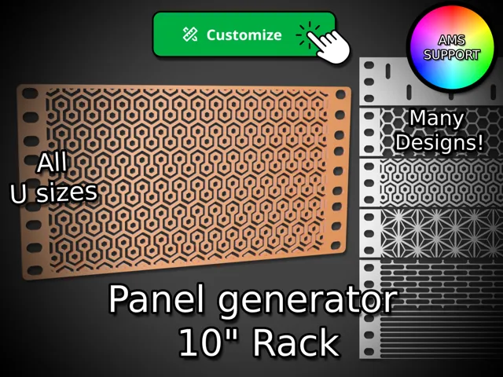</a> 
<b>Customizable vent &amp; blank panels for 10 Inch Rack</b> 
by Kiwiworks 
<a href="https://makerworld.com/en/models/1872040-customizable-vent-blank-panels-for-10-inch-rack">MakerWorld</a> &middot; <a href="Customizable%2Bvent%2B%26%2Bblank%2Bpanels%2Bfor%2B10%2BInch%2BRack">Repo folder</a>
</td>
<td width="33%" align="center" valign="top">
 
<b>HomeRacker - Core</b> 
<a href="https://makerworld.com/en/search/models?keyword=HomeRacker%20-%20Core">Search MakerWorld</a> &middot; <a href="HomeRacker%2B-%2BCore">Repo folder</a>
</td>
</tr>
<tr>
<td width="33%" align="center" valign="top">
<a href="KWS%2BRack%2Bv.2%2B-%2BHeavy%E2%80%91Duty%2B10%E2%80%91Inch%2BHomelab%2BRack">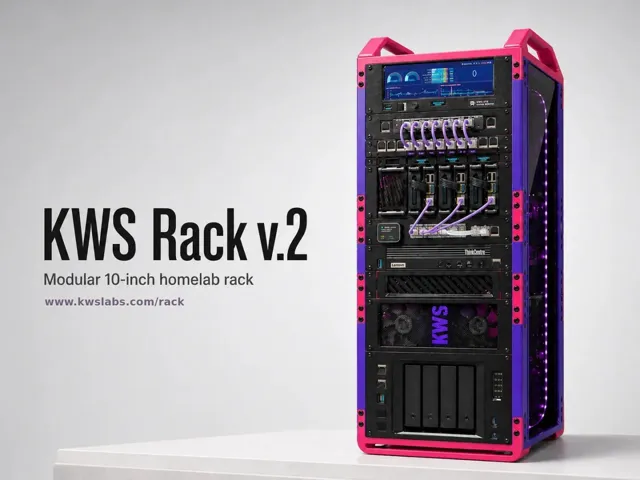</a> 
<b>KWS Rack v.2 - Heavy‑Duty 10‑Inch Homelab Rack</b> 
by Ilan Kushnir 
<a href="https://makerworld.com/en/models/2139130-kws-rack-v-2-heavy-duty-10-inch-homelab-rack">MakerWorld</a> &middot; <a href="KWS%2BRack%2Bv.2%2B-%2BHeavy%E2%80%91Duty%2B10%E2%80%91Inch%2BHomelab%2BRack">Repo folder</a>
</td>
<td width="33%" align="center" valign="top">
<a href="Lab%2BRax%2B1-5U%2BPosts%2B%26%2BPanels">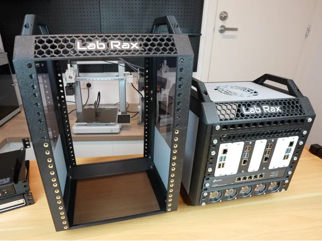</a> 
<b>Lab Rax 1-5U Posts &amp; Panels</b> 
by mklements 
<a href="https://makerworld.com/en/models/1294478-lab-rax-1-5u-posts-panels">MakerWorld</a> &middot; <a href="Lab%2BRax%2B1-5U%2BPosts%2B%26%2BPanels">Repo folder</a>
</td>
<td width="33%" align="center" valign="top">
<a href="Lab%2BRax%2B10_%2BServer%2BRack%2B-%2B5U">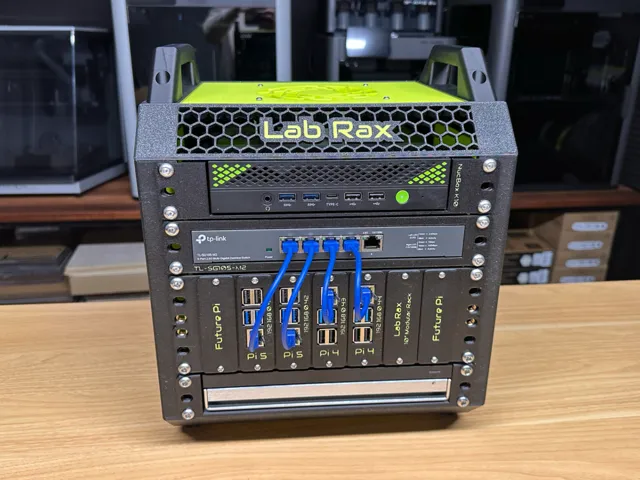</a> 
<b>Lab Rax 10&quot; Server Rack - 5U</b> 
by mklements 
<a href="https://makerworld.com/en/models/1294480-lab-rax-10-server-rack-5u">MakerWorld</a> &middot; <a href="Lab%2BRax%2B10_%2BServer%2BRack%2B-%2B5U">Repo folder</a>
</td>
</tr>
<tr>
<td width="33%" align="center" valign="top">
<a href="Lab%2BRax%2B10_%2BServer%2BRack%2B-%2BBolted%2BVersion%2B-%2B5U">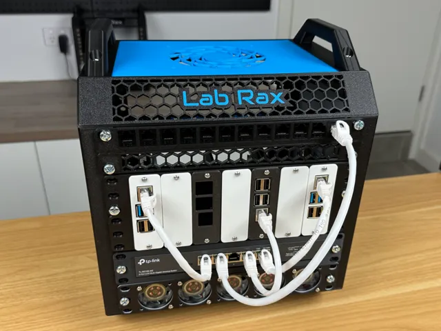</a> 
<b>Lab Rax 10&quot; Server Rack - Bolted Version - 5U</b> 
by mklements 
<a href="https://makerworld.com/en/models/1464819-lab-rax-10-server-rack-bolted-version-5u">MakerWorld</a> &middot; <a href="Lab%2BRax%2B10_%2BServer%2BRack%2B-%2BBolted%2BVersion%2B-%2B5U">Repo folder</a>
</td>
<td width="33%" align="center" valign="top">
<a href="LabRax%2BDIN%2BRail%2BMount">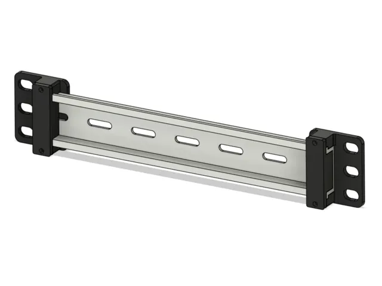</a> 
<b>LabRax DIN Rail Mount</b> 
by Dan Kreisher 
<a href="https://makerworld.com/en/models/3122809-labrax-din-rail-mount">MakerWorld</a> &middot; <a href="LabRax%2BDIN%2BRail%2BMount">Repo folder</a>
</td>
<td width="33%" align="center" valign="top">
<a href="Microlab%2B-%2BMini%2BModular%2BHome%2BServer%2BRack">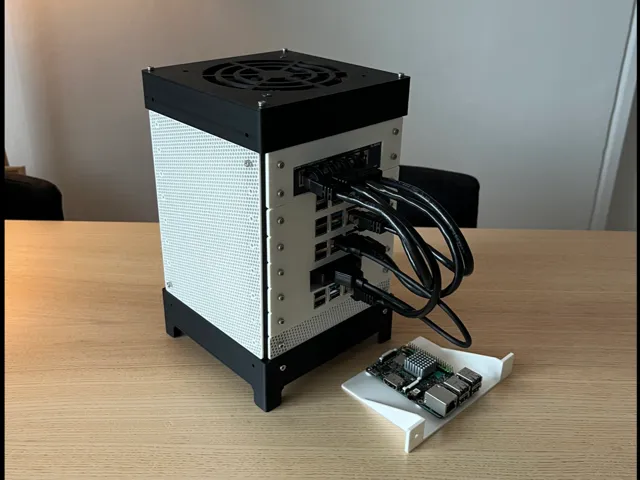</a> 
<b>Microlab - Mini Modular Home Server Rack</b> 
by CB4D 
<a href="https://makerworld.com/en/models/1062225-microlab-mini-modular-home-server-rack">MakerWorld</a> &middot; <a href="Microlab%2B-%2BMini%2BModular%2BHome%2BServer%2BRack">Repo folder</a>
</td>
</tr>
<tr>
<td width="33%" align="center" valign="top">
<a href="Mini%2BLab%2BRax%2B7U%2Brails%2Band%2Bside%2Bpanels">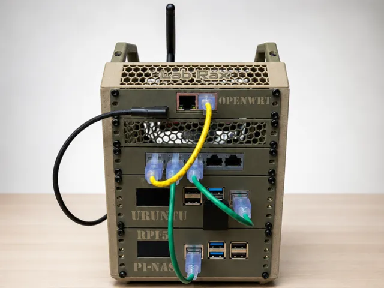</a> 
<b>Mini Lab Rax 7U rails and side panels</b> 
by Tommy_S 
<a href="https://makerworld.com/en/models/2847561-mini-lab-rax-7u-rails-and-side-panels">MakerWorld</a> &middot; <a href="Mini%2BLab%2BRax%2B7U%2Brails%2Band%2Bside%2Bpanels">Repo folder</a>
</td>
<td width="33%" align="center" valign="top">
<a href="Modular%2B10_%2BServer%2BRack">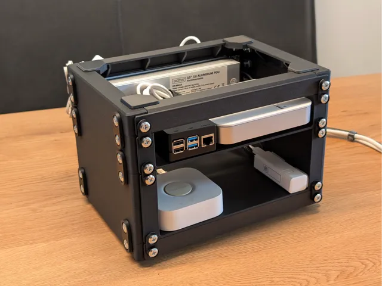</a> 
<b>Modular 10&quot; Server Rack</b> 
by Benjamin Kott 
<a href="https://makerworld.com/en/models/1452571-modular-10-server-rack">MakerWorld</a> &middot; <a href="Modular%2B10_%2BServer%2BRack">Repo folder</a>
</td>
<td width="33%" align="center" valign="top">
<a href="Ocktron%2BCompact%2B10%E2%80%91inch%2BMini%2BRack%2B5U%2Bby%2B6U%2Bby%2B8U">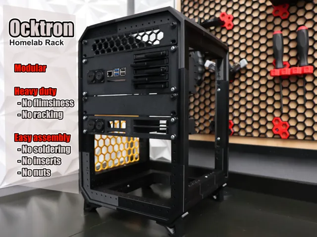</a> 
<b>Ocktron Compact 10‑inch Mini Rack 5U by 6U by 8U</b> 
by Carlos Byte 
<a href="https://makerworld.com/en/models/2021374-ocktron-compact-10-inch-mini-rack-5u-by-6u-by-8u">MakerWorld</a> &middot; <a href="Ocktron%2BCompact%2B10%E2%80%91inch%2BMini%2BRack%2B5U%2Bby%2B6U%2Bby%2B8U">Repo folder</a>
</td>
</tr>
<tr>
<td width="33%" align="center" valign="top">
<a href="OpenRack%2B1U%2B%E2%80%93%2BA%2BModular%2BServer%2BRack%2BSystem">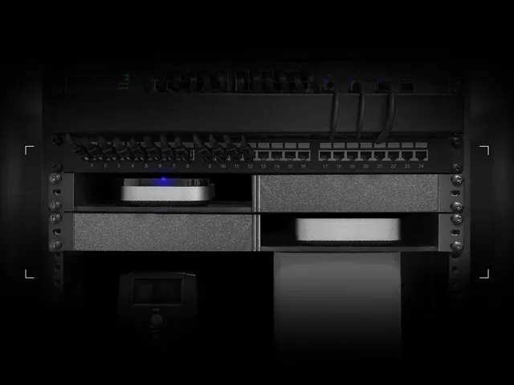</a> 
<b>OpenRack 1U – A Modular Server Rack System</b> 
by Sparco 
<a href="https://makerworld.com/en/models/1032069-openrack-1u-a-modular-server-rack-system">MakerWorld</a> &middot; <a href="OpenRack%2B1U%2B%E2%80%93%2BA%2BModular%2BServer%2BRack%2BSystem">Repo folder</a>
</td>
<td width="33%" align="center" valign="top">
<i>no preview</i> 
<b>Timber Rack</b> 
<a href="https://makerworld.com/en/search/models?keyword=Timber%20Rack">Search MakerWorld</a> &middot; <a href="Timber_Rack_stls">Repo folder</a>
</td>
</tr>
</table>

