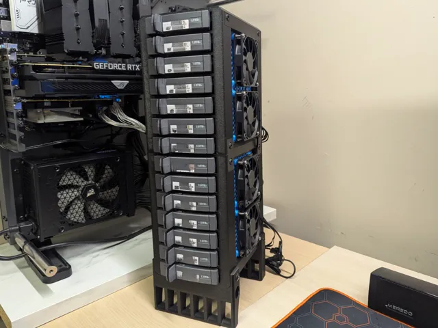
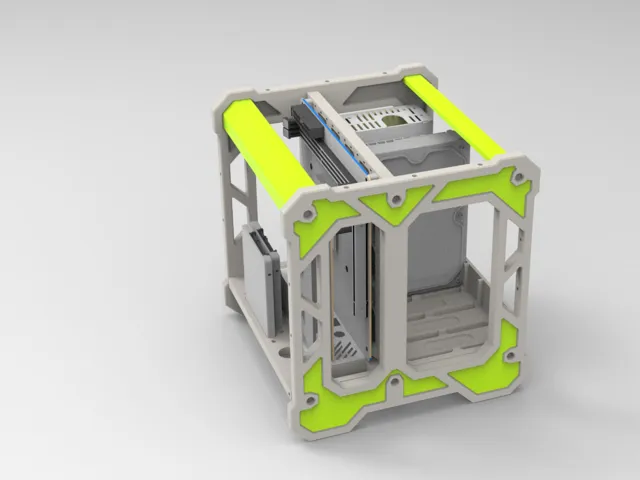
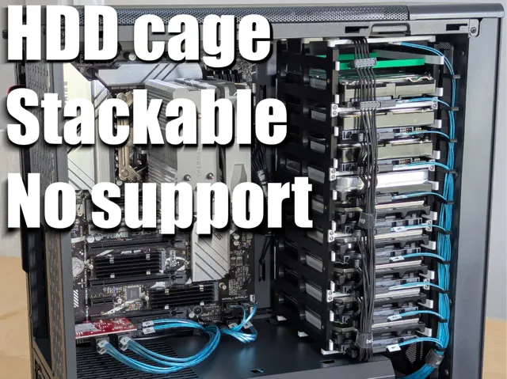
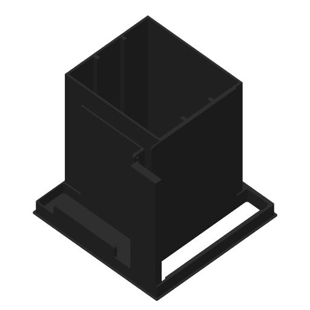

# Nas

<!-- Generated by scripts/Update-Readmes.ps1 (Linux: scripts/update_readmes.py) - edit scripts/readme-sources.json and rerun instead of editing by hand. -->

[Home](../../README.md) / [Electrical](../README.md) / **Nas**

4 builds &middot; 4 MakerWorld

## Nas

<table>
<tr>
<td width="33%" align="center" valign="top">
 
<b>14 bay JBOD / Hard Drive Enclosure</b> 
by eclipse1234 
<a href="https://makerworld.com/en/models/2843117-14-bay-jbod-hard-drive-enclosure">MakerWorld</a> &middot; <a href="14%2Bbay%2BJBOD%2B_%2BHard%2BDrive%2BEnclosure">Repo folder</a>
</td>
<td width="33%" align="center" valign="top">
 
<b>QNAS FRAMEWORK  V1 开放式NAS 适配ITX主板</b> 
by 丫丫赶海 
<a href="https://makerworld.com/en/models/1308857-qnas-framework-v1-open-source-nas-adaptable-itx-mo">MakerWorld</a> &middot; <a href="QNAS%2BFRAMEWORK%2B%2BV1%2B%E5%BC%80%E6%94%BE%E5%BC%8FNAS%2B%E9%80%82%E9%85%8DITX%E4%B8%BB%E6%9D%BF">Repo folder</a>
</td>
<td width="33%" align="center" valign="top">
 
<b>Stackable 3.5&quot; HDD cage for 140mm front fan rails</b> 
by Waarp 
<a href="https://makerworld.com/en/models/2945549-stackable-3-5-hdd-cage-for-140mm-front-fan-rails">MakerWorld</a> &middot; <a href="Stackable%2B3.5_%2BHDD%2Bcage%2Bfor%2B140mm%2Bfront%2Bfan%2Brails">Repo folder</a>
</td>
</tr>
<tr>
<td width="33%" align="center" valign="top">
 
<b>ThinkBox - A Custom 4-Bay SATA SAS HDD NAS</b> 
<a href="https://makerworld.com/en/search/models?keyword=ThinkBox%20-%20A%20Custom%204-Bay%20SATA%20SAS%20HDD%20NAS">Search MakerWorld</a> &middot; <a href="ThinkBox%2B-%2BA%2BCustom%2B4-Bay%2BSATA_SAS%2BHDD%2BNAS">Repo folder</a>
</td>
</tr>
</table>

