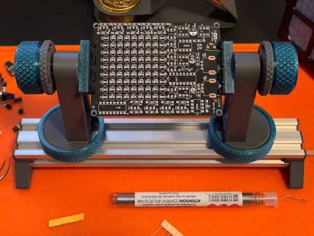
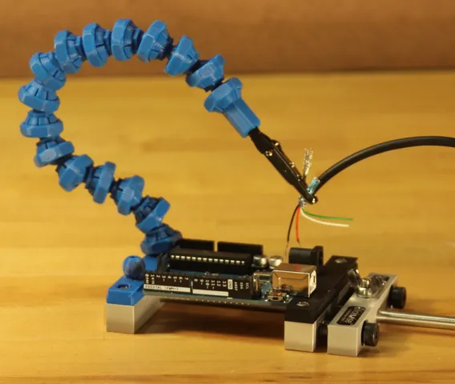
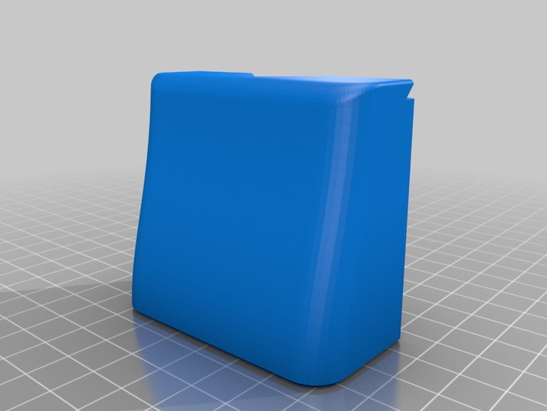
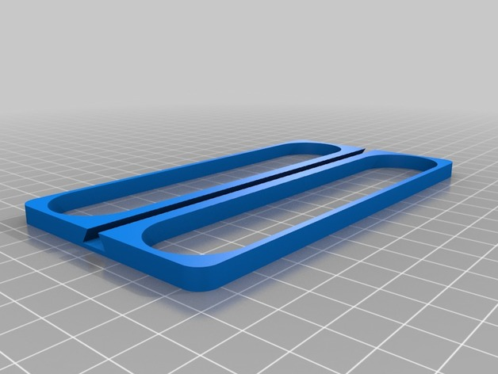
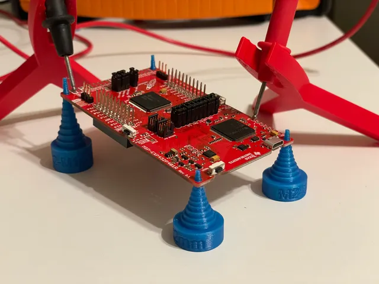
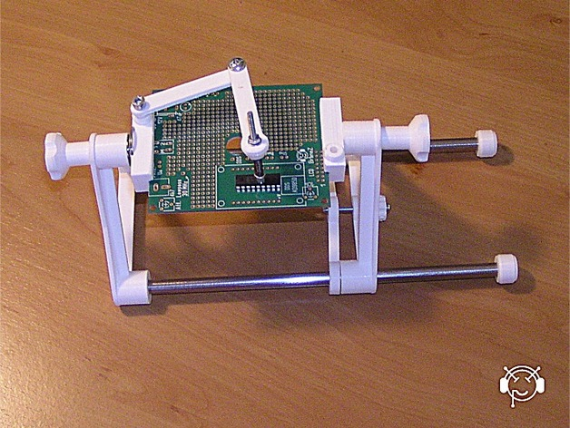
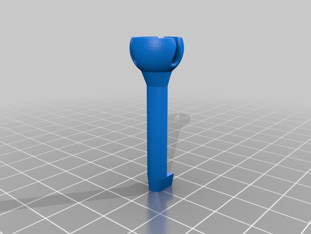
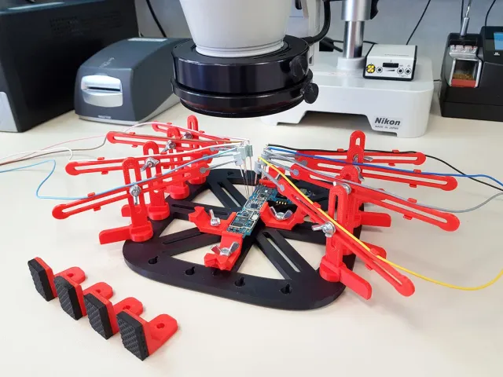
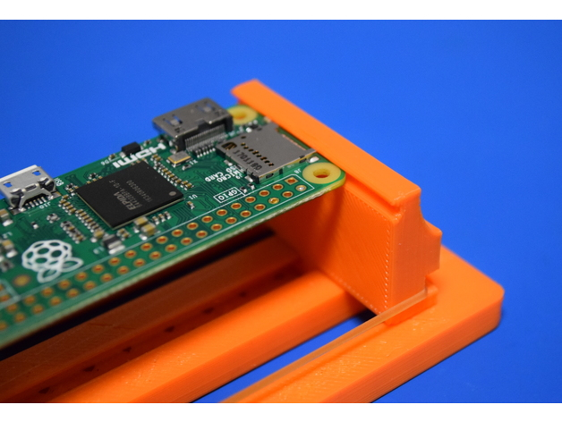

# Pcb Holders

<!-- Generated by scripts/Update-Readmes.ps1 (Linux: scripts/update_readmes.py) - edit scripts/readme-sources.json and rerun instead of editing by hand. -->

[Home](../../../README.md) / [Electrical](../../README.md) / [Soldering](../README.md) / **Pcb Holders**

10 builds &middot; 4 Printables &middot; 5 Thingiverse &middot; 1 unknown source

## Pcb Holders

<table>
<tr>
<td width="33%" align="center" valign="top">
 
<b>2040 Base PCB/Wire Holder Tool Set</b> 
by sulli18 
<a href="https://www.printables.com/model/820015-2040-base-pcbwire-holder-tool-set">Printables</a> &middot; <a href="2040-base-pcbwire-holder-tool-set-model_files">Repo folder</a>
</td>
<td width="33%" align="center" valign="top">
 
<b>Locking ball and socket arm</b> 
by Alex R 
<a href="https://www.printables.com/model/7927-locking-ball-and-socket-arm">Printables</a> &middot; <a href="locking-ball-and-socket-arm-model_files">Repo folder</a>
</td>
<td width="33%" align="center" valign="top">
 
<b>Magnetic PCB Holder</b> 
by sneakypoo 
<a href="https://www.thingiverse.com/thing:39519">Thingiverse</a> &middot; <a href="Magnetic_PCB_Holder">Repo folder</a>
</td>
</tr>
<tr>
<td width="33%" align="center" valign="top">
 
<b>My Customized Rubber Band PCB Vice</b> 
by 416rhinoceros 
<a href="https://www.thingiverse.com/thing:3647990">Thingiverse</a> &middot; <a href="My_Customized_Rubber_Band_PCB_Vice">Repo folder</a>
</td>
<td width="33%" align="center" valign="top">
 
<b>Parametric, stackable PCB standoffs (M2-M14 holes)</b> 
by bw3dp 
<a href="https://www.printables.com/model/740818-parametric-stackable-pcb-standoffs-m2-m14-holes">Printables</a> &middot; <a href="parametric-stackable-pcb-standoffs-m2-m14-holes">Repo folder</a>
</td>
<td width="33%" align="center" valign="top">
 
<b>PCB Holder</b> 
by Branez 
<a href="https://www.thingiverse.com/thing:1396013">Thingiverse</a> &middot; <a href="PCB_Holder">Repo folder</a>
</td>
</tr>
<tr>
<td width="33%" align="center" valign="top">
 
<b>PCB Workstation with Articulated Arms</b> 
by giufini 
<a href="https://www.thingiverse.com/thing:801279">Thingiverse</a> &middot; <a href="PCB_Workstation_with_Articulated_Arms">Repo folder</a>
</td>
<td width="33%" align="center" valign="top">
 
<b>PCB Workstation with Nano-Probes</b> 
by giufini 
<a href="https://www.printables.com/model/351270-pcb-workstation-with-nano-probes">Printables</a> &middot; <a href="pcb-workstation-with-nano-probes-model_files">Repo folder</a>
</td>
<td width="33%" align="center" valign="top">
 
<b>Rubber Band PCB Vice</b> 
by MS3FGX 
<a href="https://www.thingiverse.com/thing:2759522">Thingiverse</a> &middot; <a href="Rubber_Band_PCB_Vice">Repo folder</a>
</td>
</tr>
</table>

Other files in this folder (1)

- [pcb-solder-fren-model_files.zip](pcb-solder-fren-model_files.zip)

