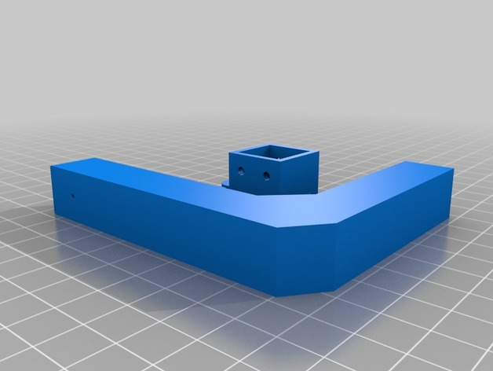
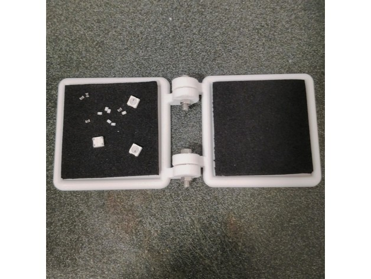
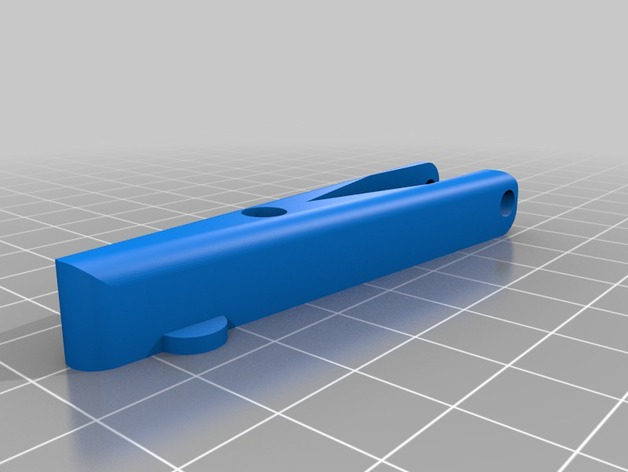
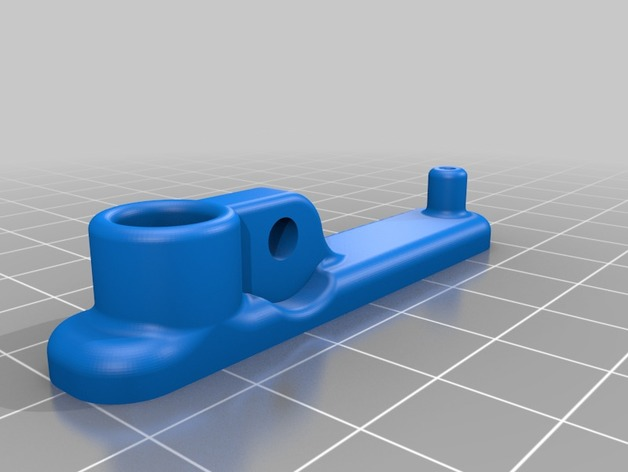
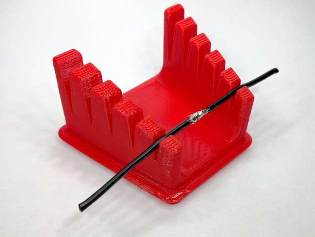

# Smd Tools

<!-- Generated by scripts/Update-Readmes.ps1 (Linux: scripts/update_readmes.py) - edit scripts/readme-sources.json and rerun instead of editing by hand. -->

[Home](../../../README.md) / [Electrical](../../README.md) / [Soldering](../README.md) / **Smd Tools**

8 builds &middot; 7 Thingiverse &middot; 1 unknown source

## Smd Tools

<table>
<tr>
<td width="33%" align="center" valign="top">
 
<b>SMD Jig</b> 
by Nomis36 
<a href="https://www.thingiverse.com/thing:2677800">Thingiverse</a> &middot; <a href="SMD_Jig">Repo folder</a>
</td>
<td width="33%" align="center" valign="top">
 
<b>SMD Part Flipper</b> 
by Wiles 
<a href="https://www.thingiverse.com/thing:2486949">Thingiverse</a> &middot; <a href="SMD_Part_Flipper">Repo folder</a>
</td>
<td width="33%" align="center" valign="top">
 
<b>SMD solder holder</b> 
by mmalcek 
<a href="https://www.thingiverse.com/thing:1718197">Thingiverse</a> &middot; <a href="SMD_solder_holder">Repo folder</a>
</td>
</tr>
<tr>
<td width="33%" align="center" valign="top">
<i>no preview</i> 
<b>SMD Soldering assistant</b> 
by telboy2002 
<a href="https://www.thingiverse.com/thing:2835634">Thingiverse</a> &middot; <a href="SMD_Soldering_assistant">Repo folder</a>
</td>
<td width="33%" align="center" valign="top">
 
<b>SMD soldering clamp</b> 
by demenev 
<a href="https://www.thingiverse.com/thing:2900194">Thingiverse</a> &middot; <a href="SMD_soldering_clamp">Repo folder</a>
</td>
<td width="33%" align="center" valign="top">
<i>no preview</i> 
<b>SMD soldering long clamp</b> 
by TK_DESIGN 
<a href="https://www.thingiverse.com/thing:3386223">Thingiverse</a> &middot; <a href="SMD_soldering_long_clamp">Repo folder</a>
</td>
</tr>
<tr>
<td width="33%" align="center" valign="top">
 
<b>Soldering Fingers</b> 
by mistertech 
<a href="https://www.thingiverse.com/thing:1725308">Thingiverse</a> &middot; <a href="Soldering_Fingers">Repo folder</a>
</td>
</tr>
</table>

Other files in this folder (1)

- [din-mount-smd-dispenser-system-model_files.zip](din-mount-smd-dispenser-system-model_files.zip)

