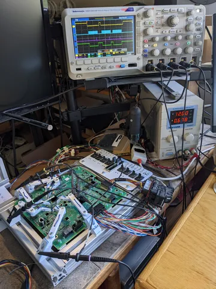
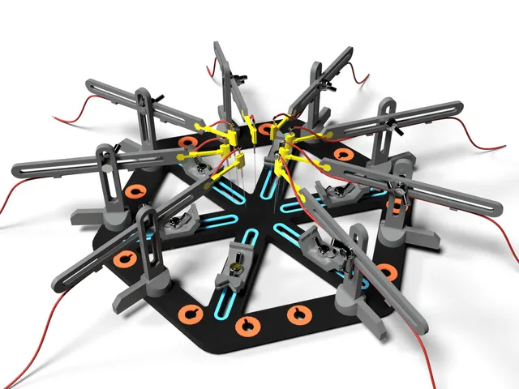

# Testing

<!-- Generated by scripts/Update-Readmes.ps1 (Linux: scripts/update_readmes.py) - edit scripts/readme-sources.json and rerun instead of editing by hand. -->

[Home](../../../README.md) / [Electrical](../../README.md) / [Soldering](../README.md) / **Testing**

3 builds &middot; 2 Printables &middot; 1 Thingiverse

## Testing

<table>
<tr>
<td width="33%" align="center" valign="top">
 
<b>Magnetic Precise PCB Probing</b> 
by Perinski 
<a href="https://www.thingiverse.com/thing:5815001">Thingiverse</a> &middot; <a href="Magnetic%20Precise%20PCB%20Probing%20-%205815001">Repo folder</a>
</td>
<td width="33%" align="center" valign="top">
 
<b>PCB Probes</b> 
by DrTomFlint 
<a href="https://www.printables.com/model/821263-pcb-probes">Printables</a> &middot; <a href="pcb-probes-model_files">Repo folder</a>
</td>
<td width="33%" align="center" valign="top">
 
<b>PCB Workstation Kit V1 with Micro Needle Probes</b> 
by giufini 
<a href="https://www.printables.com/model/414086-pcb-workstation-kit-v1-with-micro-needle-probes">Printables</a> &middot; <a href="pcb-workstation-kit-v1-with-micro-needle-probes-mo">Repo folder</a>
</td>
</tr>
</table>

