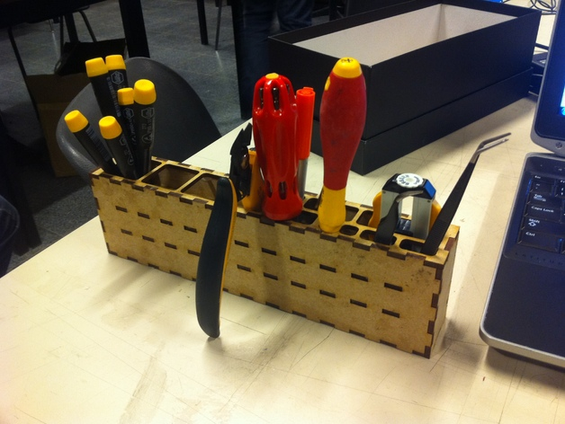
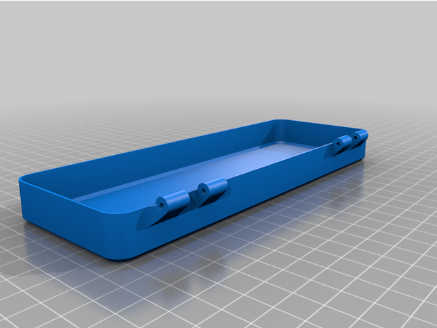
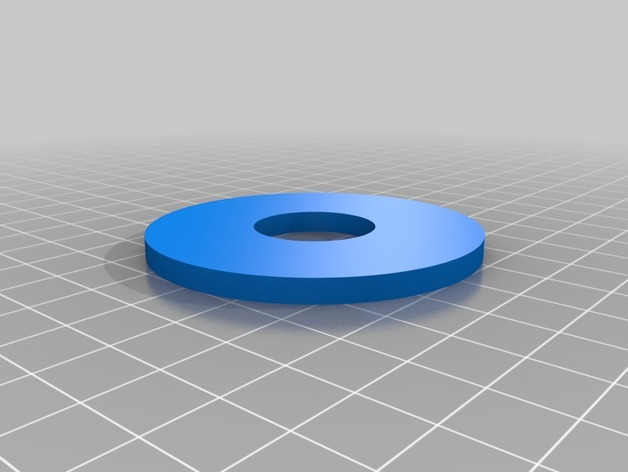
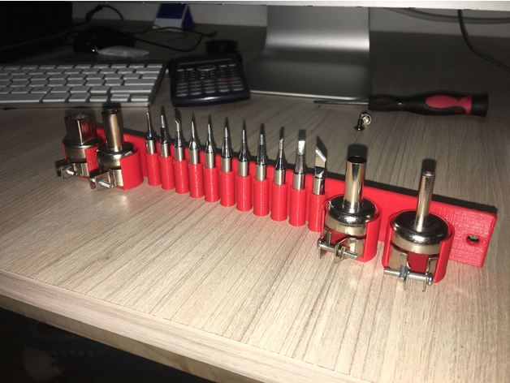

# Tool Storage

<!-- Generated by scripts/Update-Readmes.ps1 (Linux: scripts/update_readmes.py) - edit scripts/readme-sources.json and rerun instead of editing by hand. -->

[Home](../../../README.md) / [Electrical](../../README.md) / [Soldering](../README.md) / **Tool Storage**

7 builds &middot; 2 MakerWorld &middot; 1 Printables &middot; 4 Thingiverse

## Tool Storage

<table>
<tr>
<td width="33%" align="center" valign="top">
 
<b>Large soldering tool holder</b> 
by Brubacker 
<a href="https://www.thingiverse.com/thing:1436727">Thingiverse</a> &middot; <a href="Large_soldering_tool_holder">Repo folder</a>
</td>
<td width="33%" align="center" valign="top">
 
<b>Multipart Pinecil Case</b> 
by Pjotrke 
<a href="https://www.thingiverse.com/thing:5186002">Thingiverse</a> &middot; <a href="Multipart_Pinecil_Case_5186002">Repo folder</a>
</td>
<td width="33%" align="center" valign="top">
<i>no preview</i> 
<b>Pinecil Bento - Base</b> 
<a href="https://makerworld.com/en/search/models?keyword=Pinecil%20Bento%20-%20Base">Search MakerWorld</a> &middot; <a href="Pinecil%2BBento%2B-%2BBase_stls">Repo folder</a>
</td>
</tr>
<tr>
<td width="33%" align="center" valign="top">
<i>no preview</i> 
<b>Pinecil Bento - Desoldering</b> 
<a href="https://makerworld.com/en/search/models?keyword=Pinecil%20Bento%20-%20Desoldering">Search MakerWorld</a> &middot; <a href="Pinecil%2BBento%2B-%2BDesoldering_stls">Repo folder</a>
</td>
<td width="33%" align="center" valign="top">
<i>no preview</i> 
<b>Pinecil Ts100 Ts101 Ts80 Ts80p Case With Options Stand Solder Reel Storage Box</b> 
<a href="https://www.printables.com/model/237958">Printables</a> &middot; <a href="pinecil-ts100-ts101-ts80-ts80p-case-with-options-stand-solder-reel-storage-box-model_files">Repo folder</a>
</td>
<td width="33%" align="center" valign="top">
 
<b>Soldering stand</b> 
by jarano 
<a href="https://www.thingiverse.com/thing:2806028">Thingiverse</a> &middot; <a href="Soldering_stand">Repo folder</a>
</td>
</tr>
<tr>
<td width="33%" align="center" valign="top">
 
<b>SOLDERING STATION MOUN TOOLS</b> 
by infectedfpv26 
<a href="https://www.thingiverse.com/thing:2644095">Thingiverse</a> &middot; <a href="SOLDERING_STATION_MOUN_TOOLS">Repo folder</a>
</td>
</tr>
</table>

