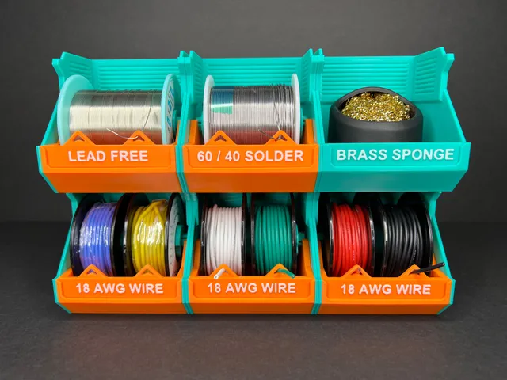
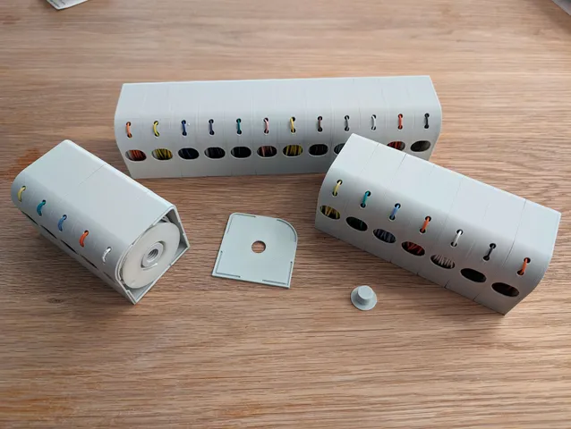

# Wire Holder

<!-- Generated by scripts/Update-Readmes.ps1 (Linux: scripts/update_readmes.py) - edit scripts/readme-sources.json and rerun instead of editing by hand. -->

[Home](../../../README.md) / [Electrical](../../README.md) / [Soldering](../README.md) / **Wire Holder**

4 builds &middot; 1 MakerWorld &middot; 2 Printables &middot; 1 unknown source

## Wire Holder

<table>
<tr>
<td width="33%" align="center" valign="top">
 
<b>Infinity Spool Holders - Stackable Storage Containers - Wire, Solder, Ribbon</b> 
by DesignCraft 
<a href="https://www.printables.com/model/744351-infinity-spool-holders-stackable-storage-container">Printables</a> &middot; <a href="infinity-spool-holders-stackable-storage-containers-wire-solder-ribbon-model_files">Repo folder</a>
</td>
<td width="33%" align="center" valign="top">
<i>no preview</i> 
<b>Modular wire spool holder with anti-retract</b> 
<a href="https://makerworld.com/en/search/models?keyword=Modular%20wire%20spool%20holder%20with%20anti-retract">Search MakerWorld</a> &middot; <a href="Modular%2Bwire%2Bspool%2Bholder%2Bwith%2Banti-retract">Repo folder</a>
</td>
<td width="33%" align="center" valign="top">
 
<b>Modular wire spool stack</b> 
by Noclafasm 
<a href="https://www.printables.com/model/740481-modular-wire-spool-stack">Printables</a> &middot; <a href="modular-wire-spool-stack-model_files">Repo folder</a>
</td>
</tr>
</table>

Other files in this folder (1)

- [Solder_Cableholder_1203831.zip](Solder_Cableholder_1203831.zip)

