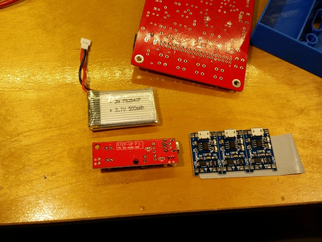
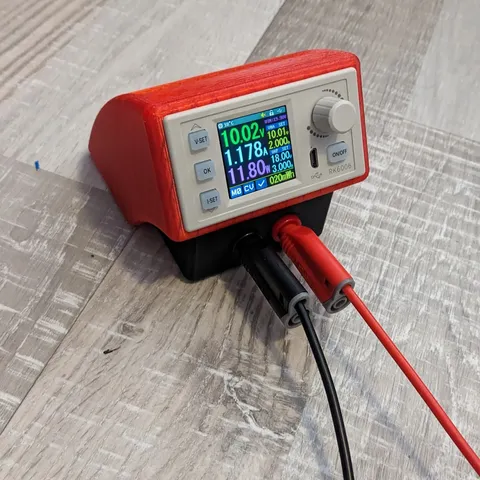
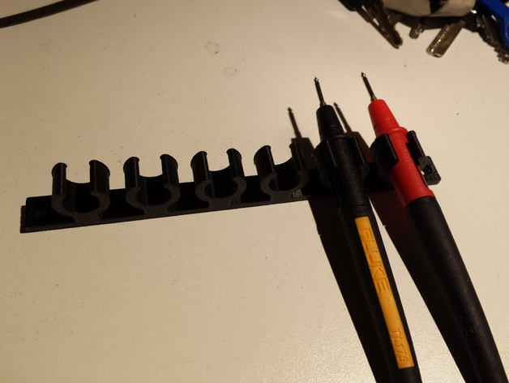
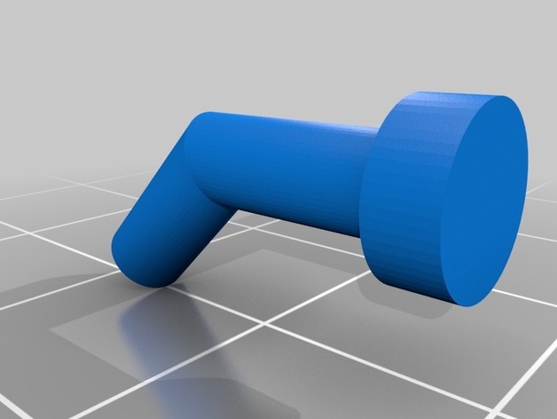
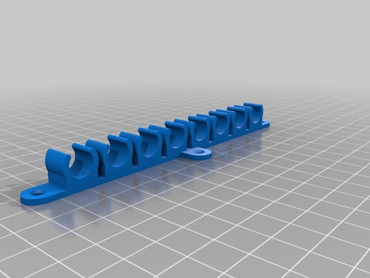
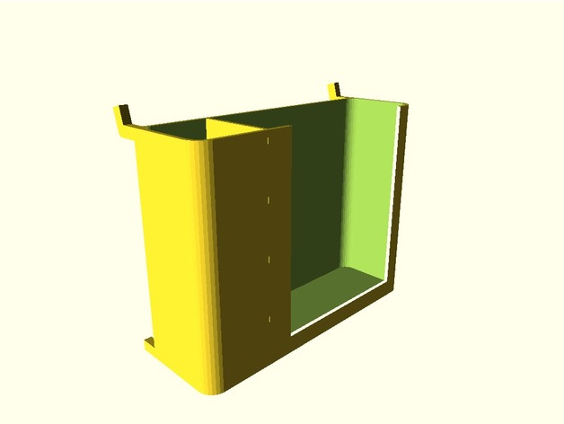
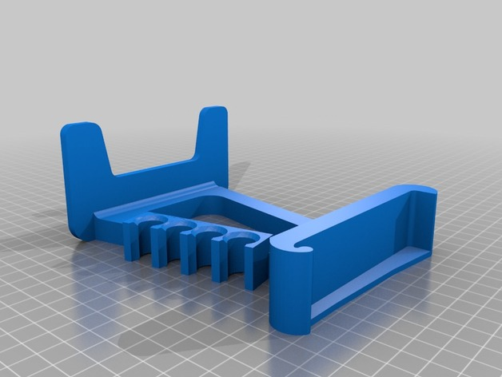
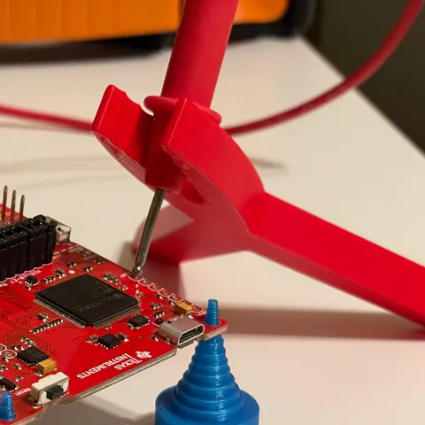
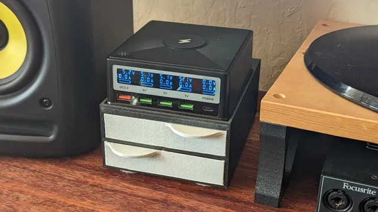

# Test Equipment

<!-- Generated by scripts/Update-Readmes.ps1 (Linux: scripts/update_readmes.py) - edit scripts/readme-sources.json and rerun instead of editing by hand. -->

[Home](../../README.md) / [Electrical](../README.md) / **Test Equipment**

12 builds &middot; 3 Printables &middot; 6 Thingiverse &middot; 3 unknown source

## Test Equipment

<table>
<tr>
<td width="33%" align="center" valign="top">
 
<b>Case for DSO138 - Remixed to fit new PCB mounting hole pattern</b> 
by Easybotics 
<a href="https://www.thingiverse.com/thing:1202909">Thingiverse</a> &middot; <a href="Case_for_DSO138_-_Remixed_to_fit_new_PCB_mounting_hole_pattern">Repo folder</a>
</td>
<td width="33%" align="center" valign="top">
 
<b>Desktop Power Supply</b> 
by Patric 
<a href="https://www.printables.com/model/668264-desktop-power-supply">Printables</a> &middot; <a href="desktop-power-supply-model_files">Repo folder</a>
</td>
<td width="33%" align="center" valign="top">
<i>no preview</i> 
<b>Mcu Programming Jig</b> 
Source unknown &middot; <a href="Mcu_Programming_Jig">Repo folder</a>
</td>
</tr>
<tr>
<td width="33%" align="center" valign="top">
 
<b>Multimeter / Oscilloscope probe Holder</b> 
by calatrabamix 
<a href="https://www.thingiverse.com/thing:1188427">Thingiverse</a> &middot; <a href="Multimeter___Oscilloscope_probe_Holder">Repo folder</a>
</td>
<td width="33%" align="center" valign="top">
 
<b>Multimeter Pegboard Holder</b> 
by DAVE42 
<a href="https://www.thingiverse.com/thing:2529844">Thingiverse</a> &middot; <a href="Multimeter_Pegboard_Holder">Repo folder</a>
</td>
<td width="33%" align="center" valign="top">
 
<b>Parametric Probe Holder</b> 
by billgertz 
<a href="https://www.thingiverse.com/thing:1134586">Thingiverse</a> &middot; <a href="Parametric_Probe_Holder">Repo folder</a>
</td>
</tr>
<tr>
<td width="33%" align="center" valign="top">
 
<b>Peg board Multimeter Holder</b> 
by jww 
<a href="https://www.thingiverse.com/thing:2024376">Thingiverse</a> &middot; <a href="Peg_board_Multimeter_Holder">Repo folder</a>
</td>
<td width="33%" align="center" valign="top">
<i>no preview</i> 
<b>Pogo Pin Charging Dock</b> 
Source unknown &middot; <a href="Pogo_Pin_Charging_Dock">Repo folder</a>
</td>
<td width="33%" align="center" valign="top">
 
<b>RIGOL DS1054Z Oscilloscope Stand with Probe Holder</b> 
by sb43201 
<a href="https://www.thingiverse.com/thing:2127891">Thingiverse</a> &middot; <a href="RIGOL_DS1054Z_Oscilloscope_Stand_with_Probe_Holder">Repo folder</a>
</td>
</tr>
<tr>
<td width="33%" align="center" valign="top">
 
<b>Simple PCB probe holder</b> 
by bw3dp 
<a href="https://www.printables.com/model/740859-simple-pcb-probe-holder">Printables</a> &middot; <a href="simple-pcb-probe-holder-model_files">Repo folder</a>
</td>
<td width="33%" align="center" valign="top">
 
<b>Small Cabinet Base and Drawers for PinePower Power Supply/Charger</b> 
by EvanBarnes 
<a href="https://www.printables.com/model/426768-small-cabinet-base-and-drawers-for-pinepower-power">Printables</a> &middot; <a href="small-cabinet-base-and-drawers-for-pinepower-power-supplycharger-model_files">Repo folder</a>
</td>
<td width="33%" align="center" valign="top">
<i>no preview</i> 
<b>Test Probe Haqnger -- Improved Slightly</b> 
Source unknown &middot; <a href="Test_Probe_Haqnger_--_Improved_Slightly">Repo folder</a>
</td>
</tr>
</table>

