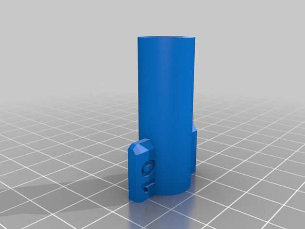
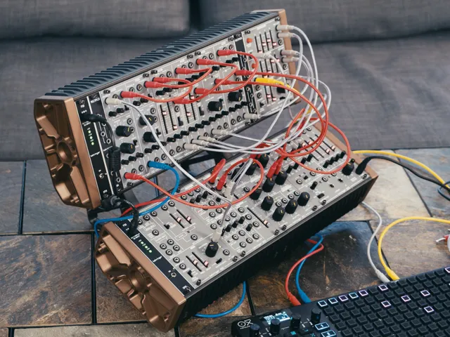
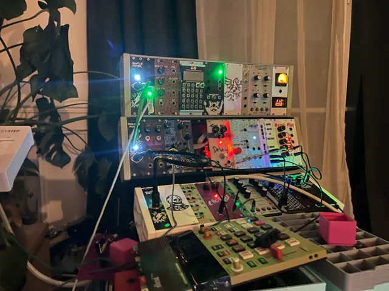
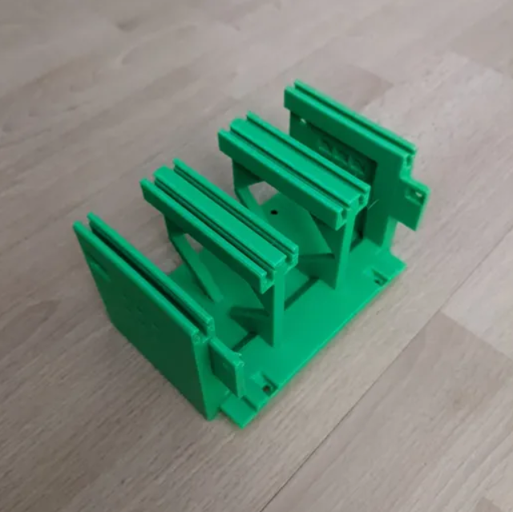

# Eurorack

<!-- Generated by scripts/Update-Readmes.ps1 - edit scripts/readme-sources.json and rerun instead of editing by hand. -->

7 builds &middot; 2 MakerWorld &middot; 1 Thingiverse &middot; 4 unknown source

## Eurorack

<table>
<tr>
<td width="33%" align="center" valign="top">
 
<b>10mm potentiometer bolt tool - NO Scratching Panel -</b> 
by marcelodamian 
<a href="https://www.thingiverse.com/thing:1111852">Thingiverse</a> &middot; <a href="10mm_potentiometer_bolt_tool_-_NO_Scratching_Panel_-">Repo folder</a>
</td>
<td width="33%" align="center" valign="top">
<i>no preview</i> 
<b>6 mm Jack bolt tool - NO Scratching Panel -</b> 
Source unknown &middot; <a href="6_mm_Jack_bolt_tool_-_NO_Scratching_Panel_-">Repo folder</a>
</td>
<td width="33%" align="center" valign="top">
 
<b>Eurorack Modular Case</b> 
by Josh-3D 
<a href="https://makerworld.com/en/models/1716936-eurorack-modular-case">MakerWorld</a> &middot; <a href="Eurorack%2BModular%2BCase">Repo folder</a>
</td>
</tr>
<tr>
<td width="33%" align="center" valign="top">
 
<b>Eurorack Modular Case - Extender</b> 
by Vakrom1f 
<a href="https://makerworld.com/en/models/2851923-eurorack-modular-case-extender">MakerWorld</a> &middot; <a href="Eurorack%2BModular%2BCase%2B-%2BExtender">Repo folder</a>
</td>
<td width="33%" align="center" valign="top">
 
<b>Expandable Eurorack Case Blocks</b> 
Source unknown &middot; <a href="expandable-eurorack-case-blocks">Repo folder</a>
</td>
<td width="33%" align="center" valign="top">
 
<b>Expandable Printable Eurorack Case</b> 
Source unknown &middot; <a href="expandable-printable-eurorack-case">Repo folder</a>
</td>
</tr>
</table>

Other files in this folder (1)

- [Llave_tubo_6mm_para_jacks_v2.stl](Llave_tubo_6mm_para_jacks_v2.stl)

