# Home

<!-- Generated by scripts/Update-Readmes.ps1 - edit scripts/readme-sources.json and rerun instead of editing by hand. -->

78 builds &middot; 12 MakerWorld &middot; 35 Printables &middot; 21 Thingiverse &middot; 10 unknown source

## Contents

- [Home](#home) (7)
- [Bathroom](#bathroom) (7)
- [Drawer Organization](#drawer-organization) (7)
- [Espresso / Grinder](#espresso--grinder) (6)
- [Espresso / Scale](#espresso--scale) (2)
- [Holiday](#holiday) (4)
- [Kitchen](#kitchen) (1)
- [Kitchen / Garbage Bags](#kitchen--garbage-bags) (4)
- [Kitchen / Kitchenaid Mixer Accessories](#kitchen--kitchenaid-mixer-accessories) (4)
- [Kitchen / Oxo Scale Stand](#kitchen--oxo-scale-stand) (3)
- [Kitchen / Plate Stands](#kitchen--plate-stands) (6)
- [Kitchen / Pop Can Organizer](#kitchen--pop-can-organizer) (2)
- [Lighting](#lighting) (5)
- [Planters](#planters) (18)
- [Shoes](#shoes) (2)

## Home

<table>
<tr>
<td width="33%" align="center" valign="top">
<a href="Clothes%2BHanger%2BConnector%2B_%2BCoat%2BHanger%2BHook">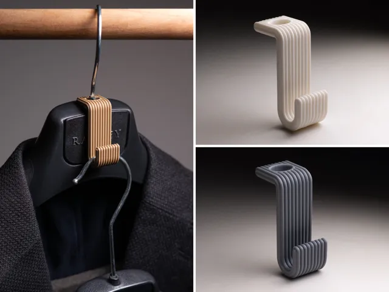</a> 
<b>Clothes Hanger Connector | Coat Hanger Hook</b> 
by yekta 
<a href="https://makerworld.com/en/models/2705544-clothes-hanger-connector-coat-hanger-hook">MakerWorld</a> &middot; <a href="Clothes%2BHanger%2BConnector%2B_%2BCoat%2BHanger%2BHook">Repo folder</a>
</td>
<td width="33%" align="center" valign="top">
<a href="Drawer-divider">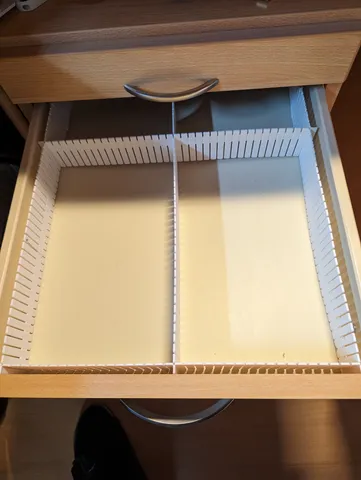</a> 
<b>Drawer Divider</b> 
by Helmar 
<a href="https://www.printables.com/model/663544-drawer-divider">Printables</a> &middot; <a href="Drawer-divider">Repo folder</a>
</td>
<td width="33%" align="center" valign="top">
<a href="Kallax%2BDoor%2BSystem">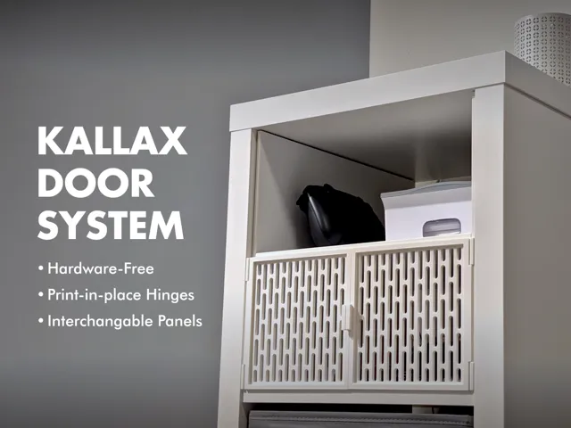</a> 
<b>Kallax Door System</b> 
by ARCHIGAMI 
<a href="https://makerworld.com/en/models/2767405-kallax-door-system">MakerWorld</a> &middot; <a href="Kallax%2BDoor%2BSystem">Repo folder</a>
</td>
</tr>
<tr>
<td width="33%" align="center" valign="top">
<i>no preview</i> 
<b>Latch For Cardboard Box</b> 
Source unknown &middot; <a href="latch-for-cardboard-box">Repo folder</a>
</td>
<td width="33%" align="center" valign="top">
<a href="Modular%2BShelf%2Bfor%2BWall%2B_%2BFloor%2B_%2BDesk">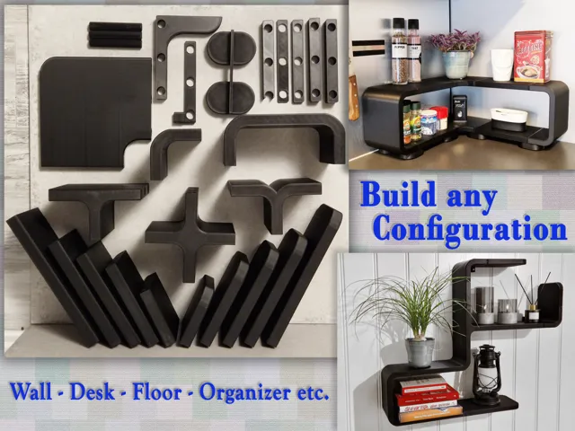</a> 
<b>Modular Shelf for Wall / Floor / Desk</b> 
by Uzziel3D 
<a href="https://makerworld.com/en/models/1179211-modular-shelf-for-wall-floor-desk">MakerWorld</a> &middot; <a href="Modular%2BShelf%2Bfor%2BWall%2B_%2BFloor%2B_%2BDesk">Repo folder</a>
</td>
<td width="33%" align="center" valign="top">
<a href="Parametric-Picture-Frame-Generator-v2.3mf">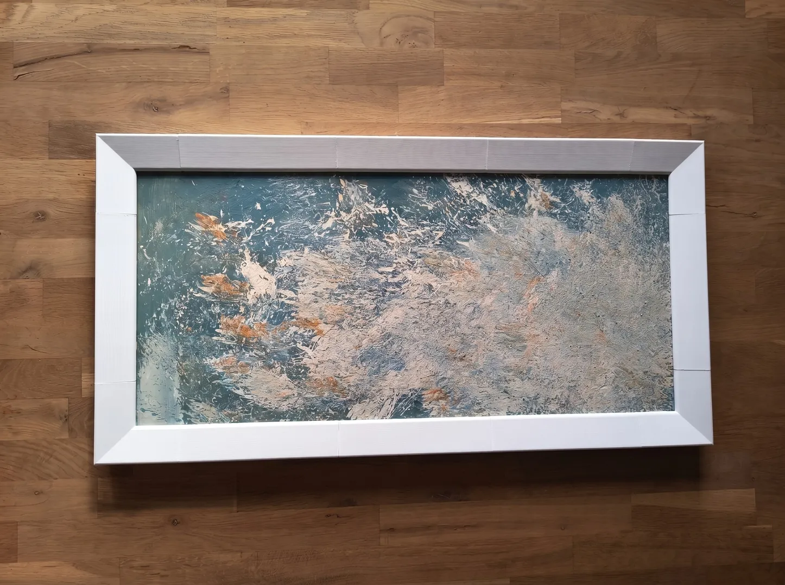</a> 
<b>Parametric-Picture-Frame-Generator-v2</b> 
Source unknown &middot; <a href="Parametric-Picture-Frame-Generator-v2.3mf">Parametric-Picture-Frame-Generator-v2.3mf</a>
</td>
</tr>
<tr>
<td width="33%" align="center" valign="top">
<a href="picture-frame-honeycomb-model_files">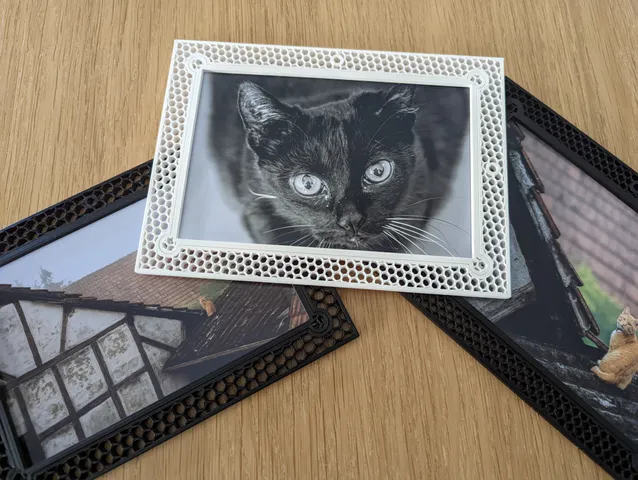</a> 
<b>Picture Frame Honeycomb</b> 
by Kittelot 
<a href="https://www.printables.com/model/268131-picture-frame-honeycomb">Printables</a> &middot; <a href="picture-frame-honeycomb-model_files">Repo folder</a>
</td>
</tr>
</table>

## Bathroom

<table>
<tr>
<td width="33%" align="center" valign="top">
<a href="bathroom/A1-corner-shelf-PLA.3mf">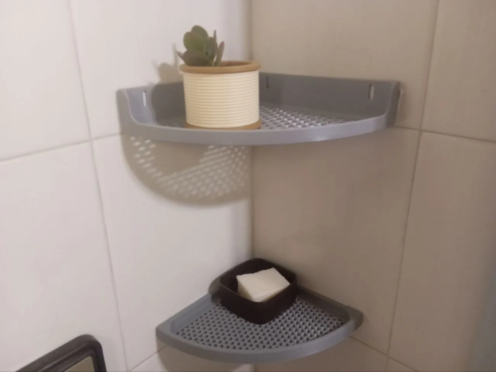</a> 
<b>A1-corner-shelf-PLA</b> 
Source unknown &middot; <a href="bathroom/A1-corner-shelf-PLA.3mf">A1-corner-shelf-PLA.3mf</a>
</td>
<td width="33%" align="center" valign="top">
 
<b>Bathroom corner shelf - No drilling</b> 
by Frasse16 
<a href="https://www.printables.com/model/712408-bathroom-corner-shelf-no-drilling">Printables</a> &middot; <a href="bathroom/bathroom-corner-shelf-no-drilling-model_files">Repo folder</a>
</td>
<td width="33%" align="center" valign="top">
 
<b>Bathroom-shelf</b> 
Source unknown &middot; <a href="bathroom/Bathroom-shelf.3mf">Bathroom-shelf.3mf</a>
</td>
</tr>
<tr>
<td width="33%" align="center" valign="top">
<a href="bathroom/Corner%2BShower%2BCaddy%2C%2BBathroom%2BShelf%2Bwith%2BDrainage">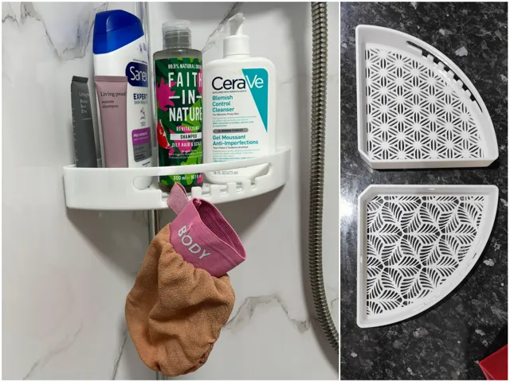</a> 
<b>Corner Shower Caddy, Bathroom Shelf with Drainage</b> 
by Zen Aku 
<a href="https://makerworld.com/en/models/1963711-corner-shower-caddy-bathroom-shelf-with-drainage">MakerWorld</a> &middot; <a href="bathroom/Corner%2BShower%2BCaddy%2C%2BBathroom%2BShelf%2Bwith%2BDrainage">Repo folder</a>
</td>
<td width="33%" align="center" valign="top">
<i>no preview</i> 
<b>DuschablageV1</b> 
<a href="https://makerworld.com/en/search/models?keyword=DuschablageV1">Search MakerWorld</a> &middot; <a href="bathroom/DuschablageV1_stls">Repo folder</a>
</td>
<td width="33%" align="center" valign="top">
<a href="bathroom/small-space-oral-b-toothbrush-stand-for-2-model_files">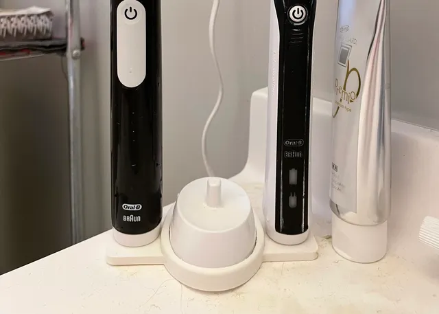</a> 
<b>Small space Oral B toothbrush stand for 2</b> 
by r0bespierre 
<a href="https://www.printables.com/model/198570-small-space-oral-b-toothbrush-stand-for-2">Printables</a> &middot; <a href="bathroom/small-space-oral-b-toothbrush-stand-for-2-model_files">Repo folder</a>
</td>
</tr>
<tr>
<td width="33%" align="center" valign="top">
<a href="bathroom/voronoi-bathroom-corner-shelf-model_files">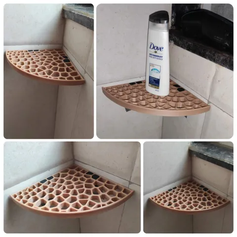</a> 
<b>Voronoi bathroom corner shelf</b> 
by CJ 
<a href="https://www.printables.com/model/719794-voronoi-bathroom-corner-shelf">Printables</a> &middot; <a href="bathroom/voronoi-bathroom-corner-shelf-model_files">Repo folder</a>
</td>
</tr>
</table>

## Drawer Organization

<table>
<tr>
<td width="33%" align="center" valign="top">
<a href="drawer-organization/Easy-Peasy%2BCustomizable%2BDrawer%2BDividers%2Bv2">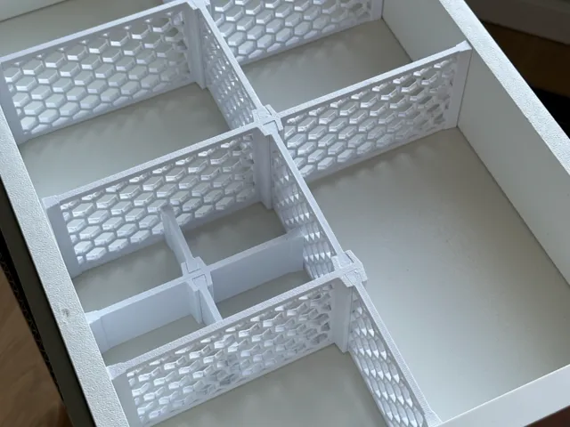</a> 
<b>Easy-Peasy Customizable Drawer Dividers v2</b> 
by printurd 
<a href="https://makerworld.com/en/models/1319616-easy-peasy-customizable-drawer-dividers-v2">MakerWorld</a> &middot; <a href="drawer-organization/Easy-Peasy%2BCustomizable%2BDrawer%2BDividers%2Bv2">Repo folder</a>
</td>
<td width="33%" align="center" valign="top">
<a href="drawer-organization/gridfinity-complete-kitchen-collection-w-modular-expansion-pieces-model_files">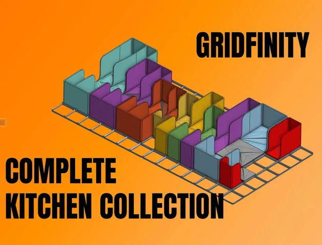</a> 
<b>Gridfinity Complete Kitchen Collection (w/ Modular Expansion Pieces)</b> 
by The Next Layer 
<a href="https://www.printables.com/model/719729-gridfinity-complete-kitchen-collection-w-modular-e">Printables</a> &middot; <a href="drawer-organization/gridfinity-complete-kitchen-collection-w-modular-expansion-pieces-model_files">Repo folder</a>
</td>
<td width="33%" align="center" valign="top">
<i>no preview</i> 
<b>Gridfinity Kitchen Drawer Organizers Collection</b> 
Source unknown &middot; <a href="drawer-organization/Gridfinity%20Kitchen%20Drawer%20Organizers%20Collection">Repo folder</a>
</td>
</tr>
<tr>
<td width="33%" align="center" valign="top">
<a href="drawer-organization/IKEA%2BKallax%2BDrawer%2BSystem">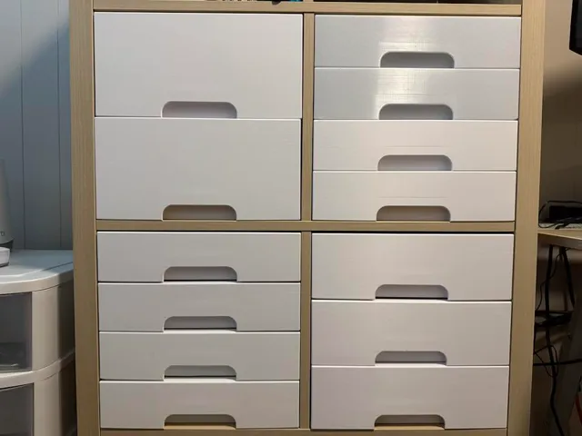</a> 
<b>IKEA Kallax Drawer System</b> 
by tedgar 
<a href="https://makerworld.com/en/models/2264316-ikea-kallax-drawer-system">MakerWorld</a> &middot; <a href="drawer-organization/IKEA%2BKallax%2BDrawer%2BSystem">Repo folder</a>
</td>
<td width="33%" align="center" valign="top">
<i>no preview</i> 
<b>Kallax Drawer-FRONT</b> 
<a href="https://makerworld.com/en/search/models?keyword=Kallax%20Drawer-FRONT">Search MakerWorld</a> &middot; <a href="drawer-organization/Kallax%2BDrawer-FRONT_stls">Repo folder</a>
</td>
<td width="33%" align="center" valign="top">
<a href="drawer-organization/Modular_Drawer_Organizer_3827538">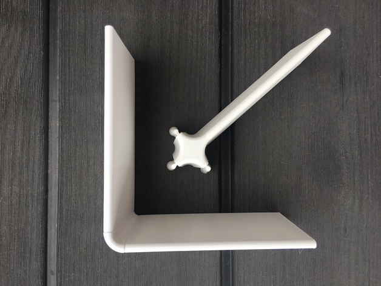</a> 
<b>Modular Drawer Organizer</b> 
by wbu42 
<a href="https://www.thingiverse.com/thing:3827538">Thingiverse</a> &middot; <a href="drawer-organization/Modular_Drawer_Organizer_3827538">Repo folder</a>
</td>
</tr>
<tr>
<td width="33%" align="center" valign="top">
<a href="drawer-organization/Ultimate%2BGridfinity%2BKitchen%2BDrawer%2BOrganizer">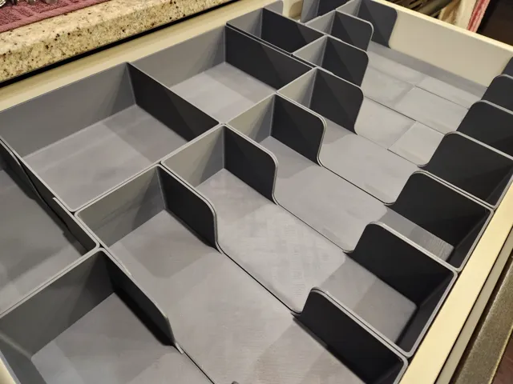</a> 
<b>Ultimate Gridfinity Kitchen Drawer Organizer</b> 
by Valorian 
<a href="https://makerworld.com/en/models/608048-ultimate-gridfinity-kitchen-drawer-organizer">MakerWorld</a> &middot; <a href="drawer-organization/Ultimate%2BGridfinity%2BKitchen%2BDrawer%2BOrganizer">Repo folder</a>
</td>
</tr>
</table>

## Espresso / Grinder

<table>
<tr>
<td width="33%" align="center" valign="top">
<a href="espresso/grinder/df64-cup-lid-model_files">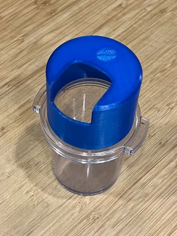</a> 
<b>DF64 cup lid</b> 
by Sto 
<a href="https://www.printables.com/model/449701-df64-cup-lid">Printables</a> &middot; <a href="espresso/grinder/df64-cup-lid-model_files">Repo folder</a>
</td>
<td width="33%" align="center" valign="top">
<a href="espresso/grinder/df64-tilt-base-split-in-half-model_files">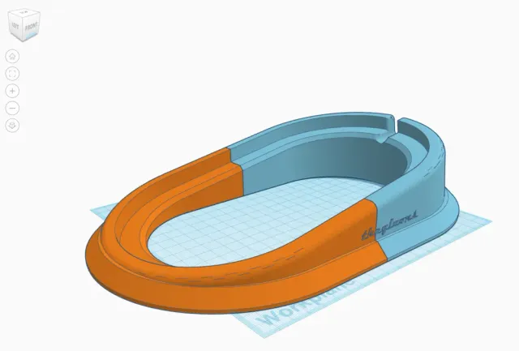</a> 
<b>DF64 Tilt Base Split in Half</b> 
by soemarko 
<a href="https://www.printables.com/model/191618-df64-tilt-base-split-in-half">Printables</a> &middot; <a href="espresso/grinder/df64-tilt-base-split-in-half-model_files">Repo folder</a>
</td>
<td width="33%" align="center" valign="top">
<a href="espresso/grinder/DF64_Two_piece_dovetailed_10_Degree_Tilted_Base_4904042">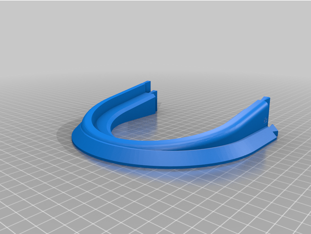</a> 
<b>DF64 Two piece dovetailed 10 Degree Tilted Base</b> 
by jkim_makes 
<a href="https://www.thingiverse.com/thing:4904042">Thingiverse</a> &middot; <a href="espresso/grinder/DF64_Two_piece_dovetailed_10_Degree_Tilted_Base_4904042">Repo folder</a>
</td>
</tr>
<tr>
<td width="33%" align="center" valign="top">
<a href="espresso/grinder/df64-two-piece-dovetailed-10-degree-tilted-base-model_files">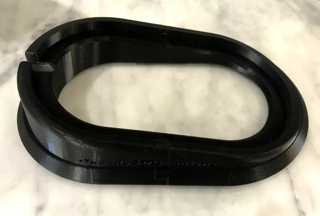</a> 
<b>DF64 Two piece dovetailed 10 Degree Tilted Base</b> 
by jkim_makes 
<a href="https://www.printables.com/model/105122-df64-two-piece-dovetailed-10-degree-tilted-base">Printables</a> &middot; <a href="espresso/grinder/df64-two-piece-dovetailed-10-degree-tilted-base-model_files">Repo folder</a>
</td>
</tr>
</table>

Other files in this folder (2)

- [DF64_-_dosing_ramp.stl](espresso/grinder/DF64_-_dosing_ramp.stl)
- [df64_holder_v7.stl](espresso/grinder/df64_holder_v7.stl)

## Espresso / Scale

<table>
<tr>
<td width="33%" align="center" valign="top">
<a href="espresso/scale/timemore-black-mirror-basic-plus-travel-case-model_files">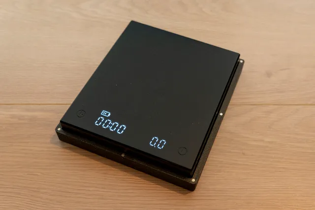</a> 
<b>Timemore Black Mirror Basic Plus - Travel Case</b> 
by Jakub Huspek 
<a href="https://www.printables.com/model/574328-timemore-black-mirror-basic-plus-travel-case">Printables</a> &middot; <a href="espresso/scale/timemore-black-mirror-basic-plus-travel-case-model_files">Repo folder</a>
</td>
</tr>
</table>

Other files in this folder (1)

- [TIMEMORE BLACKMIRROR COVER v2.stl](espresso/scale/TIMEMORE%20BLACKMIRROR%20COVER%20v2.stl)

## Holiday

<table>
<tr>
<td width="33%" align="center" valign="top">
 
<b>christmas ornaments</b> 
by h3li0 
<a href="https://www.printables.com/model/1080542-christmas-ornaments">Printables</a> &middot; <a href="holiday/christmas-ornaments-model_files">Repo folder</a>
</td>
<td width="33%" align="center" valign="top">
 
<b>Christmas Tree Ornament Set (Vase Mode Prints)</b> 
by Popandsicle 
<a href="https://www.printables.com/model/326837-christmas-tree-ornament-set-vase-mode-prints">Printables</a> &middot; <a href="holiday/christmas-tree-ornament-set-vase-mode-prints-model_files">Repo folder</a>
</td>
<td width="33%" align="center" valign="top">
<a href="holiday/christmas-tree-spiral-ornament-with-mount-model_files">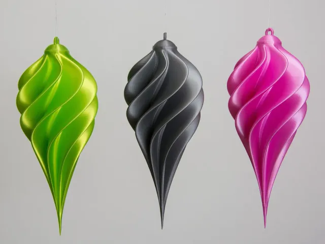</a> 
<b>Christmas tree spiral ornament with mount</b> 
by Bemko 
<a href="https://www.printables.com/model/83182-christmas-tree-spiral-ornament-with-mount">Printables</a> &middot; <a href="holiday/christmas-tree-spiral-ornament-with-mount-model_files">Repo folder</a>
</td>
</tr>
</table>

Other files in this folder (1)

- [Custom Ornament FULL1.stl](holiday/Custom%20Ornament%20FULL1.stl)

## Kitchen

<table>
<tr>
<td width="33%" align="center" valign="top">
<a href="kitchen/blade-lame-v2-model_files">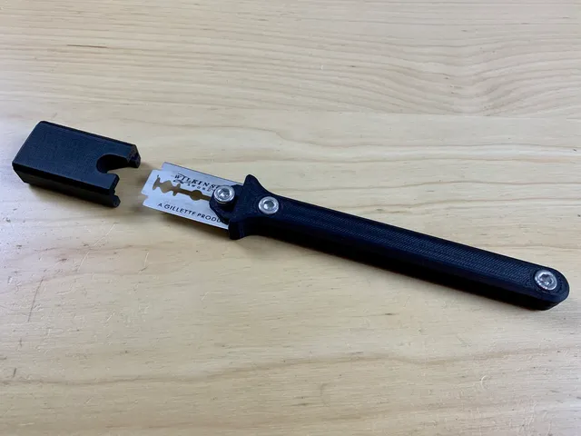</a> 
<b>Blade lame v2</b> 
by fns720 
<a href="https://www.printables.com/model/32303-blade-lame-v2">Printables</a> &middot; <a href="kitchen/blade-lame-v2-model_files">Repo folder</a>
</td>
</tr>
</table>

## Kitchen / Garbage Bags

<table>
<tr>
<td width="33%" align="center" valign="top">
<a href="kitchen/garbage-bags/garbage-bag-dispenser-model_files">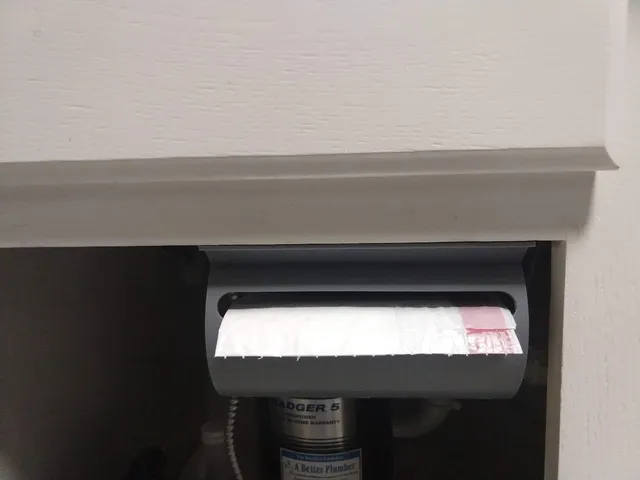</a> 
<b>Garbage Bag Dispenser</b> 
by wsreith 
<a href="https://www.printables.com/model/62075-garbage-bag-dispenser">Printables</a> &middot; <a href="kitchen/garbage-bags/garbage-bag-dispenser-model_files">Repo folder</a>
</td>
<td width="33%" align="center" valign="top">
 
<b>Garbage Bag Dispenser</b> 
by JAYTEEAU 
<a href="https://www.thingiverse.com/thing:2757789">Thingiverse</a> &middot; <a href="kitchen/garbage-bags/Garbage%20Bag%20Dispenser%20-%202757789">Repo folder</a>
</td>
<td width="33%" align="center" valign="top">
<a href="kitchen/garbage-bags/parametric-garbage-bag-dispenser-model_files">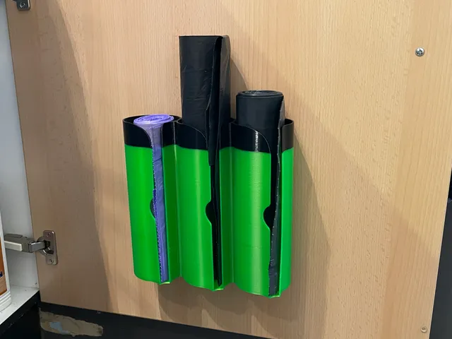</a> 
<b>Parametric garbage bag dispenser</b> 
by PjotrStrog 
<a href="https://www.printables.com/model/551669-parametric-garbage-bag-dispenser">Printables</a> &middot; <a href="kitchen/garbage-bags/parametric-garbage-bag-dispenser-model_files">Repo folder</a>
</td>
</tr>
<tr>
<td width="33%" align="center" valign="top">
<a href="kitchen/garbage-bags/slightly-over-engineered-trash-bag-roll-holder-model_files">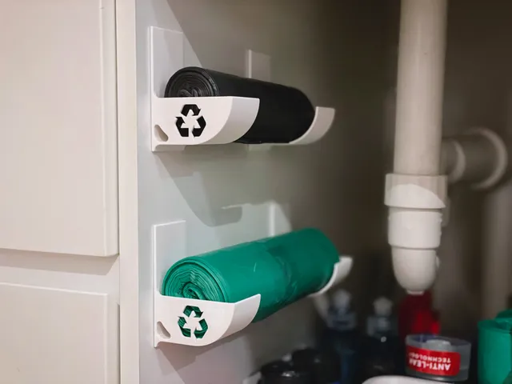</a> 
<b>Slightly Over Engineered Trash Bag Roll Holder</b> 
by MaxT 
<a href="https://www.printables.com/model/379488-slightly-over-engineered-trash-bag-roll-holder">Printables</a> &middot; <a href="kitchen/garbage-bags/slightly-over-engineered-trash-bag-roll-holder-model_files">Repo folder</a>
</td>
</tr>
</table>

## Kitchen / Kitchenaid Mixer Accessories

<table>
<tr>
<td width="33%" align="center" valign="top">
<a href="kitchen/kitchenaid-mixer-accessories/kitchenaid-attachment-hanger-no-support-model_files">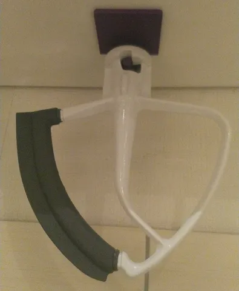</a> 
<b>Kitchenaid Attachment Hanger No Support</b> 
by c3poSAW 
<a href="https://www.printables.com/model/129495-kitchenaid-attachment-hanger-no-support">Printables</a> &middot; <a href="kitchen/kitchenaid-mixer-accessories/kitchenaid-attachment-hanger-no-support-model_files">Repo folder</a>
</td>
<td width="33%" align="center" valign="top">
<a href="kitchen/kitchenaid-mixer-accessories/kitchenaid-stand-mixer-attachment-hangar-model_files">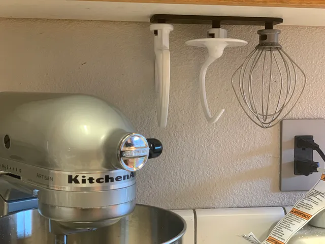</a> 
<b>KitchenAid Stand Mixer attachment hanger</b> 
by DownRight 
<a href="https://www.printables.com/model/751345-kitchenaid-stand-mixer-attachment-hanger">Printables</a> &middot; <a href="kitchen/kitchenaid-mixer-accessories/kitchenaid-stand-mixer-attachment-hangar-model_files">Repo folder</a>
</td>
<td width="33%" align="center" valign="top">
<i>no preview</i> 
<b>Kitchenaid Stand Mixer Cable Wrap</b> 
<a href="https://www.printables.com/model/535974">Printables</a> &middot; <a href="kitchen/kitchenaid-mixer-accessories/kitchenaid-stand-mixer-cable-wrap-model_files">Repo folder</a>
</td>
</tr>
<tr>
<td width="33%" align="center" valign="top">
<a href="kitchen/kitchenaid-mixer-accessories/stand-for-kitchen-aid-attachments-model_files">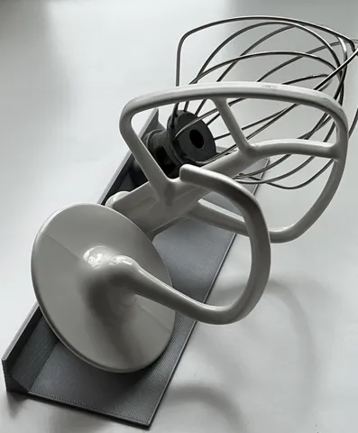</a> 
<b>Stand for Kitchen Aid attachments</b> 
by The occasional extrusionist 
<a href="https://www.printables.com/model/251474-stand-for-kitchen-aid-attachments">Printables</a> &middot; <a href="kitchen/kitchenaid-mixer-accessories/stand-for-kitchen-aid-attachments-model_files">Repo folder</a>
</td>
</tr>
</table>

## Kitchen / Oxo Scale Stand

<table>
<tr>
<td width="33%" align="center" valign="top">
<a href="kitchen/oxo-scale-stand/oxo-good-grips-food-scale-holder-model_files">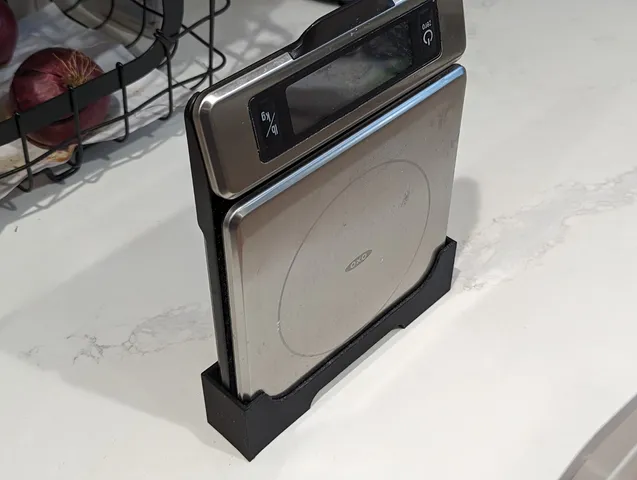</a> 
<b>OXO Good Grips Food Scale Holder</b> 
by kitlaan 
<a href="https://www.printables.com/model/638840-oxo-good-grips-food-scale-holder">Printables</a> &middot; <a href="kitchen/oxo-scale-stand/oxo-good-grips-food-scale-holder-model_files">Repo folder</a>
</td>
<td width="33%" align="center" valign="top">
<a href="kitchen/oxo-scale-stand/oxo-good-grips-food-scale-holder-with-double-sided-tape-mounting-tabs-model_files">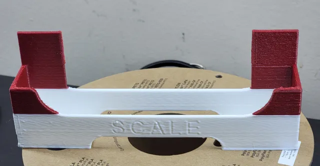</a> 
<b>OXO Good Grips Food Scale Holder - With Double Sided Tape Mounting Tabs</b> 
by With_Maltodextrin 
<a href="https://www.printables.com/model/639048-oxo-good-grips-food-scale-holder-with-double-sided">Printables</a> &middot; <a href="kitchen/oxo-scale-stand/oxo-good-grips-food-scale-holder-with-double-sided-tape-mounting-tabs-model_files">Repo folder</a>
</td>
<td width="33%" align="center" valign="top">
<a href="kitchen/oxo-scale-stand/oxo-scale-stand-model_files">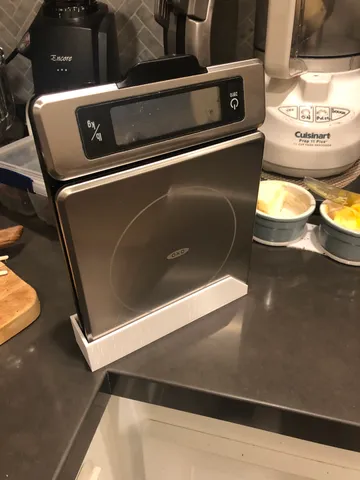</a> 
<b>OXO Scale Stand</b> 
by Shawn 
<a href="https://www.printables.com/model/57552-oxo-scale-stand">Printables</a> &middot; <a href="kitchen/oxo-scale-stand/oxo-scale-stand-model_files">Repo folder</a>
</td>
</tr>
</table>

## Kitchen / Plate Stands

<table>
<tr>
<td width="33%" align="center" valign="top">
<a href="kitchen/plate-stands/Bowl___deep_plate___dish_stand___rack_IKEA_FARGRIK_4393750">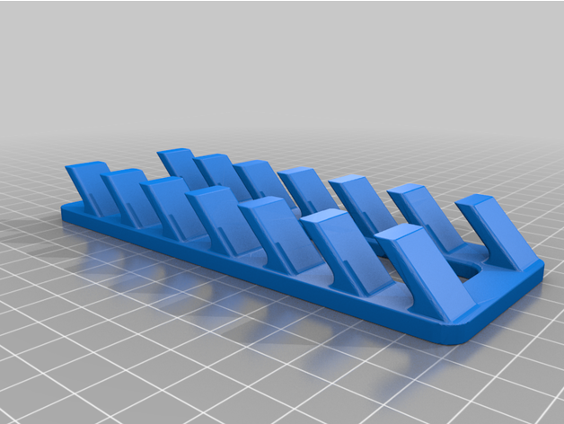</a> 
<b>Bowl / deep plate / dish stand / rack IKEA FARGRIK</b> 
by tomtastic 
<a href="https://www.thingiverse.com/thing:4393750">Thingiverse</a> &middot; <a href="kitchen/plate-stands/Bowl___deep_plate___dish_stand___rack_IKEA_FARGRIK_4393750">Repo folder</a>
</td>
<td width="33%" align="center" valign="top">
<a href="kitchen/plate-stands/Bowl_stand_1796770">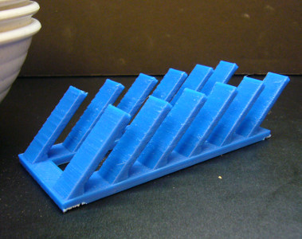</a> 
<b>Bowl stand</b> 
by Terminus 
<a href="https://www.thingiverse.com/thing:1796770">Thingiverse</a> &middot; <a href="kitchen/plate-stands/Bowl_stand_1796770">Repo folder</a>
</td>
<td width="33%" align="center" valign="top">
<a href="kitchen/plate-stands/Dish_stand_678990">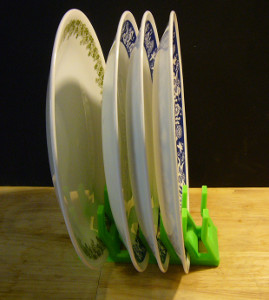</a> 
<b>Dish stand</b> 
by Terminus 
<a href="https://www.thingiverse.com/thing:678990">Thingiverse</a> &middot; <a href="kitchen/plate-stands/Dish_stand_678990">Repo folder</a>
</td>
</tr>
<tr>
<td width="33%" align="center" valign="top">
<a href="kitchen/plate-stands/dish_stand_remix_688210">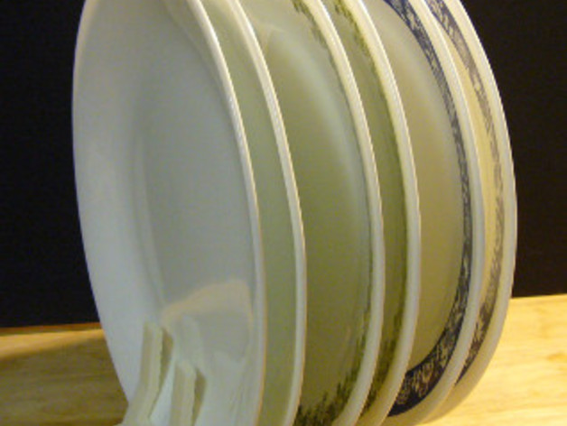</a> 
<b>dish stand remix</b> 
by Terminus 
<a href="https://www.thingiverse.com/thing:688210">Thingiverse</a> &middot; <a href="kitchen/plate-stands/dish_stand_remix_688210">Repo folder</a>
</td>
<td width="33%" align="center" valign="top">
<a href="kitchen/plate-stands/IKEA_Dish_tray_light_weight">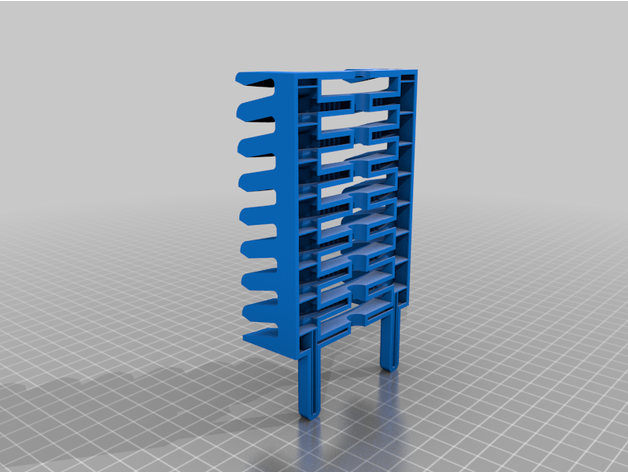</a> 
<b>IKEA Dish tray light weight / 盤子重量輕 / डिश ट्रे हल्के वजन</b> 
by GeertL 
<a href="https://www.thingiverse.com/thing:5835512">Thingiverse</a> &middot; <a href="kitchen/plate-stands/IKEA_Dish_tray_light_weight">Repo folder</a>
</td>
<td width="33%" align="center" valign="top">
<a href="kitchen/plate-stands/Small_Dish_Rack_Cabinet_Storage_for_Four_4_Dishes_5447400">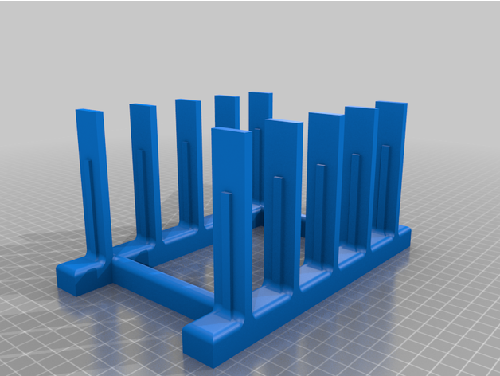</a> 
<b>Small Dish Rack Cabinet Storage for Four 4 Dishes</b> 
by tedday 
<a href="https://www.thingiverse.com/thing:5447400">Thingiverse</a> &middot; <a href="kitchen/plate-stands/Small_Dish_Rack_Cabinet_Storage_for_Four_4_Dishes_5447400">Repo folder</a>
</td>
</tr>
</table>

## Kitchen / Pop Can Organizer

<table>
<tr>
<td width="33%" align="center" valign="top">
<a href="kitchen/pop-can-organizer/Refrigerator_Beer___Pop_Can_Holder___Dispenser_1121142">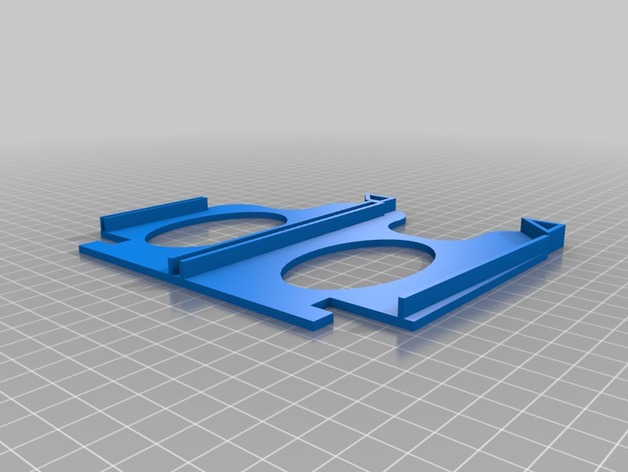</a> 
<b>Refrigerator Beer / Pop Can Holder / Dispenser</b> 
by MR2C280 
<a href="https://www.thingiverse.com/thing:1121142">Thingiverse</a> &middot; <a href="kitchen/pop-can-organizer/Refrigerator_Beer___Pop_Can_Holder___Dispenser_1121142">Repo folder</a>
</td>
<td width="33%" align="center" valign="top">
<a href="kitchen/pop-can-organizer/stackable-can-dispenser-model_files">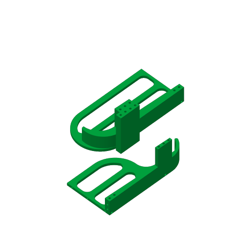</a> 
<b>Stackable Can Dispenser</b> 
<a href="https://www.printables.com/model/732198">Printables</a> &middot; <a href="kitchen/pop-can-organizer/stackable-can-dispenser-model_files">Repo folder</a>
</td>
</tr>
</table>

## Lighting

<table>
<tr>
<td width="33%" align="center" valign="top">
<a href="lighting/3D_printed_articulating_lamp">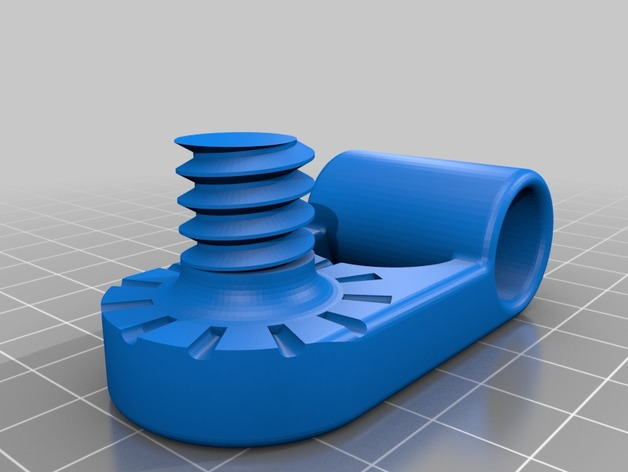</a> 
<b>3D printed articulating lamp</b> 
by igorF2 
<a href="https://www.thingiverse.com/thing:2505394">Thingiverse</a> &middot; <a href="lighting/3D_printed_articulating_lamp">Repo folder</a>
</td>
<td width="33%" align="center" valign="top">
<a href="lighting/arachnid-task-lamp">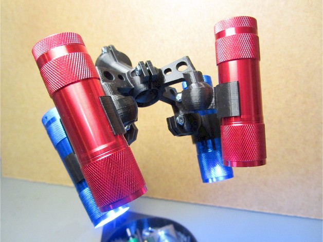</a> 
<b>Arachnid Task Lamp</b> 
by LoboCNC 
<a href="https://www.thingiverse.com/thing:1776424">Thingiverse</a> &middot; <a href="lighting/arachnid-task-lamp">Repo folder</a>
</td>
<td width="33%" align="center" valign="top">
<a href="lighting/Artichoke_Lamp_Shade_1015178">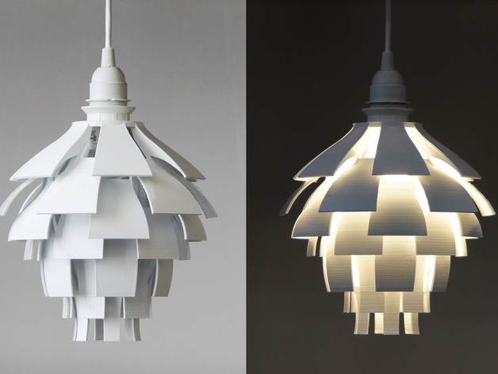</a> 
<b>Artichoke Lamp Shade</b> 
by gCreate 
<a href="https://www.thingiverse.com/thing:1015178">Thingiverse</a> &middot; <a href="lighting/Artichoke_Lamp_Shade_1015178">Repo folder</a>
</td>
</tr>
<tr>
<td width="33%" align="center" valign="top">
<a href="lighting/LED_bridge_lamp_1639224">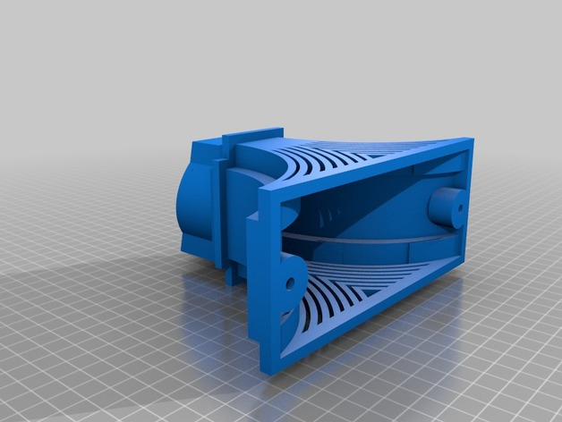</a> 
<b>LED bridge lamp</b> 
by Opossums 
<a href="https://www.thingiverse.com/thing:1639224">Thingiverse</a> &middot; <a href="lighting/LED_bridge_lamp_1639224">Repo folder</a>
</td>
<td width="33%" align="center" valign="top">
<a href="lighting/mid-century-modern-lamp-print_files">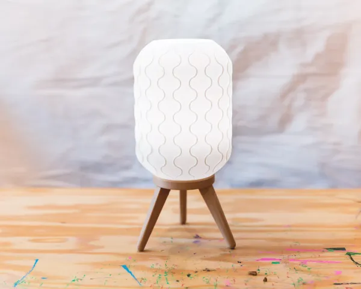</a> 
<b>mid-century modern lamp</b> 
by Catdad Workshop 
<a href="https://www.printables.com/model/335575-mid-century-modern-lamp">Printables</a> &middot; <a href="lighting/mid-century-modern-lamp-print_files">Repo folder</a>
</td>
</tr>
</table>

## Planters

<table>
<tr>
<td width="33%" align="center" valign="top">
<a href="planters/anti-sphere-plant-pot-and-planter-vase-mode-design-model_files">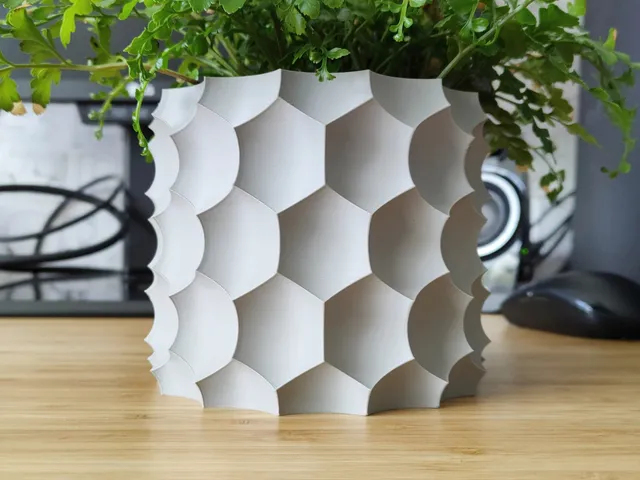</a> 
<b>Anti-sphere Plant pot and Planter - Vase mode design</b> 
by SASSy Design 
<a href="https://www.printables.com/model/538186-anti-sphere-plant-pot-and-planter-vase-mode-design">Printables</a> &middot; <a href="planters/anti-sphere-plant-pot-and-planter-vase-mode-design-model_files">Repo folder</a>
</td>
<td width="33%" align="center" valign="top">
<a href="planters/gerometric-origami-flower-pot-and-planter-for-plants-model_files">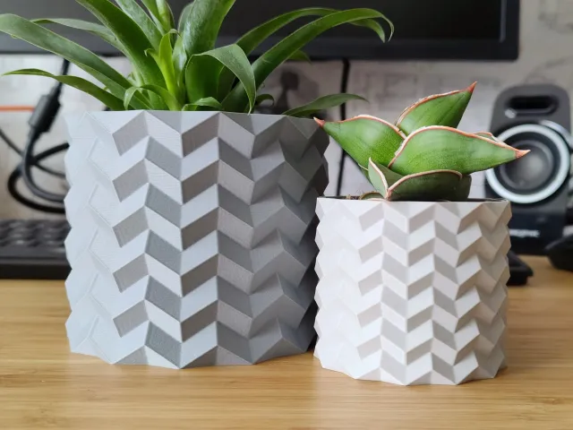</a> 
<b>Gerometric Origami Flower Pot and Planter for Plants</b> 
by SASSy Design 
<a href="https://www.printables.com/model/282130-gerometric-origami-flower-pot-and-planter-for-plan">Printables</a> &middot; <a href="planters/gerometric-origami-flower-pot-and-planter-for-plants-model_files">Repo folder</a>
</td>
<td width="33%" align="center" valign="top">
<a href="planters/helical-self-watering-planters-model_files">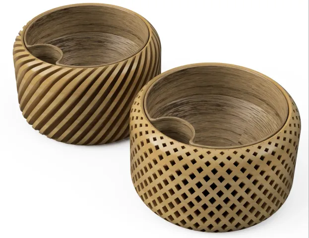</a> 
<b>Helical Self Watering Planters</b> 
by RB3D 
<a href="https://www.printables.com/model/65450-helical-self-watering-planters">Printables</a> &middot; <a href="planters/helical-self-watering-planters-model_files">Repo folder</a>
</td>
</tr>
<tr>
<td width="33%" align="center" valign="top">
<a href="planters/Hydroponic_Garden_with_modules_5929335">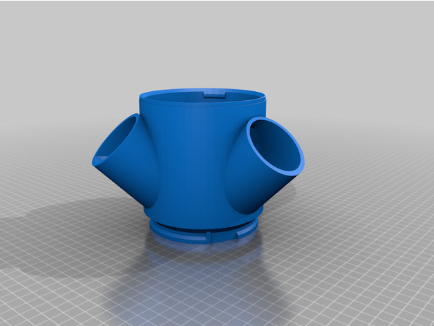</a> 
<b>Hydroponic Garden with modules</b> 
by RenatoCrespo99 
<a href="https://www.thingiverse.com/thing:5929335">Thingiverse</a> &middot; <a href="planters/Hydroponic_Garden_with_modules_5929335">Repo folder</a>
</td>
<td width="33%" align="center" valign="top">
<a href="planters/Low_Poly_Planter__-_Wide_Top_2999036">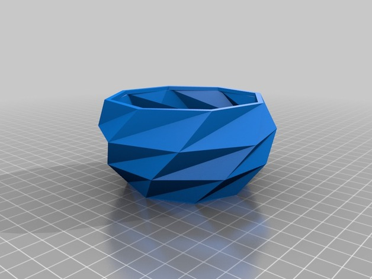</a> 
<b>Low Poly Planter  - Wide Top</b> 
by OmNomNomagon 
<a href="https://www.thingiverse.com/thing:2999036">Thingiverse</a> &middot; <a href="planters/Low_Poly_Planter__-_Wide_Top_2999036">Repo folder</a>
</td>
<td width="33%" align="center" valign="top">
<a href="planters/Modern_geometric_Succulent_plant_pot__4591435">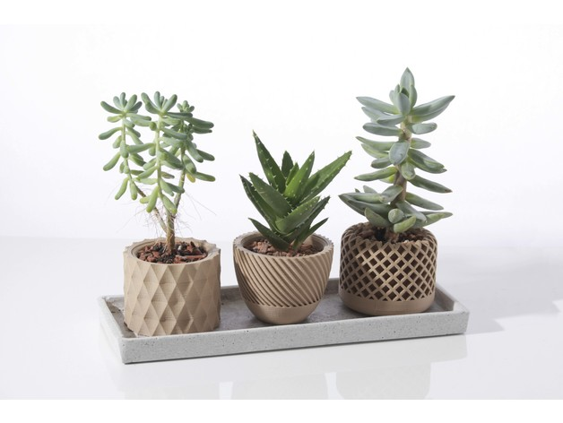</a> 
<b>Modern geometric Succulent plant pot</b> 
by SchulteGeileTechnik 
<a href="https://www.thingiverse.com/thing:4591435">Thingiverse</a> &middot; <a href="planters/Modern_geometric_Succulent_plant_pot__4591435">Repo folder</a>
</td>
</tr>
<tr>
<td width="33%" align="center" valign="top">
 
<b>Modern spiral planter</b> 
by SchulteGeileTechnik 
<a href="https://www.printables.com/model/225251-modern-spiral-planter">Printables</a> &middot; <a href="planters/modern-spiral-planter-model_files">Repo folder</a>
</td>
<td width="33%" align="center" valign="top">
 
<b>Modular Self Watering Planter - Endless Expandability !</b> 
by Mossi Brossi 
<a href="https://www.printables.com/model/62972-modular-self-watering-planter-endless-expandabilit">Printables</a> &middot; <a href="planters/modular-self-watering-planter-endless-expandability-model_files">Repo folder</a>
</td>
<td width="33%" align="center" valign="top">
 
<b>Parametric Seed Starter</b> 
by Quint 
<a href="https://www.printables.com/model/122772-parametric-seed-starter">Printables</a> &middot; <a href="planters/parametric-seed-starter-model_files">Repo folder</a>
</td>
</tr>
<tr>
<td width="33%" align="center" valign="top">
 
<b>Parametric Self Watering Planter w/ Water Level Indicator</b> 
by Justin 
<a href="https://www.printables.com/model/39715-parametric-self-watering-planter-w-water-level-ind">Printables</a> &middot; <a href="planters/parametric-self-watering-planter-w-water-level-indicator-model_files">Repo folder</a>
</td>
<td width="33%" align="center" valign="top">
 
<b>Parametrischer Pflanztopf</b> 
Source unknown &middot; <a href="planters/Parametrischer%20Pflanztopf.3mf">Parametrischer Pflanztopf.3mf</a>
</td>
<td width="33%" align="center" valign="top">
 
<b>Plantygon - Modular Geometric Stacking Planter for Succulents</b> 
by printfutura 
<a href="https://www.thingiverse.com/thing:2448911">Thingiverse</a> &middot; <a href="planters/Plantygon_-_Modular_Geometric_Stacking_Planter_for_Succulents">Repo folder</a>
</td>
</tr>
<tr>
<td width="33%" align="center" valign="top">
 
<b>Self-Watering Planter (Small)</b> 
by parallelgoods 
<a href="https://www.thingiverse.com/thing:903411">Thingiverse</a> &middot; <a href="planters/Self-Watering_Planter__Small__903411">Repo folder</a>
</td>
<td width="33%" align="center" valign="top">
 
<b>Small Geometric Planter</b> 
by Julian1111 
<a href="https://www.printables.com/model/221739-small-geometric-planter">Printables</a> &middot; <a href="planters/small-geometric-planter-model_files">Repo folder</a>
</td>
<td width="33%" align="center" valign="top">
<i>no preview</i> 
<b>Smart Indoor Mini Herb Garden 2.0 ESP32 Automated</b> 
<a href="https://makerworld.com/en/search/models?keyword=Smart%20Indoor%20Mini%20Herb%20Garden%202.0%20ESP32%20Automated">Search MakerWorld</a> &middot; <a href="planters/Smart%2BIndoor%2BMini%2BHerb%2BGarden%2B2.0%2B_ESP32%2BAutomated">Repo folder</a>
</td>
</tr>
<tr>
<td width="33%" align="center" valign="top">
 
<b>Succulent Planter 11</b> 
by cgpena 
<a href="https://www.thingiverse.com/thing:3005472">Thingiverse</a> &middot; <a href="planters/Succulent_Planter_11_3005472">Repo folder</a>
</td>
<td width="33%" align="center" valign="top">
 
<b>Suculent Planter / Maceta para Suculentas</b> 
by SURPRINT3D 
<a href="https://www.printables.com/model/4078-suculent-planter-maceta-para-suculentas">Printables</a> &middot; <a href="planters/suculent-planter-maceta-para-suculentas-model_files">Repo folder</a>
</td>
<td width="33%" align="center" valign="top">
 
<b>Vasemania: Low poly vases</b> 
by Ferjerez 
<a href="https://www.thingiverse.com/thing:2638924">Thingiverse</a> &middot; <a href="planters/Vasemania__Low_poly_vases_2638924">Repo folder</a>
</td>
</tr>
</table>

## Shoes

<table>
<tr>
<td width="33%" align="center" valign="top">
 
<b>Legs for shoe rack stackable by emay.design</b> 
by Boeghs 
<a href="https://makerworld.com/en/models/1165099-legs-for-shoe-rack-stackable-by-emay-design">MakerWorld</a> &middot; <a href="shoes/Legs%2Bfor%2Bshoe%2Brack%2Bstackable%2Bby%2Bemay.design">Repo folder</a>
</td>
<td width="33%" align="center" valign="top">
 
<b>Shoe Rack Stackable</b> 
by EMAY-DESIGN 
<a href="https://makerworld.com/en/models/1105944-shoe-rack-stackable">MakerWorld</a> &middot; <a href="shoes/Shoe%2BRack%2BStackable">Repo folder</a>
</td>
</tr>
</table>

