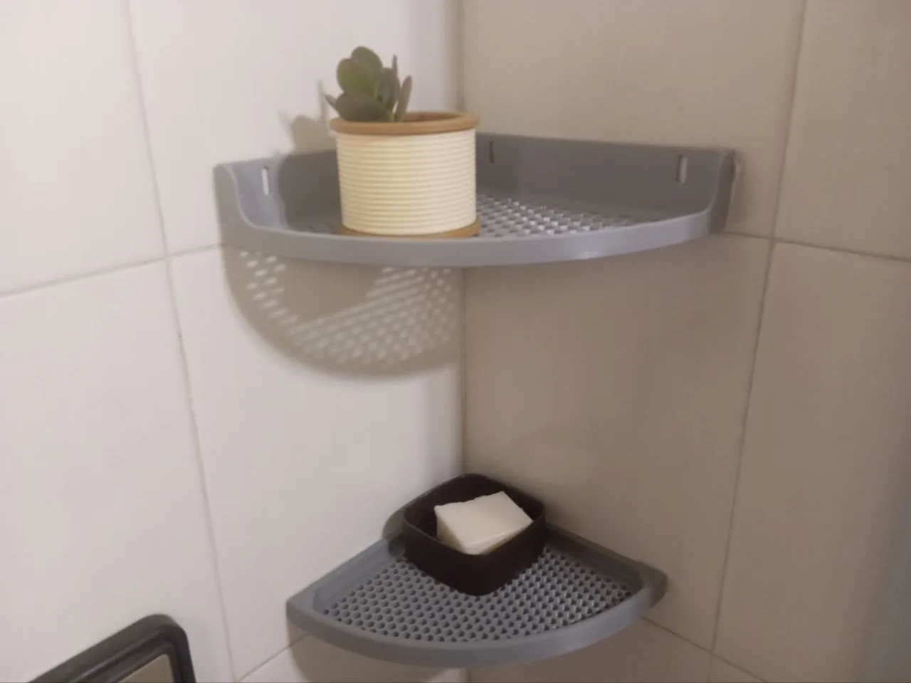
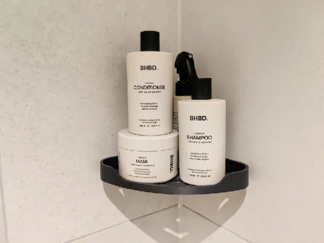
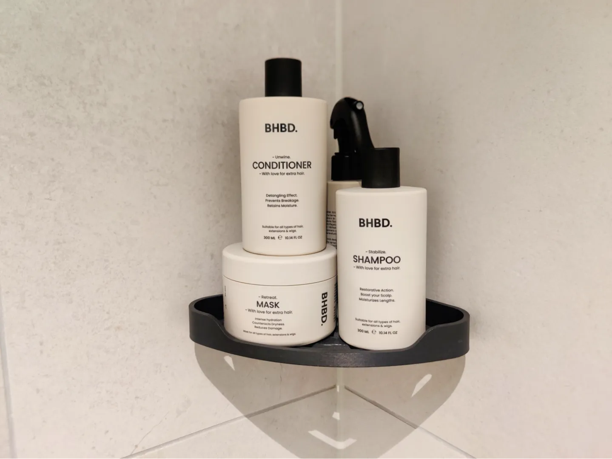
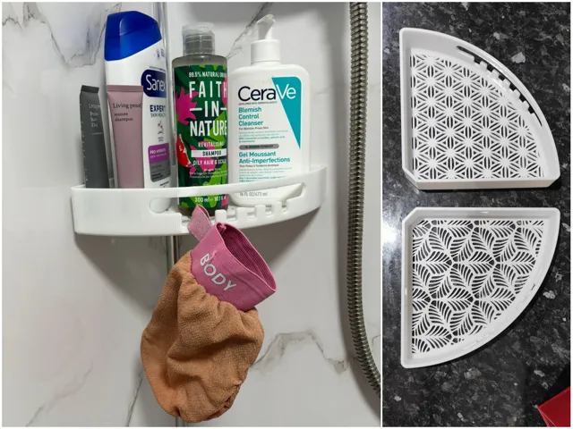
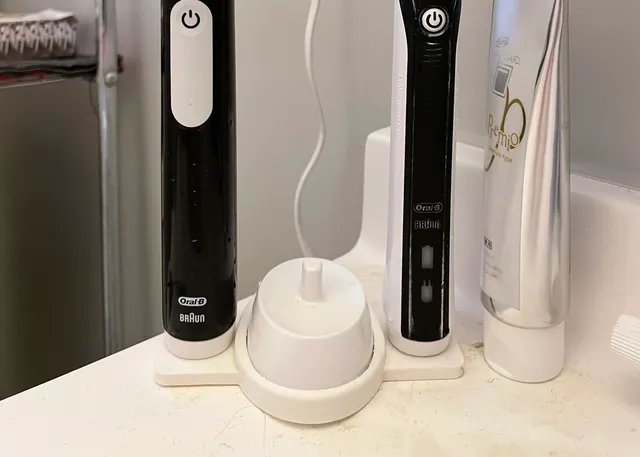
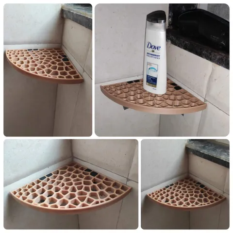

# Bathroom

<!-- Generated by scripts/Update-Readmes.ps1 (Linux: scripts/update_readmes.py) - edit scripts/readme-sources.json and rerun instead of editing by hand. -->

[Home](../../README.md) / [Home](../README.md) / **Bathroom**

7 builds &middot; 2 MakerWorld &middot; 3 Printables &middot; 2 unknown source

## Bathroom

<table>
<tr>
<td width="33%" align="center" valign="top">
 
<b>A1-corner-shelf-PLA</b> 
Source unknown &middot; <a href="A1-corner-shelf-PLA.3mf">A1-corner-shelf-PLA.3mf</a>
</td>
<td width="33%" align="center" valign="top">
 
<b>Bathroom corner shelf - No drilling</b> 
by Frasse16 
<a href="https://www.printables.com/model/712408-bathroom-corner-shelf-no-drilling">Printables</a> &middot; <a href="bathroom-corner-shelf-no-drilling-model_files">Repo folder</a>
</td>
<td width="33%" align="center" valign="top">
 
<b>Bathroom-shelf</b> 
Source unknown &middot; <a href="Bathroom-shelf.3mf">Bathroom-shelf.3mf</a>
</td>
</tr>
<tr>
<td width="33%" align="center" valign="top">
 
<b>Corner Shower Caddy, Bathroom Shelf with Drainage</b> 
by Zen Aku 
<a href="https://makerworld.com/en/models/1963711-corner-shower-caddy-bathroom-shelf-with-drainage">MakerWorld</a> &middot; <a href="Corner%2BShower%2BCaddy%2C%2BBathroom%2BShelf%2Bwith%2BDrainage">Repo folder</a>
</td>
<td width="33%" align="center" valign="top">
<i>no preview</i> 
<b>DuschablageV1</b> 
<a href="https://makerworld.com/en/search/models?keyword=DuschablageV1">Search MakerWorld</a> &middot; <a href="DuschablageV1_stls">Repo folder</a>
</td>
<td width="33%" align="center" valign="top">
 
<b>Small space Oral B toothbrush stand for 2</b> 
by r0bespierre 
<a href="https://www.printables.com/model/198570-small-space-oral-b-toothbrush-stand-for-2">Printables</a> &middot; <a href="small-space-oral-b-toothbrush-stand-for-2-model_files">Repo folder</a>
</td>
</tr>
<tr>
<td width="33%" align="center" valign="top">
 
<b>Voronoi bathroom corner shelf</b> 
by CJ 
<a href="https://www.printables.com/model/719794-voronoi-bathroom-corner-shelf">Printables</a> &middot; <a href="voronoi-bathroom-corner-shelf-model_files">Repo folder</a>
</td>
</tr>
</table>

