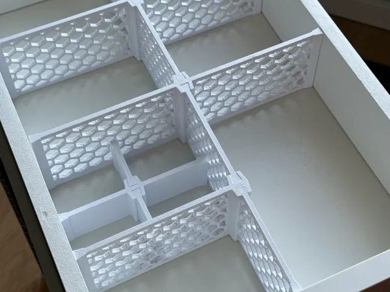
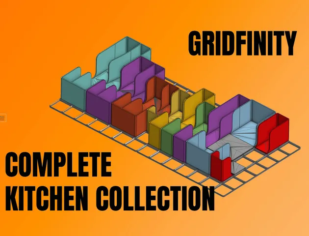
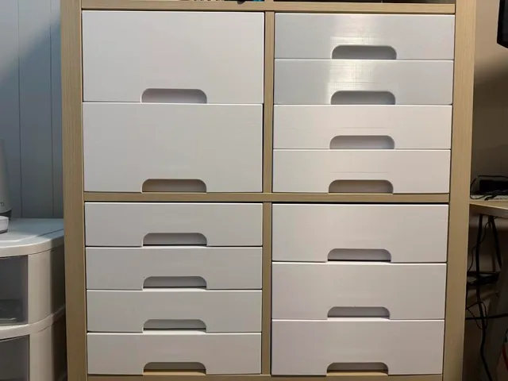
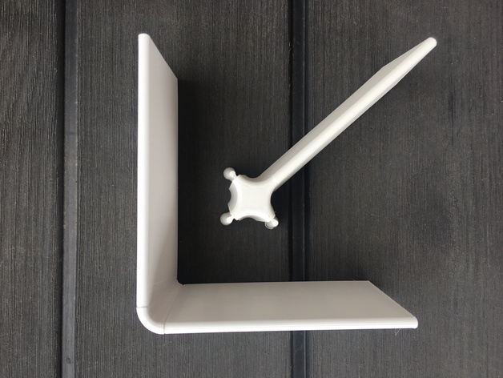
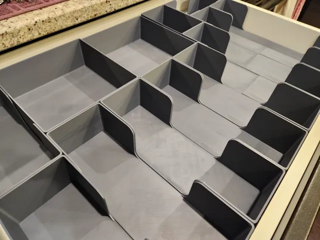

# Drawer Organization

<!-- Generated by scripts/Update-Readmes.ps1 (Linux: scripts/update_readmes.py) - edit scripts/readme-sources.json and rerun instead of editing by hand. -->

[Home](../../README.md) / [Home](../README.md) / **Drawer Organization**

7 builds &middot; 4 MakerWorld &middot; 1 Printables &middot; 1 Thingiverse &middot; 1 unknown source

## Drawer Organization

<table>
<tr>
<td width="33%" align="center" valign="top">
 
<b>Easy-Peasy Customizable Drawer Dividers v2</b> 
by printurd 
<a href="https://makerworld.com/en/models/1319616-easy-peasy-customizable-drawer-dividers-v2">MakerWorld</a> &middot; <a href="Easy-Peasy%2BCustomizable%2BDrawer%2BDividers%2Bv2">Repo folder</a>
</td>
<td width="33%" align="center" valign="top">
 
<b>Gridfinity Complete Kitchen Collection (w/ Modular Expansion Pieces)</b> 
by The Next Layer 
<a href="https://www.printables.com/model/719729-gridfinity-complete-kitchen-collection-w-modular-e">Printables</a> &middot; <a href="gridfinity-complete-kitchen-collection-w-modular-expansion-pieces-model_files">Repo folder</a>
</td>
<td width="33%" align="center" valign="top">
<i>no preview</i> 
<b>Gridfinity Kitchen Drawer Organizers Collection</b> 
Source unknown &middot; <a href="Gridfinity%20Kitchen%20Drawer%20Organizers%20Collection">Repo folder</a>
</td>
</tr>
<tr>
<td width="33%" align="center" valign="top">
 
<b>IKEA Kallax Drawer System</b> 
by tedgar 
<a href="https://makerworld.com/en/models/2264316-ikea-kallax-drawer-system">MakerWorld</a> &middot; <a href="IKEA%2BKallax%2BDrawer%2BSystem">Repo folder</a>
</td>
<td width="33%" align="center" valign="top">
<i>no preview</i> 
<b>Kallax Drawer-FRONT</b> 
<a href="https://makerworld.com/en/search/models?keyword=Kallax%20Drawer-FRONT">Search MakerWorld</a> &middot; <a href="Kallax%2BDrawer-FRONT_stls">Repo folder</a>
</td>
<td width="33%" align="center" valign="top">
 
<b>Modular Drawer Organizer</b> 
by wbu42 
<a href="https://www.thingiverse.com/thing:3827538">Thingiverse</a> &middot; <a href="Modular_Drawer_Organizer_3827538">Repo folder</a>
</td>
</tr>
<tr>
<td width="33%" align="center" valign="top">
 
<b>Ultimate Gridfinity Kitchen Drawer Organizer</b> 
by Valorian 
<a href="https://makerworld.com/en/models/608048-ultimate-gridfinity-kitchen-drawer-organizer">MakerWorld</a> &middot; <a href="Ultimate%2BGridfinity%2BKitchen%2BDrawer%2BOrganizer">Repo folder</a>
</td>
</tr>
</table>

