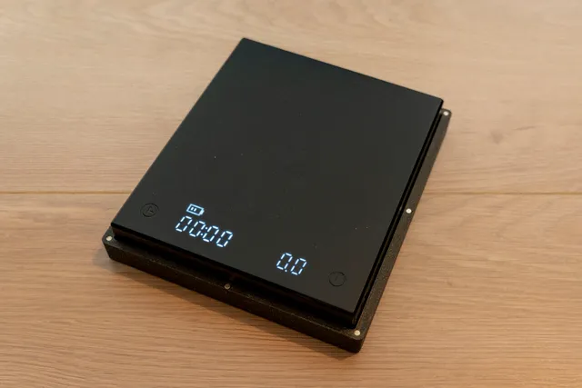

# Espresso

<!-- Generated by scripts/Update-Readmes.ps1 (Linux: scripts/update_readmes.py) - edit scripts/readme-sources.json and rerun instead of editing by hand. -->

[Home](../../README.md) / [Home](../README.md) / **Espresso**

2 builds &middot; 1 Printables &middot; 1 unknown source &middot; 1 collections (6 more builds)

## Collections

- [Grinder](grinder/README.md) - 6 builds

## Scale

<table>
<tr>
<td width="33%" align="center" valign="top">
 
<b>Timemore Black Mirror Basic Plus - Travel Case</b> 
by Jakub Huspek 
<a href="https://www.printables.com/model/574328-timemore-black-mirror-basic-plus-travel-case">Printables</a> &middot; <a href="scale/timemore-black-mirror-basic-plus-travel-case-model_files">Repo folder</a>
</td>
</tr>
</table>

Other files in this folder (1)

- [TIMEMORE BLACKMIRROR COVER v2.stl](scale/TIMEMORE%20BLACKMIRROR%20COVER%20v2.stl)

