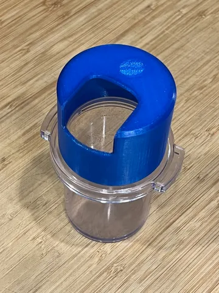
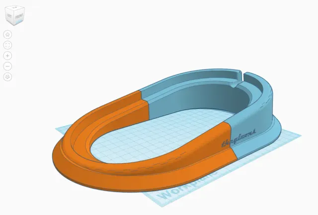
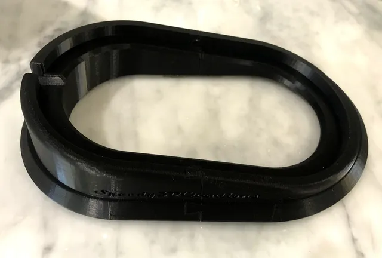
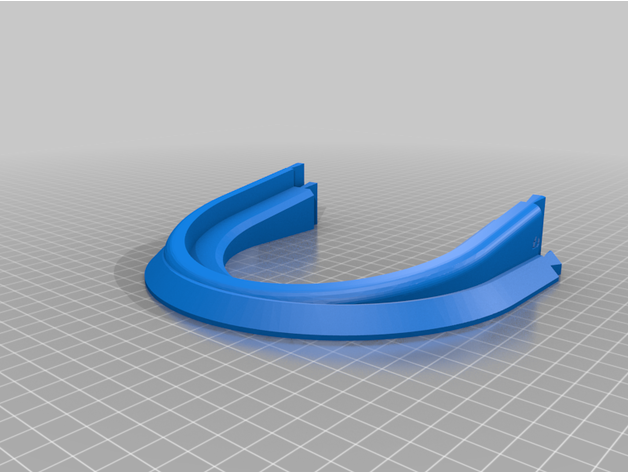

# Grinder

<!-- Generated by scripts/Update-Readmes.ps1 (Linux: scripts/update_readmes.py) - edit scripts/readme-sources.json and rerun instead of editing by hand. -->

[Home](../../../README.md) / [Home](../../README.md) / [Espresso](../README.md) / **Grinder**

6 builds &middot; 3 Printables &middot; 1 Thingiverse &middot; 2 unknown source

## Grinder

<table>
<tr>
<td width="33%" align="center" valign="top">
 
<b>DF64 cup lid</b> 
by Sto 
<a href="https://www.printables.com/model/449701-df64-cup-lid">Printables</a> &middot; <a href="df64-cup-lid-model_files">Repo folder</a>
</td>
<td width="33%" align="center" valign="top">
 
<b>DF64 Tilt Base Split in Half</b> 
by soemarko 
<a href="https://www.printables.com/model/191618-df64-tilt-base-split-in-half">Printables</a> &middot; <a href="df64-tilt-base-split-in-half-model_files">Repo folder</a>
</td>
<td width="33%" align="center" valign="top">
 
<b>DF64 Two piece dovetailed 10 Degree Tilted Base</b> 
by jkim_makes 
<a href="https://www.printables.com/model/105122-df64-two-piece-dovetailed-10-degree-tilted-base">Printables</a> &middot; <a href="df64-two-piece-dovetailed-10-degree-tilted-base-model_files">Repo folder</a>
</td>
</tr>
<tr>
<td width="33%" align="center" valign="top">
 
<b>DF64 Two piece dovetailed 10 Degree Tilted Base</b> 
by jkim_makes 
<a href="https://www.thingiverse.com/thing:4904042">Thingiverse</a> &middot; <a href="DF64_Two_piece_dovetailed_10_Degree_Tilted_Base_4904042">Repo folder</a>
</td>
</tr>
</table>

Other files in this folder (2)

- [DF64_-_dosing_ramp.stl](DF64_-_dosing_ramp.stl)
- [df64_holder_v7.stl](df64_holder_v7.stl)

