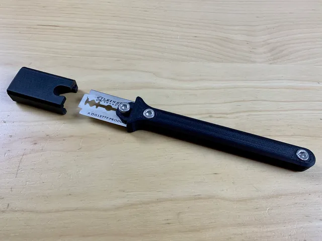

# Kitchen

<!-- Generated by scripts/Update-Readmes.ps1 (Linux: scripts/update_readmes.py) - edit scripts/readme-sources.json and rerun instead of editing by hand. -->

[Home](../../README.md) / [Home](../README.md) / **Kitchen**

1 builds &middot; 1 Printables &middot; 5 collections (19 more builds)

## Collections

- [Garbage Bags](garbage-bags/README.md) - 4 builds
- [Kitchenaid Mixer Accessories](kitchenaid-mixer-accessories/README.md) - 4 builds
- [Oxo Scale Stand](oxo-scale-stand/README.md) - 3 builds
- [Plate Stands](plate-stands/README.md) - 6 builds
- [Pop Can Organizer](pop-can-organizer/README.md) - 2 builds

## Kitchen

<table>
<tr>
<td width="33%" align="center" valign="top">
 
<b>Blade lame v2</b> 
by fns720 
<a href="https://www.printables.com/model/32303-blade-lame-v2">Printables</a> &middot; <a href="blade-lame-v2-model_files">Repo folder</a>
</td>
</tr>
</table>

