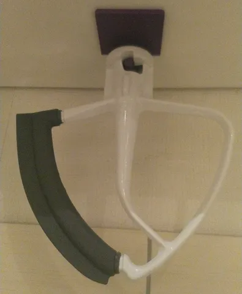
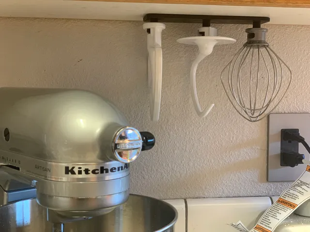
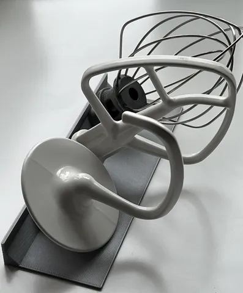

# Kitchenaid Mixer Accessories

<!-- Generated by scripts/Update-Readmes.ps1 (Linux: scripts/update_readmes.py) - edit scripts/readme-sources.json and rerun instead of editing by hand. -->

[Home](../../../README.md) / [Home](../../README.md) / [Kitchen](../README.md) / **Kitchenaid Mixer Accessories**

4 builds &middot; 4 Printables

## Kitchenaid Mixer Accessories

<table>
<tr>
<td width="33%" align="center" valign="top">
 
<b>Kitchenaid Attachment Hanger No Support</b> 
by c3poSAW 
<a href="https://www.printables.com/model/129495-kitchenaid-attachment-hanger-no-support">Printables</a> &middot; <a href="kitchenaid-attachment-hanger-no-support-model_files">Repo folder</a>
</td>
<td width="33%" align="center" valign="top">
 
<b>KitchenAid Stand Mixer attachment hanger</b> 
by DownRight 
<a href="https://www.printables.com/model/751345-kitchenaid-stand-mixer-attachment-hanger">Printables</a> &middot; <a href="kitchenaid-stand-mixer-attachment-hangar-model_files">Repo folder</a>
</td>
<td width="33%" align="center" valign="top">
<i>no preview</i> 
<b>Kitchenaid Stand Mixer Cable Wrap</b> 
<a href="https://www.printables.com/model/535974">Printables</a> &middot; <a href="kitchenaid-stand-mixer-cable-wrap-model_files">Repo folder</a>
</td>
</tr>
<tr>
<td width="33%" align="center" valign="top">
 
<b>Stand for Kitchen Aid attachments</b> 
by The occasional extrusionist 
<a href="https://www.printables.com/model/251474-stand-for-kitchen-aid-attachments">Printables</a> &middot; <a href="stand-for-kitchen-aid-attachments-model_files">Repo folder</a>
</td>
</tr>
</table>

