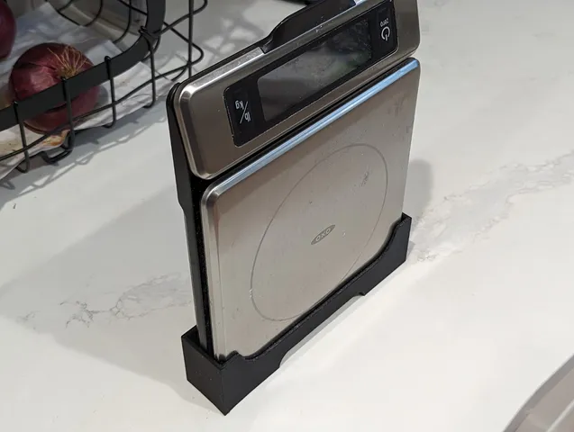
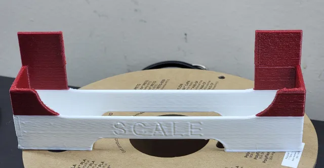
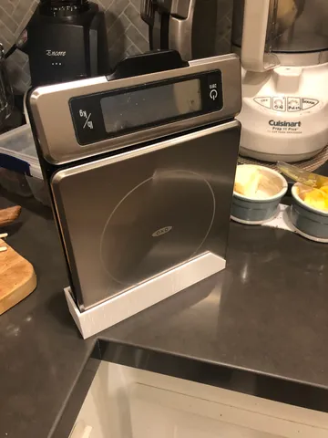

# Oxo Scale Stand

<!-- Generated by scripts/Update-Readmes.ps1 (Linux: scripts/update_readmes.py) - edit scripts/readme-sources.json and rerun instead of editing by hand. -->

[Home](../../../README.md) / [Home](../../README.md) / [Kitchen](../README.md) / **Oxo Scale Stand**

3 builds &middot; 3 Printables

## Oxo Scale Stand

<table>
<tr>
<td width="33%" align="center" valign="top">
 
<b>OXO Good Grips Food Scale Holder</b> 
by kitlaan 
<a href="https://www.printables.com/model/638840-oxo-good-grips-food-scale-holder">Printables</a> &middot; <a href="oxo-good-grips-food-scale-holder-model_files">Repo folder</a>
</td>
<td width="33%" align="center" valign="top">
 
<b>OXO Good Grips Food Scale Holder - With Double Sided Tape Mounting Tabs</b> 
by With_Maltodextrin 
<a href="https://www.printables.com/model/639048-oxo-good-grips-food-scale-holder-with-double-sided">Printables</a> &middot; <a href="oxo-good-grips-food-scale-holder-with-double-sided-tape-mounting-tabs-model_files">Repo folder</a>
</td>
<td width="33%" align="center" valign="top">
 
<b>OXO Scale Stand</b> 
by Shawn 
<a href="https://www.printables.com/model/57552-oxo-scale-stand">Printables</a> &middot; <a href="oxo-scale-stand-model_files">Repo folder</a>
</td>
</tr>
</table>

