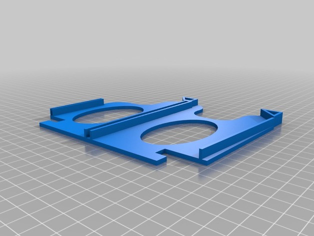
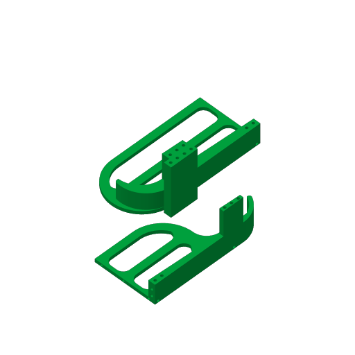

# Pop Can Organizer

<!-- Generated by scripts/Update-Readmes.ps1 (Linux: scripts/update_readmes.py) - edit scripts/readme-sources.json and rerun instead of editing by hand. -->

[Home](../../../README.md) / [Home](../../README.md) / [Kitchen](../README.md) / **Pop Can Organizer**

2 builds &middot; 1 Printables &middot; 1 Thingiverse

## Pop Can Organizer

<table>
<tr>
<td width="33%" align="center" valign="top">
 
<b>Refrigerator Beer / Pop Can Holder / Dispenser</b> 
by MR2C280 
<a href="https://www.thingiverse.com/thing:1121142">Thingiverse</a> &middot; <a href="Refrigerator_Beer___Pop_Can_Holder___Dispenser_1121142">Repo folder</a>
</td>
<td width="33%" align="center" valign="top">
 
<b>Stackable Can Dispenser</b> 
<a href="https://www.printables.com/model/732198">Printables</a> &middot; <a href="stackable-can-dispenser-model_files">Repo folder</a>
</td>
</tr>
</table>

