# Planters

<!-- Generated by scripts/Update-Readmes.ps1 (Linux: scripts/update_readmes.py) - edit scripts/readme-sources.json and rerun instead of editing by hand. -->

[Home](../../README.md) / [Home](../README.md) / **Planters**

18 builds &middot; 1 MakerWorld &middot; 9 Printables &middot; 7 Thingiverse &middot; 1 unknown source

## Planters

<table>
<tr>
<td width="33%" align="center" valign="top">
<a href="anti-sphere-plant-pot-and-planter-vase-mode-design-model_files">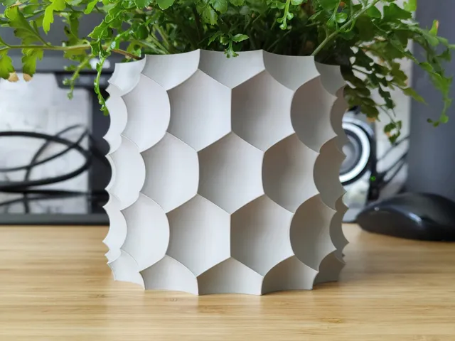</a> 
<b>Anti-sphere Plant pot and Planter - Vase mode design</b> 
by SASSy Design 
<a href="https://www.printables.com/model/538186-anti-sphere-plant-pot-and-planter-vase-mode-design">Printables</a> &middot; <a href="anti-sphere-plant-pot-and-planter-vase-mode-design-model_files">Repo folder</a>
</td>
<td width="33%" align="center" valign="top">
<a href="gerometric-origami-flower-pot-and-planter-for-plants-model_files">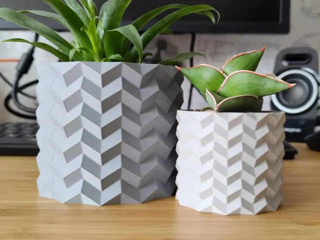</a> 
<b>Gerometric Origami Flower Pot and Planter for Plants</b> 
by SASSy Design 
<a href="https://www.printables.com/model/282130-gerometric-origami-flower-pot-and-planter-for-plan">Printables</a> &middot; <a href="gerometric-origami-flower-pot-and-planter-for-plants-model_files">Repo folder</a>
</td>
<td width="33%" align="center" valign="top">
<a href="helical-self-watering-planters-model_files">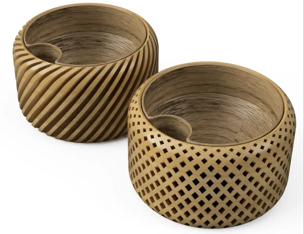</a> 
<b>Helical Self Watering Planters</b> 
by RB3D 
<a href="https://www.printables.com/model/65450-helical-self-watering-planters">Printables</a> &middot; <a href="helical-self-watering-planters-model_files">Repo folder</a>
</td>
</tr>
<tr>
<td width="33%" align="center" valign="top">
<a href="Hydroponic_Garden_with_modules_5929335">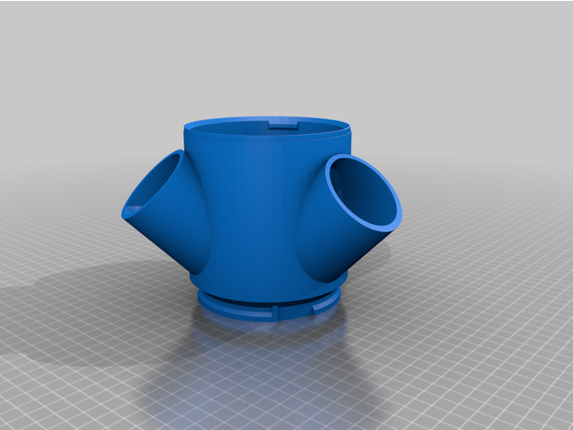</a> 
<b>Hydroponic Garden with modules</b> 
by RenatoCrespo99 
<a href="https://www.thingiverse.com/thing:5929335">Thingiverse</a> &middot; <a href="Hydroponic_Garden_with_modules_5929335">Repo folder</a>
</td>
<td width="33%" align="center" valign="top">
<a href="Low_Poly_Planter__-_Wide_Top_2999036">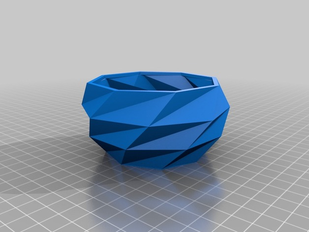</a> 
<b>Low Poly Planter  - Wide Top</b> 
by OmNomNomagon 
<a href="https://www.thingiverse.com/thing:2999036">Thingiverse</a> &middot; <a href="Low_Poly_Planter__-_Wide_Top_2999036">Repo folder</a>
</td>
<td width="33%" align="center" valign="top">
<a href="Modern_geometric_Succulent_plant_pot__4591435">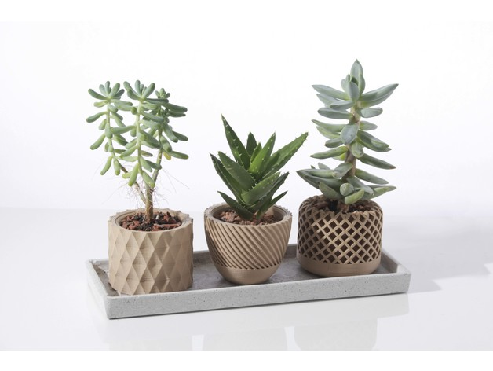</a> 
<b>Modern geometric Succulent plant pot</b> 
by SchulteGeileTechnik 
<a href="https://www.thingiverse.com/thing:4591435">Thingiverse</a> &middot; <a href="Modern_geometric_Succulent_plant_pot__4591435">Repo folder</a>
</td>
</tr>
<tr>
<td width="33%" align="center" valign="top">
<a href="modern-spiral-planter-model_files">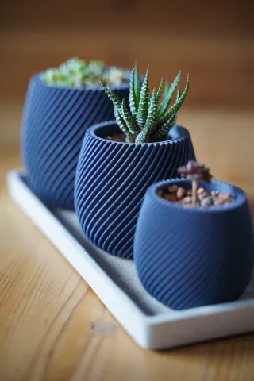</a> 
<b>Modern spiral planter</b> 
by SchulteGeileTechnik 
<a href="https://www.printables.com/model/225251-modern-spiral-planter">Printables</a> &middot; <a href="modern-spiral-planter-model_files">Repo folder</a>
</td>
<td width="33%" align="center" valign="top">
<a href="modular-self-watering-planter-endless-expandability-model_files">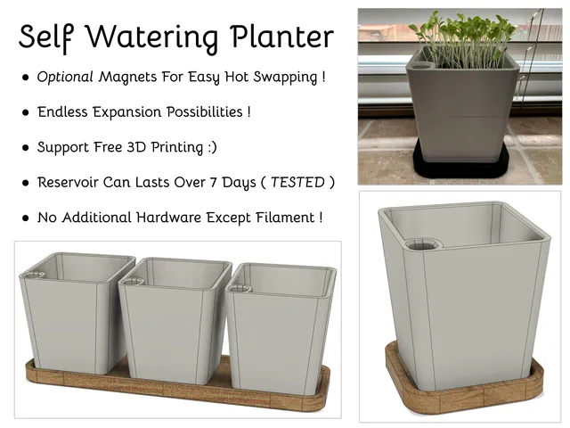</a> 
<b>Modular Self Watering Planter - Endless Expandability !</b> 
by Mossi Brossi 
<a href="https://www.printables.com/model/62972-modular-self-watering-planter-endless-expandabilit">Printables</a> &middot; <a href="modular-self-watering-planter-endless-expandability-model_files">Repo folder</a>
</td>
<td width="33%" align="center" valign="top">
<a href="parametric-seed-starter-model_files">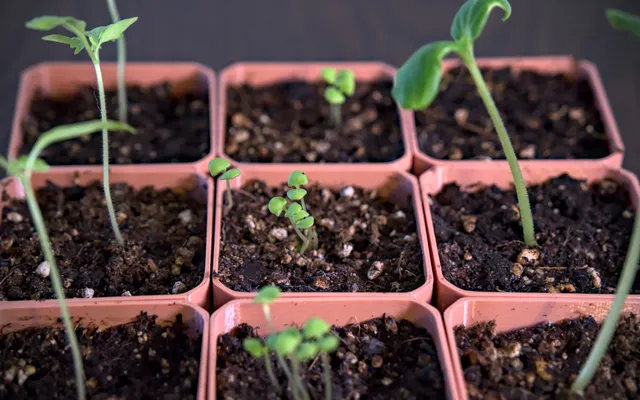</a> 
<b>Parametric Seed Starter</b> 
by Quint 
<a href="https://www.printables.com/model/122772-parametric-seed-starter">Printables</a> &middot; <a href="parametric-seed-starter-model_files">Repo folder</a>
</td>
</tr>
<tr>
<td width="33%" align="center" valign="top">
<a href="parametric-self-watering-planter-w-water-level-indicator-model_files">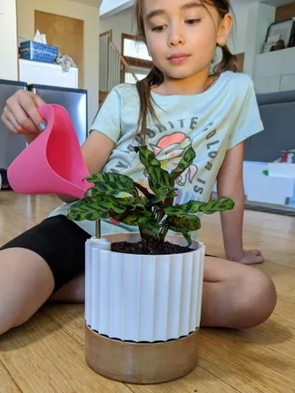</a> 
<b>Parametric Self Watering Planter w/ Water Level Indicator</b> 
by Justin 
<a href="https://www.printables.com/model/39715-parametric-self-watering-planter-w-water-level-ind">Printables</a> &middot; <a href="parametric-self-watering-planter-w-water-level-indicator-model_files">Repo folder</a>
</td>
<td width="33%" align="center" valign="top">
<a href="Parametrischer%20Pflanztopf.3mf">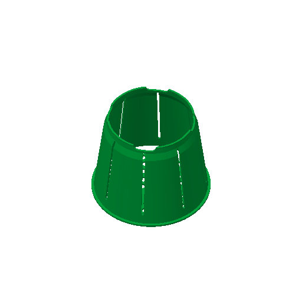</a> 
<b>Parametrischer Pflanztopf</b> 
Source unknown &middot; <a href="Parametrischer%20Pflanztopf.3mf">Parametrischer Pflanztopf.3mf</a>
</td>
<td width="33%" align="center" valign="top">
<a href="Plantygon_-_Modular_Geometric_Stacking_Planter_for_Succulents">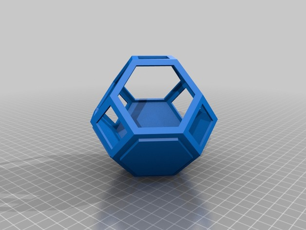</a> 
<b>Plantygon - Modular Geometric Stacking Planter for Succulents</b> 
by printfutura 
<a href="https://www.thingiverse.com/thing:2448911">Thingiverse</a> &middot; <a href="Plantygon_-_Modular_Geometric_Stacking_Planter_for_Succulents">Repo folder</a>
</td>
</tr>
<tr>
<td width="33%" align="center" valign="top">
<a href="Self-Watering_Planter__Small__903411">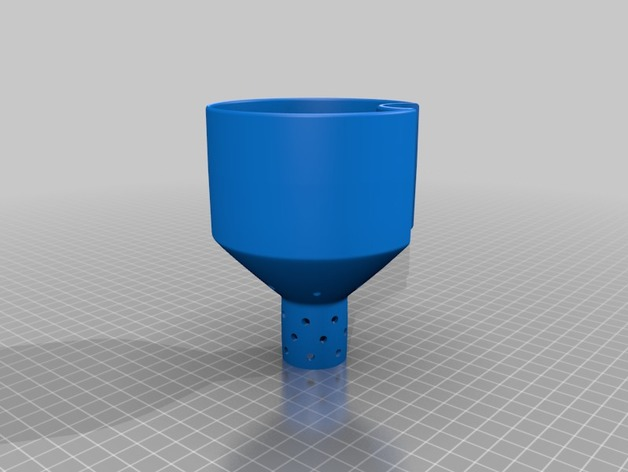</a> 
<b>Self-Watering Planter (Small)</b> 
by parallelgoods 
<a href="https://www.thingiverse.com/thing:903411">Thingiverse</a> &middot; <a href="Self-Watering_Planter__Small__903411">Repo folder</a>
</td>
<td width="33%" align="center" valign="top">
<a href="small-geometric-planter-model_files">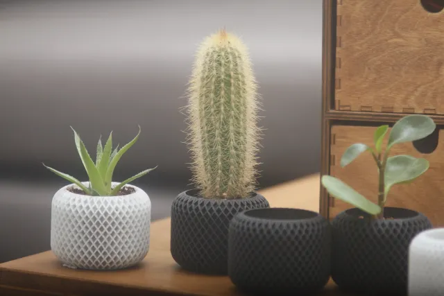</a> 
<b>Small Geometric Planter</b> 
by Julian1111 
<a href="https://www.printables.com/model/221739-small-geometric-planter">Printables</a> &middot; <a href="small-geometric-planter-model_files">Repo folder</a>
</td>
<td width="33%" align="center" valign="top">
<i>no preview</i> 
<b>Smart Indoor Mini Herb Garden 2.0 ESP32 Automated</b> 
<a href="https://makerworld.com/en/search/models?keyword=Smart%20Indoor%20Mini%20Herb%20Garden%202.0%20ESP32%20Automated">Search MakerWorld</a> &middot; <a href="Smart%2BIndoor%2BMini%2BHerb%2BGarden%2B2.0%2B_ESP32%2BAutomated">Repo folder</a>
</td>
</tr>
<tr>
<td width="33%" align="center" valign="top">
<a href="Succulent_Planter_11_3005472">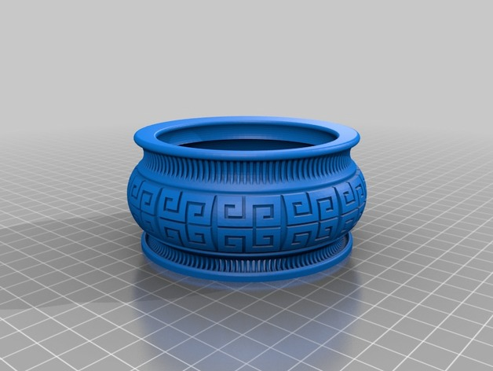</a> 
<b>Succulent Planter 11</b> 
by cgpena 
<a href="https://www.thingiverse.com/thing:3005472">Thingiverse</a> &middot; <a href="Succulent_Planter_11_3005472">Repo folder</a>
</td>
<td width="33%" align="center" valign="top">
<a href="suculent-planter-maceta-para-suculentas-model_files">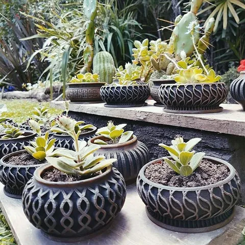</a> 
<b>Suculent Planter / Maceta para Suculentas</b> 
by SURPRINT3D 
<a href="https://www.printables.com/model/4078-suculent-planter-maceta-para-suculentas">Printables</a> &middot; <a href="suculent-planter-maceta-para-suculentas-model_files">Repo folder</a>
</td>
<td width="33%" align="center" valign="top">
<a href="Vasemania__Low_poly_vases_2638924">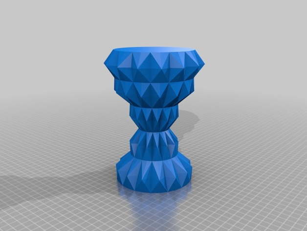</a> 
<b>Vasemania: Low poly vases</b> 
by Ferjerez 
<a href="https://www.thingiverse.com/thing:2638924">Thingiverse</a> &middot; <a href="Vasemania__Low_poly_vases_2638924">Repo folder</a>
</td>
</tr>
</table>

