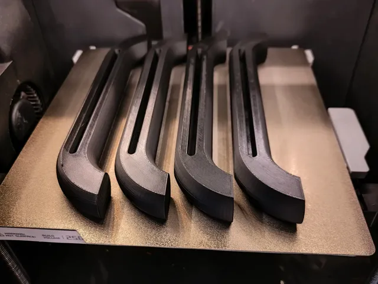
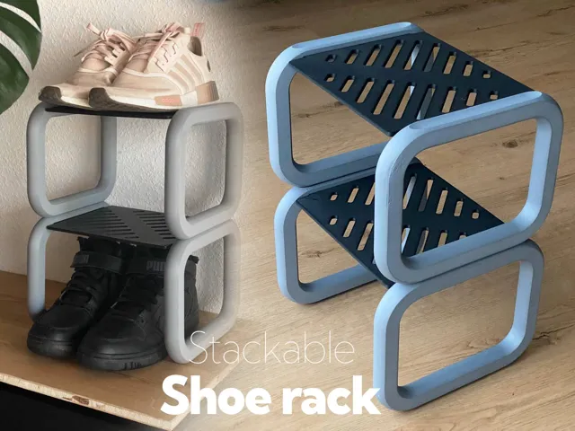

# Shoes

<!-- Generated by scripts/Update-Readmes.ps1 (Linux: scripts/update_readmes.py) - edit scripts/readme-sources.json and rerun instead of editing by hand. -->

[Home](../../README.md) / [Home](../README.md) / **Shoes**

2 builds &middot; 2 MakerWorld

## Shoes

<table>
<tr>
<td width="33%" align="center" valign="top">
 
<b>Legs for shoe rack stackable by emay.design</b> 
by Boeghs 
<a href="https://makerworld.com/en/models/1165099-legs-for-shoe-rack-stackable-by-emay-design">MakerWorld</a> &middot; <a href="Legs%2Bfor%2Bshoe%2Brack%2Bstackable%2Bby%2Bemay.design">Repo folder</a>
</td>
<td width="33%" align="center" valign="top">
 
<b>Shoe Rack Stackable</b> 
by EMAY-DESIGN 
<a href="https://makerworld.com/en/models/1105944-shoe-rack-stackable">MakerWorld</a> &middot; <a href="Shoe%2BRack%2BStackable">Repo folder</a>
</td>
</tr>
</table>

