# Printer Improvements

<!-- Generated by scripts/Update-Readmes.ps1 - edit scripts/readme-sources.json and rerun instead of editing by hand. -->

78 builds &middot; 4 MakerWorld &middot; 22 Printables &middot; 40 Thingiverse &middot; 12 unknown source

## Contents

- [Printer Improvements](#printer-improvements) (3)
- [Bambu](#bambu) (5)
- [Calibration](#calibration) (12)
- [Elegoo](#elegoo) (3)
- [Ender3 / Aesthetic Fixes](#ender3--aesthetic-fixes) (5)
- [Ender3 / Control Improvements](#ender3--control-improvements) (5)
- [Ender3 / Electronics](#ender3--electronics) (1)
- [Ender3 / Extrusion](#ender3--extrusion) (4)
- [Ender3 / Filament Guide](#ender3--filament-guide) (7)
- [Ender3 / Hotend](#ender3--hotend) (8)
- [Ender3 / Leveling](#ender3--leveling) (4)
- [Ender3 / Light](#ender3--light) (2)
- [Ender3 / Tools](#ender3--tools) (6)
- [Filament Guide](#filament-guide) (2)
- [Hotend](#hotend) (4)
- [Tools](#tools) (7)

## Printer Improvements

<table>
<tr>
<td width="33%" align="center" valign="top">
<a href="3m-filter-compatible-bayonet-model_files">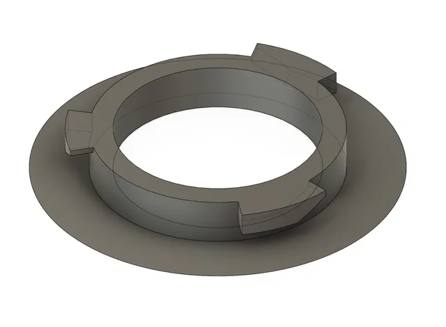</a> 
<b>3M filter compatible bayonet</b> 
by gencitch 
<a href="https://www.printables.com/model/461088-3m-filter-compatible-bayonet">Printables</a> &middot; <a href="3m-filter-compatible-bayonet-model_files">Repo folder</a>
</td>
<td width="33%" align="center" valign="top">
<a href="dessicant">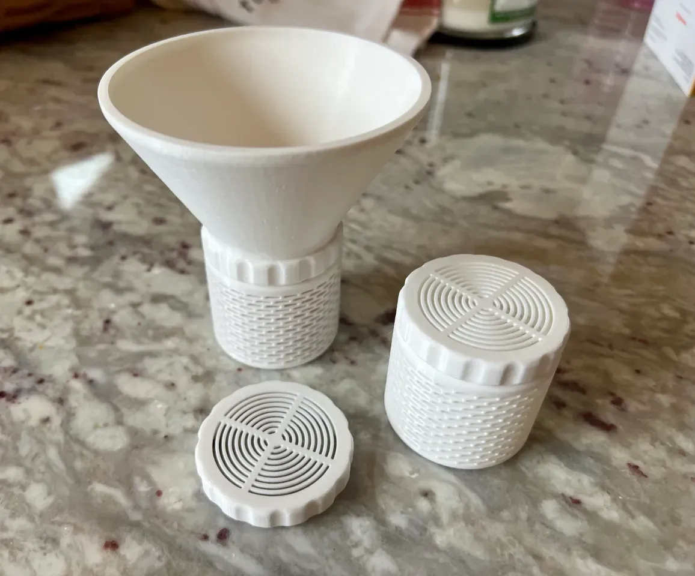</a> 
<b>Dessicant</b> 
Source unknown &middot; <a href="dessicant">Repo folder</a>
</td>
</tr>
</table>

Other files in this folder (1)

- [hardware-design-boards-model_files.zip](hardware-design-boards-model_files.zip)

## Bambu

<table>
<tr>
<td width="33%" align="center" valign="top">
<a href="bambu/AMS%2BStacking%2BSystem">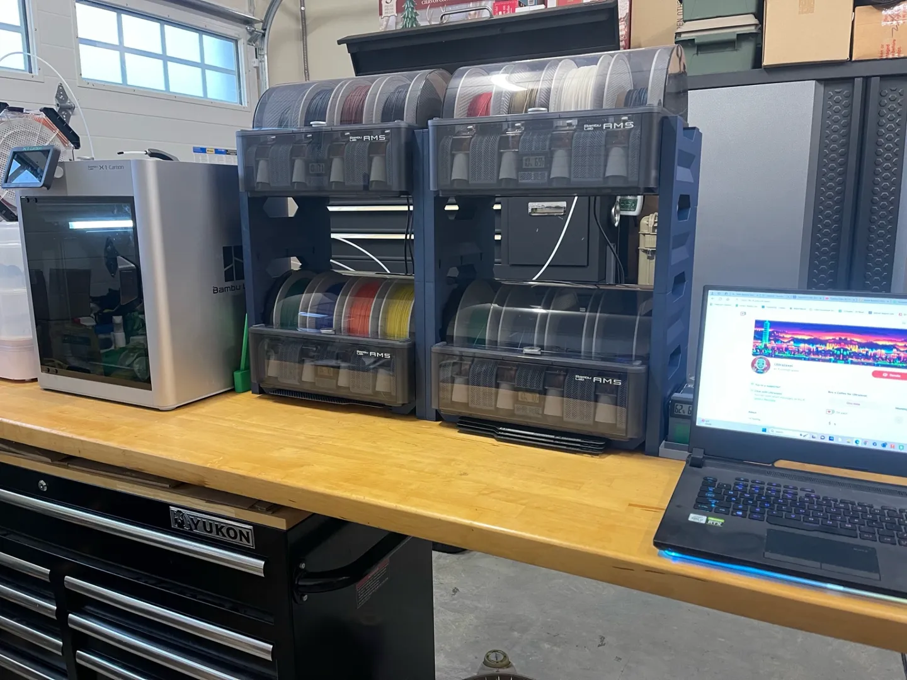</a> 
<b>AMS Stacking System</b> 
<a href="https://makerworld.com/en/search/models?keyword=AMS%20Stacking%20System">Search MakerWorld</a> &middot; <a href="bambu/AMS%2BStacking%2BSystem">Repo folder</a>
</td>
<td width="33%" align="center" valign="top">
<a href="bambu/bentobox-v20-carbon-filter-for-bambu-lab-x1c-enclosed-p1p-voron-trident-others-model_files">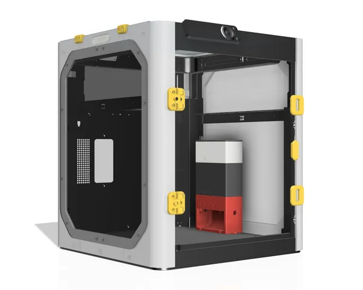</a> 
<b>BentoBox v2.0 Carbon filter for Bambu Lab X1C, enclosed P1P &amp; Voron Trident &amp; others?</b> 
by thrutheframe 
<a href="https://www.printables.com/model/272525-bentobox-v20-carbon-filter-for-bambu-lab-x1c-enclo">Printables</a> &middot; <a href="bambu/bentobox-v20-carbon-filter-for-bambu-lab-x1c-enclosed-p1p-voron-trident-others-model_files">Repo folder</a>
</td>
<td width="33%" align="center" valign="top">
<a href="bambu/Cable%2BTidy%2B-%2BX1-%2BP1S%2B-%2BP1P">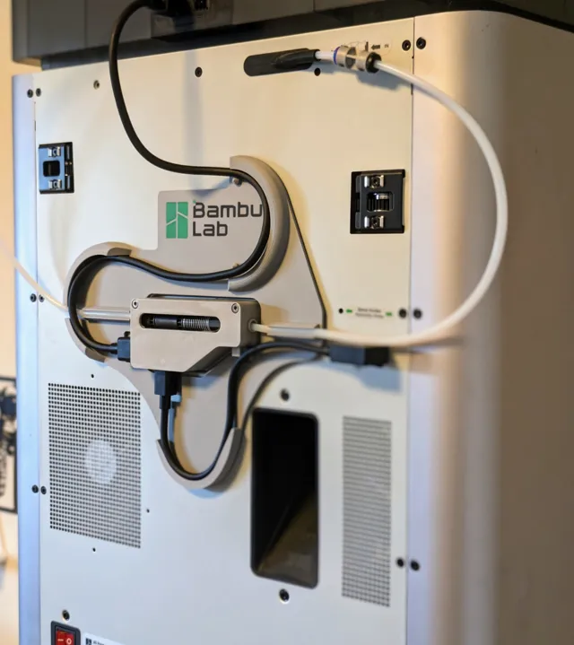</a> 
<b>Cable Tidy - X1- P1S - P1P</b> 
by KobaRiley 
<a href="https://makerworld.com/en/models/142877-cable-tidy-x1-p1s-p1p">MakerWorld</a> &middot; <a href="bambu/Cable%2BTidy%2B-%2BX1-%2BP1S%2B-%2BP1P">Repo folder</a>
</td>
</tr>
<tr>
<td width="33%" align="center" valign="top">
<a href="bambu/P1S%2Bgridfinity%2Bbase.3mf">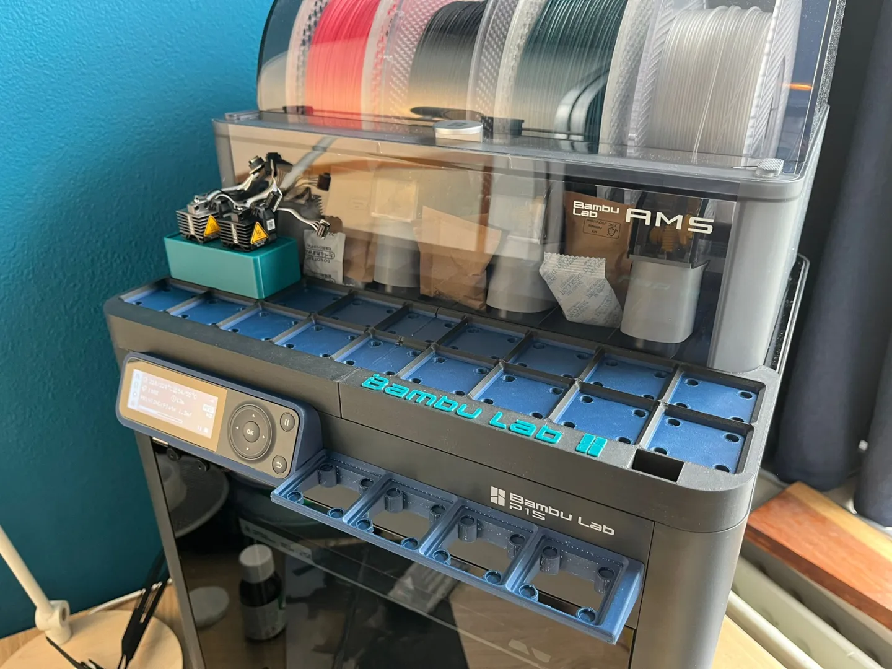</a> 
<b>P1S gridfinity base</b> 
<a href="https://makerworld.com/en/search/models?keyword=P1S%20gridfinity%20base">Search MakerWorld</a> &middot; <a href="bambu/P1S%2Bgridfinity%2Bbase.3mf">P1S+gridfinity+base.3mf</a>
</td>
<td width="33%" align="center" valign="top">
<a href="bambu/remixed-hepa-boxes-for-bento-box-v2-model_files">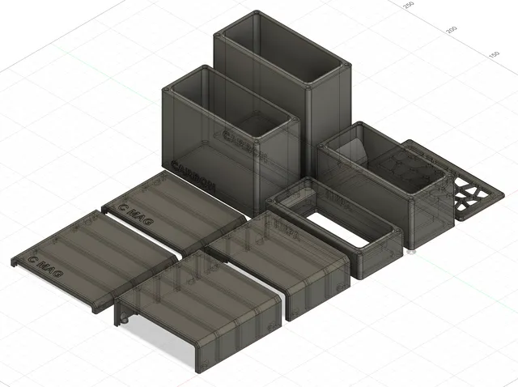</a> 
<b>Remixed HEPA boxes for Bento Box v2</b> 
by ShowStudio 
<a href="https://www.printables.com/model/654808-remixed-hepa-boxes-for-bento-box-v2">Printables</a> &middot; <a href="bambu/remixed-hepa-boxes-for-bento-box-v2-model_files">Repo folder</a>
</td>
</tr>
</table>

## Calibration

<table>
<tr>
<td width="33%" align="center" valign="top">
<a href="calibration/Ender_3_Smart_PLA_and_PETG_Temp_Tower__gcode_included__3912855">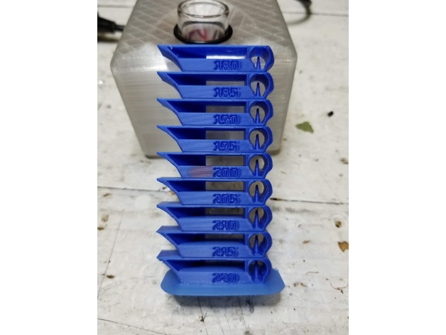</a> 
<b>Ender 3 Smart PLA and PETG Temp Tower (gcode included)</b> 
by evanphi 
<a href="https://www.thingiverse.com/thing:3912855">Thingiverse</a> &middot; <a href="calibration/Ender_3_Smart_PLA_and_PETG_Temp_Tower__gcode_included__3912855">Repo folder</a>
</td>
<td width="33%" align="center" valign="top">
<a href="calibration/filament-temp-tester-model_files">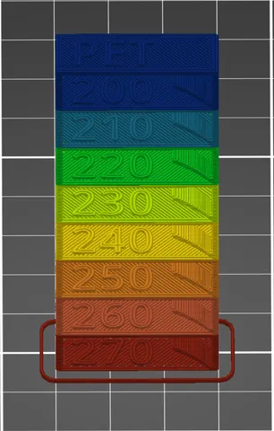</a> 
<b>Filament Temp Tester</b> 
by yahbluez 
<a href="https://www.printables.com/model/527657-filament-temp-tester">Printables</a> &middot; <a href="calibration/filament-temp-tester-model_files">Repo folder</a>
</td>
<td width="33%" align="center" valign="top">
<a href="calibration/speed-tower-test-your-maximum-print-speed-model_files">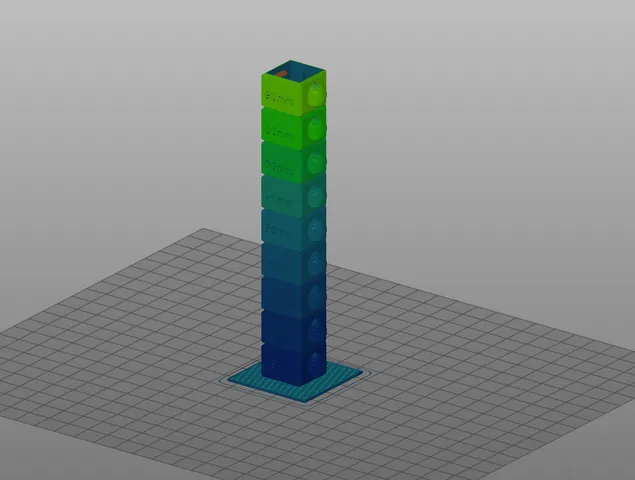</a> 
<b>Speed tower - test your maximum print speed</b> 
by Print-3D 
<a href="https://www.printables.com/model/22601-speed-tower-test-your-maximum-print-speed">Printables</a> &middot; <a href="calibration/speed-tower-test-your-maximum-print-speed-model_files">Repo folder</a>
</td>
</tr>
<tr>
<td width="33%" align="center" valign="top">
<a href="calibration/stress-free-first-layer-calibration-in-less-than-5-minutes-to-perfection-model_files">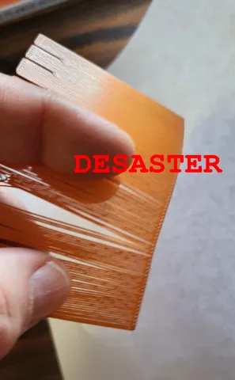</a> 
<b>Stress Free First Layer calibration in less than 5 Minutes to perfection</b> 
by yahbluez 
<a href="https://www.printables.com/model/251587-stress-free-first-layer-calibration-in-less-than-5">Printables</a> &middot; <a href="calibration/stress-free-first-layer-calibration-in-less-than-5-minutes-to-perfection-model_files">Repo folder</a>
</td>
<td width="33%" align="center" valign="top">
<a href="calibration/quick-temp-tower-model_files">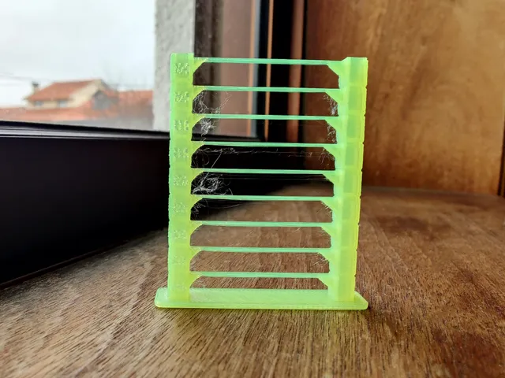</a> 
<b>Temp Tower (Fast)</b> 
by Celta 
<a href="https://www.printables.com/model/91526-temp-tower-fast">Printables</a> &middot; <a href="calibration/quick-temp-tower-model_files">Repo folder</a>
</td>
<td width="33%" align="center" valign="top">
<a href="calibration/Temp_tower_PLA__PETG__ABS_4149643">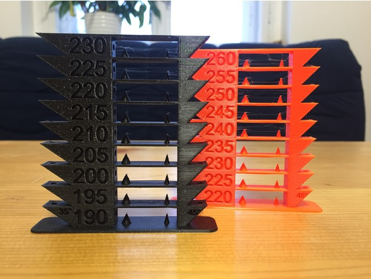</a> 
<b>Temp tower PLA, PETG, ABS</b> 
by krpavlu 
<a href="https://www.thingiverse.com/thing:4149643">Thingiverse</a> &middot; <a href="calibration/Temp_tower_PLA__PETG__ABS_4149643">Repo folder</a>
</td>
</tr>
<tr>
<td width="33%" align="center" valign="top">
<a href="calibration/The_House_Of_Benchmark_6140056">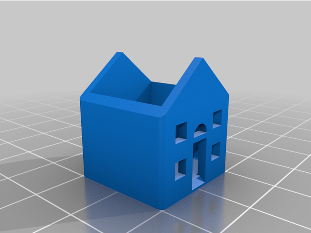</a> 
<b>The House Of Benchmark</b> 
by Kwerkshop 
<a href="https://www.thingiverse.com/thing:6140056">Thingiverse</a> &middot; <a href="calibration/The_House_Of_Benchmark_6140056">Repo folder</a>
</td>
</tr>
</table>

Other files in this folder (5)

- [11x11_10mm_square_bed_level_test.stl](calibration/11x11_10mm_square_bed_level_test.stl)
- [2x2_35mm_square_bed_level_test.stl](calibration/2x2_35mm_square_bed_level_test.stl)
- [3x3_25mm_square_bed_level_test.stl](calibration/3x3_25mm_square_bed_level_test.stl)
- [3x3_35mm_square_bed_level_test.stl](calibration/3x3_35mm_square_bed_level_test.stl)
- [parametric-bed-level-test-20200913.scad](calibration/parametric-bed-level-test-20200913.scad)

## Elegoo

<table>
<tr>
<td width="33%" align="center" valign="top">
<a href="elegoo/elegoo-neptune-4-pro-run-out-sensor-bracket-model_files">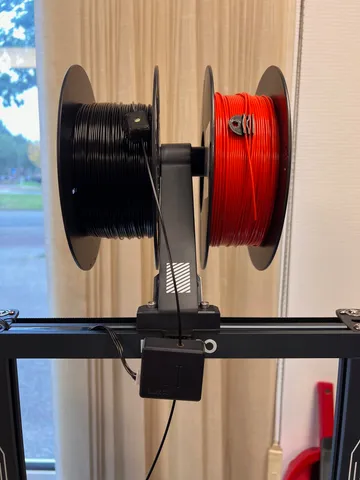</a> 
<b>Elegoo Neptune 4 (PRO) Run-Out sensor bracket</b> 
by Lesley91 
<a href="https://www.printables.com/model/610583-elegoo-neptune-4-pro-run-out-sensor-bracket">Printables</a> &middot; <a href="elegoo/elegoo-neptune-4-pro-run-out-sensor-bracket-model_files">Repo folder</a>
</td>
</tr>
</table>

Other files in this folder (2)

- [Elegoo Neptune 4 4Pro 3Plus 3Pro 3Max Left Side Screen Mount and Tool Holder.zip](elegoo/Elegoo%20Neptune%204%204Pro%203Plus%203Pro%203Max%20Left%20Side%20Screen%20Mount%20and%20Tool%20Holder.zip)
- [Left Side Screen Holder 45 Degree with tool holder-Body.stl](elegoo/Left%20Side%20Screen%20Holder%2045%20Degree%20with%20tool%20holder-Body.stl)

## Ender3 / Aesthetic Fixes

<table>
<tr>
<td width="33%" align="center" valign="top">
<a href="ender3/aesthetic-fixes/Ender_3_Cable_Chain__no_screws__no_unplug_cable_3769941">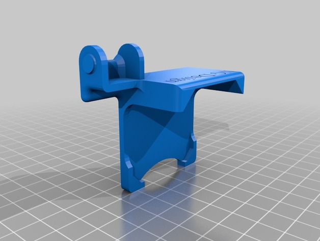</a> 
<b>Ender 3 Cable Chain, no screws, no unplug cable</b> 
by NG_Design 
<a href="https://www.thingiverse.com/thing:3769941">Thingiverse</a> &middot; <a href="ender3/aesthetic-fixes/Ender_3_Cable_Chain__no_screws__no_unplug_cable_3769941">Repo folder</a>
</td>
<td width="33%" align="center" valign="top">
<a href="ender3/aesthetic-fixes/Ender_3_Cable_Clips_2960375">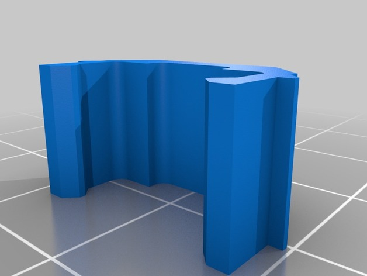</a> 
<b>Ender 3 Cable Clips</b> 
by Holspeed 
<a href="https://www.thingiverse.com/thing:2960375">Thingiverse</a> &middot; <a href="ender3/aesthetic-fixes/Ender_3_Cable_Clips_2960375">Repo folder</a>
</td>
<td width="33%" align="center" valign="top">
<a href="ender3/aesthetic-fixes/Ender_3_Touchscreen_Case___Holder_for_Raspberry_Pi_3030160">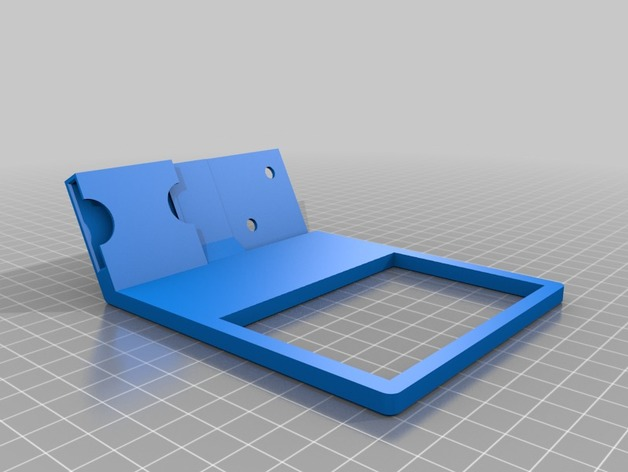</a> 
<b>Ender 3 Touchscreen Case &amp; Holder for Raspberry Pi</b> 
by Tronnic 
<a href="https://www.thingiverse.com/thing:3030160">Thingiverse</a> &middot; <a href="ender3/aesthetic-fixes/Ender_3_Touchscreen_Case___Holder_for_Raspberry_Pi_3030160">Repo folder</a>
</td>
</tr>
<tr>
<td width="33%" align="center" valign="top">
<a href="ender3/aesthetic-fixes/ender-3-v2-v-slot-covers-model_files">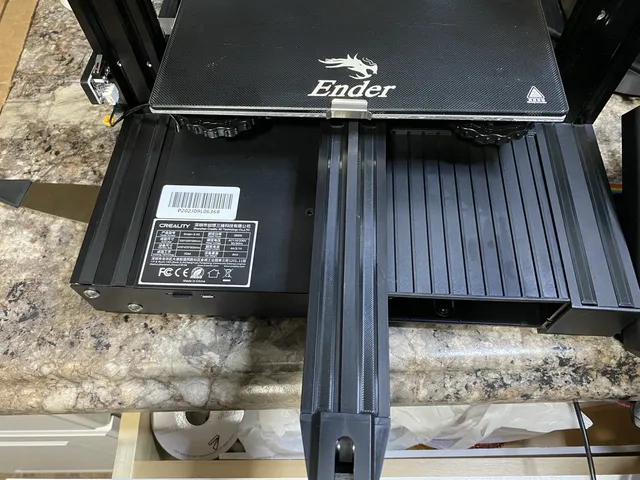</a> 
<b>Ender 3 v2 - v slot covers</b> 
by sporte77 
<a href="https://www.printables.com/model/123533-ender-3-v2-v-slot-covers">Printables</a> &middot; <a href="ender3/aesthetic-fixes/ender-3-v2-v-slot-covers-model_files">Repo folder</a>
</td>
<td width="33%" align="center" valign="top">
<a href="ender3/aesthetic-fixes/Ender_3_v2_Hidden_OctoPi_Mount_5201485">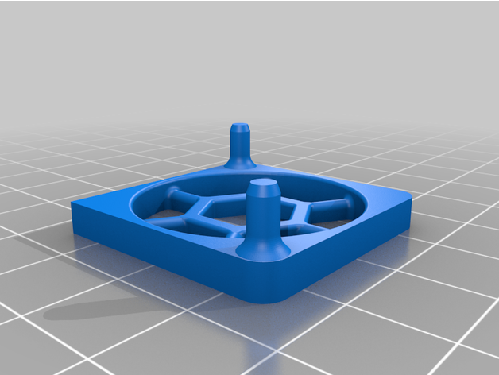</a> 
<b>Ender 3 v2 Hidden OctoPi Mount</b> 
by Department_Nine 
<a href="https://www.thingiverse.com/thing:5201485">Thingiverse</a> &middot; <a href="ender3/aesthetic-fixes/Ender_3_v2_Hidden_OctoPi_Mount_5201485">Repo folder</a>
</td>
</tr>
</table>

## Ender3 / Control Improvements

<table>
<tr>
<td width="33%" align="center" valign="top">
<a href="ender3/control-improvements/Belt_Driven_Ender_3_Pro_V2_and_CR10_4243512">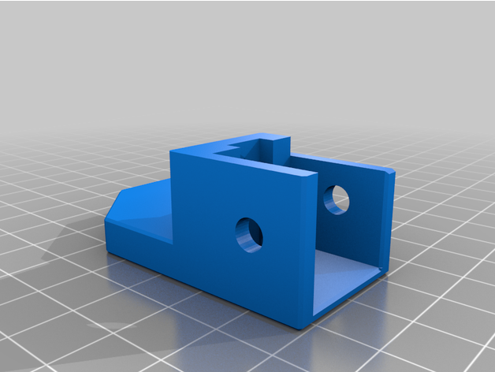</a> 
<b>Belt Driven Ender 3/Pro/V2 and CR10</b> 
by kevinakasam 
<a href="https://www.thingiverse.com/thing:4243512">Thingiverse</a> &middot; <a href="ender3/control-improvements/Belt_Driven_Ender_3_Pro_V2_and_CR10_4243512">Repo folder</a>
</td>
<td width="33%" align="center" valign="top">
<a href="ender3/control-improvements/Ender_3_-_Direct_Drive_Adapter_3386628">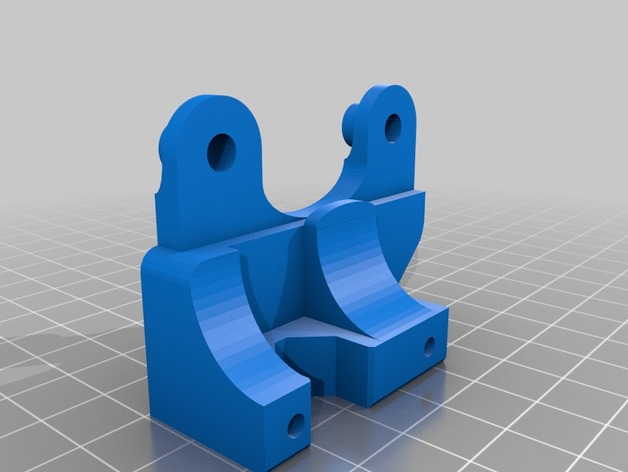</a> 
<b>Ender 3 - Direct Drive Adapter</b> 
by benawhite 
<a href="https://www.thingiverse.com/thing:3386628">Thingiverse</a> &middot; <a href="ender3/control-improvements/Ender_3_-_Direct_Drive_Adapter_3386628">Repo folder</a>
</td>
<td width="33%" align="center" valign="top">
<a href="ender3/control-improvements/Ender_3_Lead_Screw_Stabilizer_3080912">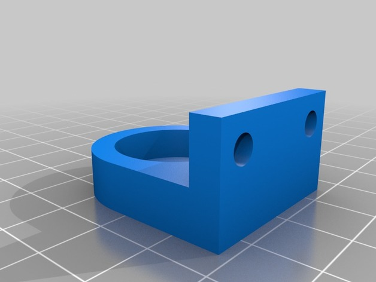</a> 
<b>Ender 3 Lead Screw Stabilizer</b> 
by elmerohueso 
<a href="https://www.thingiverse.com/thing:3080912">Thingiverse</a> &middot; <a href="ender3/control-improvements/Ender_3_Lead_Screw_Stabilizer_3080912">Repo folder</a>
</td>
</tr>
<tr>
<td width="33%" align="center" valign="top">
<a href="ender3/control-improvements/Ender_3_V2_3DTouch_BLTouch_Mount_4462870">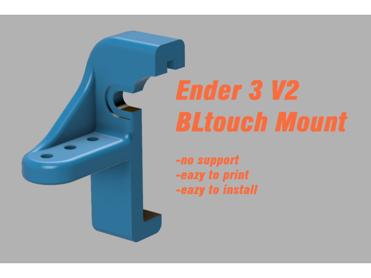</a> 
<b>Ender 3 V2 3DTouch/BLTouch Mount</b> 
by jkostenov 
<a href="https://www.thingiverse.com/thing:4462870">Thingiverse</a> &middot; <a href="ender3/control-improvements/Ender_3_V2_3DTouch_BLTouch_Mount_4462870">Repo folder</a>
</td>
<td width="33%" align="center" valign="top">
<a href="ender3/control-improvements/Z_axis_nut__coupling__4378118">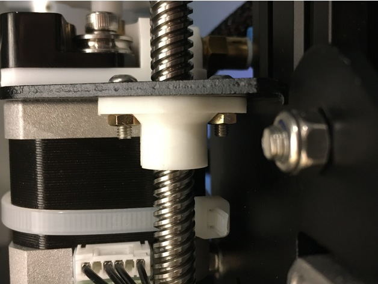</a> 
<b>Z axis nut (coupling)</b> 
by higgsb0son 
<a href="https://www.thingiverse.com/thing:4378118">Thingiverse</a> &middot; <a href="ender3/control-improvements/Z_axis_nut__coupling__4378118">Repo folder</a>
</td>
</tr>
</table>

## Ender3 / Electronics

<table>
<tr>
<td width="33%" align="center" valign="top">
<a href="ender3/electronics/Ender_3_V2_Enclosure_box_electronics_external_case_4742032">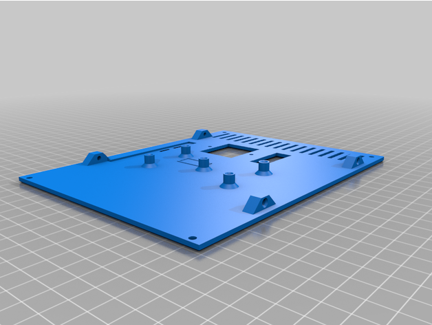</a> 
<b>Ender 3 V2 Enclosure box electronics external case</b> 
by GalvanicGlaze 
<a href="https://www.thingiverse.com/thing:4742032">Thingiverse</a> &middot; <a href="ender3/electronics/Ender_3_V2_Enclosure_box_electronics_external_case_4742032">Repo folder</a>
</td>
</tr>
</table>

## Ender3 / Extrusion

<table>
<tr>
<td width="33%" align="center" valign="top">
<a href="ender3/extrusion/Ender_3_tensionable_extruder_arm_3529205">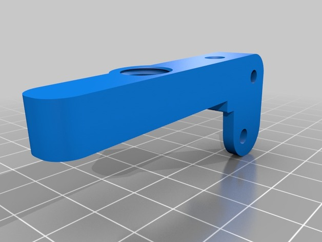</a> 
<b>Ender 3 tensionable extruder arm</b> 
by navvis 
<a href="https://www.thingiverse.com/thing:3529205">Thingiverse</a> &middot; <a href="ender3/extrusion/Ender_3_tensionable_extruder_arm_3529205">Repo folder</a>
</td>
<td width="33%" align="center" valign="top">
<a href="ender3/extrusion/Ender-3_TPU_Extruder_Fix_3844646">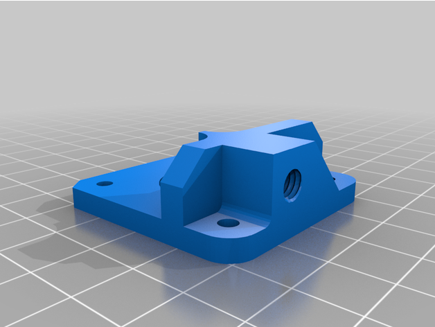</a> 
<b>Ender-3 TPU Extruder Fix</b> 
by exeswizz 
<a href="https://www.thingiverse.com/thing:3844646">Thingiverse</a> &middot; <a href="ender3/extrusion/Ender-3_TPU_Extruder_Fix_3844646">Repo folder</a>
</td>
<td width="33%" align="center" valign="top">
<a href="ender3/extrusion/Flexible_Filament_Extruder_Upgrade_for_Creality_CR-7__CR-10__Ender_2__Ender_3_2144277">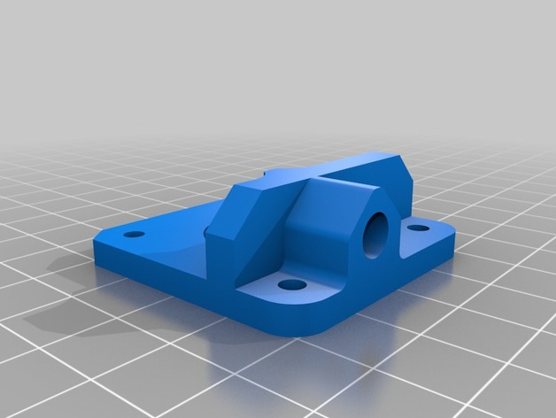</a> 
<b>Flexible Filament Extruder Upgrade for Creality CR-7, CR-10, Ender 2, Ender 3</b> 
by joshvv 
<a href="https://www.thingiverse.com/thing:2144277">Thingiverse</a> &middot; <a href="ender3/extrusion/Flexible_Filament_Extruder_Upgrade_for_Creality_CR-7__CR-10__Ender_2__Ender_3_2144277">Repo folder</a>
</td>
</tr>
<tr>
<td width="33%" align="center" valign="top">
<a href="ender3/extrusion/Top_Extruder_Mount_-_Ender_3_3248350">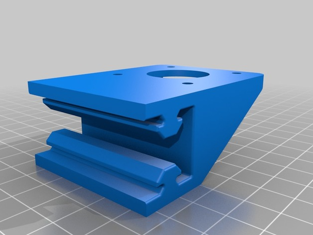</a> 
<b>Top Extruder Mount - Ender 3</b> 
by nicocazza 
<a href="https://www.thingiverse.com/thing:3248350">Thingiverse</a> &middot; <a href="ender3/extrusion/Top_Extruder_Mount_-_Ender_3_3248350">Repo folder</a>
</td>
</tr>
</table>

## Ender3 / Filament Guide

<table>
<tr>
<td width="33%" align="center" valign="top">
<a href="ender3/filament-guide/2020___Ender_3_Filament_Guide_2917932">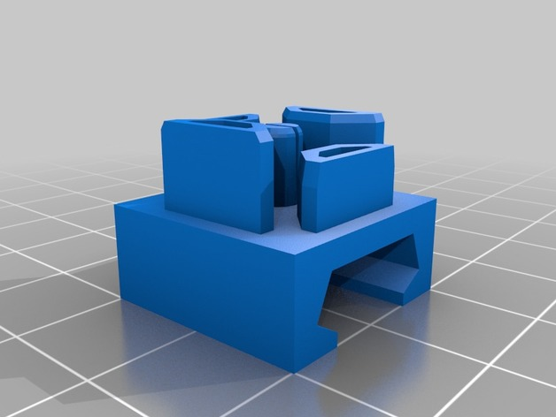</a> 
<b>2020 / Ender 3 Filament Guide</b> 
by Filboyt 
<a href="https://www.thingiverse.com/thing:2917932">Thingiverse</a> &middot; <a href="ender3/filament-guide/2020___Ender_3_Filament_Guide_2917932">Repo folder</a>
</td>
<td width="33%" align="center" valign="top">
<a href="ender3/filament-guide/Ender_3_and_3_V2_Filament_Guide_-_GO_BIG_-_No_Screws_-_No_Supports_4683505">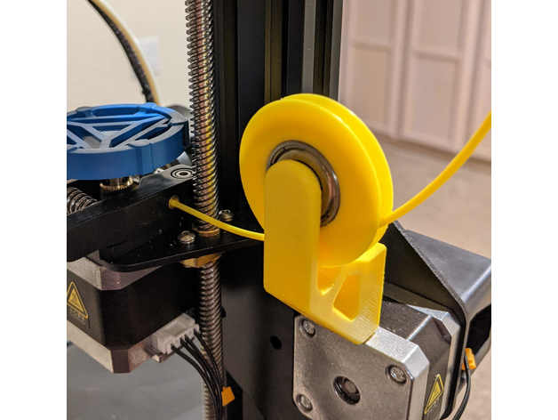</a> 
<b>Ender 3 and 3 V2 Filament Guide - GO BIG - No Screws - No Supports</b> 
by Markacho 
<a href="https://www.thingiverse.com/thing:4683505">Thingiverse</a> &middot; <a href="ender3/filament-guide/Ender_3_and_3_V2_Filament_Guide_-_GO_BIG_-_No_Screws_-_No_Supports_4683505">Repo folder</a>
</td>
<td width="33%" align="center" valign="top">
<a href="ender3/filament-guide/Ender_3_Filament_Roller_Guide_3052488">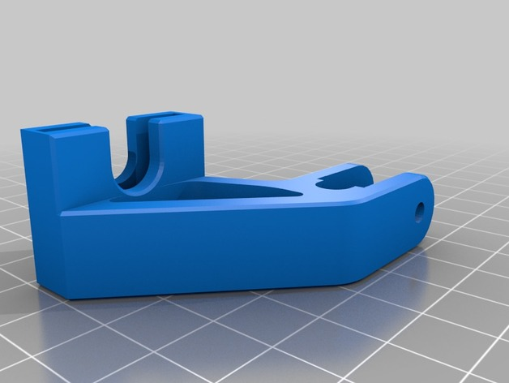</a> 
<b>Ender 3 Filament Roller Guide</b> 
by Holspeed 
<a href="https://www.thingiverse.com/thing:3052488">Thingiverse</a> &middot; <a href="ender3/filament-guide/Ender_3_Filament_Roller_Guide_3052488">Repo folder</a>
</td>
</tr>
<tr>
<td width="33%" align="center" valign="top">
<a href="ender3/filament-guide/Ender_3_V2_Filament_Guide_4581110">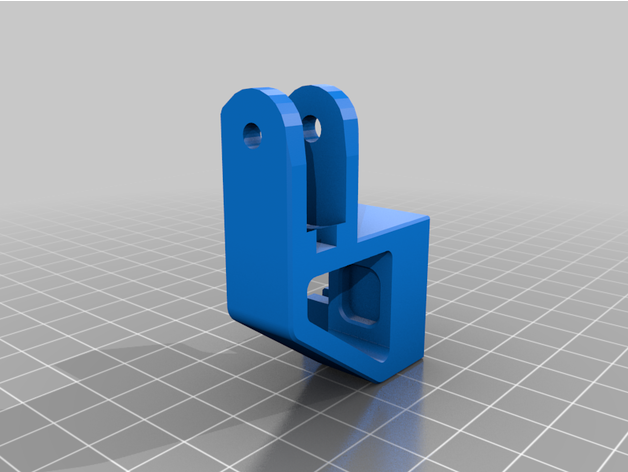</a> 
<b>Ender 3 V2 Filament Guide</b> 
by RedSoda 
<a href="https://www.thingiverse.com/thing:4581110">Thingiverse</a> &middot; <a href="ender3/filament-guide/Ender_3_V2_Filament_Guide_4581110">Repo folder</a>
</td>
<td width="33%" align="center" valign="top">
<a href="ender3/filament-guide/ender-3-v2-side-mount-spool-holder-model_files">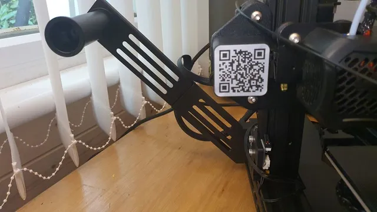</a> 
<b>Ender 3 v2 Side Mount Spool Holder</b> 
by Pugwash 
<a href="https://www.printables.com/model/201538-ender-3-v2-side-mount-spool-holder">Printables</a> &middot; <a href="ender3/filament-guide/ender-3-v2-side-mount-spool-holder-model_files">Repo folder</a>
</td>
<td width="33%" align="center" valign="top">
<a href="ender3/filament-guide/Spool_Holder_Universal_for_Ender3__Ender_3_2999446">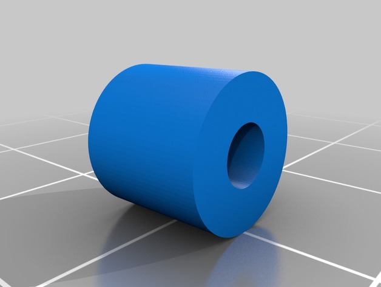</a> 
<b>Spool Holder Universal for Ender3, Ender 3</b> 
by Jaypirnts 
<a href="https://www.thingiverse.com/thing:2999446">Thingiverse</a> &middot; <a href="ender3/filament-guide/Spool_Holder_Universal_for_Ender3__Ender_3_2999446">Repo folder</a>
</td>
</tr>
<tr>
<td width="33%" align="center" valign="top">
<a href="ender3/filament-guide/The_Rocket_-_Side_Spool_Mount_-_Creality___Ender_3__Pro_V2__4691695">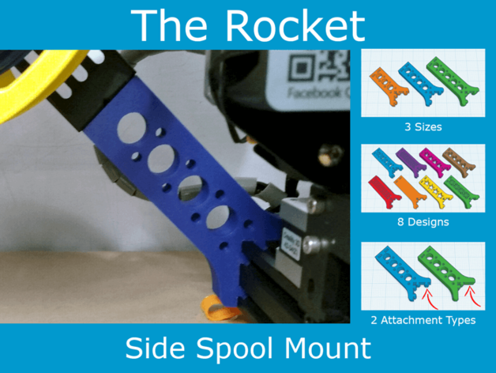</a> 
<b>The Rocket - Side Spool Mount - Creality / Ender 3 (Pro/V2)</b> 
by regularlabs 
<a href="https://www.thingiverse.com/thing:4691695">Thingiverse</a> &middot; <a href="ender3/filament-guide/The_Rocket_-_Side_Spool_Mount_-_Creality___Ender_3__Pro_V2__4691695">Repo folder</a>
</td>
</tr>
</table>

## Ender3 / Hotend

<table>
<tr>
<td width="33%" align="center" valign="top">
<a href="ender3/hotend/CR-10_FANG_dual_5015_and_BLtouch_for_MicroSwiss_direct_drive_4564060">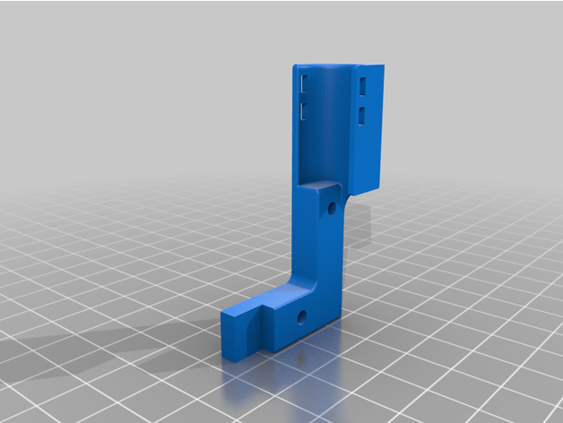</a> 
<b>CR-10 FANG dual 5015 and BLtouch for MicroSwiss direct drive</b> 
by bogdi1988 
<a href="https://www.thingiverse.com/thing:4564060">Thingiverse</a> &middot; <a href="ender3/hotend/CR-10_FANG_dual_5015_and_BLtouch_for_MicroSwiss_direct_drive_4564060">Repo folder</a>
</td>
<td width="33%" align="center" valign="top">
 
<b>Creality BEST DIRECT DRIVE MOUNT</b> 
by ElderRacing 
<a href="https://www.thingiverse.com/thing:4939645">Thingiverse</a> &middot; <a href="ender3/hotend/Creality%20BEST%20DIRECT%20DRIVE%20MOUNT%20-%204939645">Repo folder</a>
</td>
<td width="33%" align="center" valign="top">
<a href="ender3/hotend/Creality_HotEnd_Fix_4220059">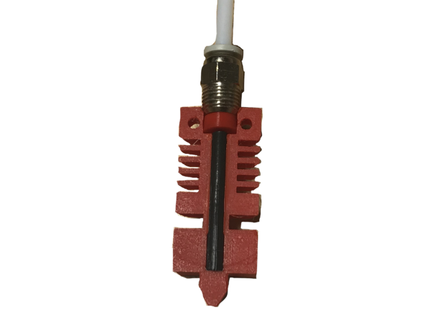</a> 
<b>Creality HotEnd Fix</b> 
by Elproducts 
<a href="https://www.thingiverse.com/thing:4220059">Thingiverse</a> &middot; <a href="ender3/hotend/Creality_HotEnd_Fix_4220059">Repo folder</a>
</td>
</tr>
<tr>
<td width="33%" align="center" valign="top">
<a href="ender3/hotend/Diplo_Duct_-_Ender_3_V2_4020_BMG_Direct_Drive__4840016">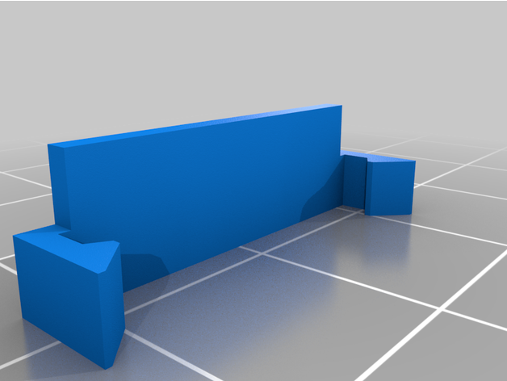</a> 
<b>Diplo Duct - Ender 3 V2 4020 BMG Direct Drive</b> 
by GalvanicGlaze 
<a href="https://www.thingiverse.com/thing:4840016">Thingiverse</a> &middot; <a href="ender3/hotend/Diplo_Duct_-_Ender_3_V2_4020_BMG_Direct_Drive__4840016">Repo folder</a>
</td>
<td width="33%" align="center" valign="top">
<a href="ender3/hotend/ender-3-v2-voron-stealthburner-conversion-model_files">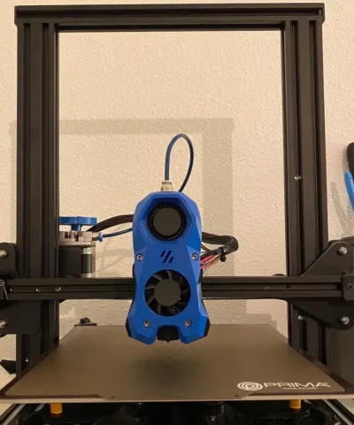</a> 
<b>Ender 3 V2 - VORON Stealthburner conversion</b> 
by WouterE_ 
<a href="https://www.printables.com/model/139183-ender-3-v2-voron-stealthburner-conversion">Printables</a> &middot; <a href="ender3/hotend/ender-3-v2-voron-stealthburner-conversion-model_files">Repo folder</a>
</td>
<td width="33%" align="center" valign="top">
 
<b>Klemco 40mm Fan Mount</b> 
by Airmaxx23 
<a href="https://www.thingiverse.com/thing:5174226">Thingiverse</a> &middot; <a href="ender3/hotend/Klemco%2040mm%20Fan%20Mount%20-%205174226">Repo folder</a>
</td>
</tr>
<tr>
<td width="33%" align="center" valign="top">
<a href="ender3/hotend/Petsfang_Duct_for_CR10_MicroSwiss_Stock_E3Dv6_Volcano_TevoTornado__Tarantula_Hot_End_E3Dv6_CNC_Mount___5015_fan_Bullseye_Blokhead_2759439">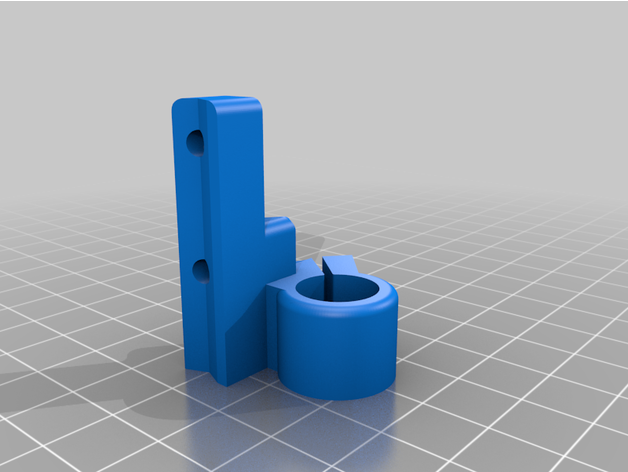</a> 
<b>Petsfang Duct for CR10 MicroSwiss/Stock/E3Dv6/Volcano/TevoTornado /Tarantula Hot End/E3Dv6 CNC Mount &amp; 5015 fan Bullseye Blokhead</b> 
by dpetsel 
<a href="https://www.thingiverse.com/thing:2759439">Thingiverse</a> &middot; <a href="ender3/hotend/Petsfang_Duct_for_CR10_MicroSwiss_Stock_E3Dv6_Volcano_TevoTornado__Tarantula_Hot_End_E3Dv6_CNC_Mount___5015_fan_Bullseye_Blokhead_2759439">Repo folder</a>
</td>
<td width="33%" align="center" valign="top">
<a href="ender3/hotend/sherpa-elephant-v6-tool-head-ender-3-v2-neo-model_files">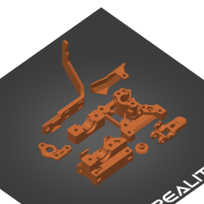</a> 
<b>Sherpa Elephant V6 Tool Head Ender 3 V2 Neo</b> 
<a href="https://www.printables.com/model/400559">Printables</a> &middot; <a href="ender3/hotend/sherpa-elephant-v6-tool-head-ender-3-v2-neo-model_files">Repo folder</a>
</td>
</tr>
</table>

## Ender3 / Leveling

<table>
<tr>
<td width="33%" align="center" valign="top">
<a href="ender3/leveling/ender-3-bed-leveling-wheel-clips-model_files">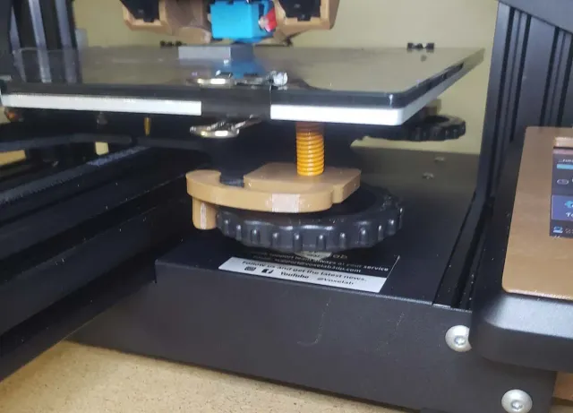</a> 
<b>Ender 3 Bed Leveling Wheel Clips</b> 
by HomeGrown3D 
<a href="https://www.printables.com/model/115938-ender-3-bed-leveling-wheel-clips">Printables</a> &middot; <a href="ender3/leveling/ender-3-bed-leveling-wheel-clips-model_files">Repo folder</a>
</td>
<td width="33%" align="center" valign="top">
<a href="ender3/leveling/ender-3-v2-bltouch-mount-with-embedded-threads-model_files">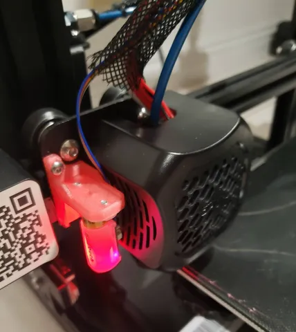</a> 
<b>Ender 3 V2 BLTouch Mount with Embedded Threads</b> 
by ReSummit 
<a href="https://www.printables.com/model/139897-ender-3-v2-bltouch-mount-with-embedded-threads">Printables</a> &middot; <a href="ender3/leveling/ender-3-v2-bltouch-mount-with-embedded-threads-model_files">Repo folder</a>
</td>
<td width="33%" align="center" valign="top">
<a href="ender3/leveling/ENDER-3_BED_HANDLE_2957507">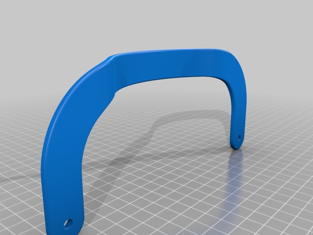</a> 
<b>ENDER-3 BED HANDLE</b> 
by LarnOm 
<a href="https://www.thingiverse.com/thing:2957507">Thingiverse</a> &middot; <a href="ender3/leveling/ENDER-3_BED_HANDLE_2957507">Repo folder</a>
</td>
</tr>
<tr>
<td width="33%" align="center" valign="top">
<a href="ender3/leveling/Ultimate_Ender_3_Bed_Leveling_Knob_4743835">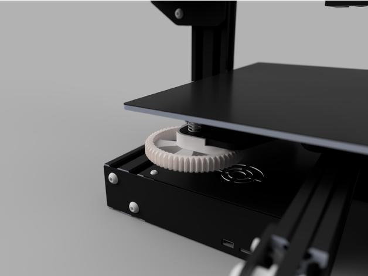</a> 
<b>Ultimate Ender 3 Bed Leveling Knob</b> 
by TheBoJaN 
<a href="https://www.thingiverse.com/thing:4743835">Thingiverse</a> &middot; <a href="ender3/leveling/Ultimate_Ender_3_Bed_Leveling_Knob_4743835">Repo folder</a>
</td>
</tr>
</table>

## Ender3 / Light

<table>
<tr>
<td width="33%" align="center" valign="top">
<a href="ender3/light/Ender_3_Light_Bar_3135488">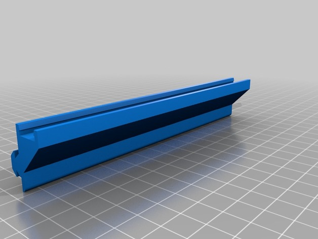</a> 
<b>Ender 3 Light Bar</b> 
by Kevlarr 
<a href="https://www.thingiverse.com/thing:3135488">Thingiverse</a> &middot; <a href="ender3/light/Ender_3_Light_Bar_3135488">Repo folder</a>
</td>
<td width="33%" align="center" valign="top">
<a href="ender3/light/Ender_3_2020_Extrusion_Light_Bar_3272248">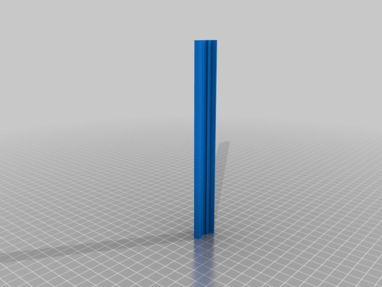</a> 
<b>Ender 3/2020 Extrusion Light Bar</b> 
by LilTrublMakr 
<a href="https://www.thingiverse.com/thing:3272248">Thingiverse</a> &middot; <a href="ender3/light/Ender_3_2020_Extrusion_Light_Bar_3272248">Repo folder</a>
</td>
</tr>
</table>

## Ender3 / Tools

<table>
<tr>
<td width="33%" align="center" valign="top">
<a href="ender3/tools/1x1-gridfinity-ender-tools-side-mount-model_files">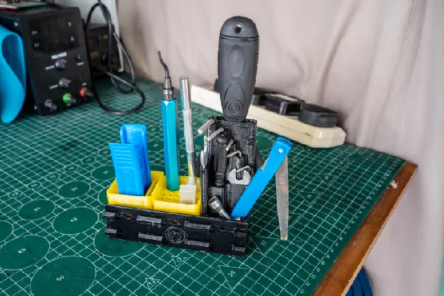</a> 
<b>1x1 Gridfinity Ender Tools Side-Mount</b> 
by BillyLjm 
<a href="https://www.printables.com/model/522496-1x1-gridfinity-ender-tools-side-mount">Printables</a> &middot; <a href="ender3/tools/1x1-gridfinity-ender-tools-side-mount-model_files">Repo folder</a>
</td>
<td width="33%" align="center" valign="top">
 
<b>Creality Ender 3 Pro dual drawer</b> 
by DWS_design 
<a href="https://www.thingiverse.com/thing:3416444">Thingiverse</a> &middot; <a href="ender3/tools/Creality_Ender_3_Pro_dual_drawer_3416444">Repo folder</a>
</td>
<td width="33%" align="center" valign="top">
 
<b>Ender 3 V2 Gridfinity Insert</b> 
by BenBreaksThings 
<a href="https://www.printables.com/model/294672-ender-3-v2-gridfinity-insert">Printables</a> &middot; <a href="ender3/tools/ender-3-v2-gridfinity-insert-model_files">Repo folder</a>
</td>
</tr>
<tr>
<td width="33%" align="center" valign="top">
 
<b>Gridfinity Ender 3 Tool holder</b> 
by ChiefFluffy 
<a href="https://www.printables.com/model/449001-gridfinity-ender-3-tool-holder">Printables</a> &middot; <a href="ender3/tools/gridfinity-ender-3-tool-holder-model_files">Repo folder</a>
</td>
<td width="33%" align="center" valign="top">
 
<b>Gridfinity Ender 3 Tools Holder</b> 
by Sepezha 
<a href="https://www.printables.com/model/478342-gridfinity-ender-3-tools-holder">Printables</a> &middot; <a href="ender3/tools/gridfinity-ender-3-tools-holder-model_files">Repo folder</a>
</td>
<td width="33%" align="center" valign="top">
 
<b>Gridfinity Ender 3 v2 side mount for tools</b> 
by Gelposki 
<a href="https://www.printables.com/model/427537-gridfinity-ender-3-v2-side-mount-for-tools">Printables</a> &middot; <a href="ender3/tools/gridfinity-ender-3-v2-side-mount-for-tools-model_files">Repo folder</a>
</td>
</tr>
</table>

## Filament Guide

<table>
<tr>
<td width="33%" align="center" valign="top">
 
<b>SPANNERHANDS Spool System Wall Mounted Spool Holder &amp; Dust Cover</b> 
by 3DMasterRace 
<a href="https://www.thingiverse.com/thing:2119644">Thingiverse</a> &middot; <a href="filament-guide/SPANNERHANDS_Spool_System_Wall_Mounted_Spool_Holder___Dust_Cover_2119644">Repo folder</a>
</td>
<td width="33%" align="center" valign="top">
 
<b>TUSH - The Ultimate Spool Holder</b> 
by filamentry 
<a href="https://www.thingiverse.com/thing:2047554">Thingiverse</a> &middot; <a href="filament-guide/TUSH_-_The_Ultimate_Spool_Holder_2047554">Repo folder</a>
</td>
</tr>
</table>

## Hotend

<table>
<tr>
<td width="33%" align="center" valign="top">
<i>no preview</i> 
<b>E3D-Adapter-Accessories</b> 
Source unknown &middot; <a href="hotend/E3D-Adapter-Accessories">Repo folder</a>
</td>
<td width="33%" align="center" valign="top">
 
<b>Manta MK2 Duct &amp; Tool Head System</b> 
by BoothyBoothy 
<a href="https://www.thingiverse.com/thing:4943125">Thingiverse</a> &middot; <a href="hotend/Manta%20MK2%20Duct%20%26%20Tool%20Head%20System%20-%204943125">Repo folder</a>
</td>
<td width="33%" align="center" valign="top">
 
<b>Sherpa Blockhead Fan system for Voron 0.1</b> 
by Meatball 
<a href="https://www.printables.com/model/213588-sherpa-blockhead-fan-system-for-voron-01">Printables</a> &middot; <a href="hotend/sherpa-blockhead-fan-system-for-voron-01-model_files">Repo folder</a>
</td>
</tr>
<tr>
<td width="33%" align="center" valign="top">
 
<b>Voron-Stealthburner-main</b> 
Source unknown &middot; <a href="hotend/Voron-Stealthburner-main">Repo folder</a>
</td>
</tr>
</table>

## Tools

<table>
<tr>
<td width="33%" align="center" valign="top">
 
<b>3D Printer Tool Stand</b> 
by STIG_ 
<a href="https://www.thingiverse.com/thing:1937236">Thingiverse</a> &middot; <a href="tools/3D_Printer_Tool_Stand_1937236">Repo folder</a>
</td>
<td width="33%" align="center" valign="top">
 
<b>Clip one color</b> 
<a href="https://makerworld.com/en/search/models?keyword=Clip%20one%20color">Search MakerWorld</a> &middot; <a href="tools/Clip%2Bone%2Bcolor.3mf">Clip+one+color.3mf</a>
</td>
<td width="33%" align="center" valign="top">
 
<b>Filament Clip</b> 
by intofocus 
<a href="https://www.thingiverse.com/thing:282242">Thingiverse</a> &middot; <a href="tools/Filament_Clip__282242">Repo folder</a>
</td>
</tr>
<tr>
<td width="33%" align="center" valign="top">
 
<b>Universal Filament Filter and Lubricator</b> 
by CreativeTools 
<a href="https://www.thingiverse.com/thing:492067">Thingiverse</a> &middot; <a href="tools/Universal_Filament_Filter_and_Lubricator_492067">Repo folder</a>
</td>
<td width="33%" align="center" valign="top">
 
<b>🟠 Thin layers scraper (tiny+ergonomic)</b> 
by sh 
<a href="https://www.printables.com/model/277302-thin-layers-scraper-tinyergonomic">Printables</a> &middot; <a href="tools/thin-layers-scraper-tinyergonomic-print_files">Repo folder</a>
</td>
<td width="33%" align="center" valign="top">
 
<b>🟠 Thin layers scraper (tiny+ergonomic)</b> 
by sh 
<a href="https://www.printables.com/model/277302-thin-layers-scraper-tinyergonomic">Printables</a> &middot; <a href="tools/thin-layers-scraper-tinyergonomic-model_files">Repo folder</a>
</td>
</tr>
</table>

Other files in this folder (1)

- [Clip-Classic.stl](tools/Clip-Classic.stl)

