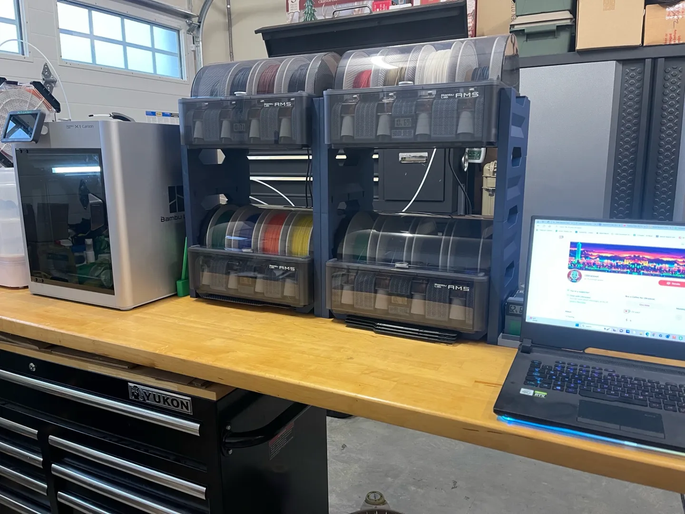
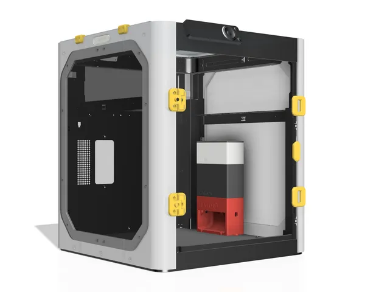
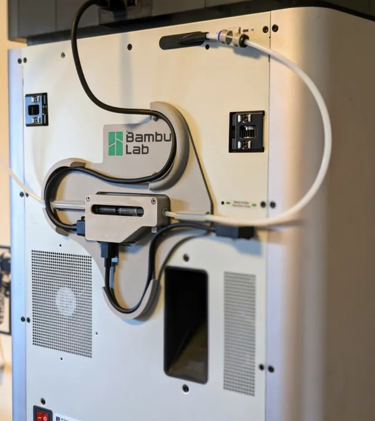
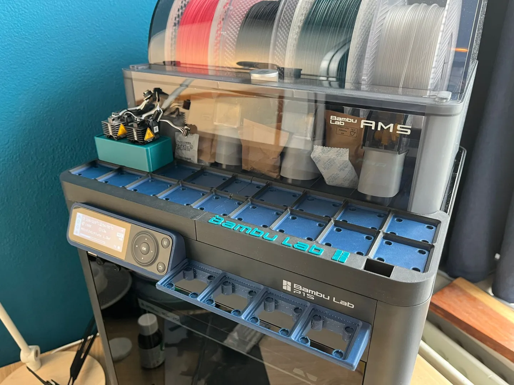
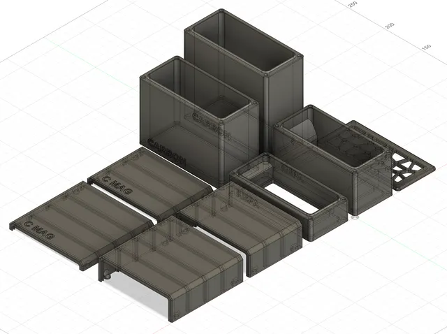

# Bambu

<!-- Generated by scripts/Update-Readmes.ps1 (Linux: scripts/update_readmes.py) - edit scripts/readme-sources.json and rerun instead of editing by hand. -->

[Home](../../README.md) / [Printer Improvements](../README.md) / **Bambu**

5 builds &middot; 3 MakerWorld &middot; 2 Printables

## Bambu

<table>
<tr>
<td width="33%" align="center" valign="top">
 
<b>AMS Stacking System</b> 
<a href="https://makerworld.com/en/search/models?keyword=AMS%20Stacking%20System">Search MakerWorld</a> &middot; <a href="AMS%2BStacking%2BSystem">Repo folder</a>
</td>
<td width="33%" align="center" valign="top">
 
<b>BentoBox v2.0 Carbon filter for Bambu Lab X1C, enclosed P1P &amp; Voron Trident &amp; others?</b> 
by thrutheframe 
<a href="https://www.printables.com/model/272525-bentobox-v20-carbon-filter-for-bambu-lab-x1c-enclo">Printables</a> &middot; <a href="bentobox-v20-carbon-filter-for-bambu-lab-x1c-enclosed-p1p-voron-trident-others-model_files">Repo folder</a>
</td>
<td width="33%" align="center" valign="top">
 
<b>Cable Tidy - X1- P1S - P1P</b> 
by KobaRiley 
<a href="https://makerworld.com/en/models/142877-cable-tidy-x1-p1s-p1p">MakerWorld</a> &middot; <a href="Cable%2BTidy%2B-%2BX1-%2BP1S%2B-%2BP1P">Repo folder</a>
</td>
</tr>
<tr>
<td width="33%" align="center" valign="top">
 
<b>P1S gridfinity base</b> 
<a href="https://makerworld.com/en/search/models?keyword=P1S%20gridfinity%20base">Search MakerWorld</a> &middot; <a href="P1S%2Bgridfinity%2Bbase.3mf">P1S+gridfinity+base.3mf</a>
</td>
<td width="33%" align="center" valign="top">
 
<b>Remixed HEPA boxes for Bento Box v2</b> 
by ShowStudio 
<a href="https://www.printables.com/model/654808-remixed-hepa-boxes-for-bento-box-v2">Printables</a> &middot; <a href="remixed-hepa-boxes-for-bento-box-v2-model_files">Repo folder</a>
</td>
</tr>
</table>

