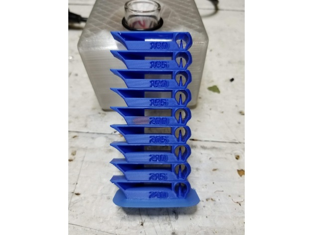
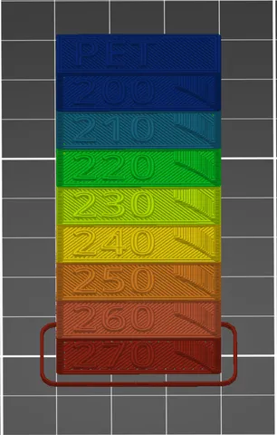
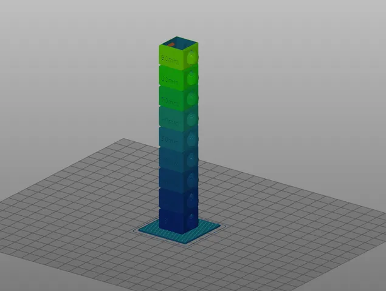
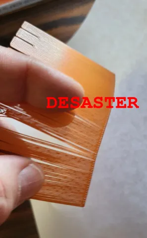
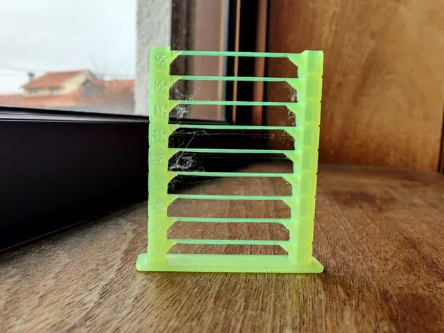
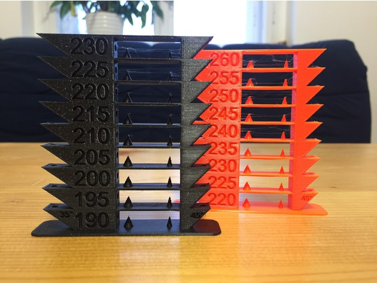
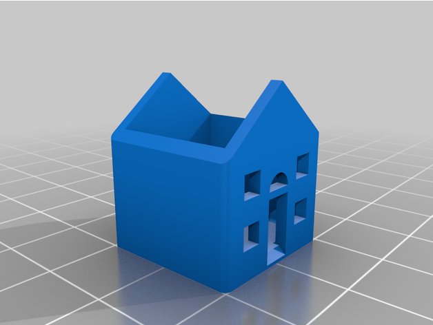

# Calibration

<!-- Generated by scripts/Update-Readmes.ps1 (Linux: scripts/update_readmes.py) - edit scripts/readme-sources.json and rerun instead of editing by hand. -->

[Home](../../README.md) / [Printer Improvements](../README.md) / **Calibration**

12 builds &middot; 4 Printables &middot; 3 Thingiverse &middot; 5 unknown source

## Calibration

<table>
<tr>
<td width="33%" align="center" valign="top">
 
<b>Ender 3 Smart PLA and PETG Temp Tower (gcode included)</b> 
by evanphi 
<a href="https://www.thingiverse.com/thing:3912855">Thingiverse</a> &middot; <a href="Ender_3_Smart_PLA_and_PETG_Temp_Tower__gcode_included__3912855">Repo folder</a>
</td>
<td width="33%" align="center" valign="top">
 
<b>Filament Temp Tester</b> 
by yahbluez 
<a href="https://www.printables.com/model/527657-filament-temp-tester">Printables</a> &middot; <a href="filament-temp-tester-model_files">Repo folder</a>
</td>
<td width="33%" align="center" valign="top">
 
<b>Speed tower - test your maximum print speed</b> 
by Print-3D 
<a href="https://www.printables.com/model/22601-speed-tower-test-your-maximum-print-speed">Printables</a> &middot; <a href="speed-tower-test-your-maximum-print-speed-model_files">Repo folder</a>
</td>
</tr>
<tr>
<td width="33%" align="center" valign="top">
 
<b>Stress Free First Layer calibration in less than 5 Minutes to perfection</b> 
by yahbluez 
<a href="https://www.printables.com/model/251587-stress-free-first-layer-calibration-in-less-than-5">Printables</a> &middot; <a href="stress-free-first-layer-calibration-in-less-than-5-minutes-to-perfection-model_files">Repo folder</a>
</td>
<td width="33%" align="center" valign="top">
 
<b>Temp Tower (Fast)</b> 
by Celta 
<a href="https://www.printables.com/model/91526-temp-tower-fast">Printables</a> &middot; <a href="quick-temp-tower-model_files">Repo folder</a>
</td>
<td width="33%" align="center" valign="top">
 
<b>Temp tower PLA, PETG, ABS</b> 
by krpavlu 
<a href="https://www.thingiverse.com/thing:4149643">Thingiverse</a> &middot; <a href="Temp_tower_PLA__PETG__ABS_4149643">Repo folder</a>
</td>
</tr>
<tr>
<td width="33%" align="center" valign="top">
 
<b>The House Of Benchmark</b> 
by Kwerkshop 
<a href="https://www.thingiverse.com/thing:6140056">Thingiverse</a> &middot; <a href="The_House_Of_Benchmark_6140056">Repo folder</a>
</td>
</tr>
</table>

Other files in this folder (5)

- [11x11_10mm_square_bed_level_test.stl](11x11_10mm_square_bed_level_test.stl)
- [2x2_35mm_square_bed_level_test.stl](2x2_35mm_square_bed_level_test.stl)
- [3x3_25mm_square_bed_level_test.stl](3x3_25mm_square_bed_level_test.stl)
- [3x3_35mm_square_bed_level_test.stl](3x3_35mm_square_bed_level_test.stl)
- [parametric-bed-level-test-20200913.scad](parametric-bed-level-test-20200913.scad)

