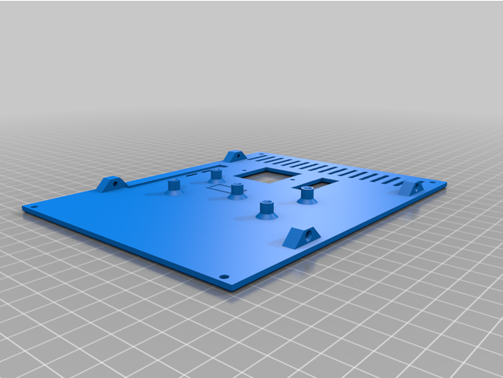

# Ender3

<!-- Generated by scripts/Update-Readmes.ps1 (Linux: scripts/update_readmes.py) - edit scripts/readme-sources.json and rerun instead of editing by hand. -->

[Home](../../README.md) / [Printer Improvements](../README.md) / **Ender3**

1 builds &middot; 1 Thingiverse &middot; 8 collections (41 more builds)

## Collections

- [Aesthetic Fixes](aesthetic-fixes/README.md) - 5 builds
- [Control Improvements](control-improvements/README.md) - 5 builds
- [Extrusion](extrusion/README.md) - 4 builds
- [Filament Guide](filament-guide/README.md) - 7 builds
- [Hotend](hotend/README.md) - 8 builds
- [Leveling](leveling/README.md) - 4 builds
- [Light](light/README.md) - 2 builds
- [Tools](tools/README.md) - 6 builds

## Electronics

<table>
<tr>
<td width="33%" align="center" valign="top">
 
<b>Ender 3 V2 Enclosure box electronics external case</b> 
by GalvanicGlaze 
<a href="https://www.thingiverse.com/thing:4742032">Thingiverse</a> &middot; <a href="electronics/Ender_3_V2_Enclosure_box_electronics_external_case_4742032">Repo folder</a>
</td>
</tr>
</table>

