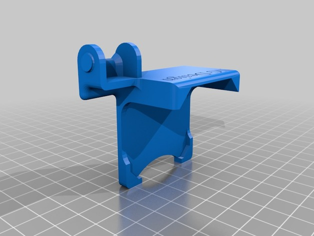
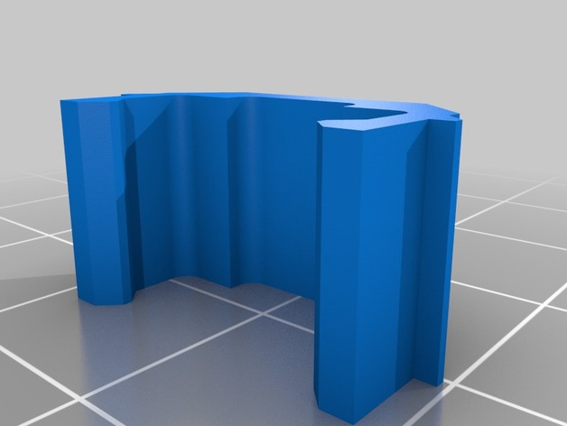
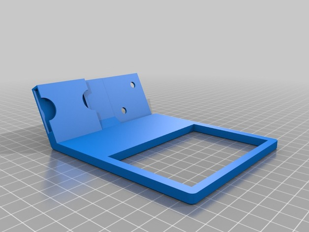
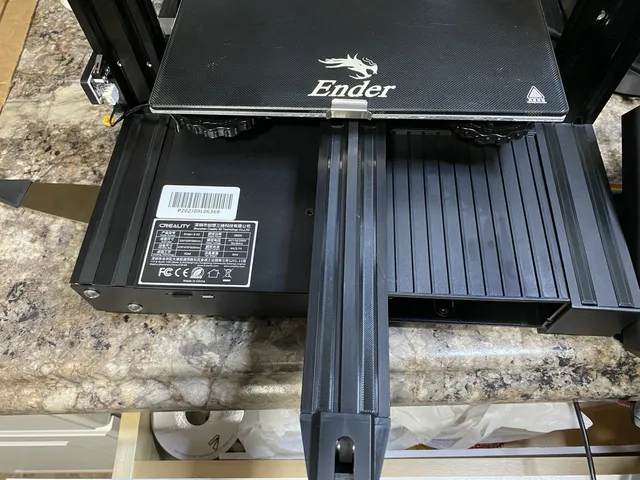
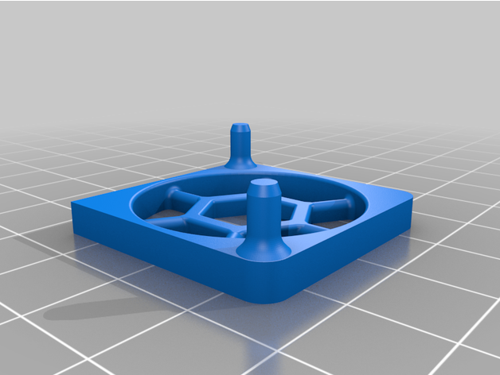

# Aesthetic Fixes

<!-- Generated by scripts/Update-Readmes.ps1 (Linux: scripts/update_readmes.py) - edit scripts/readme-sources.json and rerun instead of editing by hand. -->

[Home](../../../README.md) / [Printer Improvements](../../README.md) / [Ender3](../README.md) / **Aesthetic Fixes**

5 builds &middot; 1 Printables &middot; 4 Thingiverse

## Aesthetic Fixes

<table>
<tr>
<td width="33%" align="center" valign="top">
 
<b>Ender 3 Cable Chain, no screws, no unplug cable</b> 
by NG_Design 
<a href="https://www.thingiverse.com/thing:3769941">Thingiverse</a> &middot; <a href="Ender_3_Cable_Chain__no_screws__no_unplug_cable_3769941">Repo folder</a>
</td>
<td width="33%" align="center" valign="top">
 
<b>Ender 3 Cable Clips</b> 
by Holspeed 
<a href="https://www.thingiverse.com/thing:2960375">Thingiverse</a> &middot; <a href="Ender_3_Cable_Clips_2960375">Repo folder</a>
</td>
<td width="33%" align="center" valign="top">
 
<b>Ender 3 Touchscreen Case &amp; Holder for Raspberry Pi</b> 
by Tronnic 
<a href="https://www.thingiverse.com/thing:3030160">Thingiverse</a> &middot; <a href="Ender_3_Touchscreen_Case___Holder_for_Raspberry_Pi_3030160">Repo folder</a>
</td>
</tr>
<tr>
<td width="33%" align="center" valign="top">
 
<b>Ender 3 v2 - v slot covers</b> 
by sporte77 
<a href="https://www.printables.com/model/123533-ender-3-v2-v-slot-covers">Printables</a> &middot; <a href="ender-3-v2-v-slot-covers-model_files">Repo folder</a>
</td>
<td width="33%" align="center" valign="top">
 
<b>Ender 3 v2 Hidden OctoPi Mount</b> 
by Department_Nine 
<a href="https://www.thingiverse.com/thing:5201485">Thingiverse</a> &middot; <a href="Ender_3_v2_Hidden_OctoPi_Mount_5201485">Repo folder</a>
</td>
</tr>
</table>

