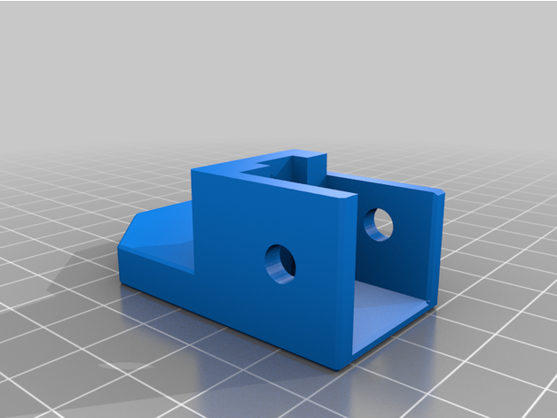
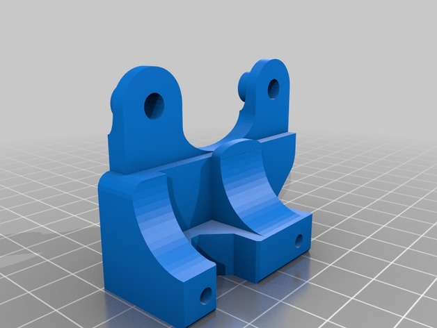
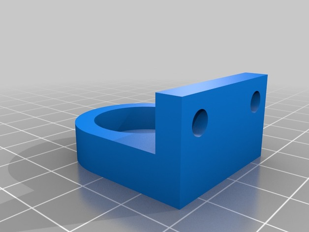
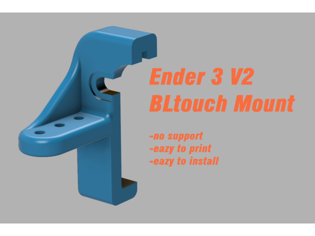
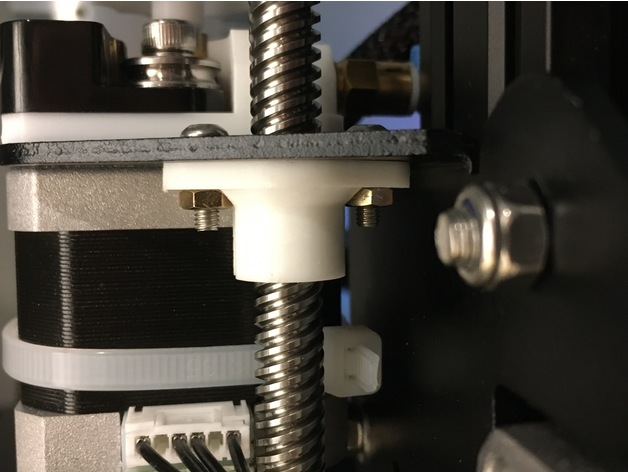

# Control Improvements

<!-- Generated by scripts/Update-Readmes.ps1 (Linux: scripts/update_readmes.py) - edit scripts/readme-sources.json and rerun instead of editing by hand. -->

[Home](../../../README.md) / [Printer Improvements](../../README.md) / [Ender3](../README.md) / **Control Improvements**

5 builds &middot; 5 Thingiverse

## Control Improvements

<table>
<tr>
<td width="33%" align="center" valign="top">
 
<b>Belt Driven Ender 3/Pro/V2 and CR10</b> 
by kevinakasam 
<a href="https://www.thingiverse.com/thing:4243512">Thingiverse</a> &middot; <a href="Belt_Driven_Ender_3_Pro_V2_and_CR10_4243512">Repo folder</a>
</td>
<td width="33%" align="center" valign="top">
 
<b>Ender 3 - Direct Drive Adapter</b> 
by benawhite 
<a href="https://www.thingiverse.com/thing:3386628">Thingiverse</a> &middot; <a href="Ender_3_-_Direct_Drive_Adapter_3386628">Repo folder</a>
</td>
<td width="33%" align="center" valign="top">
 
<b>Ender 3 Lead Screw Stabilizer</b> 
by elmerohueso 
<a href="https://www.thingiverse.com/thing:3080912">Thingiverse</a> &middot; <a href="Ender_3_Lead_Screw_Stabilizer_3080912">Repo folder</a>
</td>
</tr>
<tr>
<td width="33%" align="center" valign="top">
 
<b>Ender 3 V2 3DTouch/BLTouch Mount</b> 
by jkostenov 
<a href="https://www.thingiverse.com/thing:4462870">Thingiverse</a> &middot; <a href="Ender_3_V2_3DTouch_BLTouch_Mount_4462870">Repo folder</a>
</td>
<td width="33%" align="center" valign="top">
 
<b>Z axis nut (coupling)</b> 
by higgsb0son 
<a href="https://www.thingiverse.com/thing:4378118">Thingiverse</a> &middot; <a href="Z_axis_nut__coupling__4378118">Repo folder</a>
</td>
</tr>
</table>

