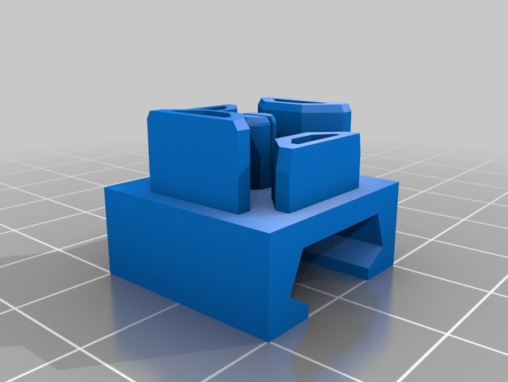
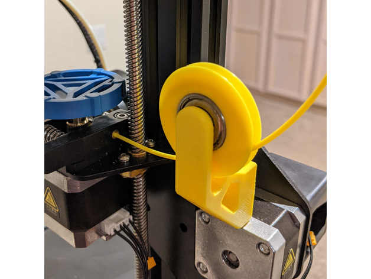
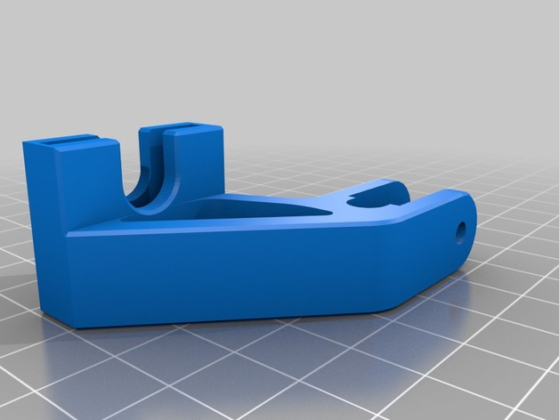
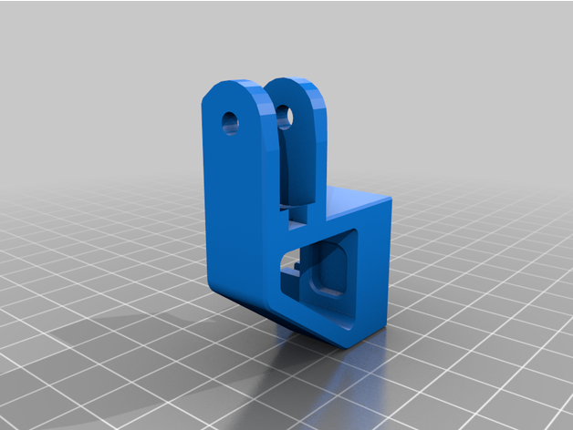
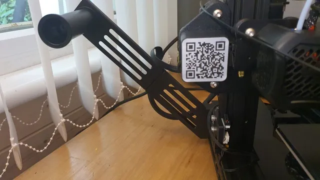
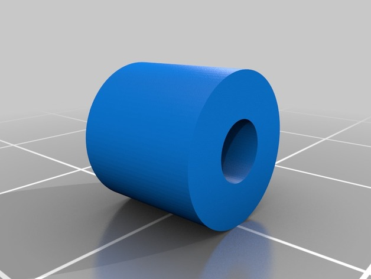
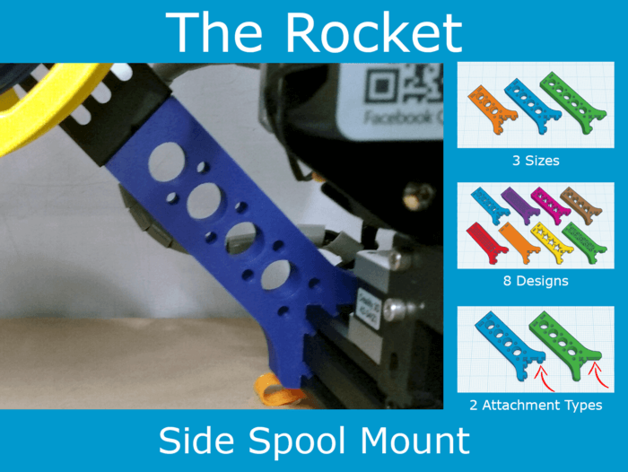

# Filament Guide

<!-- Generated by scripts/Update-Readmes.ps1 (Linux: scripts/update_readmes.py) - edit scripts/readme-sources.json and rerun instead of editing by hand. -->

[Home](../../../README.md) / [Printer Improvements](../../README.md) / [Ender3](../README.md) / **Filament Guide**

7 builds &middot; 1 Printables &middot; 6 Thingiverse

## Filament Guide

<table>
<tr>
<td width="33%" align="center" valign="top">
 
<b>2020 / Ender 3 Filament Guide</b> 
by Filboyt 
<a href="https://www.thingiverse.com/thing:2917932">Thingiverse</a> &middot; <a href="2020___Ender_3_Filament_Guide_2917932">Repo folder</a>
</td>
<td width="33%" align="center" valign="top">
 
<b>Ender 3 and 3 V2 Filament Guide - GO BIG - No Screws - No Supports</b> 
by Markacho 
<a href="https://www.thingiverse.com/thing:4683505">Thingiverse</a> &middot; <a href="Ender_3_and_3_V2_Filament_Guide_-_GO_BIG_-_No_Screws_-_No_Supports_4683505">Repo folder</a>
</td>
<td width="33%" align="center" valign="top">
 
<b>Ender 3 Filament Roller Guide</b> 
by Holspeed 
<a href="https://www.thingiverse.com/thing:3052488">Thingiverse</a> &middot; <a href="Ender_3_Filament_Roller_Guide_3052488">Repo folder</a>
</td>
</tr>
<tr>
<td width="33%" align="center" valign="top">
 
<b>Ender 3 V2 Filament Guide</b> 
by RedSoda 
<a href="https://www.thingiverse.com/thing:4581110">Thingiverse</a> &middot; <a href="Ender_3_V2_Filament_Guide_4581110">Repo folder</a>
</td>
<td width="33%" align="center" valign="top">
 
<b>Ender 3 v2 Side Mount Spool Holder</b> 
by Pugwash 
<a href="https://www.printables.com/model/201538-ender-3-v2-side-mount-spool-holder">Printables</a> &middot; <a href="ender-3-v2-side-mount-spool-holder-model_files">Repo folder</a>
</td>
<td width="33%" align="center" valign="top">
 
<b>Spool Holder Universal for Ender3, Ender 3</b> 
by Jaypirnts 
<a href="https://www.thingiverse.com/thing:2999446">Thingiverse</a> &middot; <a href="Spool_Holder_Universal_for_Ender3__Ender_3_2999446">Repo folder</a>
</td>
</tr>
<tr>
<td width="33%" align="center" valign="top">
 
<b>The Rocket - Side Spool Mount - Creality / Ender 3 (Pro/V2)</b> 
by regularlabs 
<a href="https://www.thingiverse.com/thing:4691695">Thingiverse</a> &middot; <a href="The_Rocket_-_Side_Spool_Mount_-_Creality___Ender_3__Pro_V2__4691695">Repo folder</a>
</td>
</tr>
</table>

