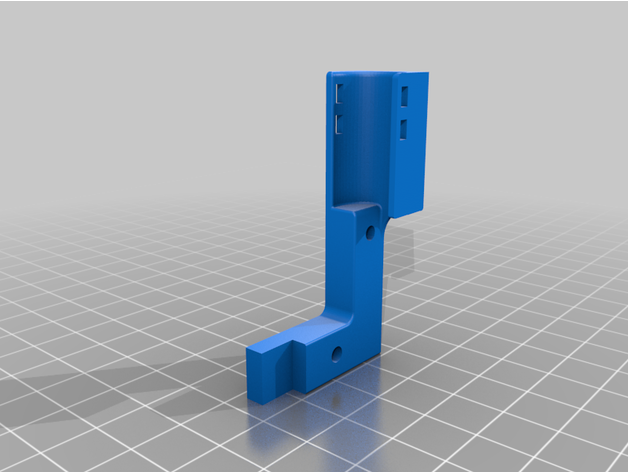
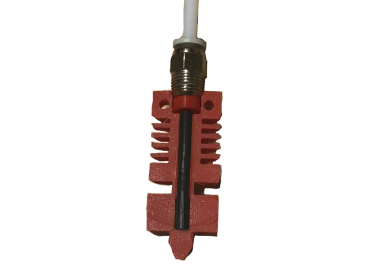
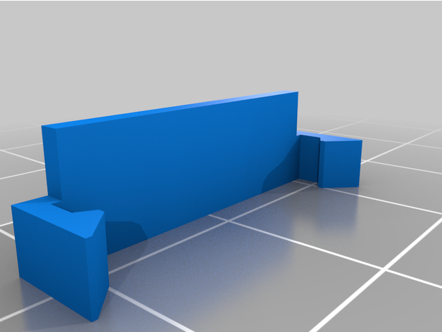
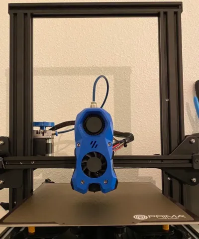
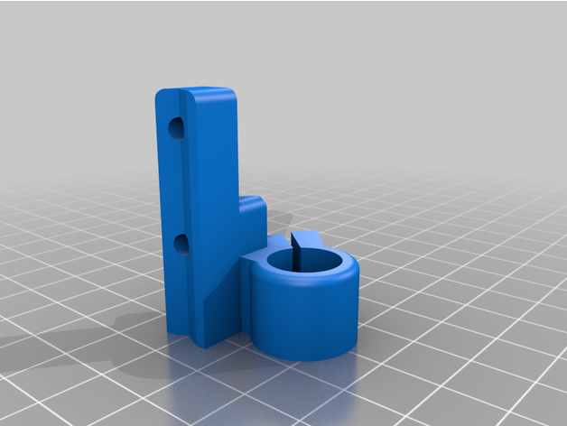
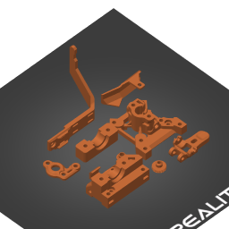

# Hotend

<!-- Generated by scripts/Update-Readmes.ps1 (Linux: scripts/update_readmes.py) - edit scripts/readme-sources.json and rerun instead of editing by hand. -->

[Home](../../../README.md) / [Printer Improvements](../../README.md) / [Ender3](../README.md) / **Hotend**

8 builds &middot; 2 Printables &middot; 6 Thingiverse

## Hotend

<table>
<tr>
<td width="33%" align="center" valign="top">
 
<b>CR-10 FANG dual 5015 and BLtouch for MicroSwiss direct drive</b> 
by bogdi1988 
<a href="https://www.thingiverse.com/thing:4564060">Thingiverse</a> &middot; <a href="CR-10_FANG_dual_5015_and_BLtouch_for_MicroSwiss_direct_drive_4564060">Repo folder</a>
</td>
<td width="33%" align="center" valign="top">
 
<b>Creality BEST DIRECT DRIVE MOUNT</b> 
by ElderRacing 
<a href="https://www.thingiverse.com/thing:4939645">Thingiverse</a> &middot; <a href="Creality%20BEST%20DIRECT%20DRIVE%20MOUNT%20-%204939645">Repo folder</a>
</td>
<td width="33%" align="center" valign="top">
 
<b>Creality HotEnd Fix</b> 
by Elproducts 
<a href="https://www.thingiverse.com/thing:4220059">Thingiverse</a> &middot; <a href="Creality_HotEnd_Fix_4220059">Repo folder</a>
</td>
</tr>
<tr>
<td width="33%" align="center" valign="top">
 
<b>Diplo Duct - Ender 3 V2 4020 BMG Direct Drive</b> 
by GalvanicGlaze 
<a href="https://www.thingiverse.com/thing:4840016">Thingiverse</a> &middot; <a href="Diplo_Duct_-_Ender_3_V2_4020_BMG_Direct_Drive__4840016">Repo folder</a>
</td>
<td width="33%" align="center" valign="top">
 
<b>Ender 3 V2 - VORON Stealthburner conversion</b> 
by WouterE_ 
<a href="https://www.printables.com/model/139183-ender-3-v2-voron-stealthburner-conversion">Printables</a> &middot; <a href="ender-3-v2-voron-stealthburner-conversion-model_files">Repo folder</a>
</td>
<td width="33%" align="center" valign="top">
 
<b>Klemco 40mm Fan Mount</b> 
by Airmaxx23 
<a href="https://www.thingiverse.com/thing:5174226">Thingiverse</a> &middot; <a href="Klemco%2040mm%20Fan%20Mount%20-%205174226">Repo folder</a>
</td>
</tr>
<tr>
<td width="33%" align="center" valign="top">
 
<b>Petsfang Duct for CR10 MicroSwiss/Stock/E3Dv6/Volcano/TevoTornado /Tarantula Hot End/E3Dv6 CNC Mount &amp; 5015 fan Bullseye Blokhead</b> 
by dpetsel 
<a href="https://www.thingiverse.com/thing:2759439">Thingiverse</a> &middot; <a href="Petsfang_Duct_for_CR10_MicroSwiss_Stock_E3Dv6_Volcano_TevoTornado__Tarantula_Hot_End_E3Dv6_CNC_Mount___5015_fan_Bullseye_Blokhead_2759439">Repo folder</a>
</td>
<td width="33%" align="center" valign="top">
 
<b>Sherpa Elephant V6 Tool Head Ender 3 V2 Neo</b> 
<a href="https://www.printables.com/model/400559">Printables</a> &middot; <a href="sherpa-elephant-v6-tool-head-ender-3-v2-neo-model_files">Repo folder</a>
</td>
</tr>
</table>

