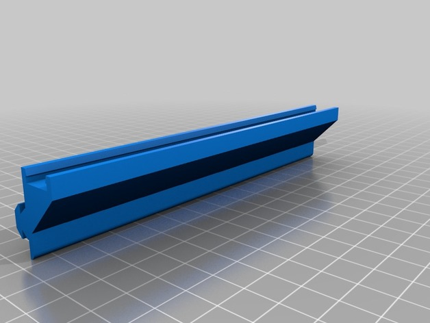
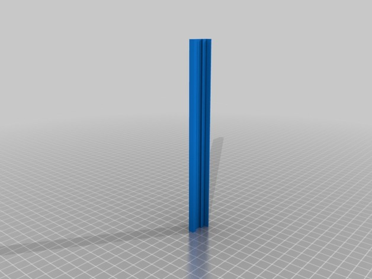

# Light

<!-- Generated by scripts/Update-Readmes.ps1 (Linux: scripts/update_readmes.py) - edit scripts/readme-sources.json and rerun instead of editing by hand. -->

[Home](../../../README.md) / [Printer Improvements](../../README.md) / [Ender3](../README.md) / **Light**

2 builds &middot; 2 Thingiverse

## Light

<table>
<tr>
<td width="33%" align="center" valign="top">
 
<b>Ender 3 Light Bar</b> 
by Kevlarr 
<a href="https://www.thingiverse.com/thing:3135488">Thingiverse</a> &middot; <a href="Ender_3_Light_Bar_3135488">Repo folder</a>
</td>
<td width="33%" align="center" valign="top">
 
<b>Ender 3/2020 Extrusion Light Bar</b> 
by LilTrublMakr 
<a href="https://www.thingiverse.com/thing:3272248">Thingiverse</a> &middot; <a href="Ender_3_2020_Extrusion_Light_Bar_3272248">Repo folder</a>
</td>
</tr>
</table>

