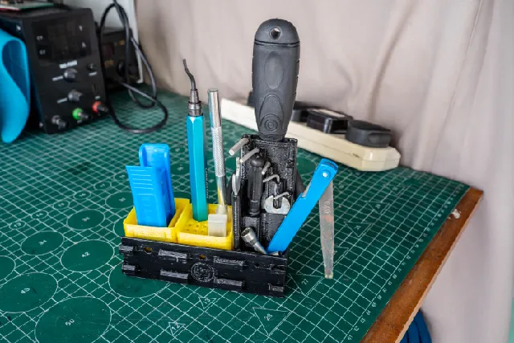
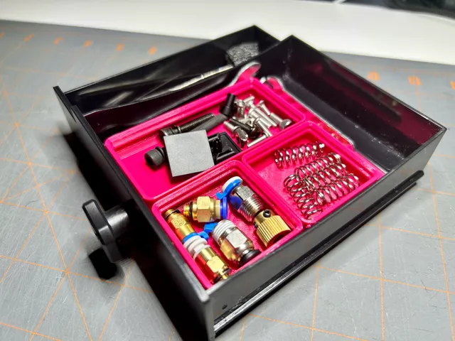
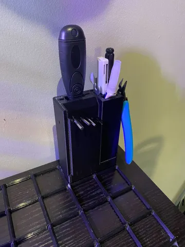
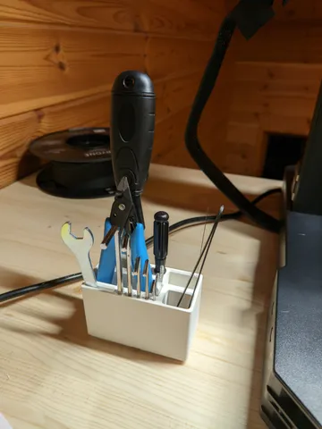
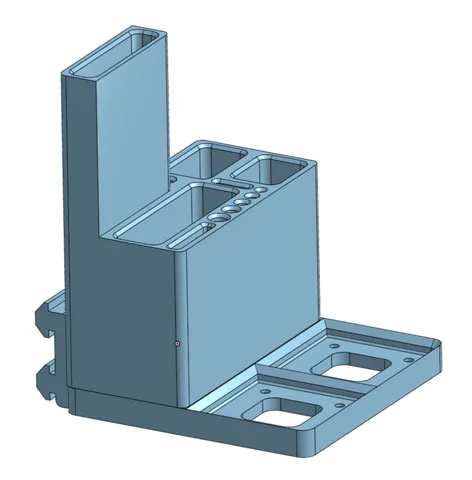

# Tools

<!-- Generated by scripts/Update-Readmes.ps1 (Linux: scripts/update_readmes.py) - edit scripts/readme-sources.json and rerun instead of editing by hand. -->

[Home](../../../README.md) / [Printer Improvements](../../README.md) / [Ender3](../README.md) / **Tools**

6 builds &middot; 5 Printables &middot; 1 Thingiverse

## Tools

<table>
<tr>
<td width="33%" align="center" valign="top">
 
<b>1x1 Gridfinity Ender Tools Side-Mount</b> 
by BillyLjm 
<a href="https://www.printables.com/model/522496-1x1-gridfinity-ender-tools-side-mount">Printables</a> &middot; <a href="1x1-gridfinity-ender-tools-side-mount-model_files">Repo folder</a>
</td>
<td width="33%" align="center" valign="top">
 
<b>Creality Ender 3 Pro dual drawer</b> 
by DWS_design 
<a href="https://www.thingiverse.com/thing:3416444">Thingiverse</a> &middot; <a href="Creality_Ender_3_Pro_dual_drawer_3416444">Repo folder</a>
</td>
<td width="33%" align="center" valign="top">
 
<b>Ender 3 V2 Gridfinity Insert</b> 
by BenBreaksThings 
<a href="https://www.printables.com/model/294672-ender-3-v2-gridfinity-insert">Printables</a> &middot; <a href="ender-3-v2-gridfinity-insert-model_files">Repo folder</a>
</td>
</tr>
<tr>
<td width="33%" align="center" valign="top">
 
<b>Gridfinity Ender 3 Tool holder</b> 
by ChiefFluffy 
<a href="https://www.printables.com/model/449001-gridfinity-ender-3-tool-holder">Printables</a> &middot; <a href="gridfinity-ender-3-tool-holder-model_files">Repo folder</a>
</td>
<td width="33%" align="center" valign="top">
 
<b>Gridfinity Ender 3 Tools Holder</b> 
by Sepezha 
<a href="https://www.printables.com/model/478342-gridfinity-ender-3-tools-holder">Printables</a> &middot; <a href="gridfinity-ender-3-tools-holder-model_files">Repo folder</a>
</td>
<td width="33%" align="center" valign="top">
 
<b>Gridfinity Ender 3 v2 side mount for tools</b> 
by Gelposki 
<a href="https://www.printables.com/model/427537-gridfinity-ender-3-v2-side-mount-for-tools">Printables</a> &middot; <a href="gridfinity-ender-3-v2-side-mount-for-tools-model_files">Repo folder</a>
</td>
</tr>
</table>

