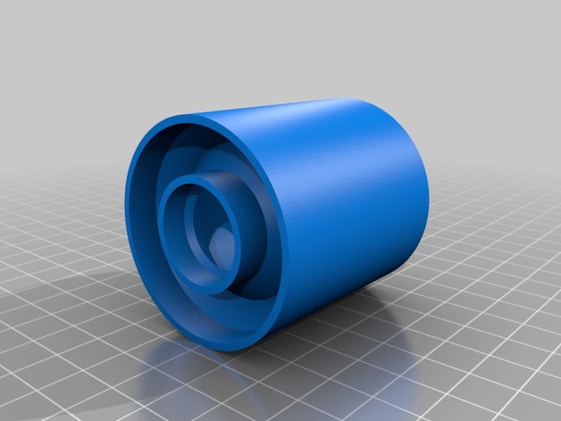
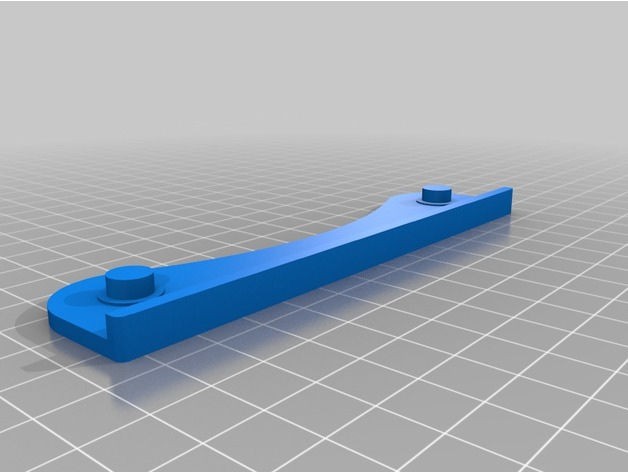

# Filament Guide

<!-- Generated by scripts/Update-Readmes.ps1 (Linux: scripts/update_readmes.py) - edit scripts/readme-sources.json and rerun instead of editing by hand. -->

[Home](../../README.md) / [Printer Improvements](../README.md) / **Filament Guide**

2 builds &middot; 2 Thingiverse

## Filament Guide

<table>
<tr>
<td width="33%" align="center" valign="top">
 
<b>SPANNERHANDS Spool System Wall Mounted Spool Holder &amp; Dust Cover</b> 
by 3DMasterRace 
<a href="https://www.thingiverse.com/thing:2119644">Thingiverse</a> &middot; <a href="SPANNERHANDS_Spool_System_Wall_Mounted_Spool_Holder___Dust_Cover_2119644">Repo folder</a>
</td>
<td width="33%" align="center" valign="top">
 
<b>TUSH - The Ultimate Spool Holder</b> 
by filamentry 
<a href="https://www.thingiverse.com/thing:2047554">Thingiverse</a> &middot; <a href="TUSH_-_The_Ultimate_Spool_Holder_2047554">Repo folder</a>
</td>
</tr>
</table>

