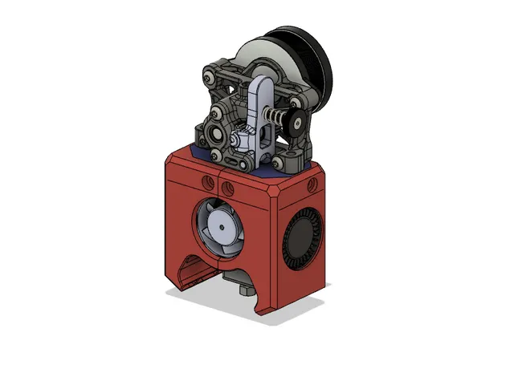
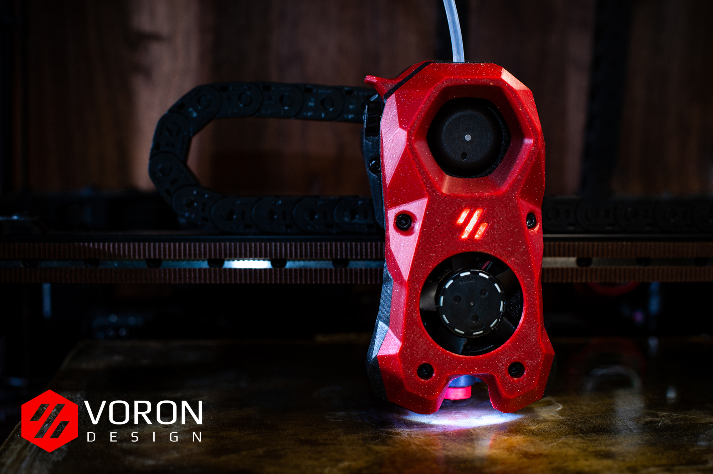

# Hotend

<!-- Generated by scripts/Update-Readmes.ps1 (Linux: scripts/update_readmes.py) - edit scripts/readme-sources.json and rerun instead of editing by hand. -->

[Home](../../README.md) / [Printer Improvements](../README.md) / **Hotend**

4 builds &middot; 1 Printables &middot; 1 Thingiverse &middot; 2 unknown source

## Hotend

<table>
<tr>
<td width="33%" align="center" valign="top">
<i>no preview</i> 
<b>E3D-Adapter-Accessories</b> 
Source unknown &middot; <a href="E3D-Adapter-Accessories">Repo folder</a>
</td>
<td width="33%" align="center" valign="top">
 
<b>Manta MK2 Duct &amp; Tool Head System</b> 
by BoothyBoothy 
<a href="https://www.thingiverse.com/thing:4943125">Thingiverse</a> &middot; <a href="Manta%20MK2%20Duct%20%26%20Tool%20Head%20System%20-%204943125">Repo folder</a>
</td>
<td width="33%" align="center" valign="top">
 
<b>Sherpa Blockhead Fan system for Voron 0.1</b> 
by Meatball 
<a href="https://www.printables.com/model/213588-sherpa-blockhead-fan-system-for-voron-01">Printables</a> &middot; <a href="sherpa-blockhead-fan-system-for-voron-01-model_files">Repo folder</a>
</td>
</tr>
<tr>
<td width="33%" align="center" valign="top">
 
<b>Voron-Stealthburner-main</b> 
Source unknown &middot; <a href="Voron-Stealthburner-main">Repo folder</a>
</td>
</tr>
</table>

