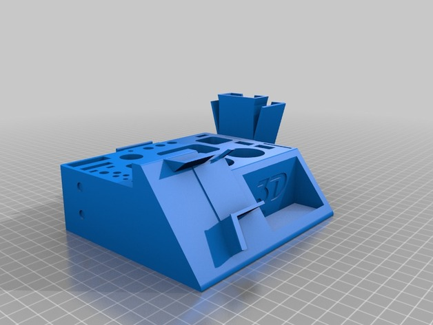
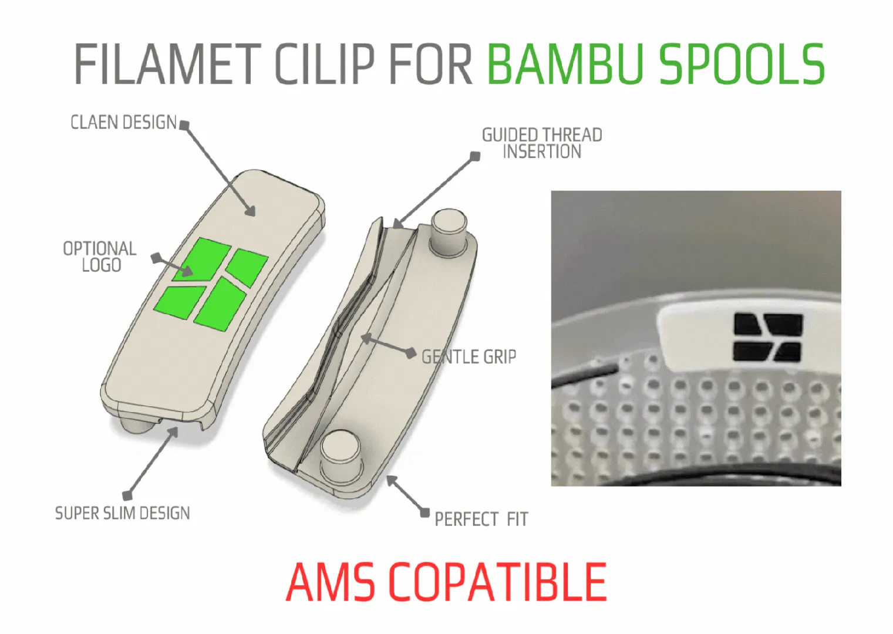
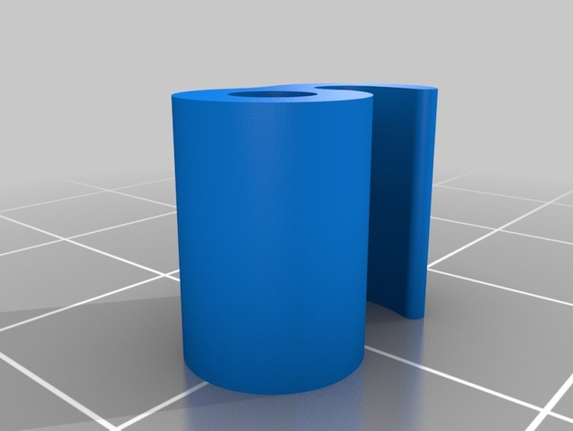
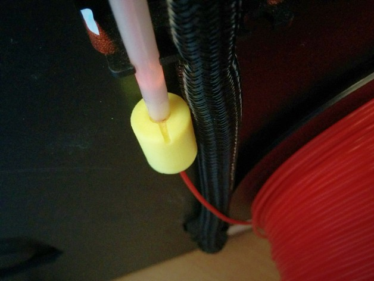
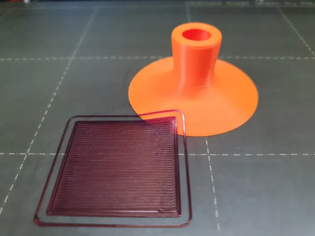

# Tools

<!-- Generated by scripts/Update-Readmes.ps1 (Linux: scripts/update_readmes.py) - edit scripts/readme-sources.json and rerun instead of editing by hand. -->

[Home](../../README.md) / [Printer Improvements](../README.md) / **Tools**

7 builds &middot; 1 MakerWorld &middot; 2 Printables &middot; 3 Thingiverse &middot; 1 unknown source

## Tools

<table>
<tr>
<td width="33%" align="center" valign="top">
 
<b>3D Printer Tool Stand</b> 
by STIG_ 
<a href="https://www.thingiverse.com/thing:1937236">Thingiverse</a> &middot; <a href="3D_Printer_Tool_Stand_1937236">Repo folder</a>
</td>
<td width="33%" align="center" valign="top">
 
<b>Clip one color</b> 
<a href="https://makerworld.com/en/search/models?keyword=Clip%20one%20color">Search MakerWorld</a> &middot; <a href="Clip%2Bone%2Bcolor.3mf">Clip+one+color.3mf</a>
</td>
<td width="33%" align="center" valign="top">
 
<b>Filament Clip</b> 
by intofocus 
<a href="https://www.thingiverse.com/thing:282242">Thingiverse</a> &middot; <a href="Filament_Clip__282242">Repo folder</a>
</td>
</tr>
<tr>
<td width="33%" align="center" valign="top">
 
<b>Universal Filament Filter and Lubricator</b> 
by CreativeTools 
<a href="https://www.thingiverse.com/thing:492067">Thingiverse</a> &middot; <a href="Universal_Filament_Filter_and_Lubricator_492067">Repo folder</a>
</td>
<td width="33%" align="center" valign="top">
 
<b>🟠 Thin layers scraper (tiny+ergonomic)</b> 
by sh 
<a href="https://www.printables.com/model/277302-thin-layers-scraper-tinyergonomic">Printables</a> &middot; <a href="thin-layers-scraper-tinyergonomic-model_files">Repo folder</a>
</td>
<td width="33%" align="center" valign="top">
 
<b>🟠 Thin layers scraper (tiny+ergonomic)</b> 
by sh 
<a href="https://www.printables.com/model/277302-thin-layers-scraper-tinyergonomic">Printables</a> &middot; <a href="thin-layers-scraper-tinyergonomic-print_files">Repo folder</a>
</td>
</tr>
</table>

Other files in this folder (1)

- [Clip-Classic.stl](Clip-Classic.stl)

