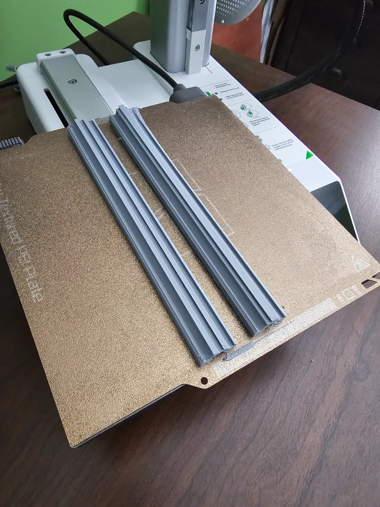
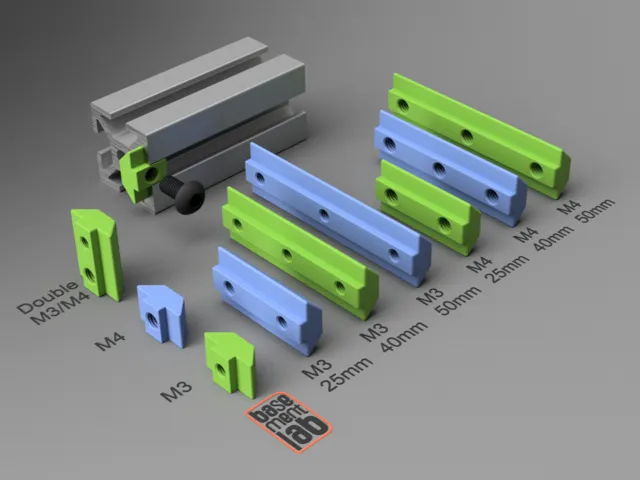
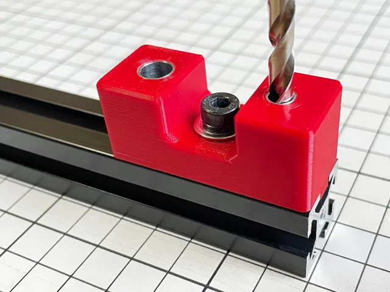
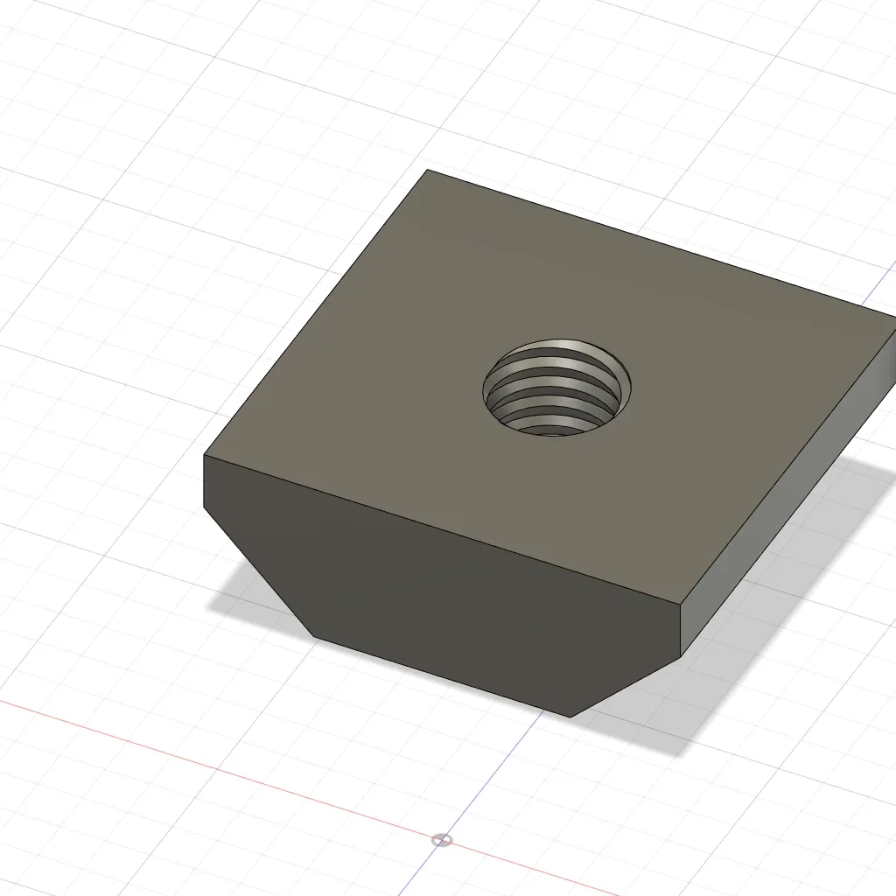

# 8020

<!-- Generated by scripts/Update-Readmes.ps1 (Linux: scripts/update_readmes.py) - edit scripts/readme-sources.json and rerun instead of editing by hand. -->

[Home](../../README.md) / [Storage](../README.md) / **8020**

14 builds &middot; 14 MakerWorld

## 8020

<table>
<tr>
<td width="33%" align="center" valign="top">
 
<b>2020 Half 180mm</b> 
<a href="https://makerworld.com/en/search/models?keyword=2020%20Half%20180mm">Search MakerWorld</a> &middot; <a href="2020%2BHalf%2B180mm.3mf">2020+Half+180mm.3mf</a>
</td>
<td width="33%" align="center" valign="top">
 
<b>2020 T-Slot Nut M3 / M4 / Double Thread   </b> 
by BasementLAB 
<a href="https://makerworld.com/en/models/1370080-2020-t-slot-nut-m3-m4-double-thread">MakerWorld</a> &middot; <a href="2020%2BT-Slot%2BNut%2BM3%2B_%2BM4%2B_%2BDouble%2BThread%2B%2B%2B">Repo folder</a>
</td>
<td width="33%" align="center" valign="top">
 
<b>Drill Guide for 2020/3030 Aluminum Profile</b> 
by TrocheHole 
<a href="https://makerworld.com/en/models/55872-drill-guide-for-2020-3030-aluminum-profile">MakerWorld</a> &middot; <a href="Drill%2BGuide%2Bfor%2B2020_3030%2BAluminum%2BProfile">Repo folder</a>
</td>
</tr>
<tr>
<td width="33%" align="center" valign="top">
<i>no preview</i> 
<b>Horizontal Print 20mm x20mm Extrusion V-Slot 180mm</b> 
<a href="https://makerworld.com/en/search/models?keyword=Horizontal%20Print%2020mm%20x20mm%20Extrusion%20V-Slot%20180mm">Search MakerWorld</a> &middot; <a href="Horizontal%2BPrint%2B20mm%2Bx20mm%2BExtrusion%2BV-Slot%2B180mm">Repo folder</a>
</td>
<td width="33%" align="center" valign="top">
 
<b>T Nut M3</b> 
<a href="https://makerworld.com/en/search/models?keyword=T%20Nut%20M3">Search MakerWorld</a> &middot; <a href="T%2BNut%2BM3.3mf">T+Nut+M3.3mf</a>
</td>
<td width="33%" align="center" valign="top">
<i>no preview</i> 
<b>挂钩-2020-A型</b> 
<a href="https://makerworld.com/en/search/models?keyword=%E6%8C%82%E9%92%A9-2020-A%E5%9E%8B">Search MakerWorld</a> &middot; <a href="%E6%8C%82%E9%92%A9-2020-A%E5%9E%8B_stls">Repo folder</a>
</td>
</tr>
<tr>
<td width="33%" align="center" valign="top">
<i>no preview</i> 
<b>挂钩-2020-B型</b> 
<a href="https://makerworld.com/en/search/models?keyword=%E6%8C%82%E9%92%A9-2020-B%E5%9E%8B">Search MakerWorld</a> &middot; <a href="%E6%8C%82%E9%92%A9-2020-B%E5%9E%8B_stls">Repo folder</a>
</td>
<td width="33%" align="center" valign="top">
<i>no preview</i> 
<b>收纳盒-2020-100mm</b> 
<a href="https://makerworld.com/en/search/models?keyword=%E6%94%B6%E7%BA%B3%E7%9B%92-2020-100mm">Search MakerWorld</a> &middot; <a href="%E6%94%B6%E7%BA%B3%E7%9B%92-2020-100mm_stls">Repo folder</a>
</td>
<td width="33%" align="center" valign="top">
<i>no preview</i> 
<b>收纳盒-2020-150mm</b> 
<a href="https://makerworld.com/en/search/models?keyword=%E6%94%B6%E7%BA%B3%E7%9B%92-2020-150mm">Search MakerWorld</a> &middot; <a href="%E6%94%B6%E7%BA%B3%E7%9B%92-2020-150mm_stls">Repo folder</a>
</td>
</tr>
<tr>
<td width="33%" align="center" valign="top">
<i>no preview</i> 
<b>铝型材-收纳盒-2020-60mm</b> 
<a href="https://makerworld.com/en/search/models?keyword=%E9%93%9D%E5%9E%8B%E6%9D%90-%E6%94%B6%E7%BA%B3%E7%9B%92-2020-60mm">Search MakerWorld</a> &middot; <a href="%E9%93%9D%E5%9E%8B%E6%9D%90-%E6%94%B6%E7%BA%B3%E7%9B%92-2020-60mm_stls">Repo folder</a>
</td>
<td width="33%" align="center" valign="top">
<i>no preview</i> 
<b>铝型材-方形地脚-2020</b> 
<a href="https://makerworld.com/en/search/models?keyword=%E9%93%9D%E5%9E%8B%E6%9D%90-%E6%96%B9%E5%BD%A2%E5%9C%B0%E8%84%9A-2020">Search MakerWorld</a> &middot; <a href="%E9%93%9D%E5%9E%8B%E6%9D%90-%E6%96%B9%E5%BD%A2%E5%9C%B0%E8%84%9A-2020_stls">Repo folder</a>
</td>
<td width="33%" align="center" valign="top">
<i>no preview</i> 
<b>铝型材-方形地脚-3030</b> 
<a href="https://makerworld.com/en/search/models?keyword=%E9%93%9D%E5%9E%8B%E6%9D%90-%E6%96%B9%E5%BD%A2%E5%9C%B0%E8%84%9A-3030">Search MakerWorld</a> &middot; <a href="%E9%93%9D%E5%9E%8B%E6%9D%90-%E6%96%B9%E5%BD%A2%E5%9C%B0%E8%84%9A-3030_stls">Repo folder</a>
</td>
</tr>
<tr>
<td width="33%" align="center" valign="top">
<i>no preview</i> 
<b>铝型材-方形地脚-4040</b> 
<a href="https://makerworld.com/en/search/models?keyword=%E9%93%9D%E5%9E%8B%E6%9D%90-%E6%96%B9%E5%BD%A2%E5%9C%B0%E8%84%9A-4040">Search MakerWorld</a> &middot; <a href="%E9%93%9D%E5%9E%8B%E6%9D%90-%E6%96%B9%E5%BD%A2%E5%9C%B0%E8%84%9A-4040_stls">Repo folder</a>
</td>
<td width="33%" align="center" valign="top">
<i>no preview</i> 
<b>铝型材-理线夹-2020</b> 
<a href="https://makerworld.com/en/search/models?keyword=%E9%93%9D%E5%9E%8B%E6%9D%90-%E7%90%86%E7%BA%BF%E5%A4%B9-2020">Search MakerWorld</a> &middot; <a href="%E9%93%9D%E5%9E%8B%E6%9D%90-%E7%90%86%E7%BA%BF%E5%A4%B9-2020_stls">Repo folder</a>
</td>
</tr>
</table>

