# Storage

<!-- Generated by scripts/Update-Readmes.ps1 - edit scripts/readme-sources.json and rerun instead of editing by hand. -->

518 builds &middot; 132 MakerWorld &middot; 259 Printables &middot; 31 Thingiverse &middot; 96 unknown source

## Contents

- [Storage](#storage) (5)
- [8020](#8020) (14)
- [Boxes](#boxes) (9)
- [Cable Storage](#cable-storage) (3)
- [Cable Storage / Gridfinity](#cable-storage--gridfinity) (6)
- [Hooks](#hooks) (2)
- [Pinecil](#pinecil) (4)
- [Pinecil / Gridfinity](#pinecil--gridfinity) (4)
- [Pinecil / Portable](#pinecil--portable) (3)
- [Sd Card Storage](#sd-card-storage) (8)
- [Small Parts Storage](#small-parts-storage) (20)
- [Systems / Gen2 Drawers](#systems--gen2-drawers) (9)
- [Systems / Gridfinity](#systems--gridfinity) (6)
- [Systems / Gridfinity / Baseplates](#systems--gridfinity--baseplates) (26)
- [Systems / Gridfinity / Baseplate Spacers](#systems--gridfinity--baseplate-spacers) (3)
- [Systems / Gridfinity / Boxes](#systems--gridfinity--boxes) (10)
- [Systems / Gridfinity / Boxes / Gridfinity Shelves For Boxes](#systems--gridfinity--boxes--gridfinity-shelves-for-boxes) (3)
- [Systems / Gridfinity / Collections](#systems--gridfinity--collections) (13)
- [Systems / Gridfinity / Collections / Rugged Collection](#systems--gridfinity--collections--rugged-collection) (9)
- [Systems / Gridfinity / Drawers](#systems--gridfinity--drawers) (9)
- [Systems / Gridfinity / Jigs](#systems--gridfinity--jigs) (5)
- [Systems / Gridfinity / Labels](#systems--gridfinity--labels) (2)
- [Systems / Gridfinity / Parts Bins](#systems--gridfinity--parts-bins) (37)
- [Systems / Gridfinity / Templates](#systems--gridfinity--templates) (11)
- [Systems / Gridfinity / Tool Holders](#systems--gridfinity--tool-holders) (105)
- [Systems / Gridfinity / Tool Holders / 3d Printing](#systems--gridfinity--tool-holders--3d-printing) (1)
- [Systems / Gridfinity / Tool Holders / Batteries](#systems--gridfinity--tool-holders--batteries) (7)
- [Systems / Gridfinity / Tool Holders / Computer](#systems--gridfinity--tool-holders--computer) (5)
- [Systems / Gridfinity / Tool Holders / Electrical](#systems--gridfinity--tool-holders--electrical) (14)
- [Systems / Gridfinity / Tool Holders / Hand Tools](#systems--gridfinity--tool-holders--hand-tools) (47)
- [Systems / Gridfinity / Tool Holders / Label Printer](#systems--gridfinity--tool-holders--label-printer) (5)
- [Systems / Gridfinity / Tool Holders / Soldering](#systems--gridfinity--tool-holders--soldering) (11)
- [Systems / Honeycomb Wall](#systems--honeycomb-wall) (4)
- [Systems / Multiboard](#systems--multiboard) (7)
- [Systems / Neogrid](#systems--neogrid) (1)
- [Systems / Opengrid](#systems--opengrid) (8)
- [Systems / Opengrid / Cable Organization](#systems--opengrid--cable-organization) (13)
- [Systems / Opengrid / Channels](#systems--opengrid--channels) (1)
- [Systems / Opengrid / Collections](#systems--opengrid--collections) (4)
- [Systems / Opengrid / Connectors](#systems--opengrid--connectors) (2)
- [Systems / Opengrid / Feet](#systems--opengrid--feet) (2)
- [Systems / Opengrid / Grids](#systems--opengrid--grids) (4)
- [Systems / Opengrid / Kyz Tool Tower](#systems--opengrid--kyz-tool-tower) (3)
- [Systems / Opengrid / Snaps](#systems--opengrid--snaps) (4)
- [Systems / Skadis Pegboard](#systems--skadis-pegboard) (12)
- [Systems / Skadis Pegboard / Bins](#systems--skadis-pegboard--bins) (5)
- [Systems / Skadis Pegboard / Pegboard](#systems--skadis-pegboard--pegboard) (4)
- [Systems / Skadis Pegboard / Tool Holders](#systems--skadis-pegboard--tool-holders) (2)
- [Tool Holders](#tool-holders) (24)
- [Tool Holders / Toolbox Wrench Organizer](#tool-holders--toolbox-wrench-organizer) (2)

## Storage

<table>
<tr>
<td width="33%" align="center" valign="top">
<a href="ikea-alex-multiple-inserts-model_files">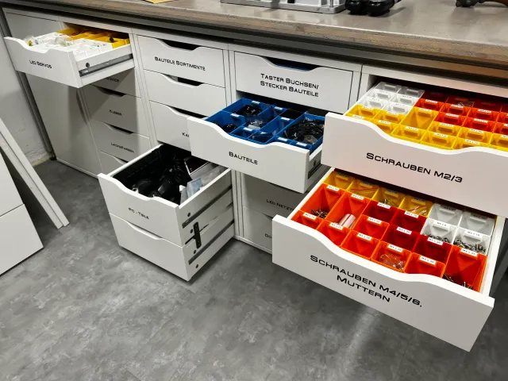</a> 
<b>IKEA ALEX &amp; Malm multiple inserts</b> 
by printingbuddy 
<a href="https://www.printables.com/model/244443-ikea-alex-malm-multiple-inserts">Printables</a> &middot; <a href="ikea-alex-multiple-inserts-model_files">Repo folder</a>
</td>
<td width="33%" align="center" valign="top">
<a href="Modular%2BStacking%2BStorage%2BBins%2B-%2BSwiffer%2BSupplies%2B">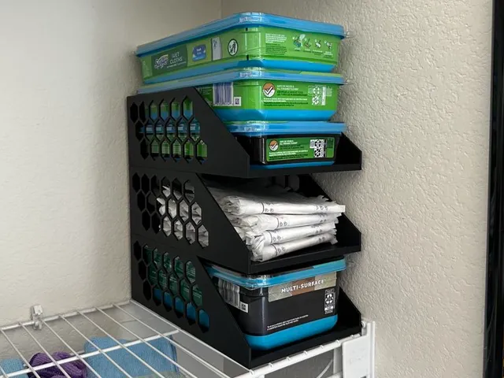</a> 
<b>Modular Stacking Storage Bins - Swiffer Supplies </b> 
by BATTCAVE 
<a href="https://makerworld.com/en/models/1506660-modular-stacking-storage-bins-swiffer-supplies">MakerWorld</a> &middot; <a href="Modular%2BStacking%2BStorage%2BBins%2B-%2BSwiffer%2BSupplies%2B">Repo folder</a>
</td>
<td width="33%" align="center" valign="top">
<a href="organizer-box-xl">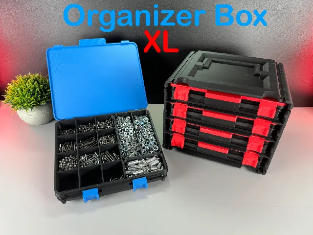</a> 
<b>Organizer Box XL</b> 
by 3DPrintyi 
<a href="https://www.printables.com/model/980912-organizer-box-xl">Printables</a> &middot; <a href="organizer-box-xl">Repo folder</a>
</td>
</tr>
<tr>
<td width="33%" align="center" valign="top">
<a href="STAK%2BWall%2BSystem%2B-%2BModular%2BEDC%2BStorage%2B">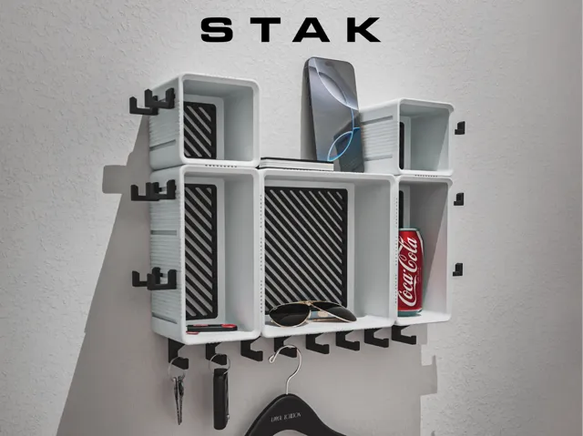</a> 
<b>STAK Wall System - Modular EDC Storage </b> 
by iRcustom 
<a href="https://makerworld.com/en/models/2695627-stak-wall-system-modular-edc-storage">MakerWorld</a> &middot; <a href="STAK%2BWall%2BSystem%2B-%2BModular%2BEDC%2BStorage%2B">Repo folder</a>
</td>
<td width="33%" align="center" valign="top">
<a href="Ultimate%2BBin%2BGenerator">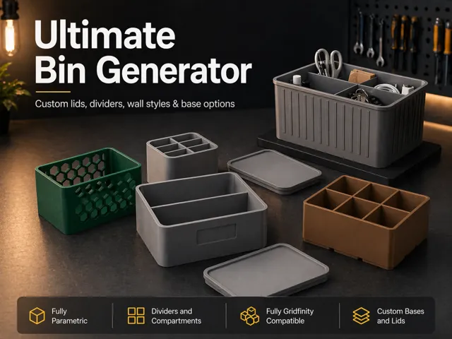</a> 
<b>Ultimate Bin Generator</b> 
by JeanBeraud 
<a href="https://makerworld.com/en/models/2695325-ultimate-bin-generator">MakerWorld</a> &middot; <a href="Ultimate%2BBin%2BGenerator">Repo folder</a>
</td>
</tr>
</table>

## 8020

<table>
<tr>
<td width="33%" align="center" valign="top">
<a href="8020/2020%2BHalf%2B180mm.3mf">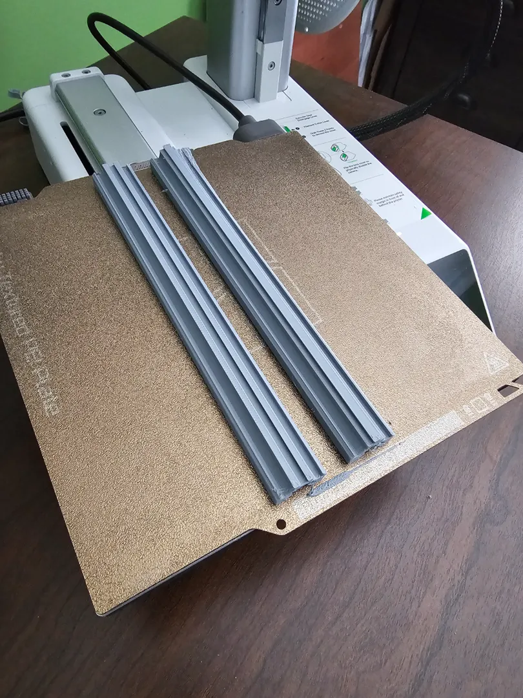</a> 
<b>2020 Half 180mm</b> 
<a href="https://makerworld.com/en/search/models?keyword=2020%20Half%20180mm">Search MakerWorld</a> &middot; <a href="8020/2020%2BHalf%2B180mm.3mf">2020+Half+180mm.3mf</a>
</td>
<td width="33%" align="center" valign="top">
<a href="8020/2020%2BT-Slot%2BNut%2BM3%2B_%2BM4%2B_%2BDouble%2BThread%2B%2B%2B">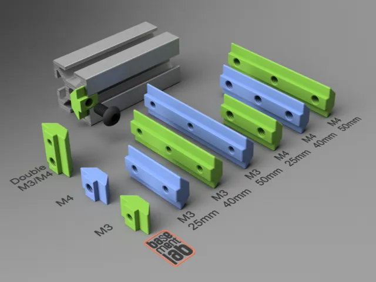</a> 
<b>2020 T-Slot Nut M3 / M4 / Double Thread   </b> 
by BasementLAB 
<a href="https://makerworld.com/en/models/1370080-2020-t-slot-nut-m3-m4-double-thread">MakerWorld</a> &middot; <a href="8020/2020%2BT-Slot%2BNut%2BM3%2B_%2BM4%2B_%2BDouble%2BThread%2B%2B%2B">Repo folder</a>
</td>
<td width="33%" align="center" valign="top">
<a href="8020/Drill%2BGuide%2Bfor%2B2020_3030%2BAluminum%2BProfile">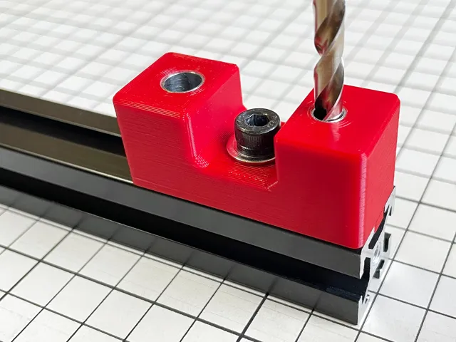</a> 
<b>Drill Guide for 2020/3030 Aluminum Profile</b> 
by TrocheHole 
<a href="https://makerworld.com/en/models/55872-drill-guide-for-2020-3030-aluminum-profile">MakerWorld</a> &middot; <a href="8020/Drill%2BGuide%2Bfor%2B2020_3030%2BAluminum%2BProfile">Repo folder</a>
</td>
</tr>
<tr>
<td width="33%" align="center" valign="top">
<i>no preview</i> 
<b>Horizontal Print 20mm x20mm Extrusion V-Slot 180mm</b> 
<a href="https://makerworld.com/en/search/models?keyword=Horizontal%20Print%2020mm%20x20mm%20Extrusion%20V-Slot%20180mm">Search MakerWorld</a> &middot; <a href="8020/Horizontal%2BPrint%2B20mm%2Bx20mm%2BExtrusion%2BV-Slot%2B180mm">Repo folder</a>
</td>
<td width="33%" align="center" valign="top">
<a href="8020/T%2BNut%2BM3.3mf">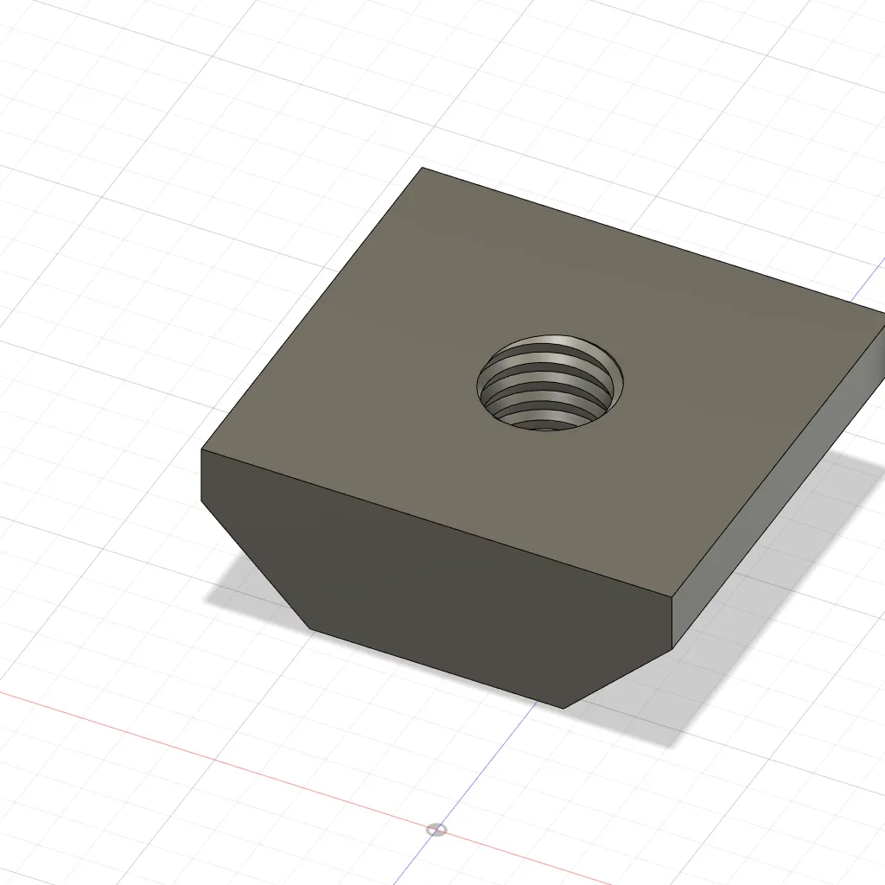</a> 
<b>T Nut M3</b> 
<a href="https://makerworld.com/en/search/models?keyword=T%20Nut%20M3">Search MakerWorld</a> &middot; <a href="8020/T%2BNut%2BM3.3mf">T+Nut+M3.3mf</a>
</td>
<td width="33%" align="center" valign="top">
<i>no preview</i> 
<b>挂钩-2020-A型</b> 
<a href="https://makerworld.com/en/search/models?keyword=%E6%8C%82%E9%92%A9-2020-A%E5%9E%8B">Search MakerWorld</a> &middot; <a href="8020/%E6%8C%82%E9%92%A9-2020-A%E5%9E%8B_stls">Repo folder</a>
</td>
</tr>
<tr>
<td width="33%" align="center" valign="top">
<i>no preview</i> 
<b>挂钩-2020-B型</b> 
<a href="https://makerworld.com/en/search/models?keyword=%E6%8C%82%E9%92%A9-2020-B%E5%9E%8B">Search MakerWorld</a> &middot; <a href="8020/%E6%8C%82%E9%92%A9-2020-B%E5%9E%8B_stls">Repo folder</a>
</td>
<td width="33%" align="center" valign="top">
<i>no preview</i> 
<b>收纳盒-2020-100mm</b> 
<a href="https://makerworld.com/en/search/models?keyword=%E6%94%B6%E7%BA%B3%E7%9B%92-2020-100mm">Search MakerWorld</a> &middot; <a href="8020/%E6%94%B6%E7%BA%B3%E7%9B%92-2020-100mm_stls">Repo folder</a>
</td>
<td width="33%" align="center" valign="top">
<i>no preview</i> 
<b>收纳盒-2020-150mm</b> 
<a href="https://makerworld.com/en/search/models?keyword=%E6%94%B6%E7%BA%B3%E7%9B%92-2020-150mm">Search MakerWorld</a> &middot; <a href="8020/%E6%94%B6%E7%BA%B3%E7%9B%92-2020-150mm_stls">Repo folder</a>
</td>
</tr>
<tr>
<td width="33%" align="center" valign="top">
<i>no preview</i> 
<b>铝型材-收纳盒-2020-60mm</b> 
<a href="https://makerworld.com/en/search/models?keyword=%E9%93%9D%E5%9E%8B%E6%9D%90-%E6%94%B6%E7%BA%B3%E7%9B%92-2020-60mm">Search MakerWorld</a> &middot; <a href="8020/%E9%93%9D%E5%9E%8B%E6%9D%90-%E6%94%B6%E7%BA%B3%E7%9B%92-2020-60mm_stls">Repo folder</a>
</td>
<td width="33%" align="center" valign="top">
<i>no preview</i> 
<b>铝型材-方形地脚-2020</b> 
<a href="https://makerworld.com/en/search/models?keyword=%E9%93%9D%E5%9E%8B%E6%9D%90-%E6%96%B9%E5%BD%A2%E5%9C%B0%E8%84%9A-2020">Search MakerWorld</a> &middot; <a href="8020/%E9%93%9D%E5%9E%8B%E6%9D%90-%E6%96%B9%E5%BD%A2%E5%9C%B0%E8%84%9A-2020_stls">Repo folder</a>
</td>
<td width="33%" align="center" valign="top">
<i>no preview</i> 
<b>铝型材-方形地脚-3030</b> 
<a href="https://makerworld.com/en/search/models?keyword=%E9%93%9D%E5%9E%8B%E6%9D%90-%E6%96%B9%E5%BD%A2%E5%9C%B0%E8%84%9A-3030">Search MakerWorld</a> &middot; <a href="8020/%E9%93%9D%E5%9E%8B%E6%9D%90-%E6%96%B9%E5%BD%A2%E5%9C%B0%E8%84%9A-3030_stls">Repo folder</a>
</td>
</tr>
<tr>
<td width="33%" align="center" valign="top">
<i>no preview</i> 
<b>铝型材-方形地脚-4040</b> 
<a href="https://makerworld.com/en/search/models?keyword=%E9%93%9D%E5%9E%8B%E6%9D%90-%E6%96%B9%E5%BD%A2%E5%9C%B0%E8%84%9A-4040">Search MakerWorld</a> &middot; <a href="8020/%E9%93%9D%E5%9E%8B%E6%9D%90-%E6%96%B9%E5%BD%A2%E5%9C%B0%E8%84%9A-4040_stls">Repo folder</a>
</td>
<td width="33%" align="center" valign="top">
<i>no preview</i> 
<b>铝型材-理线夹-2020</b> 
<a href="https://makerworld.com/en/search/models?keyword=%E9%93%9D%E5%9E%8B%E6%9D%90-%E7%90%86%E7%BA%BF%E5%A4%B9-2020">Search MakerWorld</a> &middot; <a href="8020/%E9%93%9D%E5%9E%8B%E6%9D%90-%E7%90%86%E7%BA%BF%E5%A4%B9-2020_stls">Repo folder</a>
</td>
</tr>
</table>

## Boxes

<table>
<tr>
<td width="33%" align="center" valign="top">
<i>no preview</i> 
<b>Box Builders - Shelf Storage Box Whatever Building Connectors</b> 
Source unknown &middot; <a href="boxes/Box%20Builders%20-%20Shelf%20Storage%20Box%20Whatever%20Building%20Connectors">Repo folder</a>
</td>
<td width="33%" align="center" valign="top">
<i>no preview</i> 
<b>Box Generator</b> 
<a href="https://makerworld.com/en/search/models?keyword=Box%20Generator">Search MakerWorld</a> &middot; <a href="boxes/Box%2BGenerator%2B">Repo folder</a>
</td>
<td width="33%" align="center" valign="top">
<i>no preview</i> 
<b>Customizable Box with Lid</b> 
<a href="https://makerworld.com/en/search/models?keyword=Customizable%20Box%20with%20Lid">Search MakerWorld</a> &middot; <a href="boxes/Customizable%2BBox%2Bwith%2BLid">Repo folder</a>
</td>
</tr>
<tr>
<td width="33%" align="center" valign="top">
<a href="boxes/parametric-box-v2-single-clasp-model_files">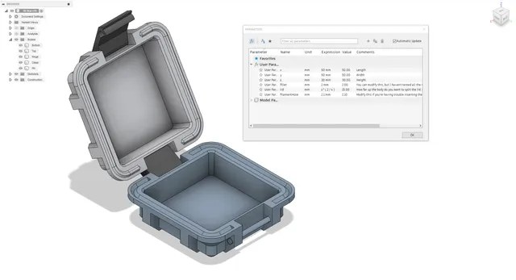</a> 
<b>Parametric Box v2 (single clasp)</b> 
by TheSameNameTwice 
<a href="https://www.printables.com/model/540605-parametric-box-v2-single-clasp">Printables</a> &middot; <a href="boxes/parametric-box-v2-single-clasp-model_files">Repo folder</a>
</td>
<td width="33%" align="center" valign="top">
<a href="boxes/PiPBox%2B_%2BPrint%2Bin%2BPlace%2BLive%2BHinge%2BParametric%2BBox">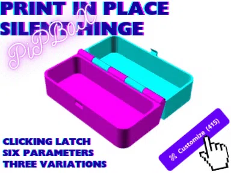</a> 
<b>PiPBox _ Print in Place Live Hinge Parametric Box</b> 
by Lysyndre 
<a href="https://makerworld.com/en/models/485147-pipbox-_-print-in-place-live-hinge-parametric-box">MakerWorld</a> &middot; <a href="boxes/PiPBox%2B_%2BPrint%2Bin%2BPlace%2BLive%2BHinge%2BParametric%2BBox">Repo folder</a>
</td>
<td width="33%" align="center" valign="top">
<a href="boxes/rugged-box-parametric-model_files">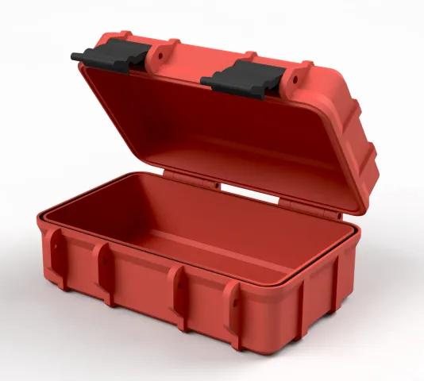</a> 
<b>Rugged Box (Parametric)</b> 
by Whity 
<a href="https://www.printables.com/model/258431-rugged-box-parametric">Printables</a> &middot; <a href="boxes/rugged-box-parametric-model_files">Repo folder</a>
</td>
</tr>
<tr>
<td width="33%" align="center" valign="top">
<a href="boxes/rugged-storage-box-parametric-screwless-model_files">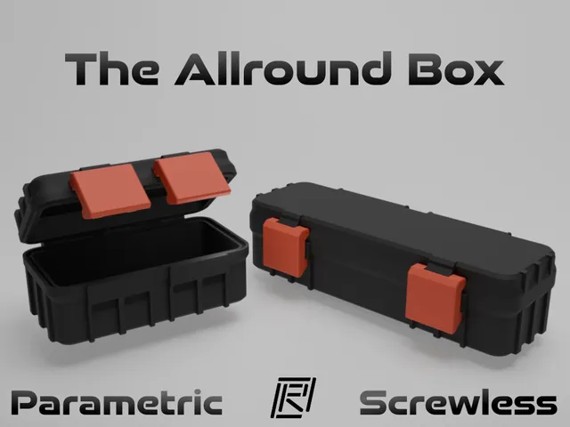</a> 
<b>Rugged Storage Box (Parametric, Screwless)</b> 
by RDesigns 
<a href="https://www.printables.com/model/819715-rugged-storage-box-parametric-screwless">Printables</a> &middot; <a href="boxes/rugged-storage-box-parametric-screwless-model_files">Repo folder</a>
</td>
<td width="33%" align="center" valign="top">
<a href="boxes/super-customizable-rugged-box-in-openscad-model_files">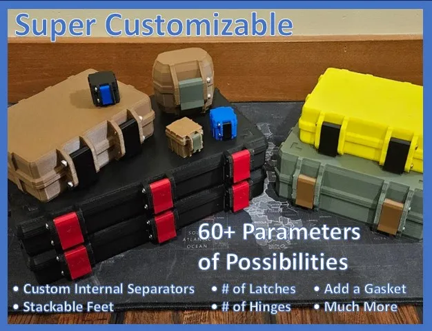</a> 
<b>Super Customizable Rugged Box in OpenSCAD</b> 
by Iceman 
<a href="https://www.printables.com/model/1073708-super-customizable-rugged-box-in-openscad">Printables</a> &middot; <a href="boxes/super-customizable-rugged-box-in-openscad-model_files">Repo folder</a>
</td>
<td width="33%" align="center" valign="top">
<a href="boxes/water-tightdust-proof-parametric-box-v2-double-clasp-model_files">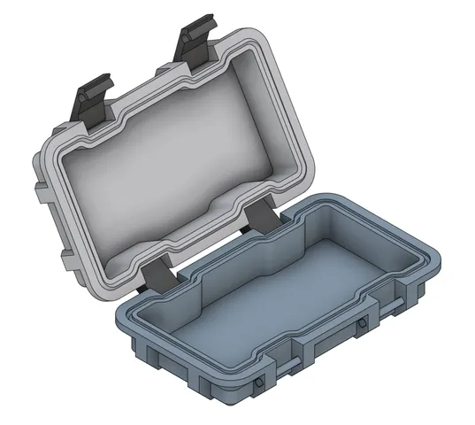</a> 
<b>Water-Tight/Dust-Proof Parametric Box v2 (double clasp)</b> 
by TheSameNameTwice 
<a href="https://www.printables.com/model/546479-water-tightdust-proof-parametric-box-v2-double-cla">Printables</a> &middot; <a href="boxes/water-tightdust-proof-parametric-box-v2-double-clasp-model_files">Repo folder</a>
</td>
</tr>
</table>

## Cable Storage

<table>
<tr>
<td width="33%" align="center" valign="top">
<i>no preview</i> 
<b>Dupont Cable Organizer Customizable</b> 
by urish 
<a href="https://www.thingiverse.com/thing:3232719">Thingiverse</a> &middot; <a href="cable-storage/Dupont_Cable_Organizer_Customizable">Repo folder</a>
</td>
<td width="33%" align="center" valign="top">
<a href="cable-storage/parametric-cable-storage-model_files">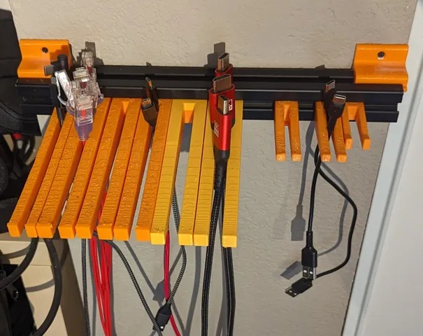</a> 
<b>Parametric Cable Storage</b> 
by The Mighty Pong 
<a href="https://www.printables.com/model/410018-parametric-cable-storage">Printables</a> &middot; <a href="cable-storage/parametric-cable-storage-model_files">Repo folder</a>
</td>
</tr>
</table>

Other files in this folder (1)

- [cubewallcableholder.stl](cable-storage/cubewallcableholder.stl)

## Cable Storage / Gridfinity

<table>
<tr>
<td width="33%" align="center" valign="top">
<i>no preview</i> 
<b>Cabel Winder gridfinity organizer different sizes</b> 
<a href="https://makerworld.com/en/search/models?keyword=Cabel%20Winder%20gridfinity%20organizer%20different%20sizes">Search MakerWorld</a> &middot; <a href="cable-storage/gridfinity/Cabel%2BWinder%2Bgridfinity%2Borganizer%2Bdifferent%2Bsizes%2B">Repo folder</a>
</td>
<td width="33%" align="center" valign="top">
<i>no preview</i> 
<b>cableholder double hollow Xx2x10</b> 
<a href="https://makerworld.com/en/search/models?keyword=cableholder%20double%20hollow%20Xx2x10">Search MakerWorld</a> &middot; <a href="cable-storage/gridfinity/cableholder%2Bdouble%2Bhollow%2BXx2x10_stls">Repo folder</a>
</td>
<td width="33%" align="center" valign="top">
<a href="cable-storage/gridfinity/Ergonomic%2BCable%2BWinder">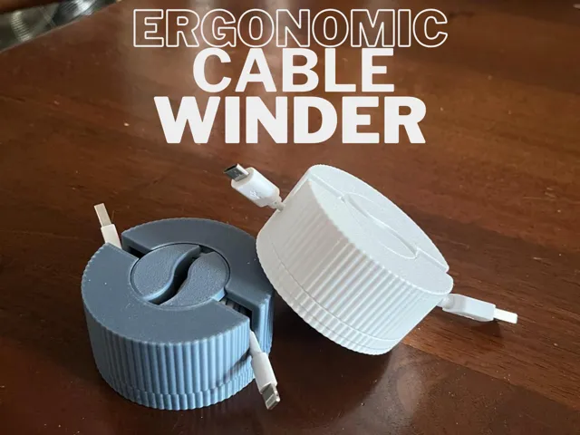</a> 
<b>ERGONOMIC CABLE WINDER</b> 
by PUPOdesign 
<a href="https://makerworld.com/en/models/1830818-ergonomic-cable-winder">MakerWorld</a> &middot; <a href="cable-storage/gridfinity/Ergonomic%2BCable%2BWinder">Repo folder</a>
</td>
</tr>
<tr>
<td width="33%" align="center" valign="top">
<i>no preview</i> 
<b>Gridfinity Cable Organizer For Large Cables</b> 
<a href="https://makerworld.com/en/search/models?keyword=Gridfinity%20Cable%20Organizer%20For%20Large%20Cables">Search MakerWorld</a> &middot; <a href="cable-storage/gridfinity/Gridfinity%2BCable%2BOrganizer%2BFor%2BLarge%2BCables">Repo folder</a>
</td>
<td width="33%" align="center" valign="top">
<i>no preview</i> 
<b>Rugged Cable Organizer - Gridfinity</b> 
<a href="https://makerworld.com/en/search/models?keyword=Rugged%20Cable%20Organizer%20-%20Gridfinity">Search MakerWorld</a> &middot; <a href="cable-storage/gridfinity/Rugged%2BCable%2BOrganizer%2B-%2BGridfinity">Repo folder</a>
</td>
<td width="33%" align="center" valign="top">
<a href="cable-storage/gridfinity/Rugged-Cable-Organizer_X1C.3mf">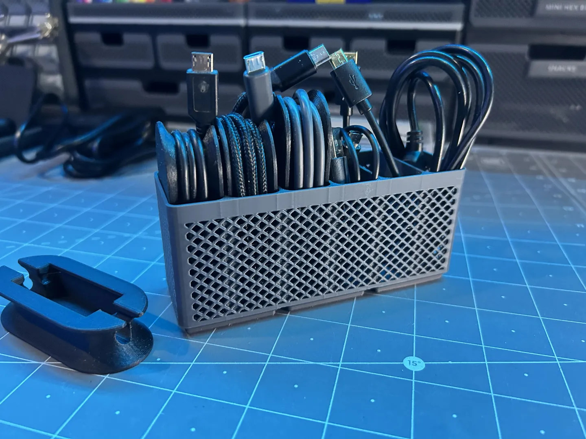</a> 
<b>Rugged-Cable-Organizer_X1C</b> 
Source unknown &middot; <a href="cable-storage/gridfinity/Rugged-Cable-Organizer_X1C.3mf">Rugged-Cable-Organizer_X1C.3mf</a>
</td>
</tr>
</table>

## Hooks

<table>
<tr>
<td width="33%" align="center" valign="top">
<a href="hooks/wall-hook-model_files">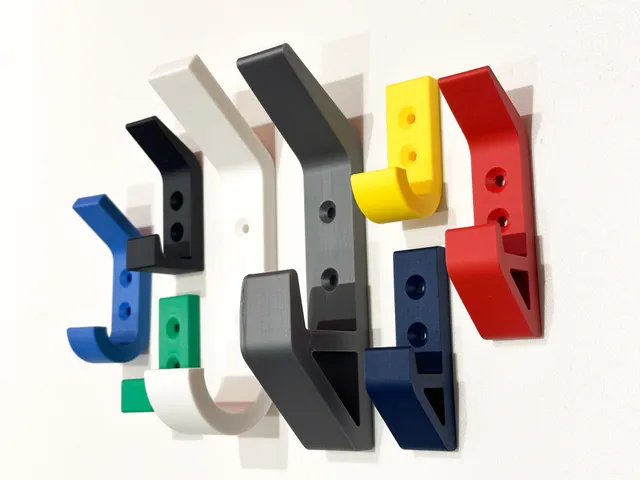</a> 
<b>Wall hook</b> 
by Buzzz 
<a href="https://www.printables.com/model/688293-wall-hook">Printables</a> &middot; <a href="hooks/wall-hook-model_files">Repo folder</a>
</td>
</tr>
</table>

Other files in this folder (1)

- [support-helmet-big.stl](hooks/support-helmet-big.stl)

## Pinecil

<table>
<tr>
<td width="33%" align="center" valign="top">
<a href="pinecil/cnc-kitchen-ts100-solder-tips-case-model_files">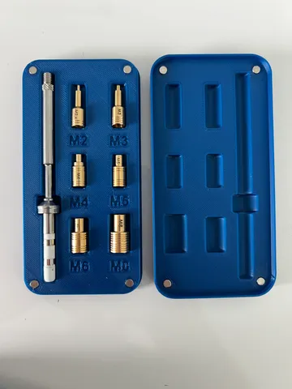</a> 
<b>CNC Kitchen TS100 Solder Tips Case</b> 
by Layers Studio 
<a href="https://www.printables.com/model/611977-cnc-kitchen-ts100-solder-tips-case">Printables</a> &middot; <a href="pinecil/cnc-kitchen-ts100-solder-tips-case-model_files">Repo folder</a>
</td>
<td width="33%" align="center" valign="top">
<a href="pinecil/pinecil-all-in-one-ts100101-beta-testing-model_files">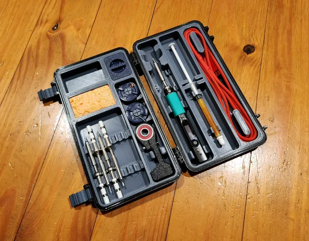</a> 
<b>PINECIL &amp; TS100/101 ALL-IN-ONE CASE</b> 
by TheCafeRacer 
<a href="https://www.printables.com/model/555123-pinecil-ts100101-all-in-one-case">Printables</a> &middot; <a href="pinecil/pinecil-all-in-one-ts100101-beta-testing-model_files">Repo folder</a>
</td>
<td width="33%" align="center" valign="top">
<a href="pinecil/pinecil-organizer-iron-tips-and-cable-only-model_files">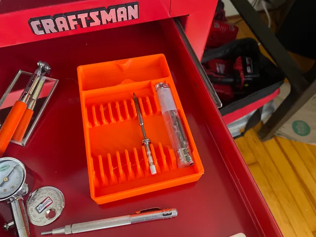</a> 
<b>Pinecil organizer (iron, tips, and cable only)</b> 
by Will 
<a href="https://www.printables.com/model/348442-pinecil-organizer-iron-tips-and-cable-only">Printables</a> &middot; <a href="pinecil/pinecil-organizer-iron-tips-and-cable-only-model_files">Repo folder</a>
</td>
</tr>
<tr>
<td width="33%" align="center" valign="top">
<a href="pinecil/ts100-cnc-kitchen-heatset-insert-fixed-sizing-model_files">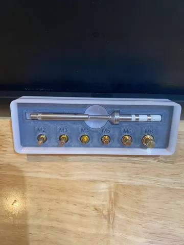</a> 
<b>TS100 CNC Kitchen Heatset Insert Fixed Sizing</b> 
by Devin Gearing 
<a href="https://www.printables.com/model/775217-ts100-cnc-kitchen-heatset-insert-fixed-sizing">Printables</a> &middot; <a href="pinecil/ts100-cnc-kitchen-heatset-insert-fixed-sizing-model_files">Repo folder</a>
</td>
</tr>
</table>

## Pinecil / Gridfinity

<table>
<tr>
<td width="33%" align="center" valign="top">
<a href="pinecil/gridfinity/gridfinity-cnc-kitchen-threaded-insert-tray-model_files">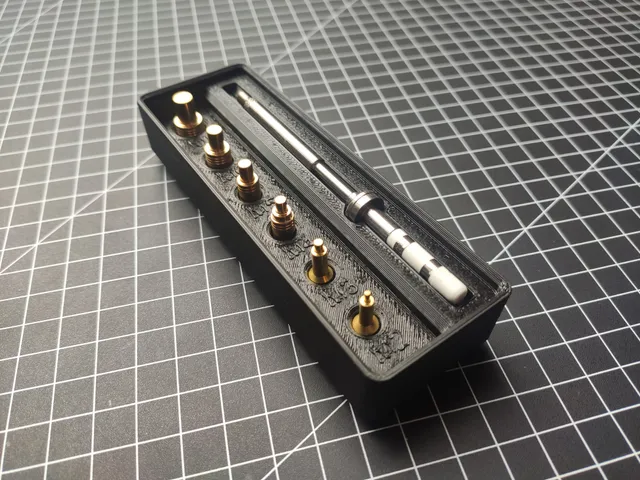</a> 
<b>Gridfinity CNC Kitchen Threaded Insert Tray</b> 
by Thorou 
<a href="https://www.printables.com/model/775281-gridfinity-cnc-kitchen-threaded-insert-tray">Printables</a> &middot; <a href="pinecil/gridfinity/gridfinity-cnc-kitchen-threaded-insert-tray-model_files">Repo folder</a>
</td>
<td width="33%" align="center" valign="top">
<a href="pinecil/gridfinity/gridfinity-pinecil-case-model_files">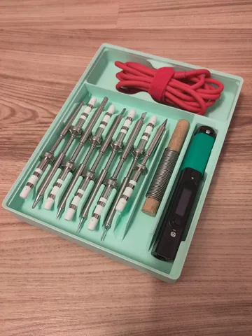</a> 
<b>Gridfinity Pinecil Case</b> 
by Johannes 
<a href="https://www.printables.com/model/471373-gridfinity-pinecil-case">Printables</a> &middot; <a href="pinecil/gridfinity/gridfinity-pinecil-case-model_files">Repo folder</a>
</td>
<td width="33%" align="center" valign="top">
<a href="pinecil/gridfinity/gridfinity-ts100-tray-model_files">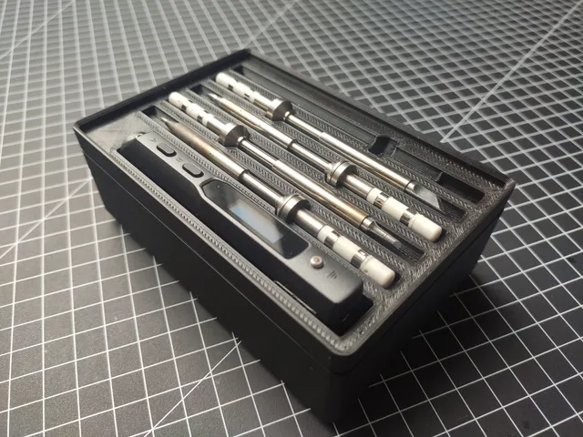</a> 
<b>Gridfinity TS100 Tray</b> 
by Thorou 
<a href="https://www.printables.com/model/775224-gridfinity-ts100-tray">Printables</a> &middot; <a href="pinecil/gridfinity/gridfinity-ts100-tray-model_files">Repo folder</a>
</td>
</tr>
<tr>
<td width="33%" align="center" valign="top">
<a href="pinecil/gridfinity/pinecil-organizer-with-gridfinity-support-model_files">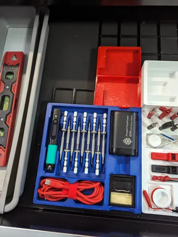</a> 
<b>Pinecil organizer with Gridfinity support</b> 
by Kieran E 
<a href="https://www.printables.com/model/525429-pinecil-organizer-with-gridfinity-support">Printables</a> &middot; <a href="pinecil/gridfinity/pinecil-organizer-with-gridfinity-support-model_files">Repo folder</a>
</td>
</tr>
</table>

## Pinecil / Portable

<table>
<tr>
<td width="33%" align="center" valign="top">
<a href="pinecil/portable/double-layer-rugged-multipart-pinecilts100ts80-case-v2-model_files">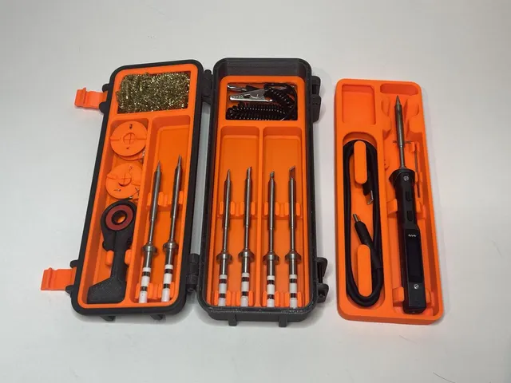</a> 
<b>Double Layer Rugged Multipart Pinecil/TS100/TS80 Case (V2)</b> 
by Aikano9 
<a href="https://www.printables.com/model/427403-double-layer-rugged-multipart-pinecilts100ts80-cas">Printables</a> &middot; <a href="pinecil/portable/double-layer-rugged-multipart-pinecilts100ts80-case-v2-model_files">Repo folder</a>
</td>
<td width="33%" align="center" valign="top">
<a href="pinecil/portable/rugged-multipart-pinecilts100ts80-case-v2-model_files">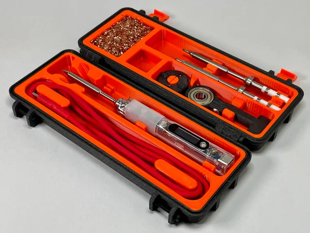</a> 
<b>Rugged Multipart Pinecil/TS100/TS80 Case (V2)</b> 
by PjotrStrog 
<a href="https://www.printables.com/model/345083-rugged-multipart-pinecilts100ts80-case-v2">Printables</a> &middot; <a href="pinecil/portable/rugged-multipart-pinecilts100ts80-case-v2-model_files">Repo folder</a>
</td>
<td width="33%" align="center" valign="top">
<a href="pinecil/portable/ts101-rugged-box-magnetic-version-model_files">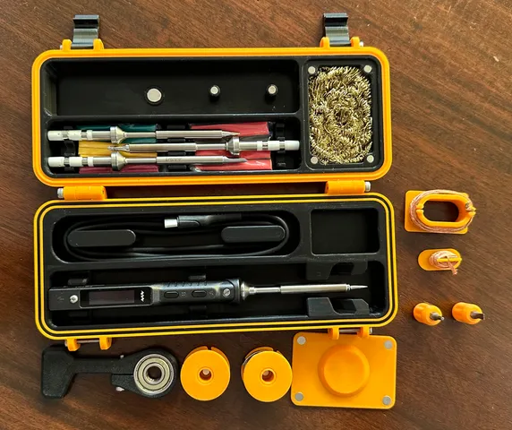</a> 
<b>TS101 Rugged Box (Magnetic Version)</b> 
by FrostyTheClownMan 
<a href="https://www.printables.com/model/479937-ts101-rugged-box-magnetic-version">Printables</a> &middot; <a href="pinecil/portable/ts101-rugged-box-magnetic-version-model_files">Repo folder</a>
</td>
</tr>
</table>

## Sd Card Storage

<table>
<tr>
<td width="33%" align="center" valign="top">
<a href="sd-card-storage/frozenweb_SD_Card_Mini_SD_Card_Holder_4804120">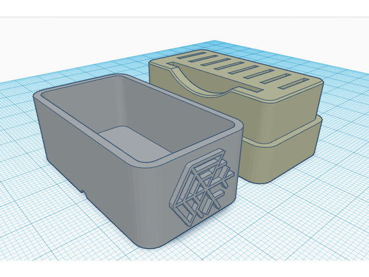</a> 
<b>frozenweb SD Card Mini SD Card Holder</b> 
by frozenweb 
<a href="https://www.thingiverse.com/thing:4804120">Thingiverse</a> &middot; <a href="sd-card-storage/frozenweb_SD_Card_Mini_SD_Card_Holder_4804120">Repo folder</a>
</td>
<td width="33%" align="center" valign="top">
<a href="sd-card-storage/Improved_SD_and_microSD_Card_Cases_5144211">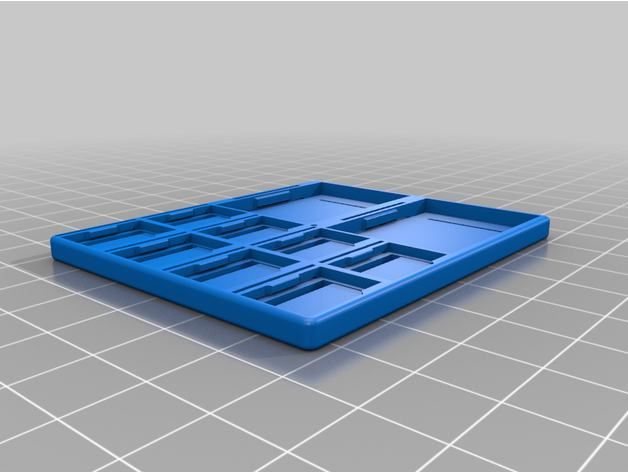</a> 
<b>Improved SD and microSD Card Cases</b> 
by MartinNohr 
<a href="https://www.thingiverse.com/thing:5144211">Thingiverse</a> &middot; <a href="sd-card-storage/Improved_SD_and_microSD_Card_Cases_5144211">Repo folder</a>
</td>
<td width="33%" align="center" valign="top">
<a href="sd-card-storage/sd-microsd-card-case-model_files">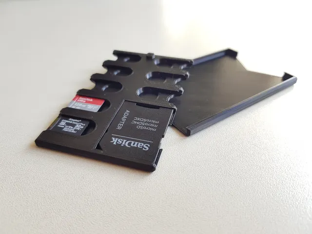</a> 
<b>SD || MicroSD card case</b> 
by Sedak 
<a href="https://www.printables.com/model/257385-sd-microsd-card-case">Printables</a> &middot; <a href="sd-card-storage/sd-microsd-card-case-model_files">Repo folder</a>
</td>
</tr>
<tr>
<td width="33%" align="center" valign="top">
<a href="sd-card-storage/slim-magnetic-sd-micro-sd-card-case-print_files">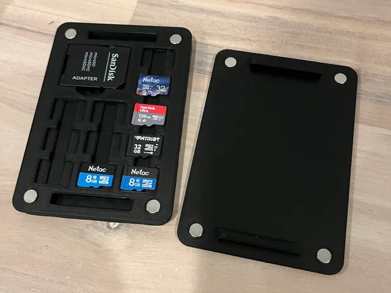</a> 
<b>Slim Magnetic SD + Micro SD Card Case</b> 
by Landon Campbell 
<a href="https://www.printables.com/model/464786-slim-magnetic-sd-micro-sd-card-case">Printables</a> &middot; <a href="sd-card-storage/slim-magnetic-sd-micro-sd-card-case-print_files">Repo folder</a>
</td>
<td width="33%" align="center" valign="top">
<a href="sd-card-storage/tf-sd-card-holder-wallet-print_files">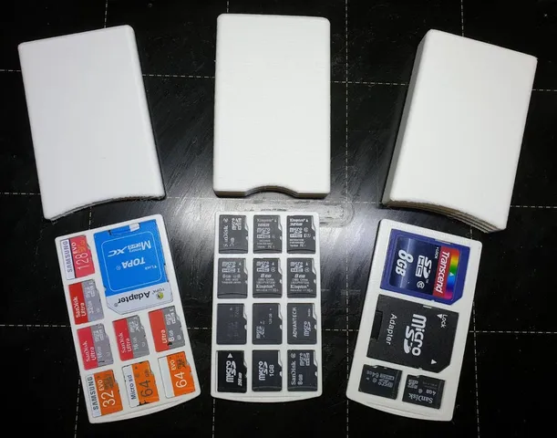</a> 
<b>TF &amp; SD Card Holder/ Wallet</b> 
by artsef 
<a href="https://www.printables.com/model/71165-tf-sd-card-holder-wallet">Printables</a> &middot; <a href="sd-card-storage/tf-sd-card-holder-wallet-print_files">Repo folder</a>
</td>
<td width="33%" align="center" valign="top">
<a href="sd-card-storage/USB_SD_and_MicroSD_holder_for_wide_USB_sticks">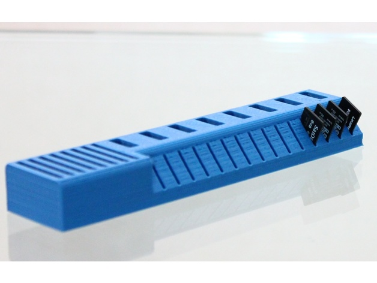</a> 
<b>USB SD and MicroSD holder for wide USB sticks</b> 
by Lalo_Solo 
<a href="https://www.thingiverse.com/thing:2637487">Thingiverse</a> &middot; <a href="sd-card-storage/USB_SD_and_MicroSD_holder_for_wide_USB_sticks">Repo folder</a>
</td>
</tr>
</table>

Other files in this folder (2)

- [SD_Card_holder.stl](sd-card-storage/SD_Card_holder.stl)
- [usbsticksdcardholderv2_20230725-49-1khvl1i.stl](sd-card-storage/usbsticksdcardholderv2_20230725-49-1khvl1i.stl)

## Small Parts Storage

<table>
<tr>
<td width="33%" align="center" valign="top">
<a href="small-parts-storage/clamshell-boxes">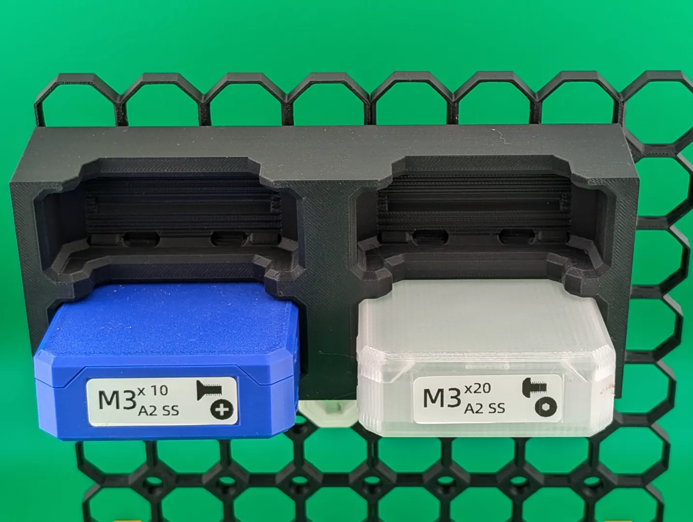</a> 
<b>Clamshell Boxes</b> 
Source unknown &middot; <a href="small-parts-storage/clamshell-boxes">Repo folder</a>
</td>
<td width="33%" align="center" valign="top">
<a href="small-parts-storage/Economical_Drawers_1750692">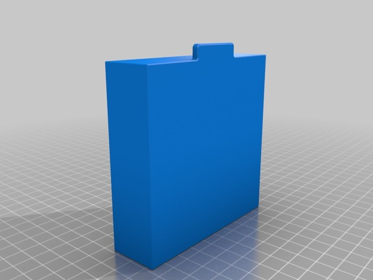</a> 
<b>Economical Drawers</b> 
by O3D 
<a href="https://www.thingiverse.com/thing:1750692">Thingiverse</a> &middot; <a href="small-parts-storage/Economical_Drawers_1750692">Repo folder</a>
</td>
<td width="33%" align="center" valign="top">
<a href="small-parts-storage/Fast-Printing_Modular_Drawer_System___Vase_Mode__5210727">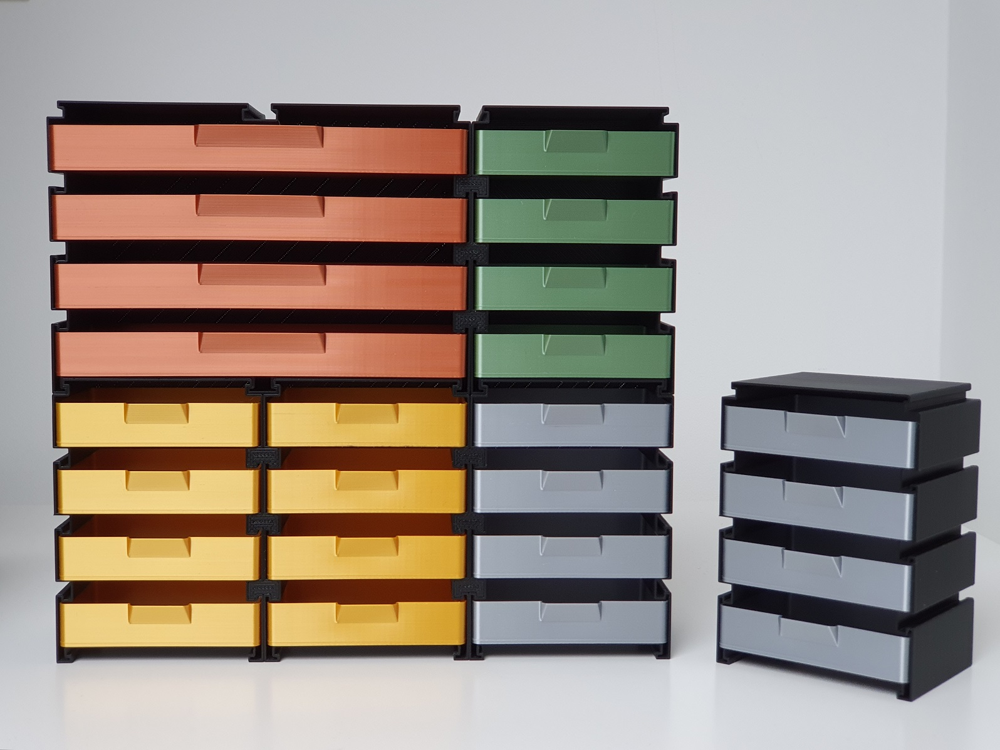</a> 
<b>Fast-Printing Modular Drawer System  (Vase Mode)</b> 
by LR3DUK 
<a href="https://www.thingiverse.com/thing:5210727">Thingiverse</a> &middot; <a href="small-parts-storage/Fast-Printing_Modular_Drawer_System___Vase_Mode__5210727">Repo folder</a>
</td>
</tr>
<tr>
<td width="33%" align="center" valign="top">
<a href="small-parts-storage/infinity-bins-stackable-sorting-containers-model_files">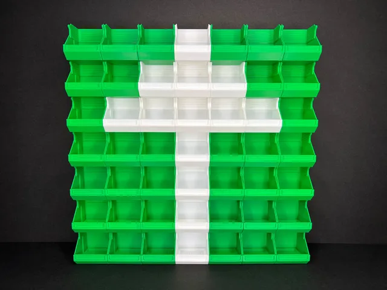</a> 
<b>Infinity Bins - Stackable Sorting Containers</b> 
by DesignCraft 
<a href="https://www.printables.com/model/737342-infinity-bins-stackable-sorting-containers">Printables</a> &middot; <a href="small-parts-storage/infinity-bins-stackable-sorting-containers-model_files">Repo folder</a>
</td>
<td width="33%" align="center" valign="top">
<a href="small-parts-storage/infinity-spool-holders-stackable-storage-containers-wire-solder-ribbon-model_files">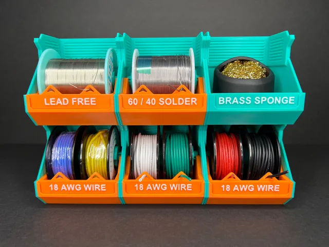</a> 
<b>Infinity Spool Holders - Stackable Storage Containers - Wire, Solder, Ribbon</b> 
by DesignCraft 
<a href="https://www.printables.com/model/744351-infinity-spool-holders-stackable-storage-container">Printables</a> &middot; <a href="small-parts-storage/infinity-spool-holders-stackable-storage-containers-wire-solder-ribbon-model_files">Repo folder</a>
</td>
<td width="33%" align="center" valign="top">
<a href="small-parts-storage/Mini_Container_with_PET_Bottle_Cap_Size_4900080">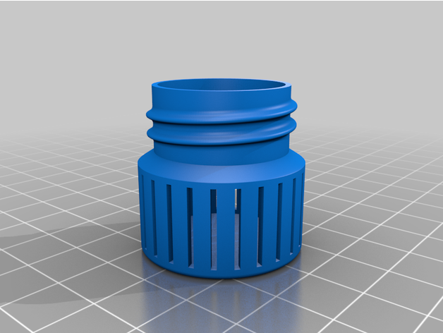</a> 
<b>Mini Container with PET Bottle Cap Size</b> 
by Tokyo_Bird 
<a href="https://www.thingiverse.com/thing:4900080">Thingiverse</a> &middot; <a href="small-parts-storage/Mini_Container_with_PET_Bottle_Cap_Size_4900080">Repo folder</a>
</td>
</tr>
<tr>
<td width="33%" align="center" valign="top">
<a href="small-parts-storage/Mini_Drawers_Ultimate_1889761">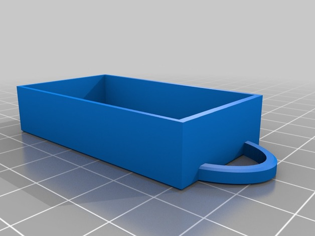</a> 
<b>Mini Drawers Ultimate</b> 
by zeropage 
<a href="https://www.thingiverse.com/thing:1889761">Thingiverse</a> &middot; <a href="small-parts-storage/Mini_Drawers_Ultimate_1889761">Repo folder</a>
</td>
<td width="33%" align="center" valign="top">
<a href="small-parts-storage/Modular_desk_organizer_drawers_5933854">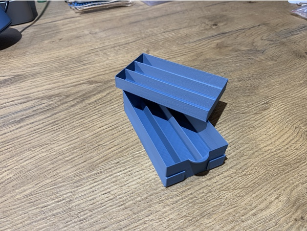</a> 
<b>Modular desk organizer drawers</b> 
by Ricards622 
<a href="https://www.thingiverse.com/thing:5933854">Thingiverse</a> &middot; <a href="small-parts-storage/Modular_desk_organizer_drawers_5933854">Repo folder</a>
</td>
<td width="33%" align="center" valign="top">
<a href="small-parts-storage/Modular_drawer_for_electronic_components__Vase_mode__5844925">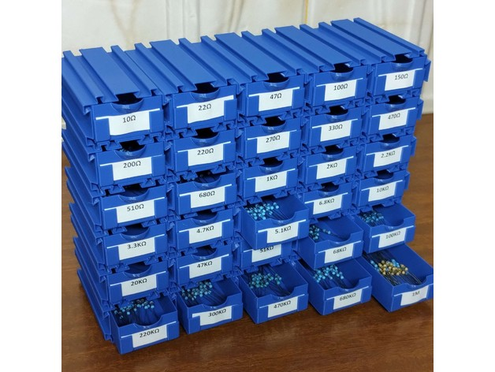</a> 
<b>Modular drawer for electronic components (Vase mode)</b> 
by Mordemot 
<a href="https://www.thingiverse.com/thing:5844925">Thingiverse</a> &middot; <a href="small-parts-storage/Modular_drawer_for_electronic_components__Vase_mode__5844925">Repo folder</a>
</td>
</tr>
<tr>
<td width="33%" align="center" valign="top">
<a href="small-parts-storage/Modular_Drawers_2_0_2539830">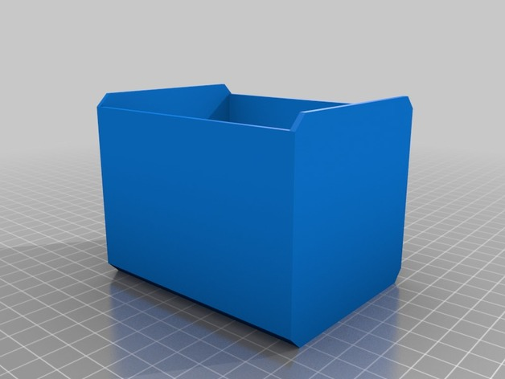</a> 
<b>Modular Drawers 2.0</b> 
by O3D 
<a href="https://www.thingiverse.com/thing:2539830">Thingiverse</a> &middot; <a href="small-parts-storage/Modular_Drawers_2_0_2539830">Repo folder</a>
</td>
<td width="33%" align="center" valign="top">
<a href="small-parts-storage/Modular_Organizer_Boxes_6017341">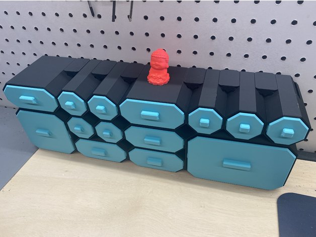</a> 
<b>Modular Organizer Boxes</b> 
by ZMonstar 
<a href="https://www.thingiverse.com/thing:6017341">Thingiverse</a> &middot; <a href="small-parts-storage/Modular_Organizer_Boxes_6017341">Repo folder</a>
</td>
<td width="33%" align="center" valign="top">
<a href="small-parts-storage/modular-shelving-system-hobby-workshop-small-parts-storage-model_files">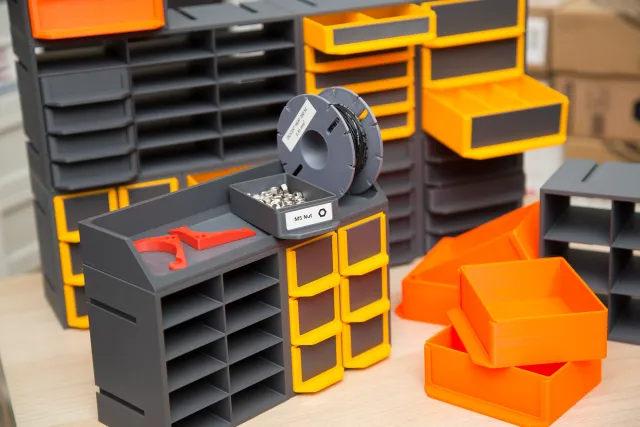</a> 
<b>Modular shelving system - Hobby &amp; Workshop - Small parts storage</b> 
by layerguru.com 
<a href="https://www.printables.com/model/230356-modular-shelving-system-hobby-workshop-small-parts">Printables</a> &middot; <a href="small-parts-storage/modular-shelving-system-hobby-workshop-small-parts-storage-model_files">Repo folder</a>
</td>
</tr>
<tr>
<td width="33%" align="center" valign="top">
<a href="small-parts-storage/Parts_Tray_Drawers_398548">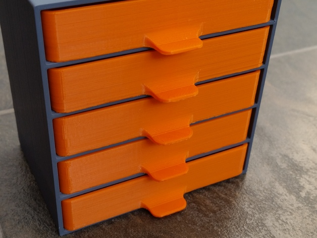</a> 
<b>Parts Tray Drawers</b> 
by FatalError3141 
<a href="https://www.thingiverse.com/thing:398548">Thingiverse</a> &middot; <a href="small-parts-storage/Parts_Tray_Drawers_398548">Repo folder</a>
</td>
<td width="33%" align="center" valign="top">
<a href="small-parts-storage/SciFi_Small_Part_Storage_Crates_1489606">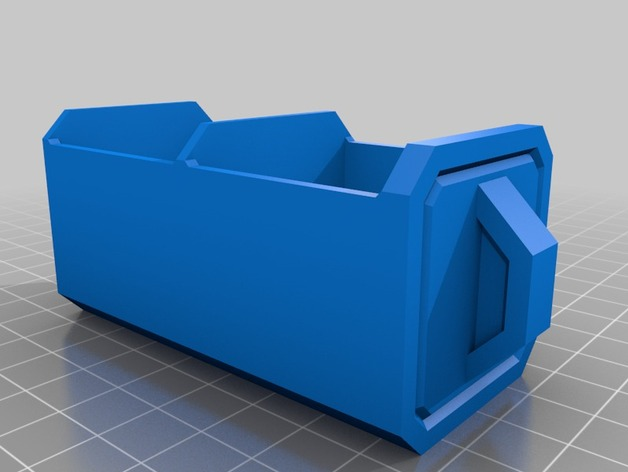</a> 
<b>SciFi Small Part Storage Crates</b> 
by AndrewBougie 
<a href="https://www.thingiverse.com/thing:1489606">Thingiverse</a> &middot; <a href="small-parts-storage/SciFi_Small_Part_Storage_Crates_1489606">Repo folder</a>
</td>
<td width="33%" align="center" valign="top">
 
<b>Small Parts Storage Box w/Gridfinity tray</b> 
by Josh-3D 
<a href="https://makerworld.com/en/models/593096-small-parts-storage-box-w-gridfinity-tray">MakerWorld</a> &middot; <a href="small-parts-storage/Small%2BParts%2BStorage%2BBox%2Bw_Gridfinity%2Btray">Repo folder</a>
</td>
</tr>
<tr>
<td width="33%" align="center" valign="top">
 
<b>Stackable Battery Holders</b> 
by adoniram 
<a href="https://www.thingiverse.com/thing:1004996">Thingiverse</a> &middot; <a href="small-parts-storage/Stackable_Battery_Holders_1004996">Repo folder</a>
</td>
<td width="33%" align="center" valign="top">
 
<b>Stackable StorageDrawers</b> 
by Maoman 
<a href="https://www.thingiverse.com/thing:5167643">Thingiverse</a> &middot; <a href="small-parts-storage/Stackable_StorageDrawers_5167643">Repo folder</a>
</td>
<td width="33%" align="center" valign="top">
 
<b>Various Size Stackable Resistor Storage Box</b> 
by termlimit 
<a href="https://www.thingiverse.com/thing:3873672">Thingiverse</a> &middot; <a href="small-parts-storage/Various_Size_Stackable_Resistor_Storage_Box_3873672">Repo folder</a>
</td>
</tr>
</table>

Other files in this folder (2)

- [modular-organizer-drawers-model_files.zip](small-parts-storage/modular-organizer-drawers-model_files.zip)
- [Small Parts Funnel Tray - 918864.zip](small-parts-storage/Small%20Parts%20Funnel%20Tray%20-%20918864.zip)

## Systems / Gen2 Drawers

<table>
<tr>
<td width="33%" align="center" valign="top">
 
<b>GEN2 Adjustable Steel Sheet Holder - Large</b> 
Source unknown &middot; <a href="systems/gen2-drawers/GEN2%20Adjustable%20Steel%20Sheet%20Holder%20-%20Large">Repo folder</a>
</td>
<td width="33%" align="center" valign="top">
 
<b>GEN2 Drawers - Medium</b> 
Source unknown &middot; <a href="systems/gen2-drawers/GEN2%20Drawers%20-%20Medium">Repo folder</a>
</td>
<td width="33%" align="center" valign="top">
 
<b>GEN2 Drawers - Standard</b> 
Source unknown &middot; <a href="systems/gen2-drawers/GEN2%20Drawers%20-%20Standard">Repo folder</a>
</td>
</tr>
<tr>
<td width="33%" align="center" valign="top">
<i>no preview</i> 
<b>GEN2 Gridfinity Drawers V2 - Extended Sizes</b> 
Source unknown &middot; <a href="systems/gen2-drawers/GEN2%20Gridfinity%20Drawers%20V2%20-%20Extended%20Sizes">Repo folder</a>
</td>
<td width="33%" align="center" valign="top">
 
<b>GEN2 Gridfinity Drawers V2 - STANDARD</b> 
by Jerrari 
<a href="https://www.printables.com/model/883243-gen2-gridfinity-drawers-v2-standard">Printables</a> &middot; <a href="systems/gen2-drawers/GEN2%20Gridfinity%20Drawers%20V2%20-%20Standard">Repo folder</a>
</td>
<td width="33%" align="center" valign="top">
 
<b>GEN2 Parts Drawers - Standard</b> 
Source unknown &middot; <a href="systems/gen2-drawers/GEN2%20Parts%20Drawers%20-%20Standard">Repo folder</a>
</td>
</tr>
<tr>
<td width="33%" align="center" valign="top">
 
<b>GEN2 Slim Drawers</b> 
Source unknown &middot; <a href="systems/gen2-drawers/GEN2%20Slim%20Drawers">Repo folder</a>
</td>
<td width="33%" align="center" valign="top">
 
<b>GEN2 Small Drawers</b> 
Source unknown &middot; <a href="systems/gen2-drawers/GEN2%20Small%20Drawers">Repo folder</a>
</td>
<td width="33%" align="center" valign="top">
 
<b>MODULITH 185 Tabletop Starter Kit</b> 
by Jerrari 
<a href="https://www.printables.com/model/1118906-modulith-185-tabletop-starter-kit">Printables</a> &middot; <a href="systems/gen2-drawers/gen2-table-top-kit-v2-standard-model_files">Repo folder</a>
</td>
</tr>
</table>

## Systems / Gridfinity

<table>
<tr>
<td width="33%" align="center" valign="top">
<i>no preview</i> 
<b>1U gridfinity draver</b> 
<a href="https://makerworld.com/en/search/models?keyword=1U%20gridfinity%20draver">Search MakerWorld</a> &middot; <a href="systems/gridfinity/1U%2Bgridfinity%2Bdraver_stls">Repo folder</a>
</td>
<td width="33%" align="center" valign="top">
<i>no preview</i> 
<b>Gridfinity Adapters</b> 
<a href="https://makerworld.com/en/search/models?keyword=Gridfinity%20Adapters">Search MakerWorld</a> &middot; <a href="systems/gridfinity/Gridfinity%2BAdapters">Repo folder</a>
</td>
<td width="33%" align="center" valign="top">
 
<b>Gridfinity Bin Label Icons</b> 
by Joe Jankowiak 
<a href="https://www.printables.com/model/621771-gridfinity-bin-label-icons">Printables</a> &middot; <a href="systems/gridfinity/gridfinity-bin-label-icons-other_files">Repo folder</a>
</td>
</tr>
<tr>
<td width="33%" align="center" valign="top">
 
<b>gridfinity funnel</b> 
by Jools 
<a href="https://www.printables.com/model/188075-gridfinity-funnel">Printables</a> &middot; <a href="systems/gridfinity/gridfinity-funnel-model_files">Repo folder</a>
</td>
<td width="33%" align="center" valign="top">
 
<b>Gridfinity Makpac stackable tray (magnetic)</b> 
by TmDvd 
<a href="https://makerworld.com/en/models/568924-gridfinity-makpac-stackable-tray-magnetic">MakerWorld</a> &middot; <a href="systems/gridfinity/Gridfinity%2BMakpac%2Bstackable%2Btray%2B(magnetic)">Repo folder</a>
</td>
</tr>
</table>

Other files in this folder (1)

- [parametric-gridfinity-trays-model_files.zip](systems/gridfinity/parametric-gridfinity-trays-model_files.zip)

## Systems / Gridfinity / Baseplates

<table>
<tr>
<td width="33%" align="center" valign="top">
 
<b>4x4 superlight 4 8 stack NEW AND IMPROVED</b> 
<a href="https://makerworld.com/en/search/models?keyword=4x4%20superlight%204%208%20stack%20NEW%20AND%20IMPROVED">Search MakerWorld</a> &middot; <a href="systems/gridfinity/baseplates/4x4%2Bsuperlight%2B4%2B8%2Bstack%2BNEW%2BAND%2BIMPROVED.3mf">4x4+superlight+4+8+stack+NEW+AND+IMPROVED.3mf</a>
</td>
<td width="33%" align="center" valign="top">
 
<b>Base Grid 5x5 16-STACK-makerworld</b> 
<a href="https://makerworld.com/en/search/models?keyword=Base%20Grid%205x5%2016-STACK-makerworld">Search MakerWorld</a> &middot; <a href="systems/gridfinity/baseplates/Base%2BGrid%2B5x5%2B16-STACK-makerworld.3mf">Base+Grid+5x5+16-STACK-makerworld.3mf</a>
</td>
<td width="33%" align="center" valign="top">
 
<b>Base Grid 5x5 8-STACK-makerworld</b> 
<a href="https://makerworld.com/en/search/models?keyword=Base%20Grid%205x5%208-STACK-makerworld">Search MakerWorld</a> &middot; <a href="systems/gridfinity/baseplates/Base%2BGrid%2B5x5%2B8-STACK-makerworld.3mf">Base+Grid+5x5+8-STACK-makerworld.3mf</a>
</td>
</tr>
<tr>
<td width="33%" align="center" valign="top">
 
<b>Baseplate - SL H - 256x256 Bed</b> 
<a href="https://makerworld.com/en/search/models?keyword=Baseplate%20-%20SL%20H%20-%20256x256%20Bed">Search MakerWorld</a> &middot; <a href="systems/gridfinity/baseplates/Baseplate%2B-%2BSL%2BH%2B-%2B256x256%2BBed.3mf">Baseplate+-+SL+H+-+256x256+Bed.3mf</a>
</td>
<td width="33%" align="center" valign="top">
 
<b>Baseplate - Superlight - 5x5 - Stacked 8 Levels</b> 
Source unknown &middot; <a href="systems/gridfinity/baseplates/Baseplate%20-%20Superlight%20-%205x5%20-%20Stacked%208%20Levels.3mf">Baseplate - Superlight - 5x5 - Stacked 8 Levels.3mf</a>
</td>
<td width="33%" align="center" valign="top">
 
<b>Baseplate - Superlight - All Sizes - Updated</b> 
<a href="https://makerworld.com/en/search/models?keyword=Baseplate%20-%20Superlight%20-%20All%20Sizes%20-%20Updated">Search MakerWorld</a> &middot; <a href="systems/gridfinity/baseplates/Baseplate%2B-%2BSuperlight%2B-%2BAll%2BSizes%2B-%2BUpdated.3mf">Baseplate+-+Superlight+-+All+Sizes+-+Updated.3mf</a>
</td>
</tr>
<tr>
<td width="33%" align="center" valign="top">
 
<b>Clickfinity Refined Baseplates for use with Gridfinity (now with STEP files)</b> 
by FPV Smitty 
<a href="https://www.printables.com/model/506105-clickfinity-refined-baseplates-for-use-with-gridfi">Printables</a> &middot; <a href="systems/gridfinity/baseplates/clickfinity-refined-baseplates-for-use-with-gridfinity-now-with-step-files-model_files">Repo folder</a>
</td>
<td width="33%" align="center" valign="top">
 
<b>Clickfinity Refined Baseplates for use with Gridfinity (now with STEP files)</b> 
by FPV Smitty 
<a href="https://www.printables.com/model/506105-clickfinity-refined-baseplates-for-use-with-gridfi">Printables</a> &middot; <a href="systems/gridfinity/baseplates/clickfinity-refined-baseplates-model_files">Repo folder</a>
</td>
<td width="33%" align="center" valign="top">
 
<b>Gridfinity - press-fit magnet light baseplates</b> 
by plomdawg 
<a href="https://www.printables.com/model/414298-gridfinity-press-fit-magnet-light-baseplates">Printables</a> &middot; <a href="systems/gridfinity/baseplates/gridfinity-press-fit-magnet-light-baseplates-model_files">Repo folder</a>
</td>
</tr>
<tr>
<td width="33%" align="center" valign="top">
 
<b>Gridfinity Base for Ikea Alex</b> 
by Pey3D 
<a href="https://www.printables.com/model/213778-gridfinity-base-for-ikea-alex">Printables</a> &middot; <a href="systems/gridfinity/baseplates/gridfinity-base-for-ikea-alex-model_files">Repo folder</a>
</td>
<td width="33%" align="center" valign="top">
<i>no preview</i> 
<b>Gridfinity Baseplates stl</b> 
Source unknown &middot; <a href="systems/gridfinity/baseplates/Gridfinity%20Baseplates%20stl">Repo folder</a>
</td>
<td width="33%" align="center" valign="top">
 
<b>Gridfinity Clickfinity Baseplate - No magnets, universally compatible with all bins, minimal filament usage.</b> 
by NoWarrenty 
<a href="https://www.printables.com/model/452675-gridfinity-clickfinity-baseplate-no-magnets-univer">Printables</a> &middot; <a href="systems/gridfinity/baseplates/gridfinity-clickfinity-baseplate-no-magnets-universally-compatible-with-all-bins-minimal-filament-usage-model_files">Repo folder</a>
</td>
</tr>
<tr>
<td width="33%" align="center" valign="top">
 
<b>Gridfinity Desktop Baseplates</b> 
by KYZ Design 
<a href="https://www.printables.com/model/1123454-gridfinity-desktop-baseplates">Printables</a> &middot; <a href="systems/gridfinity/baseplates/gridfinity-desktop-baseplates-model_files">Repo folder</a>
</td>
<td width="33%" align="center" valign="top">
 
<b>Gridfinity Magnet Light Baseplate</b> 
by RIP_Plo-Koon 
<a href="https://www.printables.com/model/250550-gridfinity-magnet-light-baseplate">Printables</a> &middot; <a href="systems/gridfinity/baseplates/gridfinity-magnet-light-baseplate-model_files">Repo folder</a>
</td>
<td width="33%" align="center" valign="top">
 
<b>Gridfinity Screw Together baseplate</b> 
by Kyle Warren 
<a href="https://www.printables.com/model/300603-gridfinity-screw-together-baseplate">Printables</a> &middot; <a href="systems/gridfinity/baseplates/gridfinity-screw-together-baseplate-model_files">Repo folder</a>
</td>
</tr>
<tr>
<td width="33%" align="center" valign="top">
 
<b>Gridfinity Sk&#229;dis</b> 
by SeqSEE 
<a href="https://www.printables.com/model/253507-gridfinity-skadis">Printables</a> &middot; <a href="systems/gridfinity/baseplates/gridfinity-skadis-print_files">Repo folder</a>
</td>
<td width="33%" align="center" valign="top">
 
<b>Gridfinity Snap Together Baseplate with Captured Magnets</b> 
by jack_hmr 
<a href="https://www.printables.com/model/356890-gridfinity-snap-together-baseplate-with-captured-m">Printables</a> &middot; <a href="systems/gridfinity/baseplates/gridfinity-snap-together-baseplate-with-captured-magnets-model_files">Repo folder</a>
</td>
<td width="33%" align="center" valign="top">
<i>no preview</i> 
<b>Gridfinity Superlight Baseplates</b> 
<a href="https://makerworld.com/en/search/models?keyword=Gridfinity%20Superlight%20Baseplates">Search MakerWorld</a> &middot; <a href="systems/gridfinity/baseplates/Gridfinity%2BSuperlight%2BBaseplates">Repo folder</a>
</td>
</tr>
<tr>
<td width="33%" align="center" valign="top">
<i>no preview</i> 
<b>gridfinity-eco-ClickPlates</b> 
Source unknown &middot; <a href="systems/gridfinity/baseplates/gridfinity-eco-ClickPlates">Repo folder</a>
</td>
<td width="33%" align="center" valign="top">
<i>no preview</i> 
<b>Gridfinity-Step Storage</b> 
Source unknown &middot; <a href="systems/gridfinity/baseplates/Gridfinity-Step%20Storage">Repo folder</a>
</td>
<td width="33%" align="center" valign="top">
 
<b>IKEA ALEX (wide) Gridfinity Baseplate</b> 
by Mino 
<a href="https://www.printables.com/model/366128-ikea-alex-wide-gridfinity-baseplate">Printables</a> &middot; <a href="systems/gridfinity/baseplates/ikea-alex-wide-gridfinity-baseplate-model_files">Repo folder</a>
</td>
</tr>
<tr>
<td width="33%" align="center" valign="top">
 
<b>Ikea Alex Gridfinity Spacers</b> 
by Tomie M 
<a href="https://www.printables.com/model/303068-ikea-alex-gridfinity-spacers">Printables</a> &middot; <a href="systems/gridfinity/baseplates/ikea-alex-gridfinity-spacers-model_files">Repo folder</a>
</td>
<td width="33%" align="center" valign="top">
 
<b>Lightest Gridfinity Base Ever - Customizable</b> 
by Sparky 
<a href="https://makerworld.com/en/models/1685835-lightest-gridfinity-base-ever-customizable">MakerWorld</a> &middot; <a href="systems/gridfinity/baseplates/Lightest%2BGridfinity%2BBase%2BEver%2B-%2BCustomizable">Repo folder</a>
</td>
<td width="33%" align="center" valign="top">
 
<b>Optimized Gridfinity Base: Faster, Smarter, Better!</b> 
by J-Max 
<a href="https://www.thingiverse.com/thing:6837189">Thingiverse</a> &middot; <a href="systems/gridfinity/baseplates/Optimized%20Gridfinity%20Base_%20Faster%2C%20Smarter%2C%20Better!%20-%206837189">Repo folder</a>
</td>
</tr>
<tr>
<td width="33%" align="center" valign="top">
 
<b>Optimized Gridfinity Base: Faster, Smarter, Better!</b> 
by JMAW 
<a href="https://www.printables.com/model/1078733-optimized-gridfinity-base-faster-smarter-better">Printables</a> &middot; <a href="systems/gridfinity/baseplates/optimized-gridfinity-base-faster-smarter-better-model_files">Repo folder</a>
</td>
<td width="33%" align="center" valign="top">
 
<b>STACK 4</b> 
<a href="https://makerworld.com/en/search/models?keyword=STACK%204">Search MakerWorld</a> &middot; <a href="systems/gridfinity/baseplates/STACK%2B4.3mf">STACK+4.3mf</a>
</td>
</tr>
</table>

## Systems / Gridfinity / Baseplate Spacers

<table>
<tr>
<td width="33%" align="center" valign="top">
 
<b>Gridfinity Base with Clip - Spacers</b> 
by HuMa 
<a href="https://www.printables.com/model/625523-gridfinity-base-with-clip-spacers">Printables</a> &middot; <a href="systems/gridfinity/baseplate-spacers/gridfinity-clip-base-spacers-model_files">Repo folder</a>
</td>
<td width="33%" align="center" valign="top">
 
<b>Gridfinity Universal base Spacers V2</b> 
by Rebel3D 
<a href="https://makerworld.com/en/models/1917674-gridfinity-universal-base-spacers-v2">MakerWorld</a> &middot; <a href="systems/gridfinity/baseplate-spacers/Gridfinity%2BUniversal%2Bbase%2BSpacers%2BV2">Repo folder</a>
</td>
<td width="33%" align="center" valign="top">
 
<b>universal spacers V2</b> 
<a href="https://makerworld.com/en/search/models?keyword=universal%20spacers%20V2">Search MakerWorld</a> &middot; <a href="systems/gridfinity/baseplate-spacers/universal%2Bspacers%2BV2">Repo folder</a>
</td>
</tr>
</table>

## Systems / Gridfinity / Boxes

<table>
<tr>
<td width="33%" align="center" valign="top">
 
<b>Gridfinity Base Storage Box by Pred Remix</b> 
by VersusMakes 
<a href="https://makerworld.com/en/models/788692-gridfinity-base-storage-box-by-pred-remix">MakerWorld</a> &middot; <a href="systems/gridfinity/boxes/Gridfinity%2BBase%2BStorage%2BBox%2Bby%2BPred%2BRemix">Repo folder</a>
</td>
<td width="33%" align="center" valign="top">
 
<b>Gridfinity Box</b> 
by deagudeloj 
<a href="https://makerworld.com/en/models/1559322-gridfinity-box">MakerWorld</a> &middot; <a href="systems/gridfinity/boxes/gridfinity-box">Repo folder</a>
</td>
<td width="33%" align="center" valign="top">
 
<b>Gridfinity Rugged Box &amp; Modular Expandable Shelves</b> 
by Stormwalker 
<a href="https://makerworld.com/en/models/2124702-gridfinity-rugged-box-modular-expandable-shelves">MakerWorld</a> &middot; <a href="systems/gridfinity/boxes/Gridfinity%2BRugged%2BBox%2B%26%2BModular%2BExpandable%2BShelves">Repo folder</a>
</td>
</tr>
<tr>
<td width="33%" align="center" valign="top">
 
<b>Gridfinity Rugged Case &quot;Light&quot; R3 - 150+ SIZES</b> 
by suit 
<a href="https://www.printables.com/model/873932-gridfinity-rugged-case-light-r3-150-sizes">Printables</a> &middot; <a href="systems/gridfinity/boxes/gridfinity-rugged-case-light-r3-new-sizes-parametric-model_files">Repo folder</a>
</td>
<td width="33%" align="center" valign="top">
 
<b>Gridfinity Rugged Storage Box, Parametric and Customizable</b> 
by bulbasaur0 
<a href="https://www.printables.com/model/757297-gridfinity-rugged-storage-box-parametric-and-custo">Printables</a> &middot; <a href="systems/gridfinity/boxes/gridfinity-rugged-storage-box-parametric-and-customizable-other_files">Repo folder</a>
</td>
<td width="33%" align="center" valign="top">
 
<b>Gridfinity Rugged Storage Box, Parametric and Customizable</b> 
by bulbasaur0 
<a href="https://www.printables.com/model/757297-gridfinity-rugged-storage-box-parametric-and-custo">Printables</a> &middot; <a href="systems/gridfinity/boxes/gridfinity-rugged-storage-box-parametric-and-customizable-model_files">Repo folder</a>
</td>
</tr>
<tr>
<td width="33%" align="center" valign="top">
 
<b>Gridfinity Storage Box by Pred (now parametric)</b> 
by Pred 
<a href="https://www.printables.com/model/543553-gridfinity-storage-box-by-pred-now-parametric">Printables</a> &middot; <a href="systems/gridfinity/boxes/gridfinity-storage-box-by-pred-now-parametric-model_files">Repo folder</a>
</td>
<td width="33%" align="center" valign="top">
 
<b>Gridfinity Storage Box Shelves (Parametric)</b> 
by Aleks Plewinski 
<a href="https://www.printables.com/model/1023055-gridfinity-storage-box-shelves-parametric">Printables</a> &middot; <a href="systems/gridfinity/boxes/gridfinity-storage-box-shelves-parametric-model_files">Repo folder</a>
</td>
<td width="33%" align="center" valign="top">
 
<b>GridfinityStorageBox_Parametric v1.1_Stackable base_20250127</b> 
<a href="https://makerworld.com/en/search/models?keyword=GridfinityStorageBox_Parametric%20v1.1_Stackable%20base_20250127">Search MakerWorld</a> &middot; <a href="systems/gridfinity/boxes/GridfinityStorageBox_Parametric%2Bv1.1_Stackable%2Bbase_20250127.3mf">GridfinityStorageBox_Parametric+v1.1_Stackable+base_20250127.3mf</a>
</td>
</tr>
<tr>
<td width="33%" align="center" valign="top">
 
<b>Lite Base for Gridfinity Storage Box by Pred *Now Parametric!*</b> 
by theLolrus 
<a href="https://www.printables.com/model/561688-lite-base-for-gridfinity-storage-box-by-pred-now-p">Printables</a> &middot; <a href="systems/gridfinity/boxes/lite-base-for-gridfinity-storage-box-by-pred-now-parametric-model_files">Repo folder</a>
</td>
</tr>
</table>

## Systems / Gridfinity / Boxes / Gridfinity Shelves For Boxes

<table>
<tr>
<td width="33%" align="center" valign="top">
<i>no preview</i> 
<b>Box Storage</b> 
<a href="https://makerworld.com/en/search/models?keyword=Box%20Storage">Search MakerWorld</a> &middot; <a href="systems/gridfinity/boxes/gridfinity-shelves-for-boxes/box%2Bstorage_stls">Repo folder</a>
</td>
<td width="33%" align="center" valign="top">
 
<b>box storage All Size</b> 
<a href="https://makerworld.com/en/search/models?keyword=box%20storage%20All%20Size">Search MakerWorld</a> &middot; <a href="systems/gridfinity/boxes/gridfinity-shelves-for-boxes/box%2Bstorage%2BAll%2BSize.3mf">box+storage+All+Size.3mf</a>
</td>
<td width="33%" align="center" valign="top">
<i>no preview</i> 
<b>box storage All Size</b> 
<a href="https://makerworld.com/en/search/models?keyword=box%20storage%20All%20Size">Search MakerWorld</a> &middot; <a href="systems/gridfinity/boxes/gridfinity-shelves-for-boxes/box%2Bstorage%2BAll%2BSize_stls">Repo folder</a>
</td>
</tr>
</table>

## Systems / Gridfinity / Collections

<table>
<tr>
<td width="33%" align="center" valign="top">
 
<b>Gridfinity 3D Printing Bundle for nerds</b> 
by CmdrMoto 
<a href="https://www.printables.com/model/170479-gridfinity-3d-printing-bundle-for-nerds">Printables</a> &middot; <a href="systems/gridfinity/collections/Gridfinity%203D%20Printing%20Bundle%20for%20Nerds">Repo folder</a>
</td>
<td width="33%" align="center" valign="top">
 
<b>Gridfinity Complete Kitchen Collection (w/ Modular Expansion Pieces)</b> 
by The Next Layer 
<a href="https://www.printables.com/model/719729-gridfinity-complete-kitchen-collection-w-modular-e">Printables</a> &middot; <a href="systems/gridfinity/collections/gridfinity-complete-kitchen-collection-w-modular-expansion-pieces-model_files">Repo folder</a>
</td>
<td width="33%" align="center" valign="top">
 
<b>Gridfinity Desk Organizer System - Deskfinity</b> 
by ethanthompson 
<a href="https://www.printables.com/model/376580-gridfinity-desk-organizer-system-deskfinity">Printables</a> &middot; <a href="systems/gridfinity/collections/gridfinity-desk-organizer-system-deskfinity-model_files">Repo folder</a>
</td>
</tr>
<tr>
<td width="33%" align="center" valign="top">
 
<b>Gridfinity Encyclopedia</b> 
by Stefano Andrianopoli 
<a href="https://www.printables.com/model/565495-gridfinity-encyclopedia">Printables</a> &middot; <a href="systems/gridfinity/collections/gridfinity-encyclopedia-model_files">Repo folder</a>
</td>
<td width="33%" align="center" valign="top">
 
<b>Gridfinity Hardware Storage System - BETA</b> 
by Tailor F. Glad 
<a href="https://makerworld.com/en/models/1005658-gridfinity-hardware-storage-system-beta">MakerWorld</a> &middot; <a href="systems/gridfinity/collections/Gridfinity%2BHardware%2BStorage%2BSystem%2B-%2BBETA.zip">Gridfinity+Hardware+Storage+System+-+BETA.zip</a>
</td>
<td width="33%" align="center" valign="top">
<i>no preview</i> 
<b>Gridfinity Kitchen Drawer Organizers Collection</b> 
Source unknown &middot; <a href="systems/gridfinity/collections/Gridfinity%20Kitchen%20Drawer%20Organizers%20Collection">Repo folder</a>
</td>
</tr>
<tr>
<td width="33%" align="center" valign="top">
<i>no preview</i> 
<b>Gridfinity Master Collection</b> 
<a href="https://www.printables.com/model/242711">Printables</a> &middot; <a href="systems/gridfinity/collections/gridfinity-master-collection-model_files">Repo folder</a>
</td>
<td width="33%" align="center" valign="top">
 
<b>Gridfinity OpenSCAD Model</b> 
by Jamie 
<a href="https://www.printables.com/model/174346-gridfinity-openscad-model">Printables</a> &middot; <a href="systems/gridfinity/collections/gridfinity-openscad-model-model_files">Repo folder</a>
</td>
<td width="33%" align="center" valign="top">
 
<b>Gridfinity Pocket Knife Storage and Others!</b> 
by KYZ Design 
<a href="https://www.printables.com/model/434747-gridfinity-pocket-knife-storage-and-others">Printables</a> &middot; <a href="systems/gridfinity/collections/gridfinity-pocket-knife-storage-and-others-model_files">Repo folder</a>
</td>
</tr>
<tr>
<td width="33%" align="center" valign="top">
 
<b>Gridfinity Refined</b> 
by grizzie17 
<a href="https://www.printables.com/model/413761-gridfinity-refined">Printables</a> &middot; <a href="systems/gridfinity/collections/gridfinity-refined-model_files">Repo folder</a>
</td>
<td width="33%" align="center" valign="top">
 
<b>Gridfinity Refined (Valet)</b> 
by grizzie17 
<a href="https://www.printables.com/model/414626-gridfinity-refined-valet">Printables</a> &middot; <a href="systems/gridfinity/collections/gridfinity-refined-valet-model_files">Repo folder</a>
</td>
<td width="33%" align="center" valign="top">
 
<b>Gridfinity tool holder collection</b> 
by Barebaric 
<a href="https://www.printables.com/model/301673-gridfinity-tool-holder-collection">Printables</a> &middot; <a href="systems/gridfinity/collections/gridfinity-tool-holder-collection-model_files">Repo folder</a>
</td>
</tr>
<tr>
<td width="33%" align="center" valign="top">
 
<b>Ultimate Gridfinity Kitchen Drawer Organizer</b> 
by Valorian 
<a href="https://makerworld.com/en/models/608048-ultimate-gridfinity-kitchen-drawer-organizer">MakerWorld</a> &middot; <a href="systems/gridfinity/collections/Ultimate%2BGridfinity%2BKitchen%2BDrawer%2BOrganizer">Repo folder</a>
</td>
</tr>
</table>

## Systems / Gridfinity / Collections / Rugged Collection

<table>
<tr>
<td width="33%" align="center" valign="top">
<i>no preview</i> 
<b>25mm Rugged Bin 1C 2C</b> 
<a href="https://makerworld.com/en/search/models?keyword=25mm%20Rugged%20Bin%201C%202C">Search MakerWorld</a> &middot; <a href="systems/gridfinity/collections/rugged-collection/25mm_Rugged_Bin_1C%2B2C_stls">Repo folder</a>
</td>
<td width="33%" align="center" valign="top">
<i>no preview</i> 
<b>Rugged Cable Organizer - Gridfinity</b> 
<a href="https://makerworld.com/en/search/models?keyword=Rugged%20Cable%20Organizer%20-%20Gridfinity">Search MakerWorld</a> &middot; <a href="systems/gridfinity/collections/rugged-collection/Rugged%2BCable%2BOrganizer%2B-%2BGridfinity">Repo folder</a>
</td>
<td width="33%" align="center" valign="top">
 
<b>Rugged Organizer Large Gridfinity</b> 
<a href="https://makerworld.com/en/search/models?keyword=Rugged%20Organizer%20Large%20Gridfinity">Search MakerWorld</a> &middot; <a href="systems/gridfinity/collections/rugged-collection/Rugged%2BOrganizer%2BLarge%2BGridfinity">Repo folder</a>
</td>
</tr>
<tr>
<td width="33%" align="center" valign="top">
 
<b>Rugged Organizer Mini&#39;s - 3x4 &amp; 4x4 Gridfinity</b> 
by K2_Kevin 
<a href="https://makerworld.com/en/models/788835-rugged-organizer-mini-s-3x4-4x4-gridfinity">MakerWorld</a> &middot; <a href="systems/gridfinity/collections/rugged-collection/Rugged%2BOrganizer%2BMini's%2B-%2B3x4%2B%26%2B4x4%2BGridfinity">Repo folder</a>
</td>
<td width="33%" align="center" valign="top">
 
<b>Rugged Organizer XL - 2x4 &amp; 2x5 Gridfinity</b> 
by K2_Kevin 
<a href="https://makerworld.com/en/models/733348-rugged-organizer-xl-2x4-2x5-gridfinity">MakerWorld</a> &middot; <a href="systems/gridfinity/collections/rugged-collection/Rugged%2BOrganizer%2BXL%2B-%2B2x4%2B%26%2B2x5%2BGridfinity">Repo folder</a>
</td>
<td width="33%" align="center" valign="top">
<i>no preview</i> 
<b>Rugged Organizer XXL - 3x5 Gridfinity</b> 
<a href="https://makerworld.com/en/search/models?keyword=Rugged%20Organizer%20XXL%20-%203x5%20Gridfinity">Search MakerWorld</a> &middot; <a href="systems/gridfinity/collections/rugged-collection/Rugged%2BOrganizer%2BXXL%2B-%2B3x5%2BGridfinity">Repo folder</a>
</td>
</tr>
<tr>
<td width="33%" align="center" valign="top">
 
<b>Rugged Organizer XXXL - 4x5 Gridfinity</b> 
by K2_Kevin 
<a href="https://makerworld.com/en/models/918691-rugged-organizer-xxxl-4x5-gridfinity">MakerWorld</a> &middot; <a href="systems/gridfinity/collections/rugged-collection/Rugged%2BOrganizer%2BXXXL%2B-%2B4x5%2BGridfinity">Repo folder</a>
</td>
<td width="33%" align="center" valign="top">
 
<b>Rugged Organizer XXXL - 4x6 Gridfinity</b> 
by K2_Kevin 
<a href="https://makerworld.com/en/models/855046-rugged-organizer-xxxl-4x6-gridfinity">MakerWorld</a> &middot; <a href="systems/gridfinity/collections/rugged-collection/Rugged%2BOrganizer%2BXXXL%2B-%2B4x6%2BGridfinity">Repo folder</a>
</td>
<td width="33%" align="center" valign="top">
 
<b>Rugged Tray Toppers - Gridfinity Trays</b> 
by K2_Kevin 
<a href="https://makerworld.com/en/models/1006433-rugged-tray-toppers-gridfinity-trays">MakerWorld</a> &middot; <a href="systems/gridfinity/collections/rugged-collection/Rugged%2BTray%2BToppers%2B-%2BGridfinity%2BTrays">Repo folder</a>
</td>
</tr>
</table>

## Systems / Gridfinity / Drawers

<table>
<tr>
<td width="33%" align="center" valign="top">
 
<b>GEN2 Gridfinity Drawers - STANDARD (LEGACY)</b> 
by Jerrari 
<a href="https://www.printables.com/model/284027-gen2-gridfinity-drawers-standard-legacy">Printables</a> &middot; <a href="systems/gridfinity/drawers/gen2-gridfinity-drawers-for-lack-enclosures-model_files">Repo folder</a>
</td>
<td width="33%" align="center" valign="top">
 
<b>Gridfinity Desk Organizer System - Deskfinity</b> 
by ethanthompson 
<a href="https://www.printables.com/model/376580-gridfinity-desk-organizer-system-deskfinity">Printables</a> &middot; <a href="systems/gridfinity/drawers/gridfinity-desk-organizer-system-deskfinity-model_files">Repo folder</a>
</td>
<td width="33%" align="center" valign="top">
<i>no preview</i> 
<b>Gridfinity Light Modular Drawer</b> 
<a href="https://www.printables.com/model/665996">Printables</a> &middot; <a href="systems/gridfinity/drawers/gridfinity-light-modular-drawer-model_files">Repo folder</a>
</td>
</tr>
<tr>
<td width="33%" align="center" valign="top">
 
<b>Gridfinity Modular Drawer Honeycomb Remix</b> 
by Pitax 
<a href="https://www.printables.com/model/619916-gridfinity-modular-drawer-honeycomb-remix">Printables</a> &middot; <a href="systems/gridfinity/drawers/gridfinity-modular-drawer-honeycomb-remix-model_files">Repo folder</a>
</td>
<td width="33%" align="center" valign="top">
 
<b>Gridfinity Modular Drawer Remix</b> 
by Viermalbe 
<a href="https://www.printables.com/model/536326-gridfinity-modular-drawer-remix">Printables</a> &middot; <a href="systems/gridfinity/drawers/gridfinity-modular-drawer-remix-model_files">Repo folder</a>
</td>
<td width="33%" align="center" valign="top">
 
<b>Gridfinity Modular Drawer System</b> 
by Chipp Walters 
<a href="https://www.printables.com/model/300896-gridfinity-modular-drawer-system">Printables</a> &middot; <a href="systems/gridfinity/drawers/gridfinity-modular-drawer-system-model_files">Repo folder</a>
</td>
</tr>
<tr>
<td width="33%" align="center" valign="top">
 
<b>Gridfinity Modular Drawer System by Chipp Walters modded for filasavings</b> 
by soulbrotherb 
<a href="https://www.printables.com/model/510525-gridfinity-modular-drawer-system-by-chipp-walters-">Printables</a> &middot; <a href="systems/gridfinity/drawers/gridfinity-modular-drawer-system-by-chipp-walters-modded-for-filasavings-model_files">Repo folder</a>
</td>
<td width="33%" align="center" valign="top">
 
<b>Linkable gridfinity drawers in various sizes</b> 
by cjs 
<a href="https://www.printables.com/model/458846-linkable-gridfinity-drawers-in-various-sizes">Printables</a> &middot; <a href="systems/gridfinity/drawers/modular-gridfinity-drawers-in-various-sizes-model_files">Repo folder</a>
</td>
<td width="33%" align="center" valign="top">
<i>no preview</i> 
<b>Screwfinity Unit 2U Medium - The Gridfinity Storage Unit</b> 
Source unknown &middot; <a href="systems/gridfinity/drawers/Screwfinity%20Unit%202U%20Medium%20-%20The%20Gridfinity%20Storage%20Unit">Repo folder</a>
</td>
</tr>
</table>

## Systems / Gridfinity / Jigs

<table>
<tr>
<td width="33%" align="center" valign="top">
 
<b>Gridfinity Label Maker</b> 
by mikedmor 
<a href="https://www.printables.com/model/525297-gridfinity-label-maker">Printables</a> &middot; <a href="systems/gridfinity/jigs/gridfinity-label-maker-other_files">Repo folder</a>
</td>
<td width="33%" align="center" valign="top">
 
<b>gridfinity magnet glue up jig</b> 
by Jools 
<a href="https://www.printables.com/model/188559-gridfinity-magnet-glue-up-jig">Printables</a> &middot; <a href="systems/gridfinity/jigs/gridfinity-magnet-glue-up-jig-model_files">Repo folder</a>
</td>
<td width="33%" align="center" valign="top">
 
<b>Gridfinity magnetic baseplate jig</b> 
by owar 
<a href="https://www.printables.com/model/329110-gridfinity-magnetic-baseplate-jig">Printables</a> &middot; <a href="systems/gridfinity/jigs/gridfinity-magnetic-baseplate-jig-model_files">Repo folder</a>
</td>
</tr>
<tr>
<td width="33%" align="center" valign="top">
 
<b>Gridfinity Pressure Fit Magnet Jig</b> 
by Software2 
<a href="https://www.printables.com/model/374624-gridfinity-pressure-fit-magnet-jig">Printables</a> &middot; <a href="systems/gridfinity/jigs/gridfinity-pressure-fit-magnet-jig-model_files">Repo folder</a>
</td>
<td width="33%" align="center" valign="top">
 
<b>Simple Glue Jig for Gridfinity Magnets</b> 
by Software2 
<a href="https://www.printables.com/model/429481-simple-glue-jig-for-gridfinity-magnets">Printables</a> &middot; <a href="systems/gridfinity/jigs/simple-glue-jig-for-gridfinity-magnets-model_files">Repo folder</a>
</td>
</tr>
</table>

## Systems / Gridfinity / Labels

<table>
<tr>
<td width="33%" align="center" valign="top">
 
<b>Gridfinity Bin Label Icons</b> 
by Joe Jankowiak 
<a href="https://www.printables.com/model/621771-gridfinity-bin-label-icons">Printables</a> &middot; <a href="systems/gridfinity/labels/gridfinity-bin-label-icons-other_files">Repo folder</a>
</td>
<td width="33%" align="center" valign="top">
<i>no preview</i> 
<b>Printed Labels</b> 
Source unknown &middot; <a href="systems/gridfinity/labels/printed-labels">Repo folder</a>
</td>
</tr>
</table>

## Systems / Gridfinity / Parts Bins

<table>
<tr>
<td width="33%" align="center" valign="top">
 
<b>.my-custom-divided-bins</b> 
Source unknown &middot; <a href="systems/gridfinity/parts-bins/.my-custom-divided-bins">Repo folder</a>
</td>
<td width="33%" align="center" valign="top">
 
<b>Gridfinity | Tiered Bins</b> 
by Machenna56k 
<a href="https://www.printables.com/model/247302-gridfinity-tiered-bins">Printables</a> &middot; <a href="systems/gridfinity/parts-bins/Gridfinity%20Tiered%20Bins">Repo folder</a>
</td>
<td width="33%" align="center" valign="top">
 
<b>Gridfinity | Wide Tiered Bins</b> 
by Machenna56k 
<a href="https://www.printables.com/model/269851-gridfinity-wide-tiered-bins">Printables</a> &middot; <a href="systems/gridfinity/parts-bins/gridfinity-wide-tiered-bins-model_files">Repo folder</a>
</td>
</tr>
<tr>
<td width="33%" align="center" valign="top">
 
<b>Gridfinity | Wide Tiered Bins</b> 
by Machenna56k 
<a href="https://www.printables.com/model/269851-gridfinity-wide-tiered-bins">Printables</a> &middot; <a href="systems/gridfinity/parts-bins/Gridfinity%20Wide%20Tiered%20Bins">Repo folder</a>
</td>
<td width="33%" align="center" valign="top">
 
<b>Gridfinity 2x (6U,9U &amp;12U) Lidded Bins version 2.2</b> 
by mystoopidstuff 
<a href="https://makerworld.com/en/models/405004-gridfinity-2x-6u-9u-12u-lidded-bins-version-2-2">MakerWorld</a> &middot; <a href="systems/gridfinity/parts-bins/Gridfinity%2B2x%2B(6U%2C9U%2B%2612U)%2BLidded%2BBins%2Bversion%2B2.2">Repo folder</a>
</td>
<td width="33%" align="center" valign="top">
<i>no preview</i> 
<b>Gridfinity Bin 1x2 Divided Into 3 Compartments With Covers Remix</b> 
<a href="https://www.printables.com/model/747515">Printables</a> &middot; <a href="systems/gridfinity/parts-bins/gridfinity-bin-1x2-divided-into-3-compartments-with-covers-remix-model_files">Repo folder</a>
</td>
</tr>
<tr>
<td width="33%" align="center" valign="top">
 
<b>Gridfinity Bin 1x4 divided into 6 compartments with covers (REMIX) Version 1.0</b> 
by MyStoopidStuff 
<a href="https://www.printables.com/model/742954-gridfinity-bin-1x4-divided-into-6-compartments-wit">Printables</a> &middot; <a href="systems/gridfinity/parts-bins/gridfinity-bin-1x4-divided-into-6-compartments-with-covers-remix-model_files">Repo folder</a>
</td>
<td width="33%" align="center" valign="top">
 
<b>Gridfinity Bin with Printable Label by Pred (parametric)</b> 
by Pred 
<a href="https://www.printables.com/model/592545-gridfinity-bin-with-printable-label-by-pred-parame">Printables</a> &middot; <a href="systems/gridfinity/parts-bins/gridfinity-bin-with-printable-label-by-pred-parametric-model_files">Repo folder</a>
</td>
<td width="33%" align="center" valign="top">
 
<b>Gridfinity Bin with Printable Label Economic</b> 
by Brice Hoogenboom 
<a href="https://www.printables.com/model/684275-gridfinity-bin-with-printable-label-economic">Printables</a> &middot; <a href="systems/gridfinity/parts-bins/gridfinity-bin-with-printable-label-economic-model_files">Repo folder</a>
</td>
</tr>
<tr>
<td width="33%" align="center" valign="top">
 
<b>Gridfinity Bins for small parts</b> 
by Plastic Flow 
<a href="https://www.printables.com/model/514480-gridfinity-bins-for-small-parts">Printables</a> &middot; <a href="systems/gridfinity/parts-bins/gridfinity-bins-for-small-parts-model_files">Repo folder</a>
</td>
<td width="33%" align="center" valign="top">
 
<b>Gridfinity bins with labels (configurable) / Contenant avec etiquettes (configurable)</b> 
by Dany 
<a href="https://www.printables.com/model/522794-gridfinity-bins-with-labels-configurable-contenant">Printables</a> &middot; <a href="systems/gridfinity/parts-bins/gridfinity-bins-with-labels-configurable-contenant-avec-etiquettes-configurable-model_files">Repo folder</a>
</td>
<td width="33%" align="center" valign="top">
 
<b>Gridfinity Bins with Lids (parametric remix)</b> 
by bulbasaur0 
<a href="https://www.printables.com/model/751715-gridfinity-bins-with-lids-parametric-remix">Printables</a> &middot; <a href="systems/gridfinity/parts-bins/gridfinity-bins-with-lids-parametric-remix-model_files">Repo folder</a>
</td>
</tr>
<tr>
<td width="33%" align="center" valign="top">
 
<b>Gridfinity Bowls</b> 
by ethanthompson 
<a href="https://www.printables.com/model/447389-gridfinity-bowls">Printables</a> &middot; <a href="systems/gridfinity/parts-bins/gridfinity-bowls-model_files">Repo folder</a>
</td>
<td width="33%" align="center" valign="top">
 
<b>Gridfinity Deep 1x1 Bin</b> 
by Matthew 
<a href="https://www.printables.com/model/1008395-gridfinity-deep-1x1-bin">Printables</a> &middot; <a href="systems/gridfinity/parts-bins/gridfinity-deep-1x1-bin-model_files">Repo folder</a>
</td>
<td width="33%" align="center" valign="top">
<i>no preview</i> 
<b>Gridfinity Divider Bins - comprehensive height options</b> 
Source unknown &middot; <a href="systems/gridfinity/parts-bins/Gridfinity%20Divider%20Bins%20-%20comprehensive%20height%20options">Repo folder</a>
</td>
</tr>
<tr>
<td width="33%" align="center" valign="top">
<i>no preview</i> 
<b>Gridfinity Height Adaptive Spacers</b> 
Source unknown &middot; <a href="systems/gridfinity/parts-bins/Gridfinity%20Height%20Adaptive%20Spacers">Repo folder</a>
</td>
<td width="33%" align="center" valign="top">
 
<b>Gridfinity Labeled Divider Bin - More Compartments</b> 
by NeonDevil 
<a href="https://www.printables.com/model/719828-gridfinity-labeled-divider-bin-more-compartments">Printables</a> &middot; <a href="systems/gridfinity/parts-bins/gridfinity-labeled-divider-bin-more-compartments-model_files">Repo folder</a>
</td>
<td width="33%" align="center" valign="top">
 
<b>Gridfinity labels for metric bolts</b> 
by Sebastian Musser 
<a href="https://www.printables.com/model/646859-gridfinity-labels-for-metric-bolts">Printables</a> &middot; <a href="systems/gridfinity/parts-bins/gridfinity-labels-for-metric-bolts-model_files">Repo folder</a>
</td>
</tr>
<tr>
<td width="33%" align="center" valign="top">
 
<b>Gridfinity lite - economical plain storage bins</b> 
by Jake 
<a href="https://www.printables.com/model/265271-gridfinity-lite-economical-plain-storage-bins">Printables</a> &middot; <a href="systems/gridfinity/parts-bins/gridfinity-lite-economical-plain-storage-bins-model_files">Repo folder</a>
</td>
<td width="33%" align="center" valign="top">
 
<b>Gridfinity LITE Ultra Blocks &amp; Template</b> 
by Masibu 
<a href="https://www.printables.com/model/353224-gridfinity-lite-ultra-blocks-template">Printables</a> &middot; <a href="systems/gridfinity/parts-bins/gridfinity-lite-ultra-blocks-template-model_files">Repo folder</a>
</td>
<td width="33%" align="center" valign="top">
 
<b>Gridfinity LITE Ultra boxes, improved version with STLs</b> 
by NoWarrenty 
<a href="https://www.printables.com/model/435429-gridfinity-lite-ultra-boxes-improved-version-with-">Printables</a> &middot; <a href="systems/gridfinity/parts-bins/gridfinity-lite-ultra-boxes-improved-version-with-stls-model_files">Repo folder</a>
</td>
</tr>
<tr>
<td width="33%" align="center" valign="top">
 
<b>Gridfinity Parametric Divider Bin Fusion360 File</b> 
by MarcusInCo 
<a href="https://www.printables.com/model/281210-gridfinity-parametric-divider-bin-fusion360-file">Printables</a> &middot; <a href="systems/gridfinity/parts-bins/gridfinity-parametric-divider-bin-fusion360-file-model_files">Repo folder</a>
</td>
<td width="33%" align="center" valign="top">
 
<b>Gridfinity Plain Bin</b> 
by Kyle Warren 
<a href="https://www.printables.com/model/321606-gridfinity-plain-bin">Printables</a> &middot; <a href="systems/gridfinity/parts-bins/gridfinity-plain-bin-model_files">Repo folder</a>
</td>
<td width="33%" align="center" valign="top">
 
<b>Gridfinity Small Parts Containment Tray</b> 
by LogoiLab 
<a href="https://www.printables.com/model/238511-gridfinity-small-parts-containment-tray">Printables</a> &middot; <a href="systems/gridfinity/parts-bins/gridfinity-small-parts-containment-tray-model_files">Repo folder</a>
</td>
</tr>
<tr>
<td width="33%" align="center" valign="top">
 
<b>Gridfinity standard bins with label + parametric file</b> 
by Akio 
<a href="https://www.printables.com/model/366532-gridfinity-standard-bins-with-label-parametric-fil">Printables</a> &middot; <a href="systems/gridfinity/parts-bins/gridfinity-standard-bins-with-label-parametric-file-model_files">Repo folder</a>
</td>
<td width="33%" align="center" valign="top">
 
<b>Gridfinity Ultra Light Bins - Divider Edition</b> 
by HuMa 
<a href="https://www.printables.com/model/640799-gridfinity-ultra-light-bins-divider-edition">Printables</a> &middot; <a href="systems/gridfinity/parts-bins/gridfinity-ultra-light-bins-divider-edition-model_files">Repo folder</a>
</td>
<td width="33%" align="center" valign="top">
 
<b>Gridfinity Ultra Light Bins - Plain Edition</b> 
by HuMa 
<a href="https://www.printables.com/model/627719-gridfinity-ultra-light-bins-plain-edition">Printables</a> &middot; <a href="systems/gridfinity/parts-bins/gridfinity-ultra-light-bins-plain-edition-model_files">Repo folder</a>
</td>
</tr>
<tr>
<td width="33%" align="center" valign="top">
 
<b>Gridfinity Ultra Light Bins - Plain Lable Edition</b> 
by HuMa 
<a href="https://www.printables.com/model/640800-gridfinity-ultra-light-bins-plain-lable-edition">Printables</a> &middot; <a href="systems/gridfinity/parts-bins/gridfinity-ultra-light-bins-plain-lable-edition-model_files">Repo folder</a>
</td>
<td width="33%" align="center" valign="top">
<i>no preview</i> 
<b>Gridfinity Ultra Light Bins Label Divider Edition</b> 
<a href="https://www.printables.com/search/models?q=Gridfinity%20Ultra%20Light%20Bins%20Label%20Divider%20Edition">Search Printables</a> &middot; <a href="systems/gridfinity/parts-bins/gridfinity-ultra-light-bins-label-divider-edition-model_files">Repo folder</a>
</td>
<td width="33%" align="center" valign="top">
 
<b>Gridfinity Window Divider Bin</b> 
by CmdrMoto 
<a href="https://www.printables.com/model/170488-gridfinity-window-divider-bin">Printables</a> &middot; <a href="systems/gridfinity/parts-bins/Gridfinity%20Window%20Divider%20Bin">Repo folder</a>
</td>
</tr>
<tr>
<td width="33%" align="center" valign="top">
 
<b>gridfinity-eco-PartsBinV2</b> 
Source unknown &middot; <a href="systems/gridfinity/parts-bins/gridfinity-eco-PartsBinV2">Repo folder</a>
</td>
<td width="33%" align="center" valign="top">
<i>no preview</i> 
<b>Latching Gridfinity Bins Ver9v</b> 
<a href="https://makerworld.com/en/search/models?keyword=Latching%20Gridfinity%20Bins%20Ver9v">Search MakerWorld</a> &middot; <a href="systems/gridfinity/parts-bins/latching-gridfinity-bins_ver9v_stls">Repo folder</a>
</td>
<td width="33%" align="center" valign="top">
 
<b>Reinforced Economical Gridfinity Bins - No vase mode (w/ half grid)</b> 
by Equbuxu 
<a href="https://www.printables.com/model/517479-reinforced-economical-gridfinity-bins-no-vase-mode">Printables</a> &middot; <a href="systems/gridfinity/parts-bins/reinforced-economical-gridfinity-bins-no-vase-mode-w-half-grid-model_files">Repo folder</a>
</td>
</tr>
<tr>
<td width="33%" align="center" valign="top">
 
<b>Removable Gridfinity Lids (Lidfinity)</b> 
by Kyle Warren 
<a href="https://www.printables.com/model/330764-removable-gridfinity-lids-lidfinity">Printables</a> &middot; <a href="systems/gridfinity/parts-bins/removable-gridfinity-lids-lidfinity-model_files">Repo folder</a>
</td>
<td width="33%" align="center" valign="top">
 
<b>Removable Gridfinity Lids (Lidfinity)</b> 
by Kyle Warren 
<a href="https://www.printables.com/model/330764-removable-gridfinity-lids-lidfinity">Printables</a> &middot; <a href="systems/gridfinity/parts-bins/removable-gridfinity-lids-lidfinity-other_files">Repo folder</a>
</td>
<td width="33%" align="center" valign="top">
 
<b>Striped Gridfinity Bins</b> 
by jorm 
<a href="https://makerworld.com/en/models/1877255-striped-gridfinity-bins">MakerWorld</a> &middot; <a href="systems/gridfinity/parts-bins/Striped%2BGridfinity%2BBins">Repo folder</a>
</td>
</tr>
</table>

Other files in this folder (1)

- [gridfinity-rebuilt-bins.stl](systems/gridfinity/parts-bins/gridfinity-rebuilt-bins.stl)

## Systems / Gridfinity / Templates

<table>
<tr>
<td width="33%" align="center" valign="top">
 
<b>Gridfinity Adapters</b> 
by atucom 
<a href="https://www.printables.com/model/226535-gridfinity-adapters">Printables</a> &middot; <a href="systems/gridfinity/templates/Gridfinity%20Adapters">Repo folder</a>
</td>
<td width="33%" align="center" valign="top">
 
<b>Gridfinity Basic boxes</b> 
by WT 
<a href="https://www.printables.com/model/420222-gridfinity-basic-boxes">Printables</a> &middot; <a href="systems/gridfinity/templates/Gridfinity%20Basic%20Boxes">Repo folder</a>
</td>
<td width="33%" align="center" valign="top">
 
<b>Gridfinity block template - Easy to use! (For Fusion 360)</b> 
by pogofcz 
<a href="https://www.printables.com/model/286722-gridfinity-block-template-easy-to-use-for-fusion-3">Printables</a> &middot; <a href="systems/gridfinity/templates/gridfinity-block-template-easy-to-use-for-fusion-360-model_files">Repo folder</a>
</td>
</tr>
<tr>
<td width="33%" align="center" valign="top">
<i>no preview</i> 
<b>Gridfinity Height Adaptive Spacers</b> 
Source unknown &middot; <a href="systems/gridfinity/templates/Gridfinity%20Height%20Adaptive%20Spacers">Repo folder</a>
</td>
<td width="33%" align="center" valign="top">
 
<b>Gridfinity Lifted</b> 
by PenguinPrints 
<a href="https://www.printables.com/model/300982-gridfinity-lifted">Printables</a> &middot; <a href="systems/gridfinity/templates/gridfinity-lifted-model_files">Repo folder</a>
</td>
<td width="33%" align="center" valign="top">
 
<b>Gridfinity Parametric Bottle Bin</b> 
by Utopioneer 
<a href="https://www.printables.com/model/441631-gridfinity-parametric-bottle-bin">Printables</a> &middot; <a href="systems/gridfinity/templates/gridfinity-parametric-bottle-bin-model_files">Repo folder</a>
</td>
</tr>
<tr>
<td width="33%" align="center" valign="top">
 
<b>Gridfinity Parametric Multiple bottle holder w/hole fix</b> 
by schneems 
<a href="https://www.printables.com/model/484636-gridfinity-parametric-multiple-bottle-holder-whole">Printables</a> &middot; <a href="systems/gridfinity/templates/gridfinity-parametric-multiple-bottle-holder-whole-fix-model_files">Repo folder</a>
</td>
<td width="33%" align="center" valign="top">
 
<b>Gridfinity Rebuilt Openscad Main</b> 
Source unknown &middot; <a href="systems/gridfinity/templates/gridfinity-rebuilt-openscad-main">Repo folder</a>
</td>
<td width="33%" align="center" valign="top">
 
<b>Gridfinity Template (modified for mid-air holes)</b> 
by desaster 
<a href="https://www.printables.com/model/269834-gridfinity-template-modified-for-mid-air-holes">Printables</a> &middot; <a href="systems/gridfinity/templates/gridfinity-template-modified-for-mid-air-holes-model_files">Repo folder</a>
</td>
</tr>
<tr>
<td width="33%" align="center" valign="top">
<i>no preview</i> 
<b>KptnAutismus-main</b> 
Source unknown &middot; <a href="systems/gridfinity/templates/KptnAutismus-main">Repo folder</a>
</td>
</tr>
</table>

Other files in this folder (1)

- [GridfinityGenerator-v1.4.0.0.zip](systems/gridfinity/templates/GridfinityGenerator-v1.4.0.0.zip)

## Systems / Gridfinity / Tool Holders

<table>
<tr>
<td width="33%" align="center" valign="top">
 
<b>1Kg solder spool #Gridfinity holder</b> 
by Bram 
<a href="https://www.printables.com/model/261286-1kg-solder-spool-gridfinity-holder">Printables</a> &middot; <a href="systems/gridfinity/tool-holders/1kg-solder-spool-gridfinity-holder-model_files">Repo folder</a>
</td>
<td width="33%" align="center" valign="top">
 
<b>2 x 2 Gridfinity Nippers Rack</b> 
by mindfest 
<a href="https://www.printables.com/model/237185-2-x-2-gridfinity-nippers-rack">Printables</a> &middot; <a href="systems/gridfinity/tool-holders/2-x-2-gridfinity-nippers-rack-model_files">Repo folder</a>
</td>
<td width="33%" align="center" valign="top">
 
<b>Bitfinity – Infinitely Expandable Drill Bit Storage System</b> 
Source unknown &middot; <a href="systems/gridfinity/tool-holders/Bitfinity_%E2%80%93_Infinitely_Expandable_Drill_Bit_Storage_System_">Repo folder</a>
</td>
</tr>
<tr>
<td width="33%" align="center" valign="top">
 
<b>Brother P-touch TZe Label Tape Gridfinity Storage Box</b> 
by serialx 
<a href="https://www.printables.com/model/302028-brother-p-touch-tze-label-tape-gridfinity-storage-">Printables</a> &middot; <a href="systems/gridfinity/tool-holders/brother-p-touch-tze-label-tape-gridfinity-storage-box-model_files">Repo folder</a>
</td>
<td width="33%" align="center" valign="top">
 
<b>Caliper Stand for Gridfinity</b> 
by Clay 
<a href="https://www.printables.com/model/335654-caliper-stand-for-gridfinity">Printables</a> &middot; <a href="systems/gridfinity/tool-holders/caliper-stand-for-gridfinity-model_files">Repo folder</a>
</td>
<td width="33%" align="center" valign="top">
 
<b>ESP32 Gridfinity</b> 
by BasementCNC 
<a href="https://makerworld.com/en/models/619282-esp32-gridfinity">MakerWorld</a> &middot; <a href="systems/gridfinity/tool-holders/ESP32%2BGridfinity">Repo folder</a>
</td>
</tr>
<tr>
<td width="33%" align="center" valign="top">
 
<b>Fast - ALL Screwdriver v6</b> 
<a href="https://makerworld.com/en/search/models?keyword=Fast%20-%20ALL%20Screwdriver%20v6">Search MakerWorld</a> &middot; <a href="systems/gridfinity/tool-holders/Fast%2B-%2BALL%2BScrewdriver%2Bv6.3mf">Fast+-+ALL+Screwdriver+v6.3mf</a>
</td>
<td width="33%" align="center" valign="top">
<i>no preview</i> 
<b>Fast - ALL Screwdriver v6</b> 
<a href="https://makerworld.com/en/search/models?keyword=Fast%20-%20ALL%20Screwdriver%20v6">Search MakerWorld</a> &middot; <a href="systems/gridfinity/tool-holders/Fast%2B-%2BALL%2BScrewdriver%2Bv6_stls">Repo folder</a>
</td>
<td width="33%" align="center" valign="top">
 
<b>Ferrule crimp tool gridfinity tray</b> 
by Miguel Camba 
<a href="https://www.printables.com/model/384125-ferrule-crimp-tool-gridfinity-tray">Printables</a> &middot; <a href="systems/gridfinity/tool-holders/ferrule-crimp-tool-gridfinity-tray-model_files">Repo folder</a>
</td>
</tr>
<tr>
<td width="33%" align="center" valign="top">
 
<b>Grab-and-Go Gridfinity SD card holder</b> 
by Jav.BR 
<a href="https://www.printables.com/model/292285-grab-and-go-gridfinity-sd-card-holder">Printables</a> &middot; <a href="systems/gridfinity/tool-holders/grab-and-go-gridfinity-sd-card-holder-model_files">Repo folder</a>
</td>
<td width="33%" align="center" valign="top">
 
<b>Gridfinity - Raspberry Pi 4 (x3) holder + Fusion File</b> 
by Micah 
<a href="https://www.printables.com/model/448280-gridfinity-raspberry-pi-4-x3-holder-fusion-file">Printables</a> &middot; <a href="systems/gridfinity/tool-holders/gridfinity-raspberry-pi-4-x3-holder-fusion-file-model_files">Repo folder</a>
</td>
<td width="33%" align="center" valign="top">
 
<b>Gridfinity - Stackable Battery Dispenser (Remix)</b> 
by MrMaKr 
<a href="https://www.printables.com/model/463478-gridfinity-stackable-battery-dispenser-remix">Printables</a> &middot; <a href="systems/gridfinity/tool-holders/gridfinity-stackable-battery-dispenser-remix-model_files">Repo folder</a>
</td>
</tr>
<tr>
<td width="33%" align="center" valign="top">
 
<b>Gridfinity (Griddex) - C2032 Battery Holder</b> 
by Griddex 
<a href="https://www.printables.com/model/441425-gridfinity-griddex-c2032-battery-holder">Printables</a> &middot; <a href="systems/gridfinity/tool-holders/gridfinity-griddex-c2032-battery-holder-model_files">Repo folder</a>
</td>
<td width="33%" align="center" valign="top">
 
<b>Gridfinity 10 Piece Wrench Sorter</b> 
by Audacity Micro 
<a href="https://www.printables.com/model/336747-gridfinity-10-piece-wrench-sorter">Printables</a> &middot; <a href="systems/gridfinity/tool-holders/gridfinity-10-piece-wrench-sorter-model_files">Repo folder</a>
</td>
<td width="33%" align="center" valign="top">
 
<b>Gridfinity 1x4 Bondhus Hex Driver Stand Fusion 360</b> 
by ECF 
<a href="https://www.printables.com/model/410938-gridfinity-1x4-bondhus-hex-driver-stand-fusion-360">Printables</a> &middot; <a href="systems/gridfinity/tool-holders/gridfinity-1x4-bondhus-hex-driver-stand-model_files">Repo folder</a>
</td>
</tr>
<tr>
<td width="33%" align="center" valign="top">
 
<b>Gridfinity 2x2 Tactile Spiral Vase Pen Cup</b> 
by cb88 
<a href="https://www.printables.com/model/280602-gridfinity-2x2-tactile-spiral-vase-pen-cup">Printables</a> &middot; <a href="systems/gridfinity/tool-holders/gridfinity-2x2-tactile-spiral-vase-pen-cup-model_files">Repo folder</a>
</td>
<td width="33%" align="center" valign="top">
 
<b>Gridfinity 4x2 Brother PT-P710BT label printer holder</b> 
by mhwlng 
<a href="https://www.printables.com/model/522046-gridfinity-4x2-brother-pt-p710bt-label-printer-hol">Printables</a> &middot; <a href="systems/gridfinity/tool-holders/gridfinity-4x2-brother-pt-p710bt-label-printer-holder-model_files">Repo folder</a>
</td>
<td width="33%" align="center" valign="top">
 
<b>Gridfinity 608ZZ Bearing Holder</b> 
by BTallack 
<a href="https://www.printables.com/model/277762-gridfinity-608zz-bearing-holder">Printables</a> &middot; <a href="systems/gridfinity/tool-holders/gridfinity-608zz-bearing-holder-model_files">Repo folder</a>
</td>
</tr>
<tr>
<td width="33%" align="center" valign="top">
 
<b>Gridfinity AAA Battery Containers</b> 
by briancmoses 
<a href="https://www.printables.com/model/219701-gridfinity-aaa-battery-containers">Printables</a> &middot; <a href="systems/gridfinity/tool-holders/gridfinity-aaa-battery-containers-model_files">Repo folder</a>
</td>
<td width="33%" align="center" valign="top">
 
<b>Gridfinity Adjustable Wrench 4 pc Set Organizer</b> 
by Chase 
<a href="https://www.printables.com/model/469410-gridfinity-adjustable-wrench-4-pc-set-organizer">Printables</a> &middot; <a href="systems/gridfinity/tool-holders/gridfinity-adjustable-wrench-4-pc-set-organizer-model_files">Repo folder</a>
</td>
<td width="33%" align="center" valign="top">
 
<b>Gridfinity Battery Box: CR2032/CR2016, 357/303/SR44 and A23/MN21/AAA slots</b> 
by dhiltonp 
<a href="https://www.printables.com/model/208053-gridfinity-battery-box-cr2032cr2016-357303sr44-and">Printables</a> &middot; <a href="systems/gridfinity/tool-holders/gridfinity-battery-box-cr2032cr2016-357303sr44-and-a23mn21aaa-slots-model_files">Repo folder</a>
</td>
</tr>
<tr>
<td width="33%" align="center" valign="top">
 
<b>Gridfinity Battery Trays (AA, AAA, AAAA, 18650, CR123, CR2, 9V, 21700, C, D)</b> 
by Dalkain 
<a href="https://www.printables.com/model/341811-gridfinity-battery-trays-aa-aaa-aaaa-18650-cr123-c">Printables</a> &middot; <a href="systems/gridfinity/tool-holders/gridfinity-battery-trays-aa-aaa-18650-cr123-9v-21700-model_files">Repo folder</a>
</td>
<td width="33%" align="center" valign="top">
 
<b>Gridfinity Bin 3x2x4 Elegoo Vacuum Pump v1a</b> 
Source unknown &middot; <a href="systems/gridfinity/tool-holders/Gridfinity%20Bin%203x2x4%20Elegoo%20Vacuum%20Pump%20v1a.3mf">Gridfinity Bin 3x2x4 Elegoo Vacuum Pump v1a.3mf</a>
</td>
<td width="33%" align="center" valign="top">
 
<b>Gridfinity Bit Holder 3x1</b> 
by Wolfgang Sagichnet 
<a href="https://www.printables.com/model/537829-gridfinity-bit-holder-3x1">Printables</a> &middot; <a href="systems/gridfinity/tool-holders/gridfinity-bit-holder-3x1-model_files">Repo folder</a>
</td>
</tr>
<tr>
<td width="33%" align="center" valign="top">
 
<b>Gridfinity Breadboard Holder</b> 
by daclasen 
<a href="https://www.printables.com/model/271937-gridfinity-breadboard-holder">Printables</a> &middot; <a href="systems/gridfinity/tool-holders/gridfinity-breadboard-holder-model_files">Repo folder</a>
</td>
<td width="33%" align="center" valign="top">
 
<b>Gridfinity Brother P-Touch TZ TZe Label Tape Holder</b> 
by Steve Chapman 
<a href="https://www.printables.com/model/281427-gridfinity-brother-p-touch-tz-tze-label-tape-holde">Printables</a> &middot; <a href="systems/gridfinity/tool-holders/gridfinity-brother-p-touch-tz-tze-label-tape-holder-model_files">Repo folder</a>
</td>
<td width="33%" align="center" valign="top">
 
<b>Gridfinity Cable Holder</b> 
by bimobutila 
<a href="https://makerworld.com/en/models/2469254-gridfinity-cable-holder">MakerWorld</a> &middot; <a href="systems/gridfinity/tool-holders/gridfinity-cable-holder_stls">Repo folder</a>
</td>
</tr>
<tr>
<td width="33%" align="center" valign="top">
 
<b>Gridfinity Caliper box</b> 
by UnoriginalElephant 
<a href="https://www.printables.com/model/299953-gridfinity-caliper-box">Printables</a> &middot; <a href="systems/gridfinity/tool-holders/gridfinity-caliper-box-model_files">Repo folder</a>
</td>
<td width="33%" align="center" valign="top">
 
<b>Gridfinity Caliper Holder - Low profile/Extra Storage</b> 
by Nagel 
<a href="https://www.printables.com/model/567890-gridfinity-caliper-holder-low-profileextra-storage">Printables</a> &middot; <a href="systems/gridfinity/tool-holders/gridfinity-caliper-holder-low-profileextra-storage-model_files">Repo folder</a>
</td>
<td width="33%" align="center" valign="top">
 
<b>Gridfinity Crimper Stand</b> 
by Beamsjr 
<a href="https://www.printables.com/model/430863-gridfinity-crimper-stand">Printables</a> &middot; <a href="systems/gridfinity/tool-holders/gridfinity-crimper-stand-model_files">Repo folder</a>
</td>
</tr>
<tr>
<td width="33%" align="center" valign="top">
 
<b>Gridfinity Deburring Tool Holder w/ Low Profile Blade Storage</b> 
by Yoni 
<a href="https://www.printables.com/model/433238-gridfinity-deburring-tool-holder-w-low-profile-bla">Printables</a> &middot; <a href="systems/gridfinity/tool-holders/gridfinity-deburring-tool-holder-w-low-profile-blade-storage-model_files">Repo folder</a>
</td>
<td width="33%" align="center" valign="top">
 
<b>Gridfinity Deburring Tool Holder with Blade Storage</b> 
by Audacity Micro 
<a href="https://www.printables.com/model/343059-gridfinity-deburring-tool-holder-with-blade-storag">Printables</a> &middot; <a href="systems/gridfinity/tool-holders/gridfinity-deburring-tool-holder-with-blade-storage-model_files">Repo folder</a>
</td>
<td width="33%" align="center" valign="top">
<i>no preview</i> 
<b>Gridfinity Dremel Bit Storage</b> 
<a href="https://www.printables.com/model/502366">Printables</a> &middot; <a href="systems/gridfinity/tool-holders/gridfinity-dremel-bit-storage-model_files">Repo folder</a>
</td>
</tr>
<tr>
<td width="33%" align="center" valign="top">
 
<b>Gridfinity dremel bit storage</b> 
by Fraham 
<a href="https://www.printables.com/model/375874-gridfinity-dremel-bit-storage">Printables</a> &middot; <a href="systems/gridfinity/tool-holders/gridfinity-dremel-bit-storage-print_files">Repo folder</a>
</td>
<td width="33%" align="center" valign="top">
 
<b>Gridfinity Engineer SS-02 stand</b> 
by Waschtl 
<a href="https://www.printables.com/model/258113-gridfinity-engineer-ss-02-stand">Printables</a> &middot; <a href="systems/gridfinity/tool-holders/gridfinity-engineer-ss-02-stand-model_files">Repo folder</a>
</td>
<td width="33%" align="center" valign="top">
 
<b>Gridfinity ESP32 Holder</b> 
by Alexander 
<a href="https://www.printables.com/model/574139-gridfinity-esp32-holder">Printables</a> &middot; <a href="systems/gridfinity/tool-holders/gridfinity-esp32-holder-model_files">Repo folder</a>
</td>
</tr>
<tr>
<td width="33%" align="center" valign="top">
 
<b>Gridfinity Generic DevBoard Holder</b> 
by fhessel 
<a href="https://www.printables.com/model/486857-gridfinity-generic-devboard-holder">Printables</a> &middot; <a href="systems/gridfinity/tool-holders/gridfinity-generic-devboard-holder-model_files">Repo folder</a>
</td>
<td width="33%" align="center" valign="top">
 
<b>Gridfinity Generic DevBoard Holder</b> 
by fhessel 
<a href="https://www.printables.com/model/486857-gridfinity-generic-devboard-holder">Printables</a> &middot; <a href="systems/gridfinity/tool-holders/gridfinity-generic-devboard-holder-print_files">Repo folder</a>
</td>
<td width="33%" align="center" valign="top">
 
<b>Gridfinity Hex Bit Holders with Larger Hex Holes</b> 
by Tache 
<a href="https://www.printables.com/model/454375-gridfinity-hex-bit-holders-with-larger-hex-holes">Printables</a> &middot; <a href="systems/gridfinity/tool-holders/gridfinity-hex-bit-holders-with-larger-hex-holes-model_files">Repo folder</a>
</td>
</tr>
<tr>
<td width="33%" align="center" valign="top">
 
<b>Gridfinity Magnet Dispenser</b> 
by Carl Belcher 
<a href="https://www.printables.com/model/418731-gridfinity-magnet-dispenser">Printables</a> &middot; <a href="systems/gridfinity/tool-holders/gridfinity-magnet-dispenser-model_files">Repo folder</a>
</td>
<td width="33%" align="center" valign="top">
 
<b>Gridfinity magnet stackable battery dispenser</b> 
by FruitieX 
<a href="https://www.printables.com/model/249933-gridfinity-magnet-stackable-battery-dispenser">Printables</a> &middot; <a href="systems/gridfinity/tool-holders/gridfinity-magnet-stackable-battery-dispenser-model_files">Repo folder</a>
</td>
<td width="33%" align="center" valign="top">
 
<b>Gridfinity Micro SD card holder 1x1x3 (added step file)</b> 
by idenny1 
<a href="https://www.printables.com/model/245161-gridfinity-micro-sd-card-holder-1x1x3-added-step-f">Printables</a> &middot; <a href="systems/gridfinity/tool-holders/gridfinity-micro-sd-card-holder-1x1x3-added-step-file-model_files">Repo folder</a>
</td>
</tr>
<tr>
<td width="33%" align="center" valign="top">
 
<b>Gridfinity Needle File Tray</b> 
by UnoriginalElephant 
<a href="https://www.printables.com/model/298086-gridfinity-needle-file-tray">Printables</a> &middot; <a href="systems/gridfinity/tool-holders/gridfinity-needle-file-tray-model_files">Repo folder</a>
</td>
<td width="33%" align="center" valign="top">
 
<b>Gridfinity Nippers + Strippers + Pliers Racks</b> 
by CmdrMoto 
<a href="https://www.printables.com/model/173342-gridfinity-nippers-strippers-pliers-racks">Printables</a> &middot; <a href="systems/gridfinity/tool-holders/Gridfinity%20Nippers%20Strippers%20Pliers%20Racks">Repo folder</a>
</td>
<td width="33%" align="center" valign="top">
 
<b>Gridfinity Nozzle Holder</b> 
by Caiman 
<a href="https://www.printables.com/model/240309-gridfinity-nozzle-holder">Printables</a> &middot; <a href="systems/gridfinity/tool-holders/gridfinity-nozzle-holder-model_files">Repo folder</a>
</td>
</tr>
<tr>
<td width="33%" align="center" valign="top">
 
<b>Gridfinity Oscillating tool blades w/ eject levers</b> 
by Oclure 
<a href="https://makerworld.com/en/models/63887-gridfinity-oscillating-tool-blades-w-eject-levers">MakerWorld</a> &middot; <a href="systems/gridfinity/tool-holders/Gridfinity%2BOscillating%2Btool%2Bblades%2Bw_%2Beject%2Blevers">Repo folder</a>
</td>
<td width="33%" align="center" valign="top">
<i>no preview</i> 
<b>Gridfinity Parametric Bit Holders</b> 
Source unknown &middot; <a href="systems/gridfinity/tool-holders/Gridfinity%20Parametric%20Bit%20Holders">Repo folder</a>
</td>
<td width="33%" align="center" valign="top">
<i>no preview</i> 
<b>Gridfinity Pick Tweezer Racks</b> 
Source unknown &middot; <a href="systems/gridfinity/tool-holders/Gridfinity%20Pick%20Tweezer%20Racks">Repo folder</a>
</td>
</tr>
<tr>
<td width="33%" align="center" valign="top">
 
<b>Gridfinity Pine Power Base</b> 
by Zor Prime 
<a href="https://www.printables.com/model/290193-gridfinity-pine-power-base">Printables</a> &middot; <a href="systems/gridfinity/tool-holders/gridfinity-pine-power-base-model_files">Repo folder</a>
</td>
<td width="33%" align="center" valign="top">
 
<b>Gridfinity Pinecil &amp; Tip holder</b> 
by Waschtl 
<a href="https://www.printables.com/model/266923-gridfinity-pinecil-tip-holder">Printables</a> &middot; <a href="systems/gridfinity/tool-holders/gridfinity-pinecil-tip-holder-model_files">Repo folder</a>
</td>
<td width="33%" align="center" valign="top">
 
<b>Gridfinity Pinecil / TS100 Stand</b> 
by Alex Is Making Things 
<a href="https://www.printables.com/model/479749-gridfinity-pinecil-ts100-stand">Printables</a> &middot; <a href="systems/gridfinity/tool-holders/gridfinity-pinecil-ts100-stand-model_files">Repo folder</a>
</td>
</tr>
<tr>
<td width="33%" align="center" valign="top">
 
<b>Gridfinity Pinecil 9 Tip Holder</b> 
by Software2 
<a href="https://www.printables.com/model/435688-gridfinity-pinecil-9-tip-holder">Printables</a> &middot; <a href="systems/gridfinity/tool-holders/gridfinity-pinecil-9-tip-holder-model_files">Repo folder</a>
</td>
<td width="33%" align="center" valign="top">
 
<b>Gridfinity Pinecil Case Holder</b> 
by beard_of_confusion 
<a href="https://www.printables.com/model/243950-gridfinity-pinecil-case-holder">Printables</a> &middot; <a href="systems/gridfinity/tool-holders/gridfinity-pinecil-case-holder-model_files">Repo folder</a>
</td>
<td width="33%" align="center" valign="top">
 
<b>Gridfinity Pliers Rack</b> 
by Clay 
<a href="https://www.printables.com/model/334247-gridfinity-pliers-rack">Printables</a> &middot; <a href="systems/gridfinity/tool-holders/gridfinity-pliers-rack-model_files">Repo folder</a>
</td>
</tr>
<tr>
<td width="33%" align="center" valign="top">
 
<b>Gridfinity Pliers Racks Mega Pack (92 different Sizes)</b> 
by Clay 
<a href="https://www.printables.com/model/493770-gridfinity-pliers-racks-mega-pack-92-different-siz">Printables</a> &middot; <a href="systems/gridfinity/tool-holders/gridfinity-pliers-racks-mega-pack-92-different-sizes-model_files">Repo folder</a>
</td>
<td width="33%" align="center" valign="top">
 
<b>Gridfinity Pliers Wrack (Small)</b> 
by SailorJerry 
<a href="https://www.printables.com/model/328889-gridfinity-pliers-wrack-small">Printables</a> &middot; <a href="systems/gridfinity/tool-holders/gridfinity-pliers-wrack-small-model_files">Repo folder</a>
</td>
<td width="33%" align="center" valign="top">
 
<b>Gridfinity pliers/tool rack 70 sizes (with pin)</b> 
by Demig 
<a href="https://makerworld.com/en/models/612167-gridfinity-pliers-tool-rack-70-sizes-with-pin">MakerWorld</a> &middot; <a href="systems/gridfinity/tool-holders/Gridfinity%2Bpliers_tool%2Brack%2B70%2Bsizes%2B(with%2Bpin)">Repo folder</a>
</td>
</tr>
<tr>
<td width="33%" align="center" valign="top">
 
<b>Gridfinity Ratchet Holder - Hyper Tough 1/4 20-Piece - 4x3x3</b> 
by ed3d 
<a href="https://www.printables.com/model/494188-gridfinity-ratchet-holder-hyper-tough-14-20-piece-">Printables</a> &middot; <a href="systems/gridfinity/tool-holders/gridfinity-ratchet-holder-hyper-tough-14-20-piece-4x3x3-model_files">Repo folder</a>
</td>
<td width="33%" align="center" valign="top">
 
<b>Gridfinity Sandpaperholder</b> 
by Another Alex 
<a href="https://www.printables.com/model/773618-gridfinity-sandpaperholder">Printables</a> &middot; <a href="systems/gridfinity/tool-holders/gridfinity-sandpaperholder-model_files">Repo folder</a>
</td>
<td width="33%" align="center" valign="top">
 
<b>Gridfinity Sharpie Storage Block (Tip Down With Clips Version)</b> 
by XanderShade01 
<a href="https://www.printables.com/model/299701-gridfinity-sharpie-storage-block-tip-down-with-cli">Printables</a> &middot; <a href="systems/gridfinity/tool-holders/gridfinity-sharpie-storage-block-tip-down-with-clips-version-model_files">Repo folder</a>
</td>
</tr>
<tr>
<td width="33%" align="center" valign="top">
 
<b>Gridfinity Socket Holders, 1/4&quot; and 3/8&quot;</b> 
by jcj99 
<a href="https://www.printables.com/model/614374-gridfinity-socket-holders-14-and-38">Printables</a> &middot; <a href="systems/gridfinity/tool-holders/gridfinity-socket-holders-14-and-38-model_files">Repo folder</a>
</td>
<td width="33%" align="center" valign="top">
 
<b>Gridfinity Storage For 7 Piece Bondhus Balldriver Set</b> 
by Brenda 
<a href="https://www.printables.com/model/325049-gridfinity-storage-for-7-piece-bondhus-balldriver-">Printables</a> &middot; <a href="systems/gridfinity/tool-holders/gridfinity-storage-for-7-piece-bondhus-balldriver-set-model_files">Repo folder</a>
</td>
<td width="33%" align="center" valign="top">
 
<b>Gridfinity tool holder collection</b> 
by Barebaric 
<a href="https://www.printables.com/model/301673-gridfinity-tool-holder-collection">Printables</a> &middot; <a href="systems/gridfinity/tool-holders/gridfinity-tool-holder-collection-model_files">Repo folder</a>
</td>
</tr>
<tr>
<td width="33%" align="center" valign="top">
 
<b>Gridfinity Toolbox (Parametric)</b> 
by classy 
<a href="https://www.printables.com/model/204907-gridfinity-toolbox-parametric">Printables</a> &middot; <a href="systems/gridfinity/tool-holders/Gridfinity%20Toolbox%20Parametric">Repo folder</a>
</td>
<td width="33%" align="center" valign="top">
 
<b>Gridfinity Universal Wera Screwdriver Inserts</b> 
by Scubafan 
<a href="https://makerworld.com/en/models/475390-gridfinity-universal-wera-screwdriver-inserts">MakerWorld</a> &middot; <a href="systems/gridfinity/tool-holders/Gridfinity%2BUniversal%2BWera%2BScrewdriver%2BInserts">Repo folder</a>
</td>
<td width="33%" align="center" valign="top">
 
<b>Gridfinity Utensil Holder</b> 
by CueBall909 
<a href="https://www.printables.com/model/722107-gridfinity-utensil-holder">Printables</a> &middot; <a href="systems/gridfinity/tool-holders/gridfinity-utensil-holder-model_files">Repo folder</a>
</td>
</tr>
<tr>
<td width="33%" align="center" valign="top">
 
<b>Gridfinity Wera Hex Organiser</b> 
by nickd 
<a href="https://www.printables.com/model/711886-gridfinity-wera-hex-organiser">Printables</a> &middot; <a href="systems/gridfinity/tool-holders/gridfinity-wera-hex-organiser-model_files">Repo folder</a>
</td>
<td width="33%" align="center" valign="top">
 
<b>Gridfinity Wera Kraftform Micro Holder</b> 
<a href="https://www.printables.com/model/452194">Printables</a> &middot; <a href="systems/gridfinity/tool-holders/gridfinity-wera-kraftform-micro-holder-model_files">Repo folder</a>
</td>
<td width="33%" align="center" valign="top">
 
<b>Gridfinity Wera screwdriver holder</b> 
by RWMH 
<a href="https://www.printables.com/model/232947-gridfinity-wera-screwdriver-holder">Printables</a> &middot; <a href="systems/gridfinity/tool-holders/gridfinity-wera-screwdriver-holder-model_files">Repo folder</a>
</td>
</tr>
<tr>
<td width="33%" align="center" valign="top">
 
<b>Gridfinity wide, variable length jumper wire organizer</b> 
by Barebaric 
<a href="https://www.printables.com/model/410775-gridfinity-wide-variable-length-jumper-wire-organi">Printables</a> &middot; <a href="systems/gridfinity/tool-holders/gridfinity-wide-variable-length-jumper-wire-organizer-model_files">Repo folder</a>
</td>
<td width="33%" align="center" valign="top">
 
<b>Gridfinity wire spool holder</b> 
by Kelly Egan 
<a href="https://www.printables.com/model/301311-gridfinity-wire-spool-holder">Printables</a> &middot; <a href="systems/gridfinity/tool-holders/gridfinity-wire-spool-holder-model_files">Repo folder</a>
</td>
<td width="33%" align="center" valign="top">
<i>no preview</i> 
<b>Gridfinity Wrench Holders 1x1–6x6</b> 
<a href="https://makerworld.com/en/search/models?keyword=Gridfinity%20Wrench%20Holders%201x1%E2%80%936x6">Search MakerWorld</a> &middot; <a href="systems/gridfinity/tool-holders/Gridfinity%2BWrench%2BHolders%2B_%2B1x1%E2%80%936x6">Repo folder</a>
</td>
</tr>
<tr>
<td width="33%" align="center" valign="top">
<i>no preview</i> 
<b>Gridfinity Wrench Holders Thicker</b> 
<a href="https://www.printables.com/model/290360">Printables</a> &middot; <a href="systems/gridfinity/tool-holders/gridfinity-wrench-holders-thicker-model_files">Repo folder</a>
</td>
<td width="33%" align="center" valign="top">
 
<b>Gridfinity x SMD Magazine</b> 
by CmdrEmily 
<a href="https://www.printables.com/model/436079-gridfinity-x-smd-magazine">Printables</a> &middot; <a href="systems/gridfinity/tool-holders/gridfinity-x-smd-magazine-model_files">Repo folder</a>
</td>
<td width="33%" align="center" valign="top">
 
<b>gridfinity-neiko-calipers</b> 
Source unknown &middot; <a href="systems/gridfinity/tool-holders/gridfinity-neiko-calipers.3mf">gridfinity-neiko-calipers.3mf</a>
</td>
</tr>
<tr>
<td width="33%" align="center" valign="top">
 
<b>Hinged SD / microSD Card Box - Gridfinity compatible, latching, print-in-place</b> 
by nerdpersonthing 
<a href="https://www.printables.com/model/1006155-hinged-sd-microsd-card-box-gridfinity-compatible-l">Printables</a> &middot; <a href="systems/gridfinity/tool-holders/hinged-sd-microsd-card-box-gridfinity-compatible-latching-print-in-place-model_files">Repo folder</a>
</td>
<td width="33%" align="center" valign="top">
 
<b>Jabra Elite Gridfinity holder</b> 
by Thargor 
<a href="https://www.printables.com/model/462053-jabra-elite-gridfinity-holder">Printables</a> &middot; <a href="systems/gridfinity/tool-holders/jabra-elite-gridfinity-holder-model_files">Repo folder</a>
</td>
<td width="33%" align="center" valign="top">
 
<b>Low Profile Gridfinity Pittsburgh Combination Wrench Set Holder</b> 
by YucA 
<a href="https://www.printables.com/model/466372-low-profile-gridfinity-pittsburgh-combination-wren">Printables</a> &middot; <a href="systems/gridfinity/tool-holders/low-profile-gridfinity-pittsburgh-combination-wrench-set-holder-model_files">Repo folder</a>
</td>
</tr>
<tr>
<td width="33%" align="center" valign="top">
 
<b>Modular chisel rack system</b> 
by A513055 
<a href="https://www.thingiverse.com/thing:4559163">Thingiverse</a> &middot; <a href="systems/gridfinity/tool-holders/Modular_chisel_rack_system_4559163">Repo folder</a>
</td>
<td width="33%" align="center" valign="top">
 
<b>Pinecil organizer with Gridfinity support</b> 
by Kieran E 
<a href="https://www.printables.com/model/525429-pinecil-organizer-with-gridfinity-support">Printables</a> &middot; <a href="systems/gridfinity/tool-holders/pinecil-organizer-with-gridfinity-support-model_files">Repo folder</a>
</td>
<td width="33%" align="center" valign="top">
 
<b>Plier Set Holder Gridfinity (shows Tekton)</b> 
by Dave.the.Borg 
<a href="https://makerworld.com/en/models/1046951-plier-set-holder-gridfinity-shows-tekton">MakerWorld</a> &middot; <a href="systems/gridfinity/tool-holders/Plier%2BSet%2BHolder%2BGridfinity%2B(shows%2BTekton)">Repo folder</a>
</td>
</tr>
<tr>
<td width="33%" align="center" valign="top">
 
<b>solder sucker ss-02 gridfinity</b> 
by LutraVulgaris 
<a href="https://www.printables.com/model/527736-solder-sucker-ss-02-gridfinity">Printables</a> &middot; <a href="systems/gridfinity/tool-holders/solder-sucker-ss-02-gridfinity-model_files">Repo folder</a>
</td>
<td width="33%" align="center" valign="top">
 
<b>Soldering station/ work station for Gridfinity</b> 
by Dan._.KKing 
<a href="https://makerworld.com/en/models/880227-soldering-station-work-station-for-gridfinity">MakerWorld</a> &middot; <a href="systems/gridfinity/tool-holders/Soldering%2Bstation_%2Bwork%2Bstation%2Bfor%2BGridfinity">Repo folder</a>
</td>
<td width="33%" align="center" valign="top">
 
<b>Wire Holder Gridfinity</b> 
by LutraVulgaris 
<a href="https://www.printables.com/model/469616-wire-holder-gridfinity">Printables</a> &middot; <a href="systems/gridfinity/tool-holders/wire-holder-gridfinity-model_files">Repo folder</a>
</td>
</tr>
</table>

Other files in this folder (21)

- [6x Solder Wire Spool Holder 3x2.stl](systems/gridfinity/tool-holders/6x%20Solder%20Wire%20Spool%20Holder%203x2.stl)
- [amazing-gridfinity-m3-bolt-sorter-model_files.zip](systems/gridfinity/tool-holders/amazing-gridfinity-m3-bolt-sorter-model_files.zip)
- [Arduino Uno Holder 2x1.stl](systems/gridfinity/tool-holders/Arduino%20Uno%20Holder%202x1.stl)
- [Brother Label 3x5.stl](systems/gridfinity/tool-holders/Brother%20Label%203x5.stl)
- [byob-gridfinity-screw-sorter-bring-your-own-bins-model_files.zip](systems/gridfinity/tool-holders/byob-gridfinity-screw-sorter-bring-your-own-bins-model_files.zip)
- [Debur Case Gridfinity.stl](systems/gridfinity/tool-holders/Debur%20Case%20Gridfinity.stl)
- [GridFinity - brother-p-touch-tz-tze-label-tape-holder-10x v1.stl](systems/gridfinity/tool-holders/GridFinity%20-%20brother-p-touch-tz-tze-label-tape-holder-10x%20v1.stl)
- [Gridfinity 2x1 10xAA Battery Holder v1.stl](systems/gridfinity/tool-holders/Gridfinity%202x1%2010xAA%20Battery%20Holder%20v1.stl)
- [Gridfinity 4 Raspberry Pi Zero holder.stl](systems/gridfinity/tool-holders/Gridfinity%204%20Raspberry%20Pi%20Zero%20holder.stl)
- [Gridfinity credit cards 2x2-7.3mf](systems/gridfinity/tool-holders/Gridfinity%20credit%20cards%202x2-7.3mf)
- [Gridfinity SD Storage.stl](systems/gridfinity/tool-holders/Gridfinity%20SD%20Storage.stl)
- [Gridfinity_Engineer_SS-02.stl](systems/gridfinity/tool-holders/Gridfinity_Engineer_SS-02.stl)
- [Gridfinity_Logic_Analyzer.stl](systems/gridfinity/tool-holders/Gridfinity_Logic_Analyzer.stl)
- [gridfinity-5in-sanding-disc-holder.stl](systems/gridfinity/tool-holders/gridfinity-5in-sanding-disc-holder.stl)
- [gridfinitybreadboard-1x2x6-v1.obj](systems/gridfinity/tool-holders/gridfinitybreadboard-1x2x6-v1.obj)
- [MX Mouse Storage.stl](systems/gridfinity/tool-holders/MX%20Mouse%20Storage.stl)
- [Pinecil-5-tips.stl](systems/gridfinity/tool-holders/Pinecil-5-tips.stl)
- [Round+Tool+Holding+Inserts+for+Gridfinity+Bins.zip](systems/gridfinity/tool-holders/Round%2BTool%2BHolding%2BInserts%2Bfor%2BGridfinity%2BBins.zip)
- [Vertical Breadboard Holder.stl](systems/gridfinity/tool-holders/Vertical%20Breadboard%20Holder.stl)
- [wera holder - Daave Remix.stl](systems/gridfinity/tool-holders/wera%20holder%20-%20Daave%20Remix.stl)
- [wera-l-key-gridfinity-holders-model_files.zip](systems/gridfinity/tool-holders/wera-l-key-gridfinity-holders-model_files.zip)

## Systems / Gridfinity / Tool Holders / 3d Printing

<table>
<tr>
<td width="33%" align="center" valign="top">
 
<b>Gridfinity Nozzle Holder</b> 
by Caiman 
<a href="https://www.printables.com/model/240309-gridfinity-nozzle-holder">Printables</a> &middot; <a href="systems/gridfinity/tool-holders/3d-printing/gridfinity-nozzle-holder-model_files">Repo folder</a>
</td>
</tr>
</table>

## Systems / Gridfinity / Tool Holders / Batteries

<table>
<tr>
<td width="33%" align="center" valign="top">
 
<b>Gridfinity - Stackable Battery Dispenser (Remix)</b> 
by MrMaKr 
<a href="https://www.printables.com/model/463478-gridfinity-stackable-battery-dispenser-remix">Printables</a> &middot; <a href="systems/gridfinity/tool-holders/batteries/gridfinity-stackable-battery-dispenser-remix-model_files">Repo folder</a>
</td>
<td width="33%" align="center" valign="top">
 
<b>Gridfinity (Griddex) - C2032 Battery Holder</b> 
by Griddex 
<a href="https://www.printables.com/model/441425-gridfinity-griddex-c2032-battery-holder">Printables</a> &middot; <a href="systems/gridfinity/tool-holders/batteries/gridfinity-griddex-c2032-battery-holder-model_files">Repo folder</a>
</td>
<td width="33%" align="center" valign="top">
 
<b>Gridfinity AAA Battery Containers</b> 
by briancmoses 
<a href="https://www.printables.com/model/219701-gridfinity-aaa-battery-containers">Printables</a> &middot; <a href="systems/gridfinity/tool-holders/batteries/gridfinity-aaa-battery-containers-model_files">Repo folder</a>
</td>
</tr>
<tr>
<td width="33%" align="center" valign="top">
 
<b>Gridfinity Battery Box: CR2032/CR2016, 357/303/SR44 and A23/MN21/AAA slots</b> 
by dhiltonp 
<a href="https://www.printables.com/model/208053-gridfinity-battery-box-cr2032cr2016-357303sr44-and">Printables</a> &middot; <a href="systems/gridfinity/tool-holders/batteries/gridfinity-battery-box-cr2032cr2016-357303sr44-and-a23mn21aaa-slots-model_files">Repo folder</a>
</td>
<td width="33%" align="center" valign="top">
 
<b>Gridfinity Battery Trays (AA, AAA, AAAA, 18650, CR123, CR2, 9V, 21700, C, D)</b> 
by Dalkain 
<a href="https://www.printables.com/model/341811-gridfinity-battery-trays-aa-aaa-aaaa-18650-cr123-c">Printables</a> &middot; <a href="systems/gridfinity/tool-holders/batteries/gridfinity-battery-trays-aa-aaa-18650-cr123-9v-21700-model_files">Repo folder</a>
</td>
<td width="33%" align="center" valign="top">
 
<b>Gridfinity magnet stackable battery dispenser</b> 
by FruitieX 
<a href="https://www.printables.com/model/249933-gridfinity-magnet-stackable-battery-dispenser">Printables</a> &middot; <a href="systems/gridfinity/tool-holders/batteries/gridfinity-magnet-stackable-battery-dispenser-model_files">Repo folder</a>
</td>
</tr>
</table>

Other files in this folder (1)

- [Gridfinity 2x1 10xAA Battery Holder v1.stl](systems/gridfinity/tool-holders/batteries/Gridfinity%202x1%2010xAA%20Battery%20Holder%20v1.stl)

## Systems / Gridfinity / Tool Holders / Computer

<table>
<tr>
<td width="33%" align="center" valign="top">
 
<b>Grab-and-Go Gridfinity SD card holder</b> 
by Jav.BR 
<a href="https://www.printables.com/model/292285-grab-and-go-gridfinity-sd-card-holder">Printables</a> &middot; <a href="systems/gridfinity/tool-holders/computer/grab-and-go-gridfinity-sd-card-holder-model_files">Repo folder</a>
</td>
<td width="33%" align="center" valign="top">
 
<b>Gridfinity Micro SD card holder 1x1x3 (added step file)</b> 
by idenny1 
<a href="https://www.printables.com/model/245161-gridfinity-micro-sd-card-holder-1x1x3-added-step-f">Printables</a> &middot; <a href="systems/gridfinity/tool-holders/computer/gridfinity-micro-sd-card-holder-1x1x3-added-step-file-model_files">Repo folder</a>
</td>
<td width="33%" align="center" valign="top">
 
<b>Hinged SD / microSD Card Box - Gridfinity compatible, latching, print-in-place</b> 
by nerdpersonthing 
<a href="https://www.printables.com/model/1006155-hinged-sd-microsd-card-box-gridfinity-compatible-l">Printables</a> &middot; <a href="systems/gridfinity/tool-holders/computer/hinged-sd-microsd-card-box-gridfinity-compatible-latching-print-in-place-model_files">Repo folder</a>
</td>
</tr>
</table>

Other files in this folder (2)

- [Gridfinity SD Storage.stl](systems/gridfinity/tool-holders/computer/Gridfinity%20SD%20Storage.stl)
- [MX Mouse Storage.stl](systems/gridfinity/tool-holders/computer/MX%20Mouse%20Storage.stl)

## Systems / Gridfinity / Tool Holders / Electrical

<table>
<tr>
<td width="33%" align="center" valign="top">
 
<b>Gridfinity - Raspberry Pi 4 (x3) holder + Fusion File</b> 
by Micah 
<a href="https://www.printables.com/model/448280-gridfinity-raspberry-pi-4-x3-holder-fusion-file">Printables</a> &middot; <a href="systems/gridfinity/tool-holders/electrical/gridfinity-raspberry-pi-4-x3-holder-fusion-file-model_files">Repo folder</a>
</td>
<td width="33%" align="center" valign="top">
 
<b>Gridfinity Breadboard Holder</b> 
by daclasen 
<a href="https://www.printables.com/model/271937-gridfinity-breadboard-holder">Printables</a> &middot; <a href="systems/gridfinity/tool-holders/electrical/gridfinity-breadboard-holder-model_files">Repo folder</a>
</td>
<td width="33%" align="center" valign="top">
 
<b>Gridfinity ESP32 Holder</b> 
by Alexander 
<a href="https://www.printables.com/model/574139-gridfinity-esp32-holder">Printables</a> &middot; <a href="systems/gridfinity/tool-holders/electrical/gridfinity-esp32-holder-model_files">Repo folder</a>
</td>
</tr>
<tr>
<td width="33%" align="center" valign="top">
 
<b>Gridfinity for SMD soldering</b> 
by HIGHVOLTAGEBEE 
<a href="https://makerworld.com/en/models/2613508-gridfinity-for-smd-soldering">MakerWorld</a> &middot; <a href="systems/gridfinity/tool-holders/electrical/Gridfinity%2Bfor%2BSMD%2Bsoldering">Repo folder</a>
</td>
<td width="33%" align="center" valign="top">
 
<b>Gridfinity Generic DevBoard Holder</b> 
by fhessel 
<a href="https://www.printables.com/model/486857-gridfinity-generic-devboard-holder">Printables</a> &middot; <a href="systems/gridfinity/tool-holders/electrical/gridfinity-generic-devboard-holder-model_files">Repo folder</a>
</td>
<td width="33%" align="center" valign="top">
 
<b>Gridfinity Generic DevBoard Holder</b> 
by fhessel 
<a href="https://www.printables.com/model/486857-gridfinity-generic-devboard-holder">Printables</a> &middot; <a href="systems/gridfinity/tool-holders/electrical/gridfinity-generic-devboard-holder-print_files">Repo folder</a>
</td>
</tr>
<tr>
<td width="33%" align="center" valign="top">
 
<b>Gridfinity Pine Power Base</b> 
by Zor Prime 
<a href="https://www.printables.com/model/290193-gridfinity-pine-power-base">Printables</a> &middot; <a href="systems/gridfinity/tool-holders/electrical/gridfinity-pine-power-base-model_files">Repo folder</a>
</td>
<td width="33%" align="center" valign="top">
 
<b>Gridfinity wide, variable length jumper wire organizer</b> 
by Barebaric 
<a href="https://www.printables.com/model/410775-gridfinity-wide-variable-length-jumper-wire-organi">Printables</a> &middot; <a href="systems/gridfinity/tool-holders/electrical/gridfinity-wide-variable-length-jumper-wire-organizer-model_files">Repo folder</a>
</td>
<td width="33%" align="center" valign="top">
<i>no preview</i> 
<b>gridfinity-dev-board-storage-2x2 Base and Bins</b> 
<a href="https://makerworld.com/en/search/models?keyword=gridfinity-dev-board-storage-2x2%20Base%20and%20Bins">Search MakerWorld</a> &middot; <a href="systems/gridfinity/tool-holders/electrical/gridfinity-dev-board-storage-2x2%2BBase%2Band%2BBins_stls">Repo folder</a>
</td>
</tr>
</table>

Other files in this folder (5)

- [Arduino Uno Holder 2x1.stl](systems/gridfinity/tool-holders/electrical/Arduino%20Uno%20Holder%202x1.stl)
- [Gridfinity 4 Raspberry Pi Zero holder.stl](systems/gridfinity/tool-holders/electrical/Gridfinity%204%20Raspberry%20Pi%20Zero%20holder.stl)
- [Gridfinity_Logic_Analyzer.stl](systems/gridfinity/tool-holders/electrical/Gridfinity_Logic_Analyzer.stl)
- [gridfinitybreadboard-1x2x6-v1.obj](systems/gridfinity/tool-holders/electrical/gridfinitybreadboard-1x2x6-v1.obj)
- [Vertical Breadboard Holder.stl](systems/gridfinity/tool-holders/electrical/Vertical%20Breadboard%20Holder.stl)

## Systems / Gridfinity / Tool Holders / Hand Tools

<table>
<tr>
<td width="33%" align="center" valign="top">
 
<b>2 x 2 Gridfinity Nippers Rack</b> 
by mindfest 
<a href="https://www.printables.com/model/237185-2-x-2-gridfinity-nippers-rack">Printables</a> &middot; <a href="systems/gridfinity/tool-holders/hand-tools/2-x-2-gridfinity-nippers-rack-model_files">Repo folder</a>
</td>
<td width="33%" align="center" valign="top">
 
<b>Caliper Stand for Gridfinity</b> 
by Clay 
<a href="https://www.printables.com/model/335654-caliper-stand-for-gridfinity">Printables</a> &middot; <a href="systems/gridfinity/tool-holders/hand-tools/caliper-stand-for-gridfinity-model_files">Repo folder</a>
</td>
<td width="33%" align="center" valign="top">
 
<b>Fast - ALL Screwdriver v6</b> 
<a href="https://makerworld.com/en/search/models?keyword=Fast%20-%20ALL%20Screwdriver%20v6">Search MakerWorld</a> &middot; <a href="systems/gridfinity/tool-holders/hand-tools/Fast%2B-%2BALL%2BScrewdriver%2Bv6.3mf">Fast+-+ALL+Screwdriver+v6.3mf</a>
</td>
</tr>
<tr>
<td width="33%" align="center" valign="top">
<i>no preview</i> 
<b>Fast - ALL Screwdriver v6</b> 
<a href="https://makerworld.com/en/search/models?keyword=Fast%20-%20ALL%20Screwdriver%20v6">Search MakerWorld</a> &middot; <a href="systems/gridfinity/tool-holders/hand-tools/Fast%2B-%2BALL%2BScrewdriver%2Bv6_stls">Repo folder</a>
</td>
<td width="33%" align="center" valign="top">
 
<b>Ferrule crimp tool gridfinity tray</b> 
by Miguel Camba 
<a href="https://www.printables.com/model/384125-ferrule-crimp-tool-gridfinity-tray">Printables</a> &middot; <a href="systems/gridfinity/tool-holders/hand-tools/ferrule-crimp-tool-gridfinity-tray-model_files">Repo folder</a>
</td>
<td width="33%" align="center" valign="top">
 
<b>Gridfinity 10 Piece Wrench Sorter</b> 
by Audacity Micro 
<a href="https://www.printables.com/model/336747-gridfinity-10-piece-wrench-sorter">Printables</a> &middot; <a href="systems/gridfinity/tool-holders/hand-tools/gridfinity-10-piece-wrench-sorter-model_files">Repo folder</a>
</td>
</tr>
<tr>
<td width="33%" align="center" valign="top">
 
<b>Gridfinity 1x4 Bondhus Hex Driver Stand Fusion 360</b> 
by ECF 
<a href="https://www.printables.com/model/410938-gridfinity-1x4-bondhus-hex-driver-stand-fusion-360">Printables</a> &middot; <a href="systems/gridfinity/tool-holders/hand-tools/gridfinity-1x4-bondhus-hex-driver-stand-model_files">Repo folder</a>
</td>
<td width="33%" align="center" valign="top">
 
<b>Gridfinity Adjustable Wrench 4 pc Set Organizer</b> 
by Chase 
<a href="https://www.printables.com/model/469410-gridfinity-adjustable-wrench-4-pc-set-organizer">Printables</a> &middot; <a href="systems/gridfinity/tool-holders/hand-tools/gridfinity-adjustable-wrench-4-pc-set-organizer-model_files">Repo folder</a>
</td>
<td width="33%" align="center" valign="top">
 
<b>Gridfinity Bit Holder 3x1</b> 
by Wolfgang Sagichnet 
<a href="https://www.printables.com/model/537829-gridfinity-bit-holder-3x1">Printables</a> &middot; <a href="systems/gridfinity/tool-holders/hand-tools/gridfinity-bit-holder-3x1-model_files">Repo folder</a>
</td>
</tr>
<tr>
<td width="33%" align="center" valign="top">
 
<b>Gridfinity Caliper box</b> 
by UnoriginalElephant 
<a href="https://www.printables.com/model/299953-gridfinity-caliper-box">Printables</a> &middot; <a href="systems/gridfinity/tool-holders/hand-tools/gridfinity-caliper-box-model_files">Repo folder</a>
</td>
<td width="33%" align="center" valign="top">
 
<b>Gridfinity Caliper Holder - Low profile/Extra Storage</b> 
by Nagel 
<a href="https://www.printables.com/model/567890-gridfinity-caliper-holder-low-profileextra-storage">Printables</a> &middot; <a href="systems/gridfinity/tool-holders/hand-tools/gridfinity-caliper-holder-low-profileextra-storage-model_files">Repo folder</a>
</td>
<td width="33%" align="center" valign="top">
 
<b>Gridfinity Crimper Stand</b> 
by Beamsjr 
<a href="https://www.printables.com/model/430863-gridfinity-crimper-stand">Printables</a> &middot; <a href="systems/gridfinity/tool-holders/hand-tools/gridfinity-crimper-stand-model_files">Repo folder</a>
</td>
</tr>
<tr>
<td width="33%" align="center" valign="top">
 
<b>Gridfinity Deburring Tool Holder w/ Low Profile Blade Storage</b> 
by Yoni 
<a href="https://www.printables.com/model/433238-gridfinity-deburring-tool-holder-w-low-profile-bla">Printables</a> &middot; <a href="systems/gridfinity/tool-holders/hand-tools/gridfinity-deburring-tool-holder-w-low-profile-blade-storage-model_files">Repo folder</a>
</td>
<td width="33%" align="center" valign="top">
 
<b>Gridfinity Deburring Tool Holder with Blade Storage</b> 
by Audacity Micro 
<a href="https://www.printables.com/model/343059-gridfinity-deburring-tool-holder-with-blade-storag">Printables</a> &middot; <a href="systems/gridfinity/tool-holders/hand-tools/gridfinity-deburring-tool-holder-with-blade-storage-model_files">Repo folder</a>
</td>
<td width="33%" align="center" valign="top">
 
<b>Gridfinity dremel bit storage</b> 
by Fraham 
<a href="https://www.printables.com/model/375874-gridfinity-dremel-bit-storage">Printables</a> &middot; <a href="systems/gridfinity/tool-holders/hand-tools/gridfinity-dremel-bit-storage-print_files">Repo folder</a>
</td>
</tr>
<tr>
<td width="33%" align="center" valign="top">
<i>no preview</i> 
<b>Gridfinity Dremel Bit Storage</b> 
<a href="https://www.printables.com/model/502366">Printables</a> &middot; <a href="systems/gridfinity/tool-holders/hand-tools/gridfinity-dremel-bit-storage-model_files">Repo folder</a>
</td>
<td width="33%" align="center" valign="top">
 
<b>Gridfinity Hex Bit Holders with Larger Hex Holes</b> 
by Tache 
<a href="https://www.printables.com/model/454375-gridfinity-hex-bit-holders-with-larger-hex-holes">Printables</a> &middot; <a href="systems/gridfinity/tool-holders/hand-tools/gridfinity-hex-bit-holders-with-larger-hex-holes-model_files">Repo folder</a>
</td>
<td width="33%" align="center" valign="top">
 
<b>Gridfinity Needle File Tray</b> 
by UnoriginalElephant 
<a href="https://www.printables.com/model/298086-gridfinity-needle-file-tray">Printables</a> &middot; <a href="systems/gridfinity/tool-holders/hand-tools/gridfinity-needle-file-tray-model_files">Repo folder</a>
</td>
</tr>
<tr>
<td width="33%" align="center" valign="top">
 
<b>Gridfinity Nippers + Strippers + Pliers Racks</b> 
by CmdrMoto 
<a href="https://www.printables.com/model/173342-gridfinity-nippers-strippers-pliers-racks">Printables</a> &middot; <a href="systems/gridfinity/tool-holders/hand-tools/Gridfinity%20Nippers%20Strippers%20Pliers%20Racks">Repo folder</a>
</td>
<td width="33%" align="center" valign="top">
<i>no preview</i> 
<b>Gridfinity Parametric Bit Holders</b> 
Source unknown &middot; <a href="systems/gridfinity/tool-holders/hand-tools/Gridfinity%20Parametric%20Bit%20Holders">Repo folder</a>
</td>
<td width="33%" align="center" valign="top">
<i>no preview</i> 
<b>Gridfinity Pick Tweezer Racks</b> 
Source unknown &middot; <a href="systems/gridfinity/tool-holders/hand-tools/Gridfinity%20Pick%20Tweezer%20Racks">Repo folder</a>
</td>
</tr>
<tr>
<td width="33%" align="center" valign="top">
 
<b>Gridfinity Pliers Rack</b> 
by Clay 
<a href="https://www.printables.com/model/334247-gridfinity-pliers-rack">Printables</a> &middot; <a href="systems/gridfinity/tool-holders/hand-tools/gridfinity-pliers-rack-model_files">Repo folder</a>
</td>
<td width="33%" align="center" valign="top">
 
<b>Gridfinity Pliers Racks Mega Pack (92 different Sizes)</b> 
by Clay 
<a href="https://www.printables.com/model/493770-gridfinity-pliers-racks-mega-pack-92-different-siz">Printables</a> &middot; <a href="systems/gridfinity/tool-holders/hand-tools/gridfinity-pliers-racks-mega-pack-92-different-sizes-model_files">Repo folder</a>
</td>
<td width="33%" align="center" valign="top">
 
<b>Gridfinity Pliers Wrack (Small)</b> 
by SailorJerry 
<a href="https://www.printables.com/model/328889-gridfinity-pliers-wrack-small">Printables</a> &middot; <a href="systems/gridfinity/tool-holders/hand-tools/gridfinity-pliers-wrack-small-model_files">Repo folder</a>
</td>
</tr>
<tr>
<td width="33%" align="center" valign="top">
 
<b>Gridfinity pliers/tool rack 70 sizes (with pin)</b> 
by Demig 
<a href="https://makerworld.com/en/models/612167-gridfinity-pliers-tool-rack-70-sizes-with-pin">MakerWorld</a> &middot; <a href="systems/gridfinity/tool-holders/hand-tools/Gridfinity%2Bpliers_tool%2Brack%2B70%2Bsizes%2B(with%2Bpin)">Repo folder</a>
</td>
<td width="33%" align="center" valign="top">
 
<b>Gridfinity Ratchet Holder - Hyper Tough 1/4 20-Piece - 4x3x3</b> 
by ed3d 
<a href="https://www.printables.com/model/494188-gridfinity-ratchet-holder-hyper-tough-14-20-piece-">Printables</a> &middot; <a href="systems/gridfinity/tool-holders/hand-tools/gridfinity-ratchet-holder-hyper-tough-14-20-piece-4x3x3-model_files">Repo folder</a>
</td>
<td width="33%" align="center" valign="top">
 
<b>Gridfinity Sandpaperholder</b> 
by Another Alex 
<a href="https://www.printables.com/model/773618-gridfinity-sandpaperholder">Printables</a> &middot; <a href="systems/gridfinity/tool-holders/hand-tools/gridfinity-sandpaperholder-model_files">Repo folder</a>
</td>
</tr>
<tr>
<td width="33%" align="center" valign="top">
 
<b>Gridfinity Socket Holders, 1/4&quot; and 3/8&quot;</b> 
by jcj99 
<a href="https://www.printables.com/model/614374-gridfinity-socket-holders-14-and-38">Printables</a> &middot; <a href="systems/gridfinity/tool-holders/hand-tools/gridfinity-socket-holders-14-and-38-model_files">Repo folder</a>
</td>
<td width="33%" align="center" valign="top">
 
<b>Gridfinity Storage For 7 Piece Bondhus Balldriver Set</b> 
by Brenda 
<a href="https://www.printables.com/model/325049-gridfinity-storage-for-7-piece-bondhus-balldriver-">Printables</a> &middot; <a href="systems/gridfinity/tool-holders/hand-tools/gridfinity-storage-for-7-piece-bondhus-balldriver-set-model_files">Repo folder</a>
</td>
<td width="33%" align="center" valign="top">
 
<b>Gridfinity tool holder collection</b> 
by Barebaric 
<a href="https://www.printables.com/model/301673-gridfinity-tool-holder-collection">Printables</a> &middot; <a href="systems/gridfinity/tool-holders/hand-tools/gridfinity-tool-holder-collection-model_files">Repo folder</a>
</td>
</tr>
<tr>
<td width="33%" align="center" valign="top">
 
<b>Gridfinity Toolbox (Parametric)</b> 
by classy 
<a href="https://www.printables.com/model/204907-gridfinity-toolbox-parametric">Printables</a> &middot; <a href="systems/gridfinity/tool-holders/hand-tools/Gridfinity%20Toolbox%20Parametric">Repo folder</a>
</td>
<td width="33%" align="center" valign="top">
 
<b>Gridfinity Universal Wera Screwdriver Inserts</b> 
by Scubafan 
<a href="https://makerworld.com/en/models/475390-gridfinity-universal-wera-screwdriver-inserts">MakerWorld</a> &middot; <a href="systems/gridfinity/tool-holders/hand-tools/Gridfinity%2BUniversal%2BWera%2BScrewdriver%2BInserts">Repo folder</a>
</td>
<td width="33%" align="center" valign="top">
 
<b>Gridfinity Wera Hex Organiser</b> 
by nickd 
<a href="https://www.printables.com/model/711886-gridfinity-wera-hex-organiser">Printables</a> &middot; <a href="systems/gridfinity/tool-holders/hand-tools/gridfinity-wera-hex-organiser-model_files">Repo folder</a>
</td>
</tr>
<tr>
<td width="33%" align="center" valign="top">
 
<b>Gridfinity Wera Kraftform Micro Holder</b> 
<a href="https://www.printables.com/model/452194">Printables</a> &middot; <a href="systems/gridfinity/tool-holders/hand-tools/gridfinity-wera-kraftform-micro-holder-model_files">Repo folder</a>
</td>
<td width="33%" align="center" valign="top">
 
<b>Gridfinity Wera screwdriver holder</b> 
by RWMH 
<a href="https://www.printables.com/model/232947-gridfinity-wera-screwdriver-holder">Printables</a> &middot; <a href="systems/gridfinity/tool-holders/hand-tools/gridfinity-wera-screwdriver-holder-model_files">Repo folder</a>
</td>
<td width="33%" align="center" valign="top">
<i>no preview</i> 
<b>Gridfinity Wrench Holders Thicker</b> 
<a href="https://www.printables.com/model/290360">Printables</a> &middot; <a href="systems/gridfinity/tool-holders/hand-tools/gridfinity-wrench-holders-thicker-model_files">Repo folder</a>
</td>
</tr>
<tr>
<td width="33%" align="center" valign="top">
 
<b>gridfinity-neiko-calipers</b> 
Source unknown &middot; <a href="systems/gridfinity/tool-holders/hand-tools/gridfinity-neiko-calipers.3mf">gridfinity-neiko-calipers.3mf</a>
</td>
<td width="33%" align="center" valign="top">
 
<b>Low Profile Gridfinity Pittsburgh Combination Wrench Set Holder</b> 
by YucA 
<a href="https://www.printables.com/model/466372-low-profile-gridfinity-pittsburgh-combination-wren">Printables</a> &middot; <a href="systems/gridfinity/tool-holders/hand-tools/low-profile-gridfinity-pittsburgh-combination-wrench-set-holder-model_files">Repo folder</a>
</td>
<td width="33%" align="center" valign="top">
 
<b>Modular chisel rack system</b> 
by A513055 
<a href="https://www.thingiverse.com/thing:4559163">Thingiverse</a> &middot; <a href="systems/gridfinity/tool-holders/hand-tools/Modular_chisel_rack_system_4559163">Repo folder</a>
</td>
</tr>
<tr>
<td width="33%" align="center" valign="top">
 
<b>Plier Set Holder Gridfinity (shows Tekton)</b> 
by Dave.the.Borg 
<a href="https://makerworld.com/en/models/1046951-plier-set-holder-gridfinity-shows-tekton">MakerWorld</a> &middot; <a href="systems/gridfinity/tool-holders/hand-tools/Plier%2BSet%2BHolder%2BGridfinity%2B(shows%2BTekton)">Repo folder</a>
</td>
</tr>
</table>

Other files in this folder (7)

- [amazing-gridfinity-m3-bolt-sorter-model_files.zip](systems/gridfinity/tool-holders/hand-tools/amazing-gridfinity-m3-bolt-sorter-model_files.zip)
- [byob-gridfinity-screw-sorter-bring-your-own-bins-model_files.zip](systems/gridfinity/tool-holders/hand-tools/byob-gridfinity-screw-sorter-bring-your-own-bins-model_files.zip)
- [Debur Case Gridfinity.stl](systems/gridfinity/tool-holders/hand-tools/Debur%20Case%20Gridfinity.stl)
- [gridfinity-5in-sanding-disc-holder.stl](systems/gridfinity/tool-holders/hand-tools/gridfinity-5in-sanding-disc-holder.stl)
- [Round+Tool+Holding+Inserts+for+Gridfinity+Bins.zip](systems/gridfinity/tool-holders/hand-tools/Round%2BTool%2BHolding%2BInserts%2Bfor%2BGridfinity%2BBins.zip)
- [wera holder - Daave Remix.stl](systems/gridfinity/tool-holders/hand-tools/wera%20holder%20-%20Daave%20Remix.stl)
- [wera-l-key-gridfinity-holders-model_files.zip](systems/gridfinity/tool-holders/hand-tools/wera-l-key-gridfinity-holders-model_files.zip)

## Systems / Gridfinity / Tool Holders / Label Printer

<table>
<tr>
<td width="33%" align="center" valign="top">
 
<b>Brother P-touch TZe Label Tape Gridfinity Storage Box</b> 
by serialx 
<a href="https://www.printables.com/model/302028-brother-p-touch-tze-label-tape-gridfinity-storage-">Printables</a> &middot; <a href="systems/gridfinity/tool-holders/label-printer/brother-p-touch-tze-label-tape-gridfinity-storage-box-model_files">Repo folder</a>
</td>
<td width="33%" align="center" valign="top">
 
<b>Gridfinity 4x2 Brother PT-P710BT label printer holder</b> 
by mhwlng 
<a href="https://www.printables.com/model/522046-gridfinity-4x2-brother-pt-p710bt-label-printer-hol">Printables</a> &middot; <a href="systems/gridfinity/tool-holders/label-printer/gridfinity-4x2-brother-pt-p710bt-label-printer-holder-model_files">Repo folder</a>
</td>
<td width="33%" align="center" valign="top">
 
<b>Gridfinity Brother P-Touch TZ TZe Label Tape Holder</b> 
by Steve Chapman 
<a href="https://www.printables.com/model/281427-gridfinity-brother-p-touch-tz-tze-label-tape-holde">Printables</a> &middot; <a href="systems/gridfinity/tool-holders/label-printer/gridfinity-brother-p-touch-tz-tze-label-tape-holder-model_files">Repo folder</a>
</td>
</tr>
</table>

Other files in this folder (2)

- [Brother Label 3x5.stl](systems/gridfinity/tool-holders/label-printer/Brother%20Label%203x5.stl)
- [GridFinity - brother-p-touch-tz-tze-label-tape-holder-10x v1.stl](systems/gridfinity/tool-holders/label-printer/GridFinity%20-%20brother-p-touch-tz-tze-label-tape-holder-10x%20v1.stl)

## Systems / Gridfinity / Tool Holders / Soldering

<table>
<tr>
<td width="33%" align="center" valign="top">
 
<b>Gridfinity Engineer SS-02 stand</b> 
by Waschtl 
<a href="https://www.printables.com/model/258113-gridfinity-engineer-ss-02-stand">Printables</a> &middot; <a href="systems/gridfinity/tool-holders/soldering/gridfinity-engineer-ss-02-stand-model_files">Repo folder</a>
</td>
<td width="33%" align="center" valign="top">
 
<b>Gridfinity Pinecil &amp; Tip holder</b> 
by Waschtl 
<a href="https://www.printables.com/model/266923-gridfinity-pinecil-tip-holder">Printables</a> &middot; <a href="systems/gridfinity/tool-holders/soldering/gridfinity-pinecil-tip-holder-model_files">Repo folder</a>
</td>
<td width="33%" align="center" valign="top">
 
<b>Gridfinity Pinecil / TS100 Stand</b> 
by Alex Is Making Things 
<a href="https://www.printables.com/model/479749-gridfinity-pinecil-ts100-stand">Printables</a> &middot; <a href="systems/gridfinity/tool-holders/soldering/gridfinity-pinecil-ts100-stand-model_files">Repo folder</a>
</td>
</tr>
<tr>
<td width="33%" align="center" valign="top">
 
<b>Gridfinity Pinecil 9 Tip Holder</b> 
by Software2 
<a href="https://www.printables.com/model/435688-gridfinity-pinecil-9-tip-holder">Printables</a> &middot; <a href="systems/gridfinity/tool-holders/soldering/gridfinity-pinecil-9-tip-holder-model_files">Repo folder</a>
</td>
<td width="33%" align="center" valign="top">
 
<b>Gridfinity Pinecil Case Holder</b> 
by beard_of_confusion 
<a href="https://www.printables.com/model/243950-gridfinity-pinecil-case-holder">Printables</a> &middot; <a href="systems/gridfinity/tool-holders/soldering/gridfinity-pinecil-case-holder-model_files">Repo folder</a>
</td>
<td width="33%" align="center" valign="top">
 
<b>Gridfinity x SMD Magazine</b> 
by CmdrEmily 
<a href="https://www.printables.com/model/436079-gridfinity-x-smd-magazine">Printables</a> &middot; <a href="systems/gridfinity/tool-holders/soldering/gridfinity-x-smd-magazine-model_files">Repo folder</a>
</td>
</tr>
<tr>
<td width="33%" align="center" valign="top">
 
<b>Pinecil organizer with Gridfinity support</b> 
by Kieran E 
<a href="https://www.printables.com/model/525429-pinecil-organizer-with-gridfinity-support">Printables</a> &middot; <a href="systems/gridfinity/tool-holders/soldering/pinecil-organizer-with-gridfinity-support-model_files">Repo folder</a>
</td>
<td width="33%" align="center" valign="top">
 
<b>solder sucker ss-02 gridfinity</b> 
by LutraVulgaris 
<a href="https://www.printables.com/model/527736-solder-sucker-ss-02-gridfinity">Printables</a> &middot; <a href="systems/gridfinity/tool-holders/soldering/solder-sucker-ss-02-gridfinity-model_files">Repo folder</a>
</td>
</tr>
</table>

Other files in this folder (3)

- [6x Solder Wire Spool Holder 3x2.stl](systems/gridfinity/tool-holders/soldering/6x%20Solder%20Wire%20Spool%20Holder%203x2.stl)
- [Gridfinity_Engineer_SS-02.stl](systems/gridfinity/tool-holders/soldering/Gridfinity_Engineer_SS-02.stl)
- [Pinecil-5-tips.stl](systems/gridfinity/tool-holders/soldering/Pinecil-5-tips.stl)

## Systems / Honeycomb Wall

<table>
<tr>
<td width="33%" align="center" valign="top">
 
<b>Honeycomb storage wall</b> 
by RostaP 
<a href="https://www.printables.com/model/152592-honeycomb-storage-wall">Printables</a> &middot; <a href="systems/honeycomb-wall/honeycomb-storage-wall-print_files">Repo folder</a>
</td>
<td width="33%" align="center" valign="top">
 
<b>Honeycomb storage wall</b> 
by RostaP 
<a href="https://www.printables.com/model/152592-honeycomb-storage-wall">Printables</a> &middot; <a href="systems/honeycomb-wall/honeycomb-storage-wall-model_files">Repo folder</a>
</td>
<td width="33%" align="center" valign="top">
 
<b>Honeycomb storage wall (HWS) gridfinity shelves</b> 
by David D 
<a href="https://www.printables.com/model/989449-honeycomb-storage-wall-hws-gridfinity-shelves">Printables</a> &middot; <a href="systems/honeycomb-wall/honeycomb-storage-wall-hws-gridfinity-shelves-model_files">Repo folder</a>
</td>
</tr>
<tr>
<td width="33%" align="center" valign="top">
 
<b>Multiconnect - Honeycomb storage wall (HSW) connector</b> 
by David D 
<a href="https://www.printables.com/model/987886-multiconnect-honeycomb-storage-wall-hsw-connector">Printables</a> &middot; <a href="systems/honeycomb-wall/multiconnect-honeycomb-storage-wall-hsw-connector-model_files">Repo folder</a>
</td>
</tr>
</table>

## Systems / Multiboard

<table>
<tr>
<td width="33%" align="center" valign="top">
 
<b>Multiboard gridfinify shelves</b> 
by David D 
<a href="https://www.printables.com/model/710796-multiboard-gridfinify-shelves">Printables</a> &middot; <a href="systems/multiboard/multiboard-gridfinify-shelves-model_files">Repo folder</a>
</td>
<td width="33%" align="center" valign="top">
 
<b>Multiboard Hook Pin</b> 
by Kunzite 
<a href="https://www.printables.com/model/749809-multiboard-hook-pin">Printables</a> &middot; <a href="systems/multiboard/multiboard-hook-pin-model_files">Repo folder</a>
</td>
<td width="33%" align="center" valign="top">
 
<b>Raised Multiconnect - generic connector for multiboard v2</b> 
by David D 
<a href="https://www.printables.com/model/1074671-raised-multiconnect-generic-connector-for-multiboa">Printables</a> &middot; <a href="systems/multiboard/multiconnect-generic-connector-for-multiboard-v2-model_files">Repo folder</a>
</td>
</tr>
<tr>
<td width="33%" align="center" valign="top">
 
<b>Scissors Holder for Multiboard</b> 
by Hands on Katie 
<a href="https://www.printables.com/model/902055-scissors-holder-for-multiboard">Printables</a> &middot; <a href="systems/multiboard/scissors-holder-for-multiboard-model_files">Repo folder</a>
</td>
<td width="33%" align="center" valign="top">
 
<b>Set of Hooks for Multiboard (Multiple Sizes)</b> 
by Hands on Katie 
<a href="https://www.printables.com/model/906926-set-of-hooks-for-multiboard-multiple-sizes">Printables</a> &middot; <a href="systems/multiboard/set-of-hooks-for-multiboard-multiple-sizes-model_files">Repo folder</a>
</td>
<td width="33%" align="center" valign="top">
<i>no preview</i> 
<b>Snaps</b> 
Source unknown &middot; <a href="systems/multiboard/snaps">Repo folder</a>
</td>
</tr>
<tr>
<td width="33%" align="center" valign="top">
<i>no preview</i> 
<b>Tiles</b> 
Source unknown &middot; <a href="systems/multiboard/tiles">Repo folder</a>
</td>
</tr>
</table>

## Systems / Neogrid

<table>
<tr>
<td width="33%" align="center" valign="top">
 
<b>Neogrid: the Complete Home Organisational System </b> 
by Hands on Katie 
<a href="https://makerworld.com/en/models/545102-neogrid-the-complete-home-organisational-system">MakerWorld</a> &middot; <a href="systems/neogrid/Neogrid_%2Bthe%2BComplete%2BHome%2BOrganisational%2BSystem%2B">Repo folder</a>
</td>
</tr>
</table>

## Systems / Opengrid

<table>
<tr>
<td width="33%" align="center" valign="top">
 
<b>ConnectorClampingToolx2</b> 
Source unknown &middot; <a href="systems/opengrid/ConnectorClampingToolx2.3mf">ConnectorClampingToolx2.3mf</a>
</td>
<td width="33%" align="center" valign="top">
 
<b>Customizable openGrid Shelves</b> 
by Mikey Ward 
<a href="https://makerworld.com/en/models/1507711-customizable-opengrid-shelves">MakerWorld</a> &middot; <a href="systems/opengrid/Customizable%2BopenGrid%2BShelves">Repo folder</a>
</td>
<td width="33%" align="center" valign="top">
 
<b>Gridfinity shelf for openGrid</b> 
by Jan 
<a href="https://makerworld.com/en/models/1452662-gridfinity-shelf-for-opengrid">MakerWorld</a> &middot; <a href="systems/opengrid/Gridfinity%2Bshelf%2Bfor%2BopenGrid">Repo folder</a>
</td>
</tr>
<tr>
<td width="33%" align="center" valign="top">
<i>no preview</i> 
<b>KYZ oG Dovetail Fittings</b> 
<a href="https://makerworld.com/en/search/models?keyword=KYZ%20oG%20Dovetail%20Fittings">Search MakerWorld</a> &middot; <a href="systems/opengrid/KYZ%2BoG%2BDovetail%2BFittings_stls">Repo folder</a>
</td>
<td width="33%" align="center" valign="top">
<i>no preview</i> 
<b>KYZ oG Vase Mode Round Cups - Standard</b> 
<a href="https://makerworld.com/en/search/models?keyword=KYZ%20oG%20Vase%20Mode%20Round%20Cups%20-%20Standard">Search MakerWorld</a> &middot; <a href="systems/opengrid/KYZ%2BoG%2BVase%2BMode%2BRound%2BCups%2B-%2BStandard_stls">Repo folder</a>
</td>
<td width="33%" align="center" valign="top">
 
<b>KYZ Tool Tower</b> 
<a href="https://makerworld.com/en/search/models?keyword=KYZ%20Tool%20Tower">Search MakerWorld</a> &middot; <a href="systems/opengrid/KYZ%2BTool%2BTower.3mf">KYZ+Tool+Tower.3mf</a>
</td>
</tr>
<tr>
<td width="33%" align="center" valign="top">
 
<b>Mounts</b> 
Source unknown &middot; <a href="systems/opengrid/mounts">Repo folder</a>
</td>
<td width="33%" align="center" valign="top">
 
<b>Personalized</b> 
Source unknown &middot; <a href="systems/opengrid/personalized">Repo folder</a>
</td>
</tr>
</table>

## Systems / Opengrid / Cable Organization

<table>
<tr>
<td width="33%" align="center" valign="top">
 
<b>Cable Clamp for OpenGrid / Underware</b> 
by Tim 
<a href="https://makerworld.com/en/models/1870669-cable-clamp-for-opengrid-underware">MakerWorld</a> &middot; <a href="systems/opengrid/cable-organization/Cable%2BClamp%2Bfor%2BOpenGrid%2B_%2BUnderware">Repo folder</a>
</td>
<td width="33%" align="center" valign="top">
 
<b>Cable holder for opengrid [Parametric]</b> 
by loki29pl 
<a href="https://makerworld.com/en/models/1988855-cable-holder-for-opengrid-parametric">MakerWorld</a> &middot; <a href="systems/opengrid/cable-organization/Cable%2Bholder%2Bfor%2Bopengrid%2B%5BParametric%5D">Repo folder</a>
</td>
<td width="33%" align="center" valign="top">
<i>no preview</i> 
<b>OpenGrid Multiconnect 2x1 cable holder</b> 
<a href="https://makerworld.com/en/search/models?keyword=OpenGrid%20Multiconnect%202x1%20cable%20holder">Search MakerWorld</a> &middot; <a href="systems/opengrid/cable-organization/OpenGrid%2BMulticonnect%2B2x1%2Bcable%2Bholder_stls">Repo folder</a>
</td>
</tr>
<tr>
<td width="33%" align="center" valign="top">
<i>no preview</i> 
<b>PowerCableSpool</b> 
<a href="https://makerworld.com/en/search/models?keyword=PowerCableSpool">Search MakerWorld</a> &middot; <a href="systems/opengrid/cable-organization/PowerCableSpool_stls">Repo folder</a>
</td>
<td width="33%" align="center" valign="top">
 
<b>Rails for cables for underware/multiboard</b> 
by 駄目ｇ 
<a href="https://makerworld.com/en/models/852842-rails-for-cables-for-underware-multiboard">MakerWorld</a> &middot; <a href="systems/opengrid/cable-organization/Rails%2Bfor%2Bcables%2Bfor%2Bunderware_multiboard">Repo folder</a>
</td>
<td width="33%" align="center" valign="top">
<i>no preview</i> 
<b>Underware - Cable collection tower</b> 
<a href="https://makerworld.com/en/search/models?keyword=Underware%20-%20Cable%20collection%20tower">Search MakerWorld</a> &middot; <a href="systems/opengrid/cable-organization/Underware%2B-%2BCable%2Bcollection%2Btower">Repo folder</a>
</td>
</tr>
<tr>
<td width="33%" align="center" valign="top">
 
<b>Underware 2.0 - Simple Cable Hook</b> 
by Jdecmac 
<a href="https://makerworld.com/en/models/1517274-underware-2-0-simple-cable-hook">MakerWorld</a> &middot; <a href="systems/opengrid/cable-organization/Underware%2B2.0%2B-%2BSimple%2BCable%2BHook">Repo folder</a>
</td>
<td width="33%" align="center" valign="top">
 
<b>Underware Cable Spool</b> 
by JoshPrints 
<a href="https://makerworld.com/en/models/1419947-underware-cable-spool">MakerWorld</a> &middot; <a href="systems/opengrid/cable-organization/Underware%2BCable%2BSpool_stls">Repo folder</a>
</td>
<td width="33%" align="center" valign="top">
<i>no preview</i> 
<b>Underware Cable Spool Long</b> 
<a href="https://makerworld.com/en/search/models?keyword=Underware%20Cable%20Spool%20Long">Search MakerWorld</a> &middot; <a href="systems/opengrid/cable-organization/underware-cable-spool-long_stls">Repo folder</a>
</td>
</tr>
<tr>
<td width="33%" align="center" valign="top">
<i>no preview</i> 
<b>Underware Large Cable Hook Reversed</b> 
<a href="https://makerworld.com/en/search/models?keyword=Underware%20Large%20Cable%20Hook%20Reversed">Search MakerWorld</a> &middot; <a href="systems/opengrid/cable-organization/underware-large-cable-hook-reversed_stls">Repo folder</a>
</td>
<td width="33%" align="center" valign="top">
 
<b>Underware OpenGrid/Multiconnect cable spool</b> 
by shir 
<a href="https://makerworld.com/en/models/1802568-underware-opengrid-multiconnect-cable-spool">MakerWorld</a> &middot; <a href="systems/opengrid/cable-organization/Underware%2BOpenGrid_Multiconnect%2Bcable%2Bspool">Repo folder</a>
</td>
<td width="33%" align="center" valign="top">
 
<b>underware-cord-spool-2x1</b> 
Source unknown &middot; <a href="systems/opengrid/cable-organization/underware-cord-spool-2x1.3mf">underware-cord-spool-2x1.3mf</a>
</td>
</tr>
<tr>
<td width="33%" align="center" valign="top">
 
<b>underware-cord-spool-2x2</b> 
Source unknown &middot; <a href="systems/opengrid/cable-organization/underware-cord-spool-2x2.3mf">underware-cord-spool-2x2.3mf</a>
</td>
</tr>
</table>

## Systems / Opengrid / Channels

<table>
<tr>
<td width="33%" align="center" valign="top">
 
<b>Opengrid Flared Underware Channels All Lengths</b> 
by WaffleWorks 
<a href="https://makerworld.com/en/models/2223087-opengrid-flared-underware-channels-all-lengths">MakerWorld</a> &middot; <a href="systems/opengrid/channels/Opengrid%2BFlared%2BUnderware%2BChannels%2BAll%2BLengths">Repo folder</a>
</td>
</tr>
</table>

## Systems / Opengrid / Collections

<table>
<tr>
<td width="33%" align="center" valign="top">
 
<b>openGrid - Wall/Desk mounting framework/ecosystem</b> 
by David D 
<a href="https://makerworld.com/en/models/1179191-opengrid-wall-desk-mounting-framework-ecosystem">MakerWorld</a> &middot; <a href="systems/opengrid/collections/openGrid%2B-%2BWall_Desk%2Bmounting%2Bframework_ecosystem">Repo folder</a>
</td>
<td width="33%" align="center" valign="top">
 
<b>Underware 2.0 - Infinite Cable Management!</b> 
by BlackjackDuck - Hands on Katie Guild Member 
<a href="https://makerworld.com/en/models/783010-underware-2-0-infinite-cable-management">MakerWorld</a> &middot; <a href="systems/opengrid/collections/Underware%2B2.0%2B-%2BInfinite%2BCable%2BManagement!">Repo folder</a>
</td>
<td width="33%" align="center" valign="top">
<i>no preview</i> 
<b>Underware for openGrid Customizer - BETA</b> 
<a href="https://makerworld.com/en/search/models?keyword=Underware%20for%20openGrid%20Customizer%20-%20BETA">Search MakerWorld</a> &middot; <a href="systems/opengrid/collections/Underware%2Bfor%2BopenGrid%2BCustomizer%2B-%2BBETA">Repo folder</a>
</td>
</tr>
<tr>
<td width="33%" align="center" valign="top">
 
<b>Underware Starter Channel Pack for openGrid</b> 
by Hands on Katie 
<a href="https://makerworld.com/en/models/2354388-underware-starter-channel-pack-for-opengrid">MakerWorld</a> &middot; <a href="systems/opengrid/collections/Underware%2BStarter%2BChannel%2BPack%2Bfor%2BopenGrid">Repo folder</a>
</td>
</tr>
</table>

## Systems / Opengrid / Connectors

<table>
<tr>
<td width="33%" align="center" valign="top">
<i>no preview</i> 
<b>KYZ oG Connectors - Angled</b> 
<a href="https://makerworld.com/en/search/models?keyword=KYZ%20oG%20Connectors%20-%20Angled">Search MakerWorld</a> &middot; <a href="systems/opengrid/connectors/KYZ%2BoG%2BConnectors%2B-%2BAngled_stls">Repo folder</a>
</td>
<td width="33%" align="center" valign="top">
<i>no preview</i> 
<b>KYZ oG Connectors - Straight</b> 
<a href="https://makerworld.com/en/search/models?keyword=KYZ%20oG%20Connectors%20-%20Straight">Search MakerWorld</a> &middot; <a href="systems/opengrid/connectors/KYZ%2BoG%2BConnectors%2B-%2BStraight_stls">Repo folder</a>
</td>
</tr>
</table>

## Systems / Opengrid / Feet

<table>
<tr>
<td width="33%" align="center" valign="top">
 
<b>OG_Edge_Feet</b> 
Source unknown &middot; <a href="systems/opengrid/feet/OG_Edge_Feet.3mf">OG_Edge_Feet.3mf</a>
</td>
<td width="33%" align="center" valign="top">
 
<b>openGrid Heavy - Feet</b> 
by KYZ Design 
<a href="https://makerworld.com/en/models/1806063-opengrid-heavy-feet">MakerWorld</a> &middot; <a href="systems/opengrid/feet/openGrid%2BHeavy%2B-%2BFeet">Repo folder</a>
</td>
</tr>
</table>

## Systems / Opengrid / Grids

<table>
<tr>
<td width="33%" align="center" valign="top">
 
<b>OG Hybrid - Medium Sizes</b> 
<a href="https://makerworld.com/en/search/models?keyword=OG%20Hybrid%20-%20Medium%20Sizes">Search MakerWorld</a> &middot; <a href="systems/opengrid/grids/OG%2BHybrid%2B-%2BMedium%2BSizes.3mf">OG+Hybrid+-+Medium+Sizes.3mf</a>
</td>
<td width="33%" align="center" valign="top">
 
<b>OG_Heavy_Tri_-_Medium_Sizes</b> 
Source unknown &middot; <a href="systems/opengrid/grids/OG_Heavy_Tri_-_Medium_Sizes.3mf">OG_Heavy_Tri_-_Medium_Sizes.3mf</a>
</td>
<td width="33%" align="center" valign="top">
 
<b>openGrid Heavy - 91 Sizes</b> 
by KYZ Design 
<a href="https://makerworld.com/en/models/1805977-opengrid-heavy-91-sizes">MakerWorld</a> &middot; <a href="systems/opengrid/grids/openGrid%2BHeavy%2B-%2B91%2BSizes">Repo folder</a>
</td>
</tr>
<tr>
<td width="33%" align="center" valign="top">
 
<b>openGrid Hybrid - 28 Sizes</b> 
by KYZ Design 
<a href="https://makerworld.com/en/models/1863562-opengrid-hybrid-28-sizes">MakerWorld</a> &middot; <a href="systems/opengrid/grids/openGrid%2BHybrid%2B-%2B28%2BSizes">Repo folder</a>
</td>
</tr>
</table>

## Systems / Opengrid / Kyz Tool Tower

<table>
<tr>
<td width="33%" align="center" valign="top">
<i>no preview</i> 
<b>KYZ oG Dovetail Fittings</b> 
<a href="https://makerworld.com/en/search/models?keyword=KYZ%20oG%20Dovetail%20Fittings">Search MakerWorld</a> &middot; <a href="systems/opengrid/kyz-tool-tower/KYZ%2BoG%2BDovetail%2BFittings_stls">Repo folder</a>
</td>
<td width="33%" align="center" valign="top">
<i>no preview</i> 
<b>KYZ oG Vase Mode Round Cups - Standard</b> 
<a href="https://makerworld.com/en/search/models?keyword=KYZ%20oG%20Vase%20Mode%20Round%20Cups%20-%20Standard">Search MakerWorld</a> &middot; <a href="systems/opengrid/kyz-tool-tower/KYZ%2BoG%2BVase%2BMode%2BRound%2BCups%2B-%2BStandard_stls">Repo folder</a>
</td>
<td width="33%" align="center" valign="top">
 
<b>KYZ Tool Tower</b> 
<a href="https://makerworld.com/en/search/models?keyword=KYZ%20Tool%20Tower">Search MakerWorld</a> &middot; <a href="systems/opengrid/kyz-tool-tower/KYZ%2BTool%2BTower.3mf">KYZ+Tool+Tower.3mf</a>
</td>
</tr>
</table>

## Systems / Opengrid / Snaps

<table>
<tr>
<td width="33%" align="center" valign="top">
 
<b>lite opengrid directional snap V2</b> 
<a href="https://makerworld.com/en/search/models?keyword=lite%20opengrid%20directional%20snap%20V2">Search MakerWorld</a> &middot; <a href="systems/opengrid/snaps/lite%2Bopengrid%2Bdirectional%2Bsnap%2BV2.3mf">lite+opengrid+directional+snap+V2.3mf</a>
</td>
<td width="33%" align="center" valign="top">
 
<b>openGrid - Metric Screw Snaps</b> 
by David D 
<a href="https://makerworld.com/en/models/1179230-opengrid-metric-screw-snaps">MakerWorld</a> &middot; <a href="systems/opengrid/snaps/openGrid%2B-%2BMetric%2BScrew%2BSnaps">Repo folder</a>
</td>
<td width="33%" align="center" valign="top">
 
<b>openGrid - Self-Expanding Snap</b> 
by mitufy 
<a href="https://makerworld.com/en/models/1412027-opengrid-self-expanding-snap">MakerWorld</a> &middot; <a href="systems/opengrid/snaps/openGrid%2B-%2BSelf-Expanding%2BSnap">Repo folder</a>
</td>
</tr>
<tr>
<td width="33%" align="center" valign="top">
 
<b>opengrid-multipoint lock snap - 6mm hex</b> 
<a href="https://makerworld.com/en/search/models?keyword=opengrid-multipoint%20lock%20snap%20-%206mm%20hex">Search MakerWorld</a> &middot; <a href="systems/opengrid/snaps/opengrid-multipoint%2Block%2Bsnap%2B-%2B6mm%2Bhex.3mf">opengrid-multipoint+lock+snap+-+6mm+hex.3mf</a>
</td>
</tr>
</table>

## Systems / Skadis Pegboard

<table>
<tr>
<td width="33%" align="center" valign="top">
 
<b>Epic IKEA Sk&#229;dis garage collection, set of 40!</b> 
by walleriusDesign 
<a href="https://makerworld.com/en/models/708229-an-epic-ikea-skadis-garage-collection-a-set-of-for">MakerWorld</a> &middot; <a href="systems/skadis-pegboard/Epic%2BIKEA%2BSk%C3%A5dis%2Bgarage%2Bcollection%2C%2Bset%2Bof%2B40!">Repo folder</a>
</td>
<td width="33%" align="center" valign="top">
 
<b>IKEA Skadis Basics - Snap Lock Hooks</b> 
by AdamKozakGrafika 
<a href="https://makerworld.com/en/models/3204025-ikea-skadis-basics-snap-lock-hooks">MakerWorld</a> &middot; <a href="systems/skadis-pegboard/IKEA%2BSkadis%2BBasics%2B-%2BSnap%2BLock%2BHooks">Repo folder</a>
</td>
<td width="33%" align="center" valign="top">
 
<b>IKEA SKADIS Organizer System</b> 
by Nupol 
<a href="https://makerworld.com/en/models/1911945-ikea-skadis-organizer-system">MakerWorld</a> &middot; <a href="systems/skadis-pegboard/IKEA%2BSKADIS%2BOrganizer%2BSystem">Repo folder</a>
</td>
</tr>
<tr>
<td width="33%" align="center" valign="top">
 
<b>Modular and Customizable Shelf for Ikea Skadis</b> 
by historicc 
<a href="https://makerworld.com/en/models/1016430-modular-and-customizable-shelf-for-ikea-skadis">MakerWorld</a> &middot; <a href="systems/skadis-pegboard/Modular%2Band%2BCustomizable%2BShelf%2Bfor%2BIkea%2BSkadis">Repo folder</a>
</td>
<td width="33%" align="center" valign="top">
<i>no preview</i> 
<b>Secret</b> 
<a href="https://makerworld.com/en/search/models?keyword=Secret">Search MakerWorld</a> &middot; <a href="systems/skadis-pegboard/secret_stls">Repo folder</a>
</td>
<td width="33%" align="center" valign="top">
<i>no preview</i> 
<b>SKADIS Add-Ons Parametric Bins and Shelves</b> 
<a href="https://makerworld.com/en/search/models?keyword=SKADIS%20Add-Ons%20Parametric%20Bins%20and%20Shelves">Search MakerWorld</a> &middot; <a href="systems/skadis-pegboard/SKADIS%2BAdd-Ons_%2BParametric%2BBins%2Band%2BShelves">Repo folder</a>
</td>
</tr>
<tr>
<td width="33%" align="center" valign="top">
 
<b>skadis gridfinity shelf</b> 
by LutraVulgaris 
<a href="https://www.printables.com/model/484295-skadis-gridfinity-shelf">Printables</a> &middot; <a href="systems/skadis-pegboard/skadis-gridfinity-shelf-model_files">Repo folder</a>
</td>
<td width="33%" align="center" valign="top">
 
<b>Skadis Hook Collection</b> 
by Carlo 
<a href="https://www.printables.com/model/228414-skadis-hook-collection">Printables</a> &middot; <a href="systems/skadis-pegboard/skadis-hook-collection-model_files">Repo folder</a>
</td>
<td width="33%" align="center" valign="top">
 
<b>Skadis Mount Collection</b> 
by Printuin 
<a href="https://www.printables.com/model/147771-skadis-mount-collection">Printables</a> &middot; <a href="systems/skadis-pegboard/skadis-mount-collection-model_files">Repo folder</a>
</td>
</tr>
<tr>
<td width="33%" align="center" valign="top">
 
<b>Skadis Mount Collection</b> 
by Printuin 
<a href="https://www.printables.com/model/147771-skadis-mount-collection">Printables</a> &middot; <a href="systems/skadis-pegboard/skadis-mount-collection-print_files">Repo folder</a>
</td>
<td width="33%" align="center" valign="top">
 
<b>SKADIS Pegboard Entryway Organizer System </b> 
by Nemo 
<a href="https://makerworld.com/en/models/3161459-skadis-pegboard-entryway-organizer-system">MakerWorld</a> &middot; <a href="systems/skadis-pegboard/SKADIS%2BPegboard%2BEntryway%2BOrganizer%2BSystem%2B">Repo folder</a>
</td>
<td width="33%" align="center" valign="top">
 
<b>Wire Holder Gridfinity</b> 
by LutraVulgaris 
<a href="https://www.printables.com/model/469616-wire-holder-gridfinity">Printables</a> &middot; <a href="systems/skadis-pegboard/wire-holder-gridfinity-model_files">Repo folder</a>
</td>
</tr>
</table>

## Systems / Skadis Pegboard / Bins

<table>
<tr>
<td width="33%" align="center" valign="top">
<i>no preview</i> 
<b>IKEA Skadis Angled Bins</b> 
<a href="https://makerworld.com/en/search/models?keyword=IKEA%20Skadis%20Angled%20Bins">Search MakerWorld</a> &middot; <a href="systems/skadis-pegboard/bins/IKEA%2BSkadis%2BAngled%2BBins_stls">Repo folder</a>
</td>
<td width="33%" align="center" valign="top">
<i>no preview</i> 
<b>SKADIS Add-Ons Parametric Bins and Shelves</b> 
<a href="https://makerworld.com/en/search/models?keyword=SKADIS%20Add-Ons%20Parametric%20Bins%20and%20Shelves">Search MakerWorld</a> &middot; <a href="systems/skadis-pegboard/bins/SKADIS%2BAdd-Ons_%2BParametric%2BBins%2Band%2BShelves">Repo folder</a>
</td>
<td width="33%" align="center" valign="top">
 
<b>Skadis Box collection &quot;no frills&quot; (with Grids)</b> 
by Carlo 
<a href="https://www.printables.com/model/277480-skadis-box-collection-no-frills-with-grids">Printables</a> &middot; <a href="systems/skadis-pegboard/bins/skadis-box-collection-no-frills-with-grids-model_files">Repo folder</a>
</td>
</tr>
<tr>
<td width="33%" align="center" valign="top">
 
<b>skadis gridfinity shelf</b> 
by LutraVulgaris 
<a href="https://www.printables.com/model/484295-skadis-gridfinity-shelf">Printables</a> &middot; <a href="systems/skadis-pegboard/bins/skadis-gridfinity-shelf-model_files">Repo folder</a>
</td>
<td width="33%" align="center" valign="top">
 
<b>Skadis Gridfinity Slider Drawers</b> 
by impwerx 
<a href="https://makerworld.com/en/models/1451199-skadis-gridfinity-slider-drawers">MakerWorld</a> &middot; <a href="systems/skadis-pegboard/bins/Skadis%2BGridfinity%2BSlider%2BDrawers">Repo folder</a>
</td>
</tr>
</table>

## Systems / Skadis Pegboard / Pegboard

<table>
<tr>
<td width="33%" align="center" valign="top">
 
<b>IKEA Skadis modular pegboard 3.0</b> 
by AdamKozakGrafika 
<a href="https://makerworld.com/en/models/2572477-ikea-skadis-modular-pegboard-3-0">MakerWorld</a> &middot; <a href="systems/skadis-pegboard/pegboard/IKEA%2BSkadis%2Bmodular%2Bpegboard%2B3.0">Repo folder</a>
</td>
<td width="33%" align="center" valign="top">
 
<b>KAIZEN PEGBOARD Modular System - SK&#197;DIS compatible</b> 
by Pavan 
<a href="https://makerworld.com/en/models/1750905-kaizen-pegboard-modular-system-skadis-compatible">MakerWorld</a> &middot; <a href="systems/skadis-pegboard/pegboard/KAIZEN%2BPEGBOARD%2BModular%2BSystem%2B-%2BSK%C3%85DIS%2Bcompatible">Repo folder</a>
</td>
<td width="33%" align="center" valign="top">
 
<b>SKADENSE – High-Density SKADIS Pegboard</b> 
by AJM 
<a href="https://makerworld.com/en/models/2734833-skadense-high-density-skadis-pegboard">MakerWorld</a> &middot; <a href="systems/skadis-pegboard/pegboard/SKADENSE%2B%E2%80%93%2BHigh-Density%2BSKADIS%2BPegboard">Repo folder</a>
</td>
</tr>
<tr>
<td width="33%" align="center" valign="top">
<i>no preview</i> 
<b>Skadis Modular Board 240x240 Voronoi</b> 
<a href="https://makerworld.com/en/search/models?keyword=Skadis%20Modular%20Board%20240x240%20Voronoi">Search MakerWorld</a> &middot; <a href="systems/skadis-pegboard/pegboard/skadis_modular_board_240x240_voronoi_stls">Repo folder</a>
</td>
</tr>
</table>

## Systems / Skadis Pegboard / Tool Holders

<table>
<tr>
<td width="33%" align="center" valign="top">
 
<b>Skadis Tool Mount Collection</b> 
by Jonas Pedrotti 
<a href="https://www.printables.com/model/57792-skadis-tool-mount-collection">Printables</a> &middot; <a href="systems/skadis-pegboard/tool-holders/skadis-tool-mount-collection-model_files">Repo folder</a>
</td>
<td width="33%" align="center" valign="top">
 
<b>Wera Hex-Plus Skadis mount</b> 
by nmattia 
<a href="https://www.printables.com/model/611131-wera-hex-plus-skadis-mount">Printables</a> &middot; <a href="systems/skadis-pegboard/tool-holders/wera-hex-plus-skadis-mount-model_files">Repo folder</a>
</td>
</tr>
</table>

## Tool Holders

<table>
<tr>
<td width="33%" align="center" valign="top">
 
<b>10x Tweezer Holder</b> 
by MasterFX 
<a href="https://www.thingiverse.com/thing:1715977">Thingiverse</a> &middot; <a href="tool-holders/10x_Tweezer_Holder">Repo folder</a>
</td>
<td width="33%" align="center" valign="top">
 
<b>Customizable Hex Bit Holder</b> 
by xchg_dot_ca 
<a href="https://www.thingiverse.com/thing:726700">Thingiverse</a> &middot; <a href="tool-holders/Customizable_Hex_Bit_Holder">Repo folder</a>
</td>
<td width="33%" align="center" valign="top">
 
<b>french cleat hex bit holder</b> 
by taddyr 
<a href="https://www.thingiverse.com/thing:2967241">Thingiverse</a> &middot; <a href="tool-holders/french_cleat_hex_bit_holder">Repo folder</a>
</td>
</tr>
<tr>
<td width="33%" align="center" valign="top">
 
<b>Gridfinity 2x6x9 Wera allen key holder v1</b> 
<a href="https://makerworld.com/en/search/models?keyword=Gridfinity%202x6x9%20Wera%20allen%20key%20holder%20v1">Search MakerWorld</a> &middot; <a href="tool-holders/Gridfinity%2B2x6x9%2BWera%2Ballen%2Bkey%2Bholder%2Bv1.3mf">Gridfinity+2x6x9+Wera+allen+key+holder+v1.3mf</a>
</td>
<td width="33%" align="center" valign="top">
 
<b>Gridfinity holder for Elegoo Vacuum Auto Pump</b> 
<a href="https://makerworld.com/en/search/models?keyword=Gridfinity%20holder%20for%20Elegoo%20Vacuum%20Auto%20Pump">Search MakerWorld</a> &middot; <a href="tool-holders/Gridfinity%2Bholder%2Bfor%2BElegoo%2BVacuum%2BAuto%2BPump.3mf">Gridfinity+holder+for+Elegoo+Vacuum+Auto+Pump.3mf</a>
</td>
<td width="33%" align="center" valign="top">
 
<b>Hex Bit Holder for Metal Pegboard (Wall Control)</b> 
by Boz 
<a href="https://www.thingiverse.com/thing:2511938">Thingiverse</a> &middot; <a href="tool-holders/Hex_Bit_Holder_for_Metal_Pegboard_Wall_Control">Repo folder</a>
</td>
</tr>
<tr>
<td width="33%" align="center" valign="top">
<i>no preview</i> 
<b>Hooks for pegboard(8mm hole, 30mm spacing)</b> 
Source unknown &middot; <a href="tool-holders/Hooks_for_pegboard(8mm_hole%2C_30mm_spacing)">Repo folder</a>
</td>
<td width="33%" align="center" valign="top">
 
<b>Logitech K400+/K400R Vertical Wall Mount</b> 
by RevHazlett 
<a href="https://www.printables.com/model/658788-logitech-k400k400r-vertical-wall-mount">Printables</a> &middot; <a href="tool-holders/logitech-k400k400r-vertical-wall-mount-model_files">Repo folder</a>
</td>
<td width="33%" align="center" valign="top">
 
<b>Pegboard drill indices</b> 
by ckirby 
<a href="https://www.thingiverse.com/thing:1003471">Thingiverse</a> &middot; <a href="tool-holders/Pegboard_drill_indices">Repo folder</a>
</td>
</tr>
<tr>
<td width="33%" align="center" valign="top">
<i>no preview</i> 
<b>Pegboard Hex Bit holder</b> 
Source unknown &middot; <a href="tool-holders/Pegboard_Hex_Bit_holder">Repo folder</a>
</td>
<td width="33%" align="center" valign="top">
 
<b>Pegstr - Pegboard Wizard</b> 
by mgx 
<a href="https://www.thingiverse.com/thing:537516">Thingiverse</a> &middot; <a href="tool-holders/Pegstr_-_Pegboard_Wizard">Repo folder</a>
</td>
<td width="33%" align="center" valign="top">
 
<b>Screwdriver bit wall mount</b> 
by SaKes 
<a href="https://www.thingiverse.com/thing:2499257">Thingiverse</a> &middot; <a href="tool-holders/Screwdriver_bit_wall_mount">Repo folder</a>
</td>
</tr>
<tr>
<td width="33%" align="center" valign="top">
 
<b>Screwdriver stand</b> 
by Nivek11 
<a href="https://www.thingiverse.com/thing:1701814">Thingiverse</a> &middot; <a href="tool-holders/Screwdriver_stand">Repo folder</a>
</td>
<td width="33%" align="center" valign="top">
 
<b>The Ultimate box maker</b> 
by Heartman 
<a href="https://www.thingiverse.com/thing:1264391">Thingiverse</a> &middot; <a href="tool-holders/The_Ultimate_box_maker">Repo folder</a>
</td>
<td width="33%" align="center" valign="top">
 
<b>Tool box parametric</b> 
by Yanev 
<a href="https://www.printables.com/model/39729-tool-box-parametric">Printables</a> &middot; <a href="tool-holders/tool-box-parametric-model_files">Repo folder</a>
</td>
</tr>
<tr>
<td width="33%" align="center" valign="top">
 
<b>Tool brackets for workshop wall</b> 
by danekshea 
<a href="https://www.thingiverse.com/thing:2259904">Thingiverse</a> &middot; <a href="tool-holders/Tool_brackets_for_workshop_wall">Repo folder</a>
</td>
<td width="33%" align="center" valign="top">
 
<b>Tools modular desktop stand (Tweezer;Plier;Screwdriver) V 2.0</b> 
by ICTAvatar 
<a href="https://www.thingiverse.com/thing:2522638">Thingiverse</a> &middot; <a href="tool-holders/Tools_modular_desktop_stand_TweezerPlierScrewdriver_V_2.0">Repo folder</a>
</td>
<td width="33%" align="center" valign="top">
 
<b>Wera allen wrench holder</b> 
<a href="https://makerworld.com/en/search/models?keyword=Wera%20allen%20wrench%20holder">Search MakerWorld</a> &middot; <a href="tool-holders/Wera%2Ballen%2Bwrench%2Bholder.3mf">Wera+allen+wrench+holder.3mf</a>
</td>
</tr>
</table>

Other files in this folder (6)

- [Crimper+Tray_stls.zip](tool-holders/Crimper%2BTray_stls.zip)
- [DeWalt Battery Holder - Square Bottom - 4847364.zip](tool-holders/DeWalt%20Battery%20Holder%20-%20Square%20Bottom%20-%204847364.zip)
- [Dewalt Battery Holder.zip](tool-holders/Dewalt%20Battery%20Holder.zip)
- [Dewalt battery mount with logo - 3760975.zip](tool-holders/Dewalt%20battery%20mount%20with%20logo%20-%203760975.zip)
- [DeWalt Tool Holder - 3658795.zip](tool-holders/DeWalt%20Tool%20Holder%20-%203658795.zip)
- [dewalt-tool-hanger-model_files.zip](tool-holders/dewalt-tool-hanger-model_files.zip)

## Tool Holders / Toolbox Wrench Organizer

<table>
<tr>
<td width="33%" align="center" valign="top">
 
<b>wrench holder (wrench organizer)</b> 
by Parsupo 
<a href="https://www.printables.com/model/225579-wrench-holder-wrench-organizer">Printables</a> &middot; <a href="tool-holders/toolbox-wrench-organizer/wrench-holder-wrench-organizer-print_files">Repo folder</a>
</td>
<td width="33%" align="center" valign="top">
 
<b>wrench holder (wrench organizer)</b> 
by Parsupo 
<a href="https://www.printables.com/model/225579-wrench-holder-wrench-organizer">Printables</a> &middot; <a href="tool-holders/toolbox-wrench-organizer/wrench-holder-wrench-organizer-model_files">Repo folder</a>
</td>
</tr>
</table>

