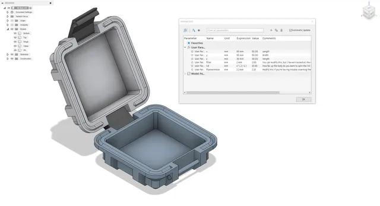
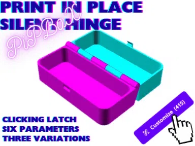
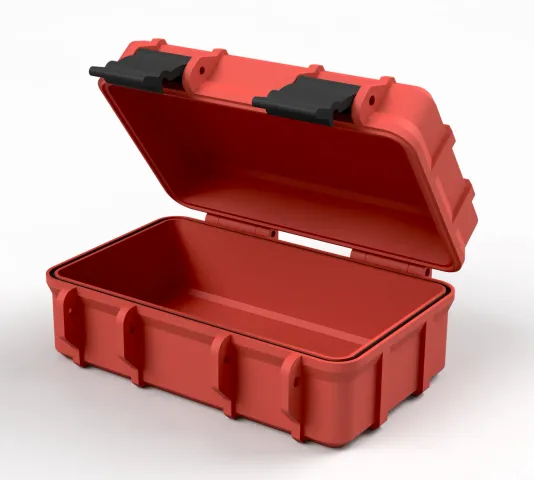
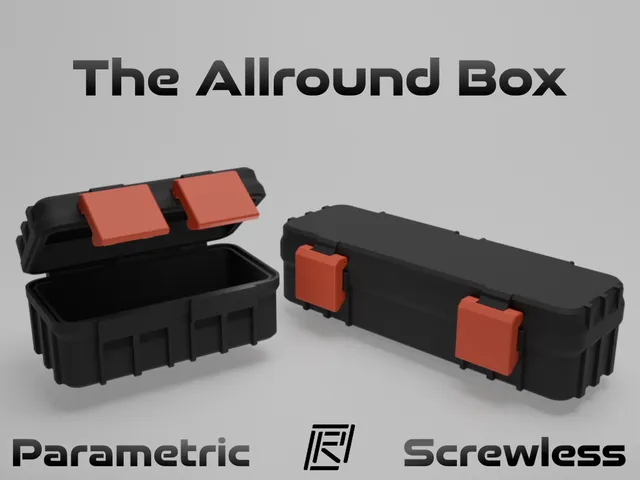
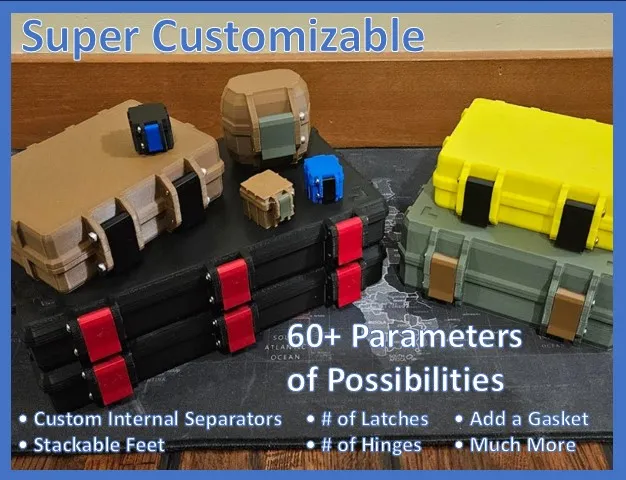
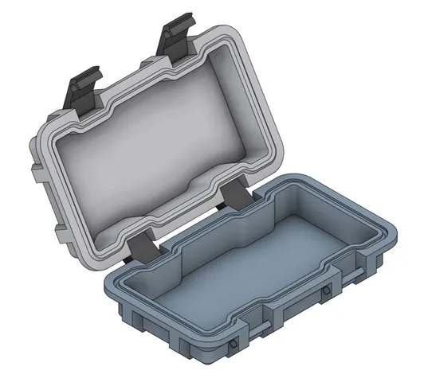

# Boxes

<!-- Generated by scripts/Update-Readmes.ps1 (Linux: scripts/update_readmes.py) - edit scripts/readme-sources.json and rerun instead of editing by hand. -->

[Home](../../README.md) / [Storage](../README.md) / **Boxes**

9 builds &middot; 3 MakerWorld &middot; 5 Printables &middot; 1 unknown source

## Boxes

<table>
<tr>
<td width="33%" align="center" valign="top">
<i>no preview</i> 
<b>Box Builders - Shelf Storage Box Whatever Building Connectors</b> 
Source unknown &middot; <a href="Box%20Builders%20-%20Shelf%20Storage%20Box%20Whatever%20Building%20Connectors">Repo folder</a>
</td>
<td width="33%" align="center" valign="top">
<i>no preview</i> 
<b>Box Generator</b> 
<a href="https://makerworld.com/en/search/models?keyword=Box%20Generator">Search MakerWorld</a> &middot; <a href="Box%2BGenerator%2B">Repo folder</a>
</td>
<td width="33%" align="center" valign="top">
<i>no preview</i> 
<b>Customizable Box with Lid</b> 
<a href="https://makerworld.com/en/search/models?keyword=Customizable%20Box%20with%20Lid">Search MakerWorld</a> &middot; <a href="Customizable%2BBox%2Bwith%2BLid">Repo folder</a>
</td>
</tr>
<tr>
<td width="33%" align="center" valign="top">
 
<b>Parametric Box v2 (single clasp)</b> 
by TheSameNameTwice 
<a href="https://www.printables.com/model/540605-parametric-box-v2-single-clasp">Printables</a> &middot; <a href="parametric-box-v2-single-clasp-model_files">Repo folder</a>
</td>
<td width="33%" align="center" valign="top">
 
<b>PiPBox _ Print in Place Live Hinge Parametric Box</b> 
by Lysyndre 
<a href="https://makerworld.com/en/models/485147-pipbox-_-print-in-place-live-hinge-parametric-box">MakerWorld</a> &middot; <a href="PiPBox%2B_%2BPrint%2Bin%2BPlace%2BLive%2BHinge%2BParametric%2BBox">Repo folder</a>
</td>
<td width="33%" align="center" valign="top">
 
<b>Rugged Box (Parametric)</b> 
by Whity 
<a href="https://www.printables.com/model/258431-rugged-box-parametric">Printables</a> &middot; <a href="rugged-box-parametric-model_files">Repo folder</a>
</td>
</tr>
<tr>
<td width="33%" align="center" valign="top">
 
<b>Rugged Storage Box (Parametric, Screwless)</b> 
by RDesigns 
<a href="https://www.printables.com/model/819715-rugged-storage-box-parametric-screwless">Printables</a> &middot; <a href="rugged-storage-box-parametric-screwless-model_files">Repo folder</a>
</td>
<td width="33%" align="center" valign="top">
 
<b>Super Customizable Rugged Box in OpenSCAD</b> 
by Iceman 
<a href="https://www.printables.com/model/1073708-super-customizable-rugged-box-in-openscad">Printables</a> &middot; <a href="super-customizable-rugged-box-in-openscad-model_files">Repo folder</a>
</td>
<td width="33%" align="center" valign="top">
 
<b>Water-Tight/Dust-Proof Parametric Box v2 (double clasp)</b> 
by TheSameNameTwice 
<a href="https://www.printables.com/model/546479-water-tightdust-proof-parametric-box-v2-double-cla">Printables</a> &middot; <a href="water-tightdust-proof-parametric-box-v2-double-clasp-model_files">Repo folder</a>
</td>
</tr>
</table>

