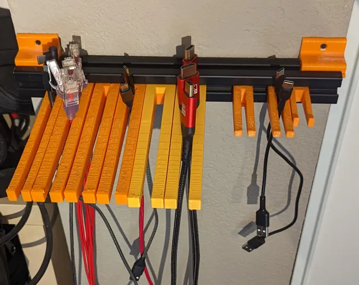

# Cable Storage

<!-- Generated by scripts/Update-Readmes.ps1 (Linux: scripts/update_readmes.py) - edit scripts/readme-sources.json and rerun instead of editing by hand. -->

[Home](../../README.md) / [Storage](../README.md) / **Cable Storage**

3 builds &middot; 1 Printables &middot; 1 Thingiverse &middot; 1 unknown source &middot; 1 collections (6 more builds)

## Collections

- [Gridfinity](gridfinity/README.md) - 6 builds

## Cable Storage

<table>
<tr>
<td width="33%" align="center" valign="top">
<i>no preview</i> 
<b>Dupont Cable Organizer Customizable</b> 
by urish 
<a href="https://www.thingiverse.com/thing:3232719">Thingiverse</a> &middot; <a href="Dupont_Cable_Organizer_Customizable">Repo folder</a>
</td>
<td width="33%" align="center" valign="top">
 
<b>Parametric Cable Storage</b> 
by The Mighty Pong 
<a href="https://www.printables.com/model/410018-parametric-cable-storage">Printables</a> &middot; <a href="parametric-cable-storage-model_files">Repo folder</a>
</td>
</tr>
</table>

Other files in this folder (1)

- [cubewallcableholder.stl](cubewallcableholder.stl)

