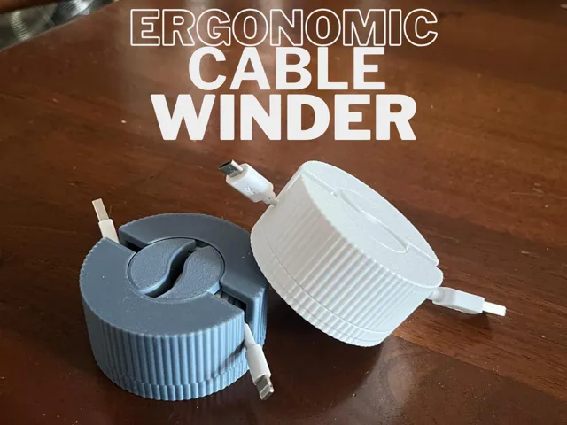
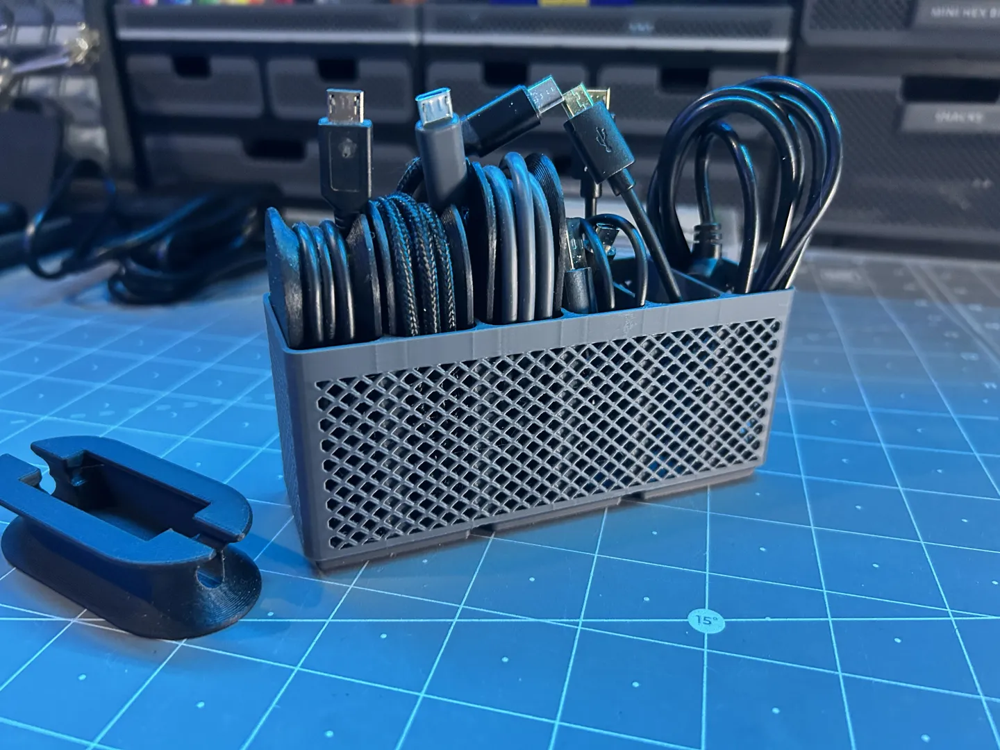

# Gridfinity

<!-- Generated by scripts/Update-Readmes.ps1 (Linux: scripts/update_readmes.py) - edit scripts/readme-sources.json and rerun instead of editing by hand. -->

[Home](../../../README.md) / [Storage](../../README.md) / [Cable Storage](../README.md) / **Gridfinity**

6 builds &middot; 5 MakerWorld &middot; 1 unknown source

## Gridfinity

<table>
<tr>
<td width="33%" align="center" valign="top">
<i>no preview</i> 
<b>Cabel Winder gridfinity organizer different sizes</b> 
<a href="https://makerworld.com/en/search/models?keyword=Cabel%20Winder%20gridfinity%20organizer%20different%20sizes">Search MakerWorld</a> &middot; <a href="Cabel%2BWinder%2Bgridfinity%2Borganizer%2Bdifferent%2Bsizes%2B">Repo folder</a>
</td>
<td width="33%" align="center" valign="top">
<i>no preview</i> 
<b>cableholder double hollow Xx2x10</b> 
<a href="https://makerworld.com/en/search/models?keyword=cableholder%20double%20hollow%20Xx2x10">Search MakerWorld</a> &middot; <a href="cableholder%2Bdouble%2Bhollow%2BXx2x10_stls">Repo folder</a>
</td>
<td width="33%" align="center" valign="top">
 
<b>ERGONOMIC CABLE WINDER</b> 
by PUPOdesign 
<a href="https://makerworld.com/en/models/1830818-ergonomic-cable-winder">MakerWorld</a> &middot; <a href="Ergonomic%2BCable%2BWinder">Repo folder</a>
</td>
</tr>
<tr>
<td width="33%" align="center" valign="top">
<i>no preview</i> 
<b>Gridfinity Cable Organizer For Large Cables</b> 
<a href="https://makerworld.com/en/search/models?keyword=Gridfinity%20Cable%20Organizer%20For%20Large%20Cables">Search MakerWorld</a> &middot; <a href="Gridfinity%2BCable%2BOrganizer%2BFor%2BLarge%2BCables">Repo folder</a>
</td>
<td width="33%" align="center" valign="top">
<i>no preview</i> 
<b>Rugged Cable Organizer - Gridfinity</b> 
<a href="https://makerworld.com/en/search/models?keyword=Rugged%20Cable%20Organizer%20-%20Gridfinity">Search MakerWorld</a> &middot; <a href="Rugged%2BCable%2BOrganizer%2B-%2BGridfinity">Repo folder</a>
</td>
<td width="33%" align="center" valign="top">
 
<b>Rugged-Cable-Organizer_X1C</b> 
Source unknown &middot; <a href="Rugged-Cable-Organizer_X1C.3mf">Rugged-Cable-Organizer_X1C.3mf</a>
</td>
</tr>
</table>

